# Mục 04 — Đặc Tả Sản Phẩm & Trải Nghiệm Người Dùng (Product & UX)

| Tài liệu | Tổng Quan Phân Hệ Sản Phẩm & Trải Nghiệm Người Dùng |
| :--- | :--- |
| **Dự án** | Nền tảng Thương mại Điện tử Đồ cũ C2C ReMarket |
| **Mã tài liệu** | `DOC-BA-04-README` |
| **Phiên bản** | v1.0 |
| **Trạng thái** | Chấp thuận (Approved) |
| **Phân hệ cha** | [Bộ Tài Liệu Phân Tích Nghiệp Vụ ReMarket (docs/BA)](file:///d:/remarket-platform-system/docs/BA/README.md) |

---

## 1. Mục Đích & Phạm Vi Phân Hệ 04

Phân hệ **04: Product and UX** chuyển hóa các yêu cầu kinh doanh, quy tắc nghiệp vụ và yêu cầu chức năng (thuộc các phần `01`, `02`, `03`) thành cấu trúc thông tin, kiến trúc trang, danh mục màn hình chi tiết và khung trải nghiệm tương tác cụ thể cho người dùng.

Khác với các tài liệu thiết kế đồ họa tĩnh (UI mockups), tài liệu BA phần 04 tập trung giải quyết các bài toán giao diện đặc thù của một hệ thống thương mại điện tử C2C đồ cũ phân tán:
1. **Minh bạch hóa dữ liệu đồ cũ:** Thang đo tình trạng hàng hóa chuẩn (`Condition Grading`), bảng khai báo khuyết điểm bắt buộc (`Defect Disclosure`), và cơ chế che giấu một phần số Serial/IMEI để chống giả mạo.
2. **Trải nghiệm nhất quán trên Hệ thống phân tán:** Phân biệt rõ dữ liệu đọc nhanh (Search Read Model / Cache) với dữ liệu gốc thời gian thực (Live Source of Truth); cơ chế khóa giữ hàng độc quyền 15 phút tại Checkout (`Reservation Hold Window`); và cách hiển thị trạng thái `Pending/Unknown` khi các cổng thanh toán/vận chuyển bên thứ ba phản hồi chậm.
3. **Bảo mật và Phân quyền theo ngữ cảnh (Contextual Privacy & PII):** Quy tắc ẩn hiện thông tin cá nhân của người mua và người bán theo từng giai đoạn đơn hàng; quy trình mở khóa dữ liệu nhạy cảm có kiểm toán an ninh đối với nhân sự hỗ trợ (`ROLE-04`).

---

## 2. Cấu Trúc Bộ Tài Liệu Thành Phần

Thư mục `docs/BA/04_product-and-ux/` bao gồm 4 tài liệu đặc tả chuyên sâu:

```
docs/BA/04_product-and-ux/
├── README.md                           # Tài liệu chỉ mục và hướng dẫn truy vết tổng thể
├── information-architecture.md         # Kiến trúc thông tin, cây danh mục, thuộc tính động & ma trận PII
├── sitemap.md                          # Sơ đồ cấu trúc phân cấp trang, ma trận Route Guard & quy tắc Deep-link
├── screen-inventory.md                 # Danh mục 27 màn hình chính, 7 modal và ma trận bao phủ 100% Use Case
└── wireframes-and-prototypes.md        # 6 UI Components chuẩn, 7 ASCII Wireframes & 3 sơ đồ luồng màn hình
```

### Tóm Tắt Nội Dung 4 Tài Liệu:

| Tên File Tài Liệu | Mục Tiêu & Trọng Tâm Kỹ Thuật | Đầu Ra Chính |
| :--- | :--- | :--- |
| [information-architecture.md](file:///d:/remarket-platform-system/docs/BA/04_product-and-ux/information-architecture.md) | Thiết lập cấu trúc tổ chức dữ liệu, phân loại danh mục sản phẩm, chuẩn hóa thang đo tình trạng đồ cũ và ma trận hiển thị PII theo vai trò. | - Cây danh mục 3 cấp & Cấu trúc thuộc tính động.<br>- Mô hình hiển thị Listing Card vs Listing Detail.<br>- Ma trận che giấu dữ liệu PII theo Role (`ROLE-00..06`). |
| [sitemap.md](file:///d:/remarket-platform-system/docs/BA/04_product-and-ux/sitemap.md) | Trực quan hóa cấu trúc liên kết toàn bộ các trang trên 3 kênh độc lập (`Marketplace`, `Seller Center`, `Back-office`). | - Sơ đồ phân cấp trang Mermaid cho 3 kênh.<br>- Ma trận kiểm soát truy cập trang (Route Guard).<br>- Quy tắc Redirect bảo toàn ngữ cảnh mua hàng (`FR-CHK-01`). |
| [screen-inventory.md](file:///d:/remarket-platform-system/docs/BA/04_product-and-ux/screen-inventory.md) | Bảng đặc tả chi tiết toàn bộ 27 màn hình chính và 7 modal dùng chung, xác định nguồn dữ liệu và kịch bản xử lý ngoại lệ. | - Master Screen Inventory Table (`SCR-MKT-*`, `SCR-SEL-*`, `SCR-ADM-*`).<br>- Chi tiết dữ liệu, CTA, trạng thái lỗi của từng màn hình.<br>- Ma trận bao phủ 100% Use Case (`UC-01` đến `UC-26`). |
| [wireframes-and-prototypes.md](file:///d:/remarket-platform-system/docs/BA/04_product-and-ux/wireframes-and-prototypes.md) | Cung cấp khung giao diện khái niệm (Low-fidelity wireframe) cho các màn hình phức tạp nhất và sơ đồ luồng tương tác đầu-cuối. | - 6 UI Components chuẩn (`CMP-01..06`).<br>- 7 Bản vẽ ASCII Wireframes (`WF-01..07`).<br>- 3 Sơ đồ Sequence/Flowchart luồng tương tác màn hình. |

---

## 3. Quy Ước Mã Định Danh Trong Phân Hệ 04

Để phục vụ công tác truy vết chéo giữa các tài liệu thiết kế kỹ thuật (`05_system-design`) và kiểm thử phần mềm (`06_testing-and-quality`), phân hệ 04 áp dụng các quy chuẩn mã hiệu sau:

| Tiền Tố Mã | Ý Nghĩa Ngữ Nghĩa | Ví Dụ Điển Hình |
| :--- | :--- | :--- |
| `SCR-MKT-xx` | Màn hình Kênh Mua sắm (Marketplace Web / Mobile App) | `SCR-MKT-03` (Chi tiết tin đăng), `SCR-MKT-06` (Checkout) |
| `SCR-SEL-xx` | Màn hình Kênh Người Bán (Seller Center) | `SCR-SEL-04` (Wizard đăng tin), `SCR-SEL-06` (Tạo vận đơn) |
| `SCR-ADM-xx` | Màn hình Kênh Quản trị & Vận hành (Admin / Back-office Portal) | `SCR-ADM-03` (Tra cứu 360°), `SCR-ADM-04` (Phân xử khiếu nại) |
| `MOD-xxx-xx` | Hộp thoại / Thanh trượt nổi tương tác (Modal / Drawer) | `MOD-AUTH-01` (Đăng nhập nhanh), `MOD-PII-01` (Mở khóa PII) |
| `CMP-xx` | Thành phần Giao diện Dùng chung (Core UI Component) | `CMP-01` (Status Badges), `CMP-02` (Countdown Banner 15p) |
| `WF-xx` | Khung Giao diện Khái niệm (ASCII Wireframe) | `WF-01` (Chi tiết tin đăng), `WF-06` (Tra cứu giao dịch 360°) |

---

## 4. Ma Trận Truy Vết Hai Chiều (Bidirectional Traceability Matrix)

Phân hệ 04 đóng vai trò cầu nối bản lề giữa Yêu cầu nghiệp vụ (`Requirements`) và Kiến trúc hệ thống (`System Design`):

```mermaid
flowchart LR
    subgraph INPUTS["Đầu Vào Nghiệp Vụ (Upstream)"]
        REQ_UC["03_requirements:\nUC-01..26, US-*, FR-*"]
        BUS_RULES["02_business-analysis:\nBR-ORD-*, BR-PAY-*, BR-SEC-*"]
        ROLES["01_stakeholders:\nROLE-00..06, Personas"]
    end

    subgraph SEC_04["Mục 04: Product & UX (Hiện Tại)"]
        IA["information-architecture.md"]
        SMP["sitemap.md"]
        SCR["screen-inventory.md"]
        WFP["wireframes-and-prototypes.md"]
    end

    subgraph OUTPUTS["Đầu Ra Kỹ Thuật (Downstream)"]
        SYS_DES["05_system-design:\nBFF / API Contracts,\nFrontend Architecture"]
        TEST_QA["06_testing-and-quality:\nE2E Test Suites,\nUI Automation Scenarios"]
    end

    INPUTS --> SEC_04
    SEC_04 --> OUTPUTS
```



### 4.1. Bảng Đối Chiếu Nguồn Nghiệp Vụ (Upstream Traceability)

| Thành Phần Cốt Lõi Mục 04 | Căn Cứ Nghiệp Vụ Đầu Vào |
| :--- | :--- |
| **Quy định 3 Kênh Giao diện (`MKT`, `SEL`, `ADM`)** | [scope-and-boundaries.md](file:///d:/remarket-platform-system/docs/BA/00_project-context/scope-and-boundaries.md) §4.3 & `DEC-DIR-06`. |
| **Bộ Huy hiệu Trạng thái Chuẩn (`CMP-01`)** | [glossary.md](file:///d:/remarket-platform-system/docs/BA/00_project-context/glossary.md) §3 (5 máy trạng thái: Listing, Order, Payment, Shipment, Dispute). |
| **Quy định Giữ hàng 15 Phút (`SCR-MKT-06`, `CMP-02`)** | `BR-ORD-003`, `FR-CHK-03`, `UC-09`, `US-CHK-02`. |
| **Phân biệt Giỏ hàng vs Giữ hàng (`SCR-MKT-05`)** | `BR-ORD-004`, `FR-CHK-02`, `UC-08`, `INV-01`. |
| **Tách biệt 3 Miền Trạng thái Đơn hàng (`CMP-03`)** | `INV-02`, `NFR-USA-03`, `FR-SUP-01`, `UC-22`. |
| **Che giấu & Mở khóa PII có Kiểm toán (`CMP-04`, `MOD-PII-01`)** | `BR-SEC-003`, `BR-SEC-004`, `FR-SUP-02`, `UC-24`, `NFR-SEC-04`. |
| **Tải ảnh S3 qua Presigned URL (`MOD-UPL-01`, `CMP-06`)** | `FR-MED-01..03`, `US-MED-01`, `NFR-PERF-03`. |

### 4.2. Định Hướng Đầu Ra Cho Thiết Kế Kỹ Thuật (Downstream Hand-off)

1. **Cho Phần 05 (System Design):**
   - Các màn hình `SCR-*` cung cấp phạm vi trực tiếp để xây dựng các API Gateway / Backend-For-Frontend (BFF) Endpoints tương ứng cho từng kênh.
   - Bảng phân định dữ liệu gốc (Source of Truth) vs dữ liệu dẫn xuất (Derived Model) xác định các chiến lược caching (Redis TTL), Read Replicas và Elasticsearch Indexing.
   - Các hành động CTA xác định các API Commands (POST/PUT), tính Idempotency key và các chuỗi điều phối Saga phân tán.
2. **Cho Phần 06 (Testing & Quality Assurance):**
   - Danh mục 27 màn hình và 7 wireframes cung cấp cấu trúc cho việc thiết lập kịch bản kiểm thử giao diện đầu-cuối (E2E Test Cases).
   - Các trạng thái ngoại lệ (Stale/Sold-out, Timer Expired, Payment Pending, Degraded Mode) cung cấp trực tiếp danh sách ca kiểm thử tiêu cực (Negative & Edge Case Testing).

