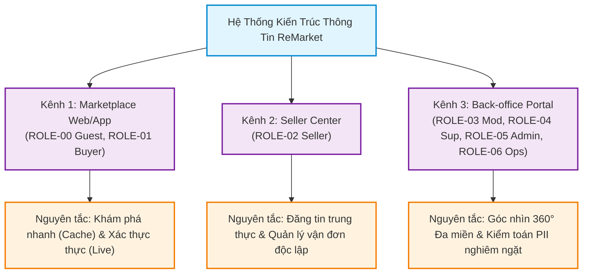
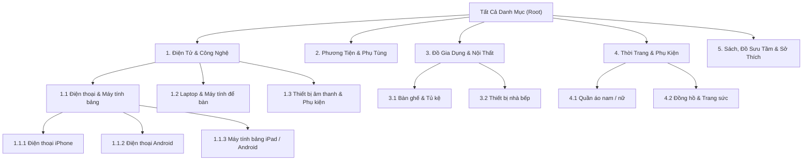
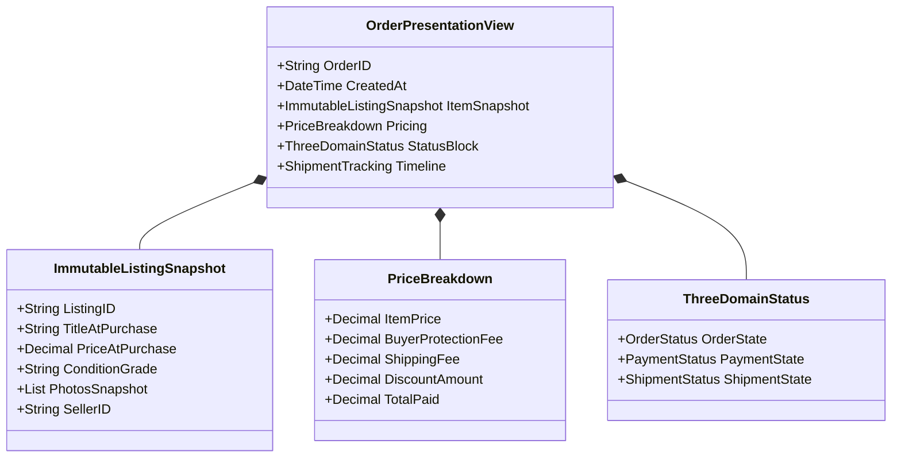
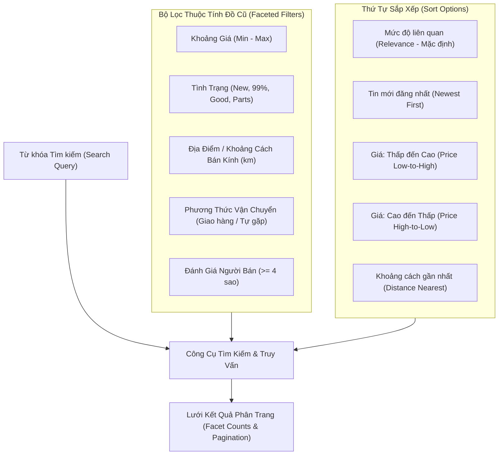
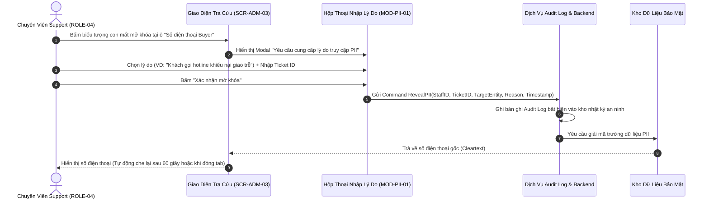

# Kiến Trúc Thông Tin — Information Architecture (IA)

| Tài liệu | Đặc tả Kiến trúc Thông tin (Information Architecture) |
| :--- | :--- |
| **Dự án** | Nền tảng Thương mại Điện tử Đồ cũ C2C ReMarket |
| **Mã tài liệu** | `DOC-BA-04-IA` |
| **Phiên bản** | v1.0 |
| **Trạng thái** | Chấp thuận (Approved) |
| **Phạm vi** | Hệ sinh thái 3 kênh giao diện: Marketplace, Seller Center, Admin / Back-office |
| **Liên kết truy vết** | [scope-and-boundaries.md](file:///d:/remarket-platform-system/docs/BA/00_project-context/scope-and-boundaries.md), [glossary.md](file:///d:/remarket-platform-system/docs/BA/00_project-context/glossary.md), [user-roles-and-permissions.md](file:///d:/remarket-platform-system/docs/BA/01_stakeholders-and-users/user-roles-and-permissions.md), [business-rules.md](file:///d:/remarket-platform-system/docs/BA/02_business-analysis/business-rules.md), [functional-requirements.md](file:///d:/remarket-platform-system/docs/BA/03_requirements/functional-requirements.md) |

---

## 1. Tổng quan & Các Nguyên Tắc IA Cốt Lõi

Kiến trúc Thông tin (Information Architecture - IA) của ReMarket thiết lập cấu trúc tổ chức, phân loại, ghi nhãn và mô hình biểu diễn dữ liệu xuyên suốt 3 kênh tương tác chính của nền tảng thương mại điện tử C2C đồ cũ.

Khác biệt với các sàn B2C hàng mới truyền thống, mô hình C2C đồ cũ vận hành trên kiến trúc Microservices phân tán đòi hỏi IA phải giải quyết 4 thách thức đặc thù:
1. **Mỗi sản phẩm là duy nhất (Unique SKU / Single Inventory):** Hàng cũ tồn tại duy nhất 1 đơn vị (`Stock = 1`). Người mua quan tâm cao độ đến tình trạng thực tế, khuyết điểm ngoại quan, lịch sử sử dụng và độ tin cậy của người bán.
2. **Minh bạch trạng thái đa miền độc lập (`INV-02`, `NFR-USA-03`):** Không gộp chung trạng thái đơn hàng. IA phải thể hiện rõ ràng 3 trục trạng thái riêng biệt: `Trạng thái Đơn hàng` (Order State), `Trạng thái Thanh toán` (Payment State), và `Trạng thái Vận chuyển` (Shipment State).
3. **Phân tách Dữ liệu Dẫn xuất và Dữ liệu Gốc (`INV-01`, `FR-SRC-06`):** Dữ liệu tìm kiếm, danh mục duyệt nhanh là dữ liệu dẫn xuất (Read Model / Cache), có thể tồn tại độ trễ nhất định. Tuy nhiên khi người dùng mở trang Chi tiết tin đăng (`Listing Detail`) hoặc tiến hành Đặt hàng (`Checkout`), IA phải định tuyến và trình bày dữ liệu thời gian thực (Source of Truth) kèm thông báo cảnh báo xung đột rõ ràng nếu dữ liệu vừa thay đổi.
4. **Bảo mật và Che giấu Dữ liệu Nhạy cảm theo Vai trò (`BR-SEC-003`, `BR-SEC-004`, `FR-SUP-02`):** Thông tin định danh cá nhân (PII: Số điện thoại, địa chỉ, tài khoản ngân hàng) phải được che giấu theo ngữ cảnh quyền hạn (Contextual Privacy & PII Masking).



---

## 2. Mô Hình Phân Vùng Không Gian Thông Tin (3-Portal Ecosystem)

Theo quyết định định hướng `DEC-DIR-06` và [scope-and-boundaries.md](file:///d:/remarket-platform-system/docs/BA/00_project-context/scope-and-boundaries.md) §4.3, hệ thống ReMarket được cấu trúc thành 3 không gian thông tin (Portal) riêng biệt nhưng kết nối chặt chẽ về dữ liệu:

```mermaid
flowchart LR
    subgraph MKT["1. Marketplace Web / Mobile App"]
        direction TB
        MKT_HOME["Khám phá & Trang chủ"]
        MKT_SEARCH["Tìm kiếm & Bộ lọc nâng cao"]
        MKT_DETAIL["Chi tiết Tin đăng (Live Status)"]
        MKT_CART["Giỏ hàng (Ý định mua)"]
        MKT_CHECKOUT["Checkout (Giữ hàng 15p)"]
        MKT_ORDERS["Quản lý Đơn mua & Khiếu nại"]
    end

    subgraph SEL["2. Seller Center (Kênh Người Bán)"]
        direction TB
        SEL_DASH["Tổng quan Hiệu suất Bán"]
        SEL_LISTING["Quản lý Kho tin đăng & Soạn thảo"]
        SEL_ORDERS["Xử lý Đơn bán & In Vận đơn"]
        SEL_SETTLE["Báo cáo Doanh thu & Đối soát Payout"]
    end

    subgraph ADM["3. Admin / Back-office Portal"]
        direction TB
        ADM_MOD["Phân hệ Kiểm duyệt Tin & Báo cáo"]
        ADM_SUP["Phân hệ Tra cứu 360° & Khiếu nại"]
        ADM_CFG["Phân hệ Danh mục, Từ khóa & Chính sách"]
        ADM_OPS["Giám sát Hạ tầng, Lệch pha & Audit Log"]
    end

    ACC[("User Identity & Profiles\n(1 Tài khoản đa vai trò)")] -->|Buyer Mode| MKT
    ACC -->|Seller Mode\n(Context Switcher)| SEL
    STAFF[("Nhân sự Vận hành Platform\n(ROLE-03..06)")] -->|RBAC / SSO| ADM
```

### 2.1. Kênh 1 — Marketplace Web/App (`MKT`)
- **Đối tượng:** Khách vãng lai (`ROLE-00` Guest), Người mua (`ROLE-01` Buyer).
- **Trọng tâm thông tin:** Tối ưu hóa khả năng tìm kiếm (Search), phân loại theo khu vực và danh mục, hiển thị minh bạch tình trạng hàng cũ (ảnh thật, lỗi sản phẩm, đánh giá uy tín người bán), quy trình thanh toán nhanh với cơ chế giữ hàng an toàn 15 phút.

### 2.2. Kênh 2 — Seller Center (`SEL`)
- **Đối tượng:** Người bán cá nhân / bán chuyên nghiệp (`ROLE-02` Seller).
- **Cơ chế chuyển đổi ngữ cảnh (Context Switcher):** Người dùng có tài khoản đã xác minh thông tin người bán có thể chuyển đổi 1-click giữa "Giao diện Mua hàng" và "Kênh Người Bán" trên thanh công cụ mà không cần đăng xuất/đăng nhập lại.
- **Trọng tâm thông tin:** Đăng tin chuẩn hóa với thuộc tính động, quản lý kho tin (Còn hàng, Đang giữ hàng, Đã bán), tiếp nhận đơn hàng, xác nhận chuẩn bị hàng và tạo yêu cầu giao vận bên thứ ba (3PL), theo dõi số dư tiền bán đang tạm giữ (Escrow / Pending Settlement) và lịch sử đối soát batch payout.

### 2.3. Kênh 3 — Admin / Back-office Portal (`ADM`)
- **Đối tượng:** Kiểm duyệt viên (`ROLE-03`), Chuyên viên Hỗ trợ Khách hàng (`ROLE-04`), Quản trị viên Nghiệp vụ (`ROLE-05`), Kỹ sư Vận hành Nền tảng (`ROLE-06`).
- **Phân tách không gian làm việc (Workspace Segregation):**
  - *Moderation Workspace:* Hàng đợi tin chờ duyệt, tin bị người dùng báo cáo vi phạm, công cụ đánh dấu vi phạm từ khóa/hình ảnh nhạy cảm.
  - *Support Workspace:* Bảng tra cứu giao dịch 360°, hiển thị song song 3 miền trạng thái, hồ sơ tranh chấp/khiếu nại, công cụ mở khóa PII kèm lý do nghiệp vụ.
  - *Business Configuration Workspace:* Quản trị cây danh mục, thuộc tính động, bảng phí nền tảng, danh mục từ khóa cấm.
  - *Platform Operations Link:* Giám sát trạng thái hàng đợi sự kiện bất đồng bộ, phát hiện đơn hàng lệch pha trạng thái (`Out-of-sync Monitor`), trạng thái sao lưu và phục hồi thảm họa (`SCR-ADM-08`).

---

## 3. Cấu Trúc Danh Mục & Thuộc Tính Động (Category Taxonomy & Dynamic Attributes)

Hệ thống phân loại của ReMarket được thiết kế theo cấu trúc cây phân cấp tối đa 3 cấp, kết hợp cơ chế gán thuộc tính động (Dynamic Attribute Schema) nhằm chuẩn hóa dữ liệu mô tả sản phẩm đồ cũ.

### 3.1. Cây Phân Cấp Danh Mục Chuẩn (Category Hierarchy)



### 3.2. Tiêu Chuẩn Phân Loại Tình Trạng Hàng Cũ (Condition Grading Standard)

Mỗi tin đăng đồ cũ bắt buộc phải gán một trong các cấp bậc tình trạng chuẩn sau (`BR-PRO-001`):

| Mã Cấp Bậc | Tên Hiển Thị | Định Nghĩa Tiêu Chuẩn | Yêu Cầu Ảnh Minh Chứng |
| :--- | :--- | :--- | :--- |
| `COND-NEW` | **Mới nguyên hộp (Like New / Chưa dùng)** | Sản phẩm chưa qua sử dụng, còn nguyên hộp/tem niêm phong hoặc phụ kiện gốc chưa bóc. | Ảnh chụp nguyên seal, vỏ hộp các mặt, tem nhà sản xuất. |
| `COND-EXC` | **Như mới (95% - 99%)** | Đã sử dụng rất ít, không có vết xước đáng kể, pin > 90% (với đồ điện tử), mọi chức năng hoàn hảo. | Ảnh chụp cận cảnh 4 góc, màn hình, cổng kết nối, thông số pin. |
| `COND-GOOD` | **Tốt (85% - 94%)** | Có hao mòn ngoại quan nhẹ theo thời gian (xước dăm nhỏ), không cấn móp nặng, chức năng hoạt động bình thường. | Ảnh chụp chi tiết các điểm xước nhẹ, ảnh chụp khi thiết bị đang hoạt động. |
| `COND-FAIR` | **Khá (70% - 84%)** | Có trầy xước rõ ràng hoặc cấn móp nhẹ, có thể thiếu phụ kiện gốc, chức năng chính hoạt động tốt. | **Bắt buộc chụp cận cảnh** các vết cấn móp, trầy xước và liệt kê danh sách phụ kiện thiếu. |
| `COND-PART` | **Lấy linh kiện / Lỗi chức năng** | Sản phẩm hỏng một phần chức năng (VD: chai pin nặng, vỡ màn hình, mất loa) hoặc chỉ bán để tháo linh kiện. | **Bắt buộc đánh dấu cảnh báo đỏ** trên giao diện, ảnh chụp rõ khuyết điểm hư hại. |

### 3.3. Khung Bắt Buộc Khai Báo Khuyết Điểm (Defect Disclosure Schema)

Để hạn chế tranh chấp khiếu nại (`UC-17`), giao diện đăng tin buộc Người bán phải hoàn thành biểu mẫu khai báo khuyết điểm minh bạch:
- **Tình trạng ngoại quan (Cosmetic Condition):** Checklist kiểm tra nhanh (Màn hình trầy? Vỏ cấn? Đã thay vỏ/ép kính chưa?).
- **Tình trạng chức năng (Functional Integrity):** Các tính năng còn hoạt động 100% hay có lỗi ẩn (FaceID, Cảm ứng, Cổng sạc, Ổ đĩa, Bàn phím...).
- **Số định danh thiết bị (Serial Number / IMEI - nếu có):**
  - Hệ thống lưu trữ an toàn trong cơ sở dữ liệu để phục vụ đối soát khi có khiếu nại tráo hàng.
  - Trên giao diện Marketplace công khai: **Tự động che 4 chữ số cuối** (VD: `35678910****123`) nhằm chống sao chép trái phép.

---

## 4. Cấu Trúc Mô Hình Hiển Thị Thực Thể Cốt Lõi (Entity Presentation Models)

### 4.1. So Sánh: Thẻ Tin Đăng (Listing Card) vs Trang Chi Tiết (Listing Detail)

Nhằm tối ưu hóa tải trang và độ chính xác dữ liệu theo kiến trúc phân tán, IA phân định rõ trường dữ liệu giữa 2 tầng hiển thị:

| Thành phần thông tin | Thẻ Tin Đăng Ngoài Danh Sách (`SCR-MKT-02`) | Trang Chi Tiết Tin Đăng (`SCR-MKT-03`) |
| :--- | :--- | :--- |
| **Nguồn dữ liệu (Source)** | **Derived Read Model (Search Engine / Cache)** | **Source of Truth (Primary Database / Replica)** |
| **Ảnh đại diện** | 01 ảnh thumbnail tối ưu WebP (300x300) | Toàn bộ album ảnh gốc phân giải cao + Trình phóng to |
| **Tiêu đề tin** | Giới hạn tối đa 60 ký tự, cắt ngắn `...` | Tiêu đề đầy đủ không cắt ngắn |
| **Giá bán** | Giá hiện tại (kèm tag giảm giá nếu có) | Giá bán chính thức + Giá mua mới tham khảo + Bảng phí |
| **Tình trạng hàng** | Badge nhỏ (`COND-EXC`, `COND-GOOD`...) | Khối đánh giá chi tiết + Bảng khai báo khuyết điểm |
| **Khu vực** | Quận/Huyện, Tỉnh/Thành phố | Địa bàn quận huyện + Ước tính thời gian giao nhận |
| **Trạng thái kho hàng** | Có thể trễ vài chục giây theo chu kỳ đồng bộ | **Real-time Availability:** Đang bán (`Published`), Đang được giữ hàng (`Reserved`), Đã bán (`Sold`) |
| **Hành động (CTA)** | Xem chi tiết / Lưu tin yêu thích | Nút **"Mua ngay"**, **"Thêm vào giỏ"**, **"Báo cáo tin xấu"** |

### 4.2. Mô Hình Hiển Thị Đơn Hàng & Giao Dịch Đa Miền (Order Presentation Model)

Trang Chi tiết Đơn hàng (`SCR-MKT-09` cho Buyer, `SCR-SEL-06` cho Seller, và `SCR-ADM-03` cho Support) được tổ chức thành 4 phân vùng thông tin cốt lõi:



1. **Snapshot Bất Biến của Sản Phẩm (`ImmutableListingSnapshot`):** Lưu trữ chính xác tiêu đề, mô tả, ảnh, giá và tình trạng tại đúng thời điểm bấm mua (`BR-ORD-009`). Người bán không thể sửa chữa tin sau khi đơn đã tạo.
2. **Bảng Phân Rã Chi Phí (Transparent Price Breakdown):** Hiển thị riêng rẽ Tiền hàng + Phí bảo vệ người mua (`BR-PAY-010`) + Phí giao hàng (`BR-SHP-001`) - Giảm giá = Tổng tiền thanh toán.
3. **Thanh Trạng Thái 3 Miền Độc Lập (3-Domain Status Bar):** Trực quan hóa tiến trình của 3 dịch vụ nền tảng:
   - *Miền Đơn hàng:* `Created` → `Confirmed` → `Completed` / `Cancelled` / `Refunded`.
   - *Miền Thanh toán:* `Pending` → `Authorized` → `Captured` / `Refunded` / `Failed`.
   - *Miền Vận chuyển:* `Pending` → `PickingUp` → `InTransit` → `Delivered` / `DeliveryFailed` / `Returned`.

---

## 5. Hệ Thống Điều Hướng & Tìm Kiếm / Bộ Lọc (Navigation & Search Systems)

### 5.1. Phân Loại Hệ Thống Điều Hướng

```
+-----------------------------------------------------------------------------------------+
| [Logo ReMarket]  [Danh mục v]  [Ô tìm kiếm đồ cũ: "iPhone 13...", Nút Tìm]  [Bán đồ cũ] |
|                                       [Chuông thông báo (3)]  [Giỏ hàng (1)]  [Tài khoản v] |
+-----------------------------------------------------------------------------------------+
| Trang chủ > Điện tử & Công nghệ > Điện thoại > iPhone 13 Pro Max 128GB                  | (Breadcrumbs)
+-----------------------------------------------------------------------------------------+
```

1. **Global Navigation (Thanh điều hướng toàn cục):** Cố định trên đỉnh mọi trang của Marketplace:
   - Logo thương hiệu (chuyển về Trang chủ).
   - Nút mở Cây Danh mục (Mega-menu đa cấp).
   - Thanh tìm kiếm trung tâm kèm gợi ý tự động (Autocomplete search keywords).
   - Nút CTA nổi bật: **"Đăng tin bán đồ"** (Chuyển ngữ cảnh sang Kênh Người Bán).
   - Nhóm tiện ích: Biểu tượng Thông báo (Unread Counter Badge), Biểu tượng Giỏ hàng (Count Badge), Menu Tài khoản cá nhân.
2. **Contextual Navigation (Điều hướng ngữ cảnh):**
   - **Breadcrumbs:** Hiển thị vị trí phân cấp danh mục chính xác, cho phép nhảy ngược về cấp cha.
   - **Action Bar cố định (Sticky Action Bar trên Mobile):** Giữ nút "Mua ngay" và "Chat/Liên hệ" ở đáy màn hình khi cuộn trang chi tiết sản phẩm dài.
3. **Local Navigation (Điều hướng phân hệ):**
   - Menu cạnh trái (Sidebar Navigation) tại Kênh Người Bán (`Seller Center`) và Kênh Vận Hành (`Back-office`).

### 5.2. Cấu Trúc Bộ Lọc & Sắp Xếp Nâng Cao (`FR-SRC-01..06`)



---

## 6. Ma Trận Phân Quyền Hiển Thị & Che Giấu Dữ Liệu Nhạy Cảm (PII Visibility Matrix)

Nhằm đảm bảo tuân thủ quyền riêng tư dữ liệu theo `NFR-SEC-04` và các quy tắc `BR-SEC-003`, `BR-SEC-004`, `FR-SUP-02`, hệ thống quy định ma trận hiển thị thông tin như sau:

| Thuộc tính dữ liệu | Khách / Người Mua khác (`ROLE-00`, `ROLE-01`) | Người Bán (`ROLE-02`) | Kiểm Duyệt Viên (`ROLE-03`) | Chuyên Viên Hỗ Trợ (`ROLE-04`) | Quản Trị Hệ Thống (`ROLE-05`, `ROLE-06`) |
| :--- | :--- | :--- | :--- | :--- | :--- |
| **Số điện thoại Người mua** | Ẩn hoàn toàn | **Chỉ hiện đầy đủ sau khi đơn chuyển `Confirmed`**; Ẩn khi còn `PendingPayment` | Ẩn hoàn toàn | **Mặc định che** (`090***5678`). Phải bấm mở khóa kèm lý do. | Mặc định che; chỉ mở trong trường hợp điều tra pháp lý. |
| **Địa chỉ nhận hàng chi tiết** | Ẩn hoàn toàn (chỉ thấy Quận/Tỉnh) | **Hiện đầy đủ khi đơn `Confirmed`** để đóng gói giao vận. | Ẩn hoàn toàn | **Mặc định che**; bấm mở khóa kèm lý do. | Ẩn hoặc che theo quy chế kiểm toán. |
| **Dữ liệu Thanh toán (Mã GD, Số thẻ)** | Chỉ thấy phương thức thanh toán của chính mình | Ẩn hoàn toàn (chỉ thấy số tiền nhận ròng) | **Ẩn hoàn toàn** (`BR-SEC-003`) | Thấy Mã GD cổng TT, 4 số cuối thẻ (không thấy CVV/PIN). | Thấy log giao dịch thanh toán che giấu để đối soát. |
| **Serial / IMEI của sản phẩm** | Mặc định che 4 số cuối (`356***123`) | Thấy đầy đủ tin do mình đăng | Thấy đầy đủ để duyệt nguồn gốc | Thấy đầy đủ để phân xử khiếu nại tráo hàng | Thấy đầy đủ trong cơ sở dữ liệu lưu vết. |
| **Lý do nội bộ khóa tài khoản** | Không nhìn thấy | Không nhìn thấy (chỉ nhận thông báo vi phạm chung) | Thấy các vi phạm do mình hoặc hệ thống gắn cờ | Thấy đầy đủ để hỗ trợ giải quyết thắc mắc | Toàn quyền xem và cấu hình danh mục lý do. |

### 6.1. Quy Trình Mở Khóa PII Có Kiểm Toán (Audited PII Reveal Flow - `FR-SUP-02`)



---

## 7. Cơ Chế Xử Lý Ngoại Lệ & Giảm Cấp Dịch Vụ Trên IA (Degraded Mode Presentation)

Trong môi trường phân tán, các sự cố hạ tầng hoặc nghẽn mạng có thể xảy ra. Kiến trúc thông tin phải chuẩn bị sẵn cách trình bày tương ứng trên giao diện để tránh gây hoang mang cho người dùng:

1. **Khi dịch vụ Tìm kiếm / Đề xuất bị nghẽn (`Search Service Outage`):**
   - Giao diện Marketplace chuyển sang chế độ dự phòng (Fallback): Ẩn thanh gợi ý tức thì, hiển thị danh mục tĩnh cơ bản kèm thông báo nhẹ: *"Hệ thống tìm kiếm nâng cao đang bảo trì, bạn có thể duyệt sản phẩm theo Danh mục bên dưới"*.
2. **Khi Cổng Thanh toán bên thứ ba Timeout / Chậm phản hồi (`EX-005`):**
   - Màn hình kết quả thanh toán (`SCR-MKT-07`) không được hiển thị lỗi thất bại ngay lập tức (tránh người dùng bấm thanh toán lần 2).
   - IA trình bày trạng thái **"Đang xác nhận kết quả với ngân hàng"** (`Payment Pending`), hiển thị đồng hồ đếm ngược đối soát 5 phút, nút *"Kiểm tra lại trạng thái"* và hướng dẫn người dùng kiểm tra biến động số dư tài khoản ngân hàng trước khi thử lại.
3. **Khi Đơn hàng vừa bị người khác mua hoặc giữ hàng (`EX-001`, `EX-002`):**
   - Nút "Mua ngay" trên trang chi tiết lập tức chuyển sang màu xám vô hiệu hóa với nhãn *"Đang có người đặt mua (Giữ chỗ 15 phút)"*.
   - Cung cấp nút tiện ích: *"Xem sản phẩm tương tự"* dẫn tới các tin đăng cùng danh mục và cùng phân khúc giá.

