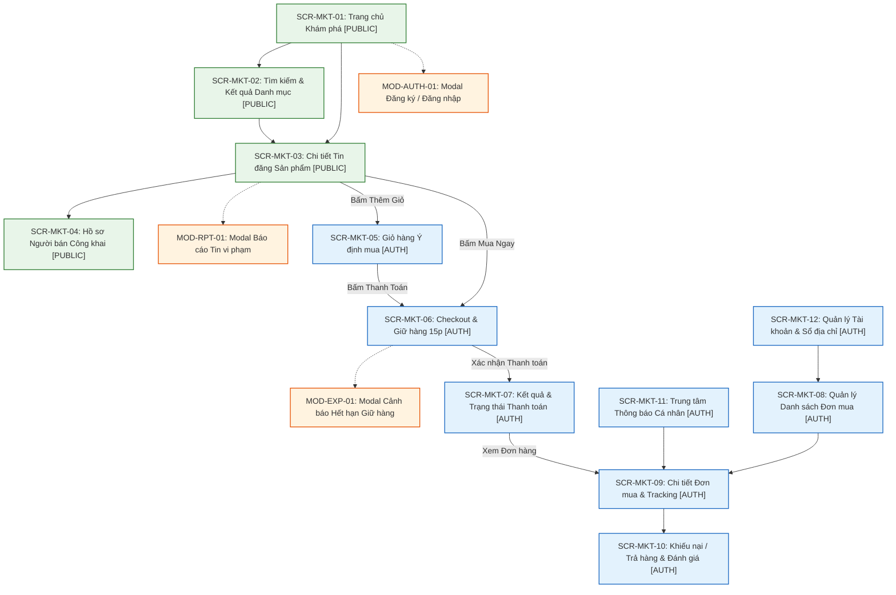
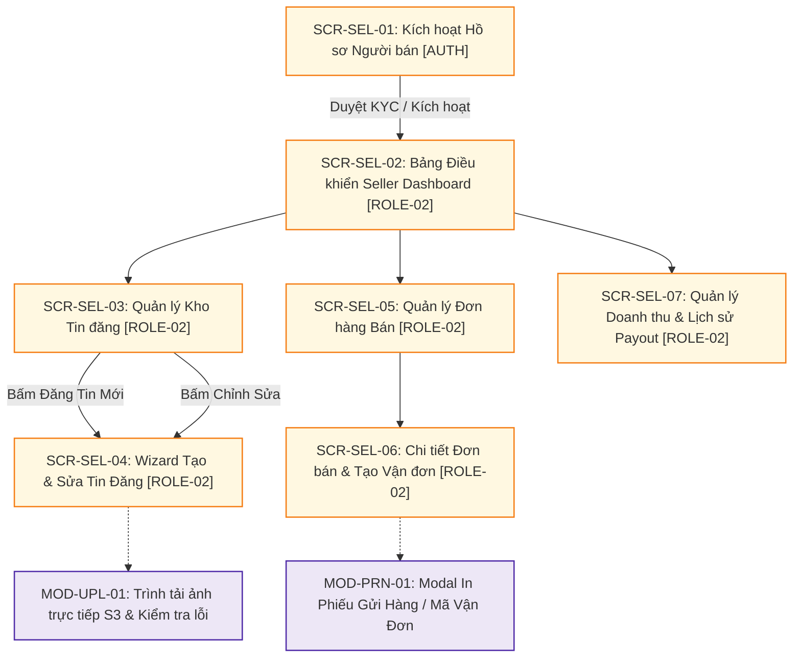
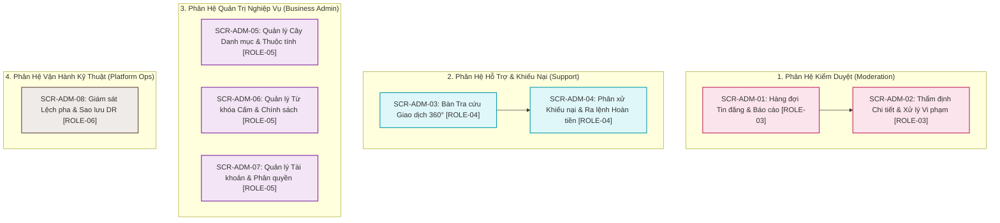

# Sơ Đồ Cấu Trúc Trang — Sitemap & Navigation Flows

| Tài liệu | Sơ đồ Cấu trúc Trang & Phân cấp Điều hướng (Sitemap) |
| :--- | :--- |
| **Dự án** | Nền tảng Thương mại Điện tử Đồ cũ C2C ReMarket |
| **Mã tài liệu** | `DOC-BA-04-SMP` |
| **Phiên bản** | v1.0 |
| **Trạng thái** | Chấp thuận (Approved) |
| **Phạm vi** | Toàn bộ các luồng trang thuộc 3 kênh: Marketplace, Seller Center, Back-office Portal |
| **Liên kết truy vết** | [information-architecture.md](file:///d:/remarket-platform-system/docs/BA/04_product-and-ux/information-architecture.md), [user-roles-and-permissions.md](file:///d:/remarket-platform-system/docs/BA/01_stakeholders-and-users/user-roles-and-permissions.md), [user-journeys.md](file:///d:/remarket-platform-system/docs/BA/01_stakeholders-and-users/user-journeys.md), [functional-requirements.md](file:///d:/remarket-platform-system/docs/BA/03_requirements/functional-requirements.md) |

---

## 1. Quy Ước Ký Hiệu & Cấu Trúc Phân Cấp Trang

Sitemap của ReMarket được phân nhóm theo 3 kênh giao diện độc lập nhằm đảm bảo tính phân tách trách nhiệm nghiệp vụ và bảo mật thông tin. Mỗi tuyến trang được gắn nhãn kiểm soát truy cập (Route Guard):

- `[PUBLIC]`: Công khai cho mọi đối tượng, kể cả khách vãng lai (`ROLE-00` Guest).
- `[AUTH]`: Yêu cầu người dùng phải đăng nhập tài khoản hợp lệ.
- `[ROLE-01]`: Người mua hàng (Buyer).
- `[ROLE-02]`: Người bán hàng đã xác thực hồ sơ (Seller).
- `[ROLE-03]`: Kiểm duyệt viên nội bộ (Moderator).
- `[ROLE-04]`: Chuyên viên hỗ trợ khách hàng (Customer Support Agent).
- `[ROLE-05]`: Quản trị viên nghiệp vụ (Business Administrator).
- `[ROLE-06]`: Kỹ sư vận hành nền tảng (Platform Operator).
- `[MODAL/DRAWER]`: Hộp thoại hoặc thanh trượt xuất hiện đè trên ngữ cảnh trang hiện tại.

---

## 2. Kênh 1 — Marketplace Web / Mobile App (`MKT`)

Kênh mua sắm và khám phá sản phẩm đồ cũ phục vụ Khách vãng lai (`ROLE-00`) và Người mua hàng (`ROLE-01`).

### Bảng Chi Tiết Phân Cấp Tuyến Trang Marketplace

| Mã Màn Hình | Tên Trang / Tuyến Đường | Route / URL Mẫu | Quyền Truy Cập | Mục Đích Nghiệp Vụ Chính |
| :--- | :--- | :--- | :--- | :--- |
| `SCR-MKT-01` | **Trang chủ Khám phá** | `/` | `[PUBLIC]` | Khám phá banner, danh mục nổi bật, tin mới đăng, tin giá tốt gần đây. |
| `SCR-MKT-02` | **Tìm kiếm & Phân loại Danh mục** | `/search?q=...&cat=...` | `[PUBLIC]` | Truy vấn từ khóa, lọc theo khoảng giá, tình trạng hàng, khoảng cách và sắp xếp. |
| `SCR-MKT-03` | **Chi tiết Tin đăng Sản phẩm** | `/items/:listingId` | `[PUBLIC]` | Hiển thị thông tin kiểm chứng tình trạng, ảnh thật, kiểm tra realtime tình trạng còn hàng, CTA "Mua ngay". |
| `SCR-MKT-04` | **Hồ sơ Người bán Công khai** | `/sellers/:sellerId` | `[PUBLIC]` | Xem tổng quan uy tín người bán, huy hiệu tin cậy, điểm đánh giá sao và danh sách tin đang bán. |
| `SCR-MKT-05` | **Giỏ hàng Ý định mua** | `/cart` | `[AUTH]` | Lưu các món hàng quan tâm (`BR-ORD-004`). Không giữ hàng, hiển thị cảnh báo nếu món hàng vừa bị bán. |
| `SCR-MKT-06` | **Checkout & Giữ hàng 15 phút** | `/checkout?item=...` | `[AUTH]` | Khóa giữ chỗ sản phẩm 15:00 (`BR-ORD-003`), tính phí bảo vệ người mua, chọn địa chỉ và chọn cổng thanh toán. |
| `SCR-MKT-07` | **Kết quả & Trạng thái Thanh toán** | `/payment/result/:orderId` | `[AUTH]` | Tiếp nhận kết quả điều hướng từ Cổng thanh toán; xử lý trạng thái Chờ xác nhận (`Pending`) hoặc Thất bại/Thành công. |
| `SCR-MKT-08` | **Danh sách Đơn mua** | `/user/orders` | `[AUTH]` | Danh sách đơn mua theo các tab: Chờ thanh toán, Chờ giao hàng, Đang giao, Đã giao, Đã hủy, Trả hàng/Khiếu nại. |
| `SCR-MKT-09` | **Chi tiết Đơn mua & Tracking** | `/user/orders/:orderId` | `[AUTH]` | Xem snapshot sản phẩm, theo dõi hành trình vận đơn 3PL theo thời gian thực, nút "Đã nhận hàng", nút "Khiếu nại". |
| `SCR-MKT-10` | **Gửi Khiếu nại & Đánh giá** | `/user/orders/:orderId/action` | `[AUTH]` | Mở tranh chấp/yêu cầu trả hàng (`BR-DSP-001`) hoặc viết đánh giá 1-5 sao kèm hình ảnh thực tế nhận được. |
| `SCR-MKT-11` | **Trung tâm Thông báo Cá nhân** | `/user/notifications` | `[AUTH]` | Xem biến động đơn hàng, nhắc nhở thanh toán, cảnh báo tin đăng quan tâm và tin tức hệ thống. |
| `SCR-MKT-12` | **Quản lý Tài khoản & Sổ địa chỉ** | `/user/profile` | `[AUTH]` | Cập nhật thông tin định danh cá nhân, đổi mật khẩu, thiết lập địa chỉ giao nhận mặc định. |

---

## 3. Kênh 2 — Seller Center (`SEL`)

Kênh dành riêng cho Người bán hàng (`ROLE-02`) nhằm tạo, tối ưu tin đăng, thực hiện đóng gói giao vận và theo dõi doanh thu thanh toán tạm giữ.

### Bảng Chi Tiết Tuyến Trang Seller Center

| Mã Màn Hình | Tên Trang / Tuyến Đường | Route / URL Mẫu | Quyền Truy Cập | Mục Đích Nghiệp Vụ Chính |
| :--- | :--- | :--- | :--- | :--- |
| `SCR-SEL-01` | **Kích hoạt Hồ sơ Người bán** | `/seller/onboarding` | `[AUTH]` | Đăng ký thông tin định danh người bán, cam kết quy chế chống hàng giả, liên kết tài khoản ngân hàng nhận tiền. |
| `SCR-SEL-02` | **Seller Dashboard (Tổng quan)** | `/seller/dashboard` | `[ROLE-02]` | Xem chỉ số nhanh: Tin đang hiển thị, Đơn cần đóng gói, Doanh thu tạm giữ (Escrow), Điểm uy tín người bán. |
| `SCR-SEL-03` | **Quản lý Kho Tin đăng** | `/seller/listings` | `[ROLE-02]` | Danh sách tin theo bộ lọc: Đang hiển thị (`Published`), Đang giữ chỗ (`Reserved`), Chờ duyệt (`PendingModeration`), Đã bán (`Sold`), Bị từ chối (`Rejected`). |
| `SCR-SEL-04` | **Wizard Tạo & Sửa Tin Đăng** | `/seller/listings/new` | `[ROLE-02]` | Quy trình 3 bước: Chọn Danh mục & Điền Thuộc tính động → Khai báo Khuyết điểm & Tải ảnh trực tiếp S3 → Định giá & Chọn vận chuyển. |
| `SCR-SEL-05` | **Quản lý Đơn hàng Bán** | `/seller/orders` | `[ROLE-02]` | Danh sách đơn hàng bán: Cần xác nhận, Cần giao cho shipper, Đang giao, Giao thành công, Đơn khiếu nại. |
| `SCR-SEL-06` | **Chi tiết Đơn bán & Tạo Vận đơn** | `/seller/orders/:orderId` | `[ROLE-02]` | Xem địa chỉ Buyer (chỉ hiện khi đơn `Confirmed` - `BR-SEC-004`), bấm "Tạo vận đơn 3PL", in phiếu gửi hàng có mã vạch. |
| `SCR-SEL-07` | **Doanh thu Tạm giữ & Đối soát Payout** | `/seller/finances` | `[ROLE-02]` | Theo dõi số dư tiền bán đang tạm giữ (Escrow Balance), tiền chuẩn bị giải ngân, lịch sử các đợt đối soát chuyển khoản ngân hàng (`Batch Payout`). |

---

## 4. Kênh 3 — Admin / Back-office Portal (`ADM`)

Phân hệ quản trị tập trung dành cho nhân sự vận hành sàn thương mại điện tử, bao gồm Kiểm duyệt viên (`ROLE-03`), Hỗ trợ khách hàng (`ROLE-04`), Quản trị kinh doanh (`ROLE-05`) và Vận hành kỹ thuật (`ROLE-06`).

### Bảng Chi Tiết Tuyến Trang Admin / Back-office

| Mã Màn Hình | Tên Trang / Tuyến Đường | Route / URL Mẫu | Quyền Truy Cập | Mục Đích Nghiệp Vụ Chính |
| :--- | :--- | :--- | :--- | :--- |
| `SCR-ADM-01` | **Hàng đợi Tin & Báo cáo Vi phạm** | `/admin/moderation/queue` | `[ROLE-03]` | Danh sách tin bị nghi ngờ từ khóa cấm (`Flagged`), tin bị người dùng báo cáo (`Reported`), lọc theo mức độ ưu tiên. |
| `SCR-ADM-02` | **Thẩm định Chi tiết Tin đăng** | `/admin/moderation/:id` | `[ROLE-03]` | So sánh ảnh, kiểm tra từ khóa vi phạm bôi đỏ, nút bấm: Duyệt (`Approve`), Từ chối kèm lý do (`Reject`), hoặc Khóa tài khoản tái phạm. **Không xem dữ liệu thanh toán** (`BR-SEC-003`). |
| `SCR-ADM-03` | **Bàn Tra cứu Giao dịch 360°** | `/admin/support/lookup` | `[ROLE-04]` | Tra cứu theo OrderID, ListingID, SĐT hoặc Email. **Hiển thị song song 3 miền: Order - Payment - Shipment**. Mặc định che PII; nút mở khóa có ghi Audit Log (`FR-SUP-01..03`). |
| `SCR-ADM-04` | **Phân xử Khiếu nại & Hoàn tiền** | `/admin/support/disputes/:id` | `[ROLE-04]` | Đối chiếu bằng chứng ảnh/video của Người mua và Người bán. Ra quyết định: Bác bỏ khiếu nại, Yêu cầu trả hàng, hoặc Ra lệnh Hoàn tiền một phần/toàn phần (`BR-DSP-003`). |
| `SCR-ADM-05` | **Quản lý Danh mục & Thuộc tính** | `/admin/config/taxonomy` | `[ROLE-05]` | Tạo/sửa cây danh mục tối đa 3 cấp, định nghĩa các trường thuộc tính động (Drop-down, Text, Checkbox) bắt buộc cho từng nhóm hàng. |
| `SCR-ADM-06` | **Quản lý Từ khóa Cấm & Chính sách** | `/admin/config/policies` | `[ROLE-05]` | Quản lý Blacklist từ khóa cấm đăng bán (vũ khí, chất cấm, hàng giả), cấu hình phí nền tảng và phí bảo vệ người mua. |
| `SCR-ADM-07` | **Quản lý Tài khoản & Phân quyền** | `/admin/users/roles` | `[ROLE-05]` | Quản lý trạng thái khóa/kích hoạt người dùng; gán vai trò nhân sự nội bộ (`ROLE-03`, `ROLE-04`, `ROLE-05`) theo nguyên tắc đặc quyền tối thiểu. |
| `SCR-ADM-08` | **Giám sát Lệch pha & Sao lưu DR** | `/admin/ops/health-status` | `[ROLE-06]` | Bảng điều khiển giám sát hàng đợi Outbox/Saga, phát hiện đơn hàng bị lệch trạng thái giữa Payment và Order (`Out-of-sync`), kiểm tra trạng thái snapshot sao lưu CSDL và DR (`NFR-REC-01`). |

---

## 5. Ma Trận Phân Quyền Truy Cập Tuyến Đường (Route Guard Matrix)

Ma trận kiểm soát truy cập đảm bảo mỗi vai trò người dùng chỉ truy cập đúng phạm vi quyền hạn được cấp phát:

| Mã Màn Hình | Tên Màn Hình | `ROLE-00` Khách | `ROLE-01` Buyer | `ROLE-02` Seller | `ROLE-03` Mod | `ROLE-04` Support | `ROLE-05` Admin | `ROLE-06` Ops |
| :--- | :--- | :---: | :---: | :---: | :---: | :---: | :---: | :---: |
| `SCR-MKT-01..04` | Trang chủ, Tìm kiếm, Chi tiết tin, Hồ sơ Seller | **Cho phép** | **Cho phép** | **Cho phép** | **Cho phép** | **Cho phép** | **Cho phép** | **Cho phép** |
| `SCR-MKT-05..07` | Giỏ hàng, Checkout giữ hàng 15p, Kết quả thanh toán | Chuyển Login | **Cho phép** | **Cho phép** | Chuyển Login | Chuyển Login | Chuyển Login | Chuyển Login |
| `SCR-MKT-08..10` | Danh sách đơn mua, Chi tiết đơn mua, Khiếu nại | Chuyển Login | **Cho phép** | **Cho phép** | Chuyển Login | Chuyển Login | Chuyển Login | Chuyển Login |
| `SCR-MKT-11..12` | Thông báo cá nhân, Hồ sơ tài khoản & Sổ địa chỉ | Chuyển Login | **Cho phép** | **Cho phép** | Chuyển Login | Chuyển Login | Chuyển Login | Chuyển Login |
| `SCR-SEL-01` | Đăng ký & Kích hoạt Người bán | Chuyển Login | **Cho phép** | Chuyển Dash | Từ chối (403) | Từ chối (403) | Từ chối (403) | Từ chối (403) |
| `SCR-SEL-02..07` | Bảng điều khiển Seller, Kho tin, Wizard đăng tin, Đơn bán, Vận đơn, Payout | Chuyển Login | Chuyển Onboard | **Cho phép** | Từ chối (403) | Từ chối (403) | Từ chối (403) | Từ chối (403) |
| `SCR-ADM-01..02` | Hàng đợi kiểm duyệt tin, Thẩm định vi phạm | Từ chối (403) | Từ chối (403) | Từ chối (403) | **Toàn quyền** | Chỉ xem (Read) | **Toàn quyền** | Từ chối (403) |
| `SCR-ADM-03..04` | Tra cứu giao dịch 360°, Phân xử tranh chấp & Hoàn tiền | Từ chối (403) | Từ chối (403) | Từ chối (403) | Từ chối (403) | **Toàn quyền** | **Toàn quyền** | Từ chối (403) |
| `SCR-ADM-05..07` | Cấu hình Danh mục, Từ khóa cấm, Phân quyền nhân sự | Từ chối (403) | Từ chối (403) | Từ chối (403) | Từ chối (403) | Từ chối (403) | **Toàn quyền** | Từ chối (403) |
| `SCR-ADM-08` | Giám sát Lệch pha & Báo cáo Sao lưu DR | Từ chối (403) | Từ chối (403) | Từ chối (403) | Từ chối (403) | Từ chối (403) | Xem tóm tắt | **Toàn quyền** |

---

## 6. Quy Tắc Chuyển Hướng & Bảo Toàn Ngữ Cảnh (Navigation & Deep-link Rules)

### 6.1. Quy Tắc Đăng Nhập Bảo Toàn Ngữ Cảnh Mua Hàng (`FR-CHK-01`)
- **Tình huống:** Khách vãng lai (`ROLE-00`) xem tin đăng tại `SCR-MKT-03` và bấm nút **"Mua ngay"**.
- **Cơ chế xử lý:**
  1. Hệ thống lưu lại URL đích kèm tham số: `/login?returnUrl=/checkout%3Fitem%3DLST-12345`.
  2. Mở hộp thoại hoặc trang đăng nhập `MOD-AUTH-01`.
  3. Sau khi xác thực thành công (hoặc hoàn tất đăng ký nhanh bằng OTP/Social), Route Guard lập tức điều hướng người dùng thẳng tới `SCR-MKT-06` (`/checkout?item=LST-12345`).
  4. Hệ thống tự động kích hoạt lệnh tạo giữ chỗ 15 phút mà không bắt người dùng tìm kiếm lại sản phẩm.

### 6.2. Quy Tắc Deep-link Từ Kênh Thông Báo (Push Notification / Email / SMS)
- **Thông báo có đơn hàng mới (`ROLE-02` Seller):** Bấm vào liên kết trong email/push notification điều hướng thẳng tới `SCR-SEL-06` (`/seller/orders/:orderId`) để chuẩn bị hàng và tạo vận đơn.
- **Thông báo hàng đang giao / đã giao (`ROLE-01` Buyer):** Điều hướng thẳng tới `SCR-MKT-09` (`/user/orders/:orderId`) hiển thị mã vận đơn và bản đồ lộ trình giao nhận.
- **Thông báo yêu cầu cung cấp bằng chứng tranh chấp (`ROLE-01` / `ROLE-02`):** Điều hướng thẳng tới `SCR-MKT-10` mở sẵn tab Khiếu nại để tải ảnh minh chứng bổ sung.

### 6.3. Xử Lý Các Trạng Thái Điều Hướng Ngoại Lệ
- **404 Not Found (Sản phẩm không tồn tại):** Hiển thị màn hình thân thiện kèm ô tìm kiếm và danh sách 6 sản phẩm gợi ý cùng tầm giá.
- **410 Gone (Tin đăng đã bán hoặc đã bị gỡ):** Không hiển thị lỗi kỹ thuật khô khan. Giao diện hiển thị: *"Sản phẩm này đã được bán cho người mua khác"* kèm nút dẫn tới trang kết quả tìm kiếm các mặt hàng tương tự.
- **403 Forbidden (Truy cập trái quyền hạn):** Điều hướng về Trang chủ tương ứng của người dùng (Marketplace hoặc Seller Dashboard) kèm thông báo cảnh báo toast: *"Bạn không có quyền truy cập khu vực này"*.

