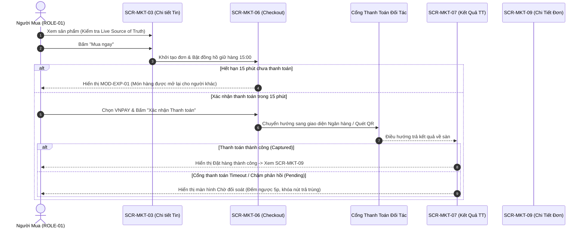
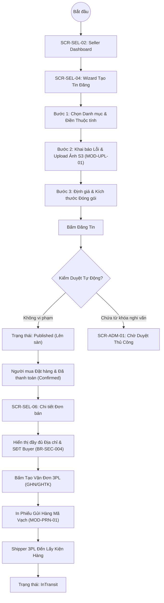
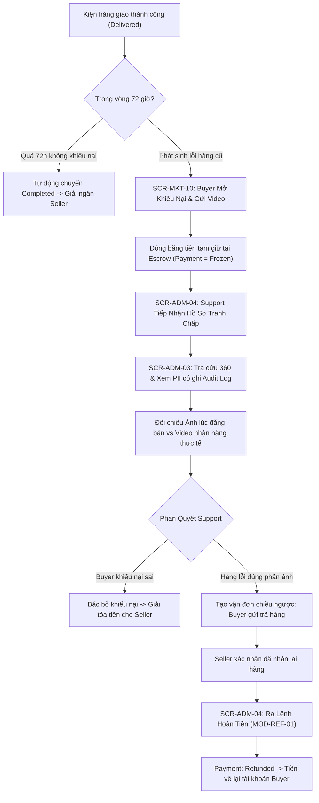

# Khung Giao Diện & Luồng Tương Tác — Wireframes & Prototypes

| Tài liệu | Khung Giao Diện & Nguyên Mẫu Tương Tác (Wireframes & Screen Flows) |
| :--- | :--- |
| **Dự án** | Nền tảng Thương mại Điện tử Đồ cũ C2C ReMarket |
| **Mã tài liệu** | `DOC-BA-04-WFP` |
| **Phiên bản** | v1.0 |
| **Trạng thái** | Chấp thuận (Approved) |
| **Phạm vi** | Bộ UI Components chuẩn hóa, 7 ASCII Wireframes trọng tâm và 3 Sơ đồ Luồng màn hình |
| **Liên kết truy vết** | [screen-inventory.md](file:///d:/remarket-platform-system/docs/BA/04_product-and-ux/screen-inventory.md), [information-architecture.md](file:///d:/remarket-platform-system/docs/BA/04_product-and-ux/information-architecture.md), [business-rules.md](file:///d:/remarket-platform-system/docs/BA/02_business-analysis/business-rules.md), [use-cases.md](file:///d:/remarket-platform-system/docs/BA/03_requirements/use-cases.md), [glossary.md](file:///d:/remarket-platform-system/docs/BA/00_project-context/glossary.md) |

---

## 1. Hệ Thống Thành Phần Giao Diện Dùng Chung (Core UI Components)

Nhằm đảm bảo tính nhất quán trên cả 3 kênh (`Marketplace`, `Seller Center`, `Back-office`), hệ thống định nghĩa 6 thành phần giao diện đặc thù cho mô hình C2C đồ cũ và kiến trúc phân tán:

### `CMP-01`: Bộ Huy Hiệu Trạng Thái Chuẩn Hóa (Standardized Status Badges)
Ánh xạ chính xác 1-1 với 5 bảng trạng thái trong [glossary.md](file:///d:/remarket-platform-system/docs/BA/00_project-context/glossary.md) §3:

| Nhóm Thực Thể | Trạng Thái Hiển Thị | Mã Màu & Kiểu Dáng | Ý Nghĩa Ngữ Nghĩa |
| :--- | :--- | :--- | :--- |
| **Listing** | `Published` | Nền xanh lá nhạt, chữ xanh đậm | Tin đang hiển thị công khai, sẵn sàng giao dịch |
| **Listing** | `Reserved` | Nền vàng nhạt, chữ nâu đậm | Đang có người giữ hàng 15 phút tại checkout |
| **Listing** | `Sold` | Nền xám nhạt, chữ xám đậm | Đã bán thành công, khóa giao dịch |
| **Listing** | `PendingModeration` | Nền cam nhạt, chữ cam đậm | Đang chờ kiểm duyệt nội dung tự động/thủ công |
| **Order** | `Created` | Nền xanh dương nhạt, chữ xanh dương | Đơn mới tạo, đang chờ thanh toán |
| **Order** | `Confirmed` | Nền xanh lá nhạt, chữ xanh lá đậm | Đã thanh toán thành công, người bán được phép chuẩn bị hàng |
| **Order** | `Completed` | Nền xanh lục đậm, chữ trắng | Đơn hàng hoàn tất mỹ mãn, đã giải ngân |
| **Order** | `Cancelled` | Nền đỏ nhạt, chữ đỏ đậm | Đơn hàng bị hủy do hết hạn hoặc người dùng chủ động |
| **Payment** | `Pending` | Nền vàng cam, icon xoay | Đang chờ kết quả phản hồi từ Cổng thanh toán |
| **Payment** | `Captured` | Nền xanh lá, icon tích | Tiền đã vào tài khoản tạm giữ bảo vệ của sàn (Escrow) |
| **Payment** | `Refunded` | Nền tím nhạt, chữ tím | Tiền đã được hoàn trả lại cho người mua |
| **Shipment** | `PickingUp` / `InTransit` | Nền xanh lơ, icon xe tải | Đơn vị vận chuyển đang gom hoặc trung chuyển hàng |
| **Shipment** | `Delivered` | Nền xanh lục nhạt | Kiện hàng đã giao thành công tới tay người nhận |
| **Dispute** | `Opened` / `UnderReview` | Nền đỏ cam, icon chấm than | Đang có khiếu nại tranh chấp, đóng băng giải ngân |

---

### `CMP-02`: Thanh Đếm Ngược Giữ Hàng (Reservation Countdown Banner)
- **Vị trí xuất hiện:** Màn hình Checkout (`SCR-MKT-06`).
- **Quy tắc hiển thị:**
  - Từ `15:00` đến `02:01`: Nền xanh dương nhạt, hiển thị biểu tượng đồng hồ và thông báo: *"Sản phẩm đang được giữ độc quyền cho bạn trong: [14:25]"*.
  - Dưới `02:00`: Chuyển sang nền vàng cam cảnh báo, nhấp nháy chữ số: *"Chỉ còn [01:45] để hoàn tất thanh toán trước khi sản phẩm được mở lại!"*.
  - Tại `00:00`: Kích hoạt hộp thoại cảnh báo `MOD-EXP-01` mờ toàn màn hình.

---

### `CMP-03`: Tiến Trình Đa Miền (3-Domain Transaction Timeline)
- **Vị trí xuất hiện:** Chi tiết Đơn mua (`SCR-MKT-09`), Chi tiết Đơn bán (`SCR-SEL-06`), Bàn Tra cứu Support (`SCR-ADM-03`).
- **Cấu trúc hiển thị:** Thể hiện 3 đường tiến trình song song, không gộp trạng thái:
  ```
  [Đơn hàng]   : (Created) ----> (Confirmed) [HIỆN TẠI] ----> (Completed)
  [Thanh toán] : (Pending) ----> (Captured)  [HIỆN TẠI]
  [Vận chuyển] : (Pending) [HIỆN TẠI] ----> (InTransit) ----> (Delivered)
  ```
- **Ý nghĩa:** Tránh che giấu trường hợp lỗi lệch pha (VD: Thanh toán đã thành công `Captured` nhưng Vận đơn chưa tạo được).

---

### `CMP-04`: Trường Dữ Liệu Che Giấu Kèm Mở Khóa Có Kiểm Toán (Audited PII Field)
- **Vị trí xuất hiện:** Toàn bộ màn hình Admin / Support (`SCR-ADM-03`, `SCR-ADM-04`).
- **Cấu trúc hiển thị:**
  ```
  Số điện thoại: [ 090***5678 ] [ 👁 Mở khóa (Ghi Audit) ]
  ```
- Khi bấm nút con mắt: Mở `MOD-PII-01` yêu cầu chọn lý do nghiệp vụ. Khi mở thành công, hiển thị đầy đủ văn bản trong 60 giây kèm thông báo: *"Hành động truy cập này đã được ghi vào Nhật ký An ninh #AUD-8921"*.

---

### `CMP-05`: Banner Cảnh Báo Dữ Liệu Trễ / Giảm Cấp Dịch Vụ (Degraded Mode Alert)
- **Vị trí xuất hiện:** Đầu trang chủ, trang tìm kiếm hoặc kết quả thanh toán khi có sự cố phụ trợ.
- **Cấu trúc:** Thanh dải màu vàng cam cố định đầu trang: *"Lưu ý: Dịch vụ tìm kiếm nâng cao đang trong chế độ bảo trì định kỳ. Kết quả lọc theo khoảng cách có thể có độ trễ nhẹ"*.

---

### `CMP-06`: Trình Tải Ảnh Trực Tiếp Object Storage (Presigned Upload Dropzone)
- **Vị trí xuất hiện:** Wizard đăng tin của Seller (`SCR-SEL-04`) và Form Khiếu nại (`SCR-MKT-10`).
- **Cấu trúc:** Vùng kéo thả file, tự động lấy Presigned URL từ S3 API và đẩy ảnh trực tiếp từ trình duyệt người dùng lên Cloud Storage. Hiển thị thumbnail kèm thanh % tiến trình từng ảnh và nút "Thử lại (Retry)" độc lập cho từng file nếu gặp lỗi mạng (`FR-MED-01..03`).

---

## 2. Khung Giao Diện Khái Niệm (ASCII Wireframes) Cho 7 Màn Hình Trọng Tâm

### WF-01: Chi Tiết Tin Đăng Đồ Cũ (`SCR-MKT-03`)

```
+-----------------------------------------------------------------------------------------+
| [Logo ReMarket]      [Tìm kiếm đồ cũ...] [Nút Tìm]         [Đăng tin] [🔔 (2)] [🛒 (1)] |
+-----------------------------------------------------------------------------------------+
| Trang chủ > Điện tử > Điện thoại > iPhone 12 Pro Max 128GB                              |
+-----------------------------------------------------------------------------------------+
| [ ALBUM ẢNH SẢN PHẨM ]           | iPhone 12 Pro Max 128GB Xanh Pacific (Chính Hãng)   |
| +------------------------------+ |                                                       |
| |                              | | GIÁ BÁN: 11.500.000 đ                                 |
| |       [ ẢNH CHÍNH LỚN ]      | | (Giá mua mới tham khảo: 24.000.000 đ)                 |
| |   (Chụp rõ viền cấn nhẹ)     | |                                                       |
| |                              | | TÌNH TRẠNG: [ TỐT - 88% (COND-GOOD) ]                 |
| +------------------------------+ | TRẠNG THÁI: [ ĐANG CÒN HÀNG (PUBLISHED) ]             |
| [Thumb 1] [Thumb 2] [Thumb 3]  |                                                       |
|                                  | +---------------------------------------------------+ |
| +------------------------------+ | | THÔNG TIN NGƯỜI BÁN                               | |
| | BẢNG KHAI BÁO KHUYẾT ĐIỂM    | | | Trần Văn B (Tham gia 2 năm) - [ Đã xác thực KYC ] | |
| | (Bắt buộc theo BR-PRO-001)   | | | Đánh giá: 4.8 / 5.0 (42 đơn thành công)           | |
| | - Màn hình: Zin, xước dăm nhẹ| | +---------------------------------------------------+ |
| | - Viền máy: Cấn 1 góc nhỏ    | |                                                       |
| | - Chức năng: FaceID tốt      | | [    MUA NGAY (GIỮ HÀNG 15P)    ] (Primary Button)    |
| | - Pin: Còn 82% dung lượng gốc| | [    THÊM VÀO GIỎ HÀNG          ] (Secondary Button)  |
| | - Serial/IMEI: 3568910****12 | |                                                       |
| +------------------------------+ | [ ⚠️ Báo cáo tin vi phạm / Hàng giả ] (Link phụ)     |
+-----------------------------------------------------------------------------------------+
| MÔ TẢ CHI TIẾT CỦA NGƯỜI BÁN:                                                           |
| "Máy mình dùng từ đầu, đã lên đời máy mới nên nhượng lại. Đầy đủ cáp sạc theo máy..."   |
+-----------------------------------------------------------------------------------------+
```

---

### WF-02: Màn Hình Checkout & Giữ Hàng 15 Phút (`SCR-MKT-06`)

```
+-----------------------------------------------------------------------------------------+
| [Logo ReMarket]               TIẾN HÀNH ĐẶT HÀNG & THANH TOÁN                           |
+-----------------------------------------------------------------------------------------+
| [ ⏱ SẢN PHẨM ĐANG ĐƯỢC GIỮ CHỖ ĐỘC QUYỀN CHO BẠN: 14:32 ]  (CMP-02 Reservation Banner)|
+-----------------------------------------------------------------------------------------+
| 1. ĐỊA CHỈ NHẬN HÀNG                             | 3. TÓM TẮT ĐƠN HÀNG (SNAPSHOT)       |
| [x] Nguyễn Văn A - 098****123                    | Sản phẩm: iPhone 12 Pro Max 128GB    |
|     123 Đường Nguyễn Trãi, Phường 2, Quận 5, TP.HCM| Tình trạng: Tốt (COND-GOOD)        |
|     [Thay đổi địa chỉ nhận hàng]                 | Người bán: Trần Văn B                |
|--------------------------------------------------+--------------------------------------|
| 2. PHƯƠNG THỨC VẬN CHUYỂN                        | BẢNG PHÂN RÃ CHI PHÍ (MINH BẠCH)     |
| (o) Giao Hàng Nhanh (Giao dự kiến: 2-3 ngày)     | - Tiền sản phẩm:        11.500.000 đ |
|     Cước phí vận chuyển: 35.000 đ                | - Phí bảo vệ người mua:     50.000 đ |
|--------------------------------------------------| - Phí vận chuyển:           35.000 đ |
| 4. PHƯƠNG THỨC THANH TOÁN                        | - Khuyến mãi:                    0 đ |
| (o) Thanh toán qua Cổng VNPAY (QR Code/ATM)      |--------------------------------------|
| ( ) Thanh toán qua Ví MoMo                       | TỔNG THANH TOÁN:        11.585.000 đ |
| ( ) Thẻ Tín Dụng / Ghi Nợ Quốc Tế                | (Tiền được giữ an toàn tại Escrow)   |
|                                                  |                                      |
|                                                  | [   XÁC NHẬN THANH TOÁN NGAY   ]     |
|                                                  | (Bấm để chuyển tới cổng thanh toán)  |
+-----------------------------------------------------------------------------------------+
| Khi bấm thanh toán, bạn đồng ý với Quy chế Giữ hàng 15 phút & Bảo vệ giao dịch đồ cũ.   |
+-----------------------------------------------------------------------------------------+
```

---

### WF-03: Kết Quả Thanh Toán Khi Cổng Timeout / Pending (`SCR-MKT-07`)

```
+-----------------------------------------------------------------------------------------+
| [Logo ReMarket]                     TRẠNG THÁI GIAO DỊCH                                |
+-----------------------------------------------------------------------------------------+
|                                                                                         |
|                            [ ⏳ BIỂU TƯỢNG ĐỒNG HỒ CÁT VÀNG ]                           |
|                                                                                         |
|                      GIAO DỊCH ĐANG ĐƯỢC ĐỐI SOÁT VỚI NGÂN HÀNG                         |
|                                                                                         |
|   Hệ thống đang chờ tín hiệu xác nhận từ cổng thanh toán VNPAY (Mã GD: TXN-892182).     |
|   Vui lòng KHÔNG thực hiện thanh toán lại để tránh trừ tiền 2 lần!                      |
|                                                                                         |
|   +---------------------------------------------------------------------------------+   |
|   | - Mã đơn hàng: ORD-20261112-9812                                                |   |
|   | - Số tiền: 11.585.000 đ                                                         |   |
|   | - Trạng thái Đơn hàng: [ Chờ Thanh Toán (Created) ]                             |   |
|   | - Trạng thái Thanh toán: [ Đang Đối Soát (Pending) ]                            |   |
|   | - Tự động kiểm tra lại sau: 00:45 giây...                                       |   |
|   +---------------------------------------------------------------------------------+   |
|                                                                                         |
|         [   KIỂM TRA LẠI TRẠNG THÁI   ]        [   VỀ DANH SÁCH ĐƠN HÀNG   ]            |
|                                                                                         |
|   Nếu tài khoản ngân hàng của bạn đã bị trừ tiền, đơn hàng sẽ tự động chuyển sang        |
|   trạng thái "Đã xác nhận" trong vòng 5 phút sau khi nhận được Webhook từ ngân hàng.   |
+-----------------------------------------------------------------------------------------+
```

---

### WF-04: Wizard Tạo Tin Đăng & Tải Ảnh Trực Tiếp S3 (`SCR-SEL-04`)

```
+-----------------------------------------------------------------------------------------+
| [KÊNH NGƯỜI BÁN]  TẠO TIN ĐĂNG BÁN ĐỒ CŨ MỚI              [ Thoát ] [ Lưu bản nháp ]   |
+-----------------------------------------------------------------------------------------+
|  [BƯỚC 1: Danh mục & Thuộc tính] > [*BƯỚC 2: Tình trạng & Ảnh*] > [BƯỚC 3: Giá & Vận chuyển]
+-----------------------------------------------------------------------------------------+
| 1. CHỌN TÌNH TRẠNG SẢN PHẨM:                                                            |
| ( ) Mới nguyên hộp (COND-NEW)       ( ) Như mới 99% (COND-EXC)                          |
| (x) Tốt 85-94% (COND-GOOD)          ( ) Khá 70-84% (COND-FAIR)   ( ) Xác máy (COND-PART)|
|                                                                                         |
| 2. KHAI BÁO KHUYẾT ĐIỂM (Bắt buộc theo BR-PRO-001):                                     |
| [x] Có vết xước nhẹ ngoại quan      [ ] Lỗi màn hình / sọc    [ ] Lỗi pin chai nặng     |
| Mô tả khuyết điểm: [ Viền góc dưới có vết cấn nhẹ do va chạm chìa khóa                 ] |
| Số Serial/IMEI thiết bị: [ 356891029481234 ] (Hệ thống tự động che 4 số cuối ngoài sàn) |
|                                                                                         |
| 3. TẢI ẢNH THẬT SẢN PHẨM (Tải trực tiếp S3 - Tối thiểu 3 ảnh):                          |
| +-------------------------------------------------------------------------------------+ |
| |  [ Kéo thả ảnh thật vào đây hoặc Bấm chọn file ] (Hỗ trợ JPG, PNG, WebP tối đa 10MB) | |
| +-------------------------------------------------------------------------------------+ |
| Tiến trình tải ảnh:                                                                     |
| [Ảnh 1 - Mặt trước]   [========== 100% ==========] [✓ Đã tải]  [ Đặt làm ảnh bìa ] [Xóa]|
| [Ảnh 2 - Mặt sau]     [========== 100% ==========] [✓ Đã tải]                      [Xóa]|
| [Ảnh 3 - Viền cấn]    [==== 45% .... LỖI MẠNG ===] [⚠️ Thất bại] [ 🔄 THỬ LẠI ]    [Xóa]|
|                                                                                         |
| [ < Quay lại Bước 1 ]                                            [ Tiếp tục Bước 3 > ]  |
+-----------------------------------------------------------------------------------------+
```

---

### WF-05: Chi Tiết Đơn Bán & Tạo Vận Đơn 3PL (`SCR-SEL-06`)

```
+-----------------------------------------------------------------------------------------+
| [KÊNH NGƯỜI BÁN]  CHI TIẾT ĐƠN HÀNG BÁN: #ORD-20261112-9812                             |
+-----------------------------------------------------------------------------------------+
| TRẠNG THÁI ĐƠN HÀNG: [ ĐÃ XÁC NHẬN - CHỜ ĐÓNG GÓI (CONFIRMED) ]                         |
| TIẾN TRÌNH: [ Thanh toán: CAPTURED ] -> [ Đơn hàng: CONFIRMED ] -> [ Vận chuyển: PENDING]|
+-----------------------------------------------------------------------------------------+
| THÔNG TIN SẢN PHẨM CẦN GIAO:                     | THÔNG TIN GIAO HÀNG & NGƯỜI MUA:     |
| - iPhone 12 Pro Max 128GB (Mã: LST-7812)         | Người nhận: Nguyễn Văn A             |
| - Tình trạng lúc bán: Tốt (COND-GOOD)            | Số điện thoại: 0987 654 321          |
| - Doanh thu nhận ròng: 10.925.000 đ              | Địa chỉ: 123 Đường Nguyễn Trãi,      |
|   (Đã trừ 5% phí sàn nền tảng: 575.000 đ)        |          Phường 2, Quận 5, TP.HCM    |
|   (Tiền đang giữ tại Escrow, giải ngân sau 72h)  | (Chỉ hiển thị khi đơn đã Confirmed)  |
+--------------------------------------------------+--------------------------------------+
| HẠN CHÓT GIAO CHO ĐƠN VỊ VẬN CHUYỂN: Còn 36 giờ (Trước 14:00 ngày 14/11/2026)          |
|                                                                                         |
| [   TẠO MÃ VẬN ĐƠN 3PL (GIAO HÀNG NHANH)   ] (Tạo đơn giao hàng tự động)                |
| [   IN PHIẾU GỬI HÀNG DÁN KIỆN (A6)         ] [ ❌ Báo Hủy Đơn (Giảm Điểm Uy Tín) ]     |
+-----------------------------------------------------------------------------------------+
```

---

### WF-06: Bàn Tra Cứu Giao Dịch Đa Miền 360° Của Support (`SCR-ADM-03`)

```
+-----------------------------------------------------------------------------------------+
| [BACK-OFFICE PORTAL]  BÀN TRA CỨU GIAO DỊCH 360 ĐỘ (SUPPORT WORKSPACE)                  |
+-----------------------------------------------------------------------------------------+
| [ Nhập Mã Đơn (ORD), Tin (LST), Mã GD (TXN), SĐT hoặc Email...        ] [ 🔍 TRA CỨU ]   |
+-----------------------------------------------------------------------------------------+
| KẾT QUẢ ĐỐI CHIẾU 3 MIỀN ĐỘC LẬP: ĐƠN HÀNG #ORD-20261112-9812                           |
|                                                                                         |
| [ MIỀN ĐƠN HÀNG ]         [ MIỀN THANH TOÁN ]         [ MIỀN VẬN CHUYỂN ]               |
| Trạng thái: CONFIRMED     Trạng thái: CAPTURED        Trạng thái: IN_TRANSIT            |
| Lúc: 13:45 12/11/2026     Lúc: 13:44 12/11/2026       Lúc: 09:15 13/11/2026             |
| Đồng bộ: [✓ KHỚP LỆNH]    Cổng: VNPAY (TXN-9812)      Đơn vị: GHN (Mã: TRK-VN8912)      |
+-----------------------------------------------------------------------------------------+
| DỮ LIỆU ĐỊNH DANH NGƯỜI DÙNG (PII - MẶC ĐỊNH CHE THEO BR-SEC-003):                      |
| - Người mua: ID #USR-1029 - SĐT: [ 098***4321 ] - Đ/C: [ 123 Đường..., Quận 5, TP.HCM ]  |
| - Người bán: ID #USR-8812 - SĐT: [ 091***8899 ] - Đ/C: [ 45 Lê Lợi, Quận 1, TP.HCM ]   |
|                                                                                         |
| [ 👁 MỞ KHÓA XEM PII ĐẦY ĐỦ (YÊU CẦU LÝ DO & GHI AUDIT LOG) ] (Mở modal MOD-PII-01)    |
+-----------------------------------------------------------------------------------------+
| NHẬT KÝ SỰ KIỆN BẤT BIẾN (IMMUTABLE AUDIT TRAIL):                                       |
| - 12/11 13:30:00: ListingReservedEvent -> Tạo giữ chỗ 15p cho User USR-1029            |
| - 12/11 13:44:12: PaymentCapturedEvent -> Cổng VNPAY báo thành công 11.585.000 đ        |
| - 12/11 13:45:01: OrderConfirmedEvent  -> Saga khớp lệnh thành công                     |
| - 13/11 09:15:20: ShipmentPickedUpEvent -> Shipper GHN đã nhận hàng từ Người bán        |
+-----------------------------------------------------------------------------------------+
```

---

### WF-07: Thẩm Định Phân Xử Khiếu Nại & Hoàn Tiền (`SCR-ADM-04`)

```
+-----------------------------------------------------------------------------------------+
| [BACK-OFFICE PORTAL]  PHÂN XỬ HỒ SƠ KHIẾU NẠI: #DSP-20261114-0012                       |
+-----------------------------------------------------------------------------------------+
| ĐƠN HÀNG: #ORD-20261112-9812 | SỐ TIỀN TRANH CHẤP: 11.585.000 đ (ĐANG ĐÓNG BĂNG ESCROW) |
+-----------------------------------------------------------------------------------------+
| ĐỐI CHIẾU CHỨNG CỨ SONG SONG:                                                           |
| BÊN BÁN (Lúc rao bán tin LST-7812):        | BÊN MUA (Khiếu nại nhận hàng):             |
| - Cam kết: Màn hình zin chỉ xước dăm nhẹ   | - Lý do: Màn hình bị sọc tím, cảm ứng đơ   |
| - Ảnh đăng bán: Góc chụp xa, không rõ sọc  | - Ảnh chụp lúc bóc hộp: Hiện rõ 1 sọc tím  |
| - Video test gửi lúc đăng: Không có        | - Video mở hộp (Unboxing): Có kèm theo     |
+-----------------------------------------------------------------------------------------+
| LỊCH SỬ THƯƠNG LƯỢNG NỘI BỘ GIỮA 2 BÊN:                                                 |
| - Buyer: "Máy bị sọc màn hình ngay khi bóc hộp, đề nghị trả hàng hoàn tiền."            |
| - Seller: "Lúc tôi gửi máy bình thường, có thể do shipper làm rơi."                     |
+-----------------------------------------------------------------------------------------+
| PHÁN QUYẾT CỦA SUPPORT AGENT (Bắt buộc nhập lý do vào biên bản kiểm toán):              |
| Kết luận: [ Chấp thuận khiếu nại của Buyer do có video mở hộp chứng minh lỗi từ trước ]|
| Phương án xử lý:                                                                        |
| ( ) Bác bỏ khiếu nại (Giải tỏa tiền cho Seller)                                        |
| (x) Yêu cầu Buyer gửi trả hàng lại cho Seller -> Sau khi Seller nhận, Hoàn 100% tiền     |
| ( ) Hoàn tiền ngay không cần trả hàng (Hàng vỡ nát / Không có giá trị)                   |
|                                                                                         |
| [   RA LỆNH PHÂN XỬ & TẠO VẬN ĐƠN TRẢ HÀNG   ]  (Chống bấm trùng Idempotent)            |
+-----------------------------------------------------------------------------------------+
```

---

## 3. Sơ Đồ Luồng Tương Tác Màn Hình (Screen Flow Prototypes)

### Luồng 1: Quy Trình Đặt Hàng & Thanh Toán C2C (Buyer Checkout Flow)



### Luồng 2: Quy Trình Đăng Tin, Chuẩn Bị & Giao Hàng (Seller Fulfillment Flow)



### Luồng 3: Quy Trình Phân Xử Khiếu Nại & Hoàn Tiền (Dispute Resolution Flow)



