# Mục 05 — Mô Hình Miền & Kiến Trúc Dữ Liệu Phân Tán (Domain & Data Architecture)

| Tài liệu | Tổng Quan Mô Hình Miền & Kiến Trúc Cơ Sở Dữ Liệu Phân Tán |
| :--- | :--- |
| **Dự án** | Nền tảng Thương mại Điện tử Đồ cũ C2C ReMarket |
| **Mã tài liệu** | `DOC-BA-05-README` |
| **Phiên bản** | v1.0 |
| **Trạng thái** | Chấp thuận (Approved) |
| **Phân hệ cha** | [Bộ Tài Liệu Phân Tích Nghiệp Vụ ReMarket (docs/BA)](file:///d:/remarket-platform-system/docs/BA/README.md) |

---

## 1. Mục Đích & Phạm Vi Phân Hệ 05

Phân hệ **05: Domain Model & Data Architecture** là trái tim kỹ thuật của dự án ReMarket, chịu trách nhiệm chuyển hóa các yêu cầu kinh doanh (`02_business-analysis`), yêu cầu chức năng và bất biến hệ thống (`03_requirements`), cùng đặc tả trải nghiệm sản phẩm (`04_product-and-ux`) thành **Kiến trúc Dữ liệu Phân tán & Mô hình Lưu trữ Đa Công nghệ (Polyglot Persistence)** hoàn chỉnh.

Khác với các tài liệu BA cơ bản chỉ vẽ sơ đồ ERD tĩnh, phân hệ 05 giải quyết toàn diện các bài toán System Design Database phức tạp nhất của nền tảng C2C đồ cũ:
1. **Mô hình hóa Miền theo DDD (Domain-Driven Design):** Thiết lập 9 Bounded Contexts độc lập, xác định rõ ranh giới giao dịch (Transactional Boundary), Context Map và cơ chế liên kết xuyên miền bằng ULID/UUID thay vì Foreign Key vật lý.
2. **Kiến Trúc Đa CSDL (Polyglot Persistence):** Phân bổ tối ưu giữa **SQL Server** (ACID, Sổ cái, Giữ hàng, Đối soát), **MongoDB** (Thuộc tính động hàng cũ, Tracking vận đơn), **Redis ElastiCache** (Distributed Lock, Sub-millisecond Cache), **OpenSearch** (Tìm kiếm toàn văn tiếng Việt) và **Amazon S3** (Lưu trữ ảnh/video trực tiếp).
3. **Các Chiến Thuật System Design Database Chuyên Sâu:**
   - **Tối ưu hóa Index:** Thiết kế Clustered Key đơn điệu chống Page Split, Covering Index (`INCLUDE`) đạt 100% Index Seek, Filtered Index và quy tắc ESR trên MongoDB.
   - **Phân vùng & Phân mảnh (Sharding & Partitioning):** Table Partitioning theo tháng kèm `SWITCH PARTITION` 0-downtime, giải quyết bài toán hóc búa Buyer xem đơn (`buyer_id`) vs Seller xem đơn (`seller_id`) bằng bảng chiếu CQRS `SellerOrdersIndex`.
   - **Nhân bản & Nhất quán (Replication & HA):** Multi-AZ Synchronous Replication (`RPO = 0`), Read/Write Splitting, và 3 kỹ thuật chống Replication Lag (nổi bật là **Read-Your-Own-Writes qua Sticky Primary Routing**).
   - **Khóa Đồng Thời & Sagas:** Giải quyết bài toán `Stock = 1` không oversell (`INV-01`) bằng Redis Fast-Fail + Chốt chặn Atomic Optimistic Lock trên SQL Server; cơ chế thu hồi giữ hàng 15 phút (`BR-ORD-003`); Orchestration Saga, Transactional Outbox và Inbox Idempotency (`INV-03`).
   - **Chiến lược Caching & CQRS:** Chống 3 sự cố kinh điển (Stampede, Penetration, Avalanche); xây dựng Read Model 360° cho màn hình Support (`SCR-ADM-03`).
   - **Vòng Đời Dữ Liệu & DR:** Phân tầng Hot/Warm/Cold (S3 Glacier WORM); kỹ thuật **Field-Level Encryption kết hợp Blind Index (HMAC-SHA256)** giúp tìm kiếm chính xác SĐT/Email đã mã hóa; quy trình PITR và phục hồi nhất quán đa kho dữ liệu.

---

## 2. Cấu Trúc Bộ Tài Liệu 10 File Thành Phần

Thư mục `docs/BA/05_domain-and-data/` bao gồm **10 tài liệu kỹ thuật chuyên sâu**:

```
docs/BA/05_domain-and-data/
├── README.md                                          # Tài liệu chỉ mục & ma trận truy vết tổng thể
├── domain-model.md                                    # Đặc tả DDD: 9 Bounded Contexts, Aggregates & Invariants
├── entity-relationship-model.md                       # Sơ đồ Polyglot ERD (SQL Server DDL & MongoDB JSON Schemas)
├── data-dictionary.md                                 # Từ điển dữ liệu cấp cột/field, kiểu dữ liệu, bảo mật PII
├── polyglot-persistence-and-db-architecture.md        # Ma trận Database-per-Service, cô lập dữ liệu, Connection Pool
├── indexing-and-query-optimization.md                 # Clustered B-Tree, Covering, Filtered, ESR, Top 15 Hot Queries
├── sharding-and-partitioning-strategy.md              # Vertical/Table Partitioning, Shard Keys, chống Hot-Partition
├── replication-high-availability-and-consistency.md   # Multi-AZ HA, Write/Read Concern, Read/Write Split & RYOW
├── concurrency-locking-and-distributed-transactions.md# Chống bán trùng Stock=1, Hết hạn 15p, Outbox/Saga, RCSI
├── caching-and-read-model-strategy.md                 # Caching đa tầng, chống Stampede/Penetration/Avalanche, CQRS 360°
└── data-lifecycle-and-retention.md                    # Hot/Warm/Cold, Blind Index tìm kiếm PII mã hóa, Backup PITR & DR
```

### Bảng Tóm Tắt Nhiệm Vụ Kỹ Thuật Của Từng Tài Liệu:

| STT | Tên Tài Liệu | Trọng Tâm Thiết Kế Kỹ Thuật | Đầu Ra Cốt Lõi |
| :---: | :--- | :--- | :--- |
| 1 | [domain-model.md](file:///d:/remarket-platform-system/docs/BA/05_domain-and-data/domain-model.md) | Phân tách ranh giới nghiệp vụ theo Domain-Driven Design (DDD). | - 9 Bounded Contexts & Mermaid Context Map.<br>- Ranh giới Transactional Boundary của từng Aggregate.<br>- Ánh xạ 5 máy trạng thái chuẩn & 5 bất biến `INV-01..05`. |
| 2 | [entity-relationship-model.md](file:///d:/remarket-platform-system/docs/BA/05_domain-and-data/entity-relationship-model.md) | Thiết kế lược đồ vật lý đa công nghệ (Polyglot ERD). | - Dual-Key: `BIGINT IDENTITY` (Clustered) + `Public ULID`.<br>- DDL SQL Server cho 4 CSDL giao dịch.<br>- JSON/BSON Schemas MongoDB cho 3 CSDL hướng tài liệu. |
| 3 | [data-dictionary.md](file:///d:/remarket-platform-system/docs/BA/05_domain-and-data/data-dictionary.md) | Từ điển dữ liệu chuẩn hóa toàn bộ các trường. | - Chuẩn hóa `DECIMAL(18,2)`, UTC `DATETIME2(3)`, `NVARCHAR`.<br>- Phân cấp 4 cấp độ bảo mật (`[PUB]`, `[INT]`, `[CON]`, `[PII]`). |
| 4 | [polyglot-persistence-and-db-architecture.md](file:///d:/remarket-platform-system/docs/BA/05_domain-and-data/polyglot-persistence-and-db-architecture.md) | Phân bổ lưu trữ & kiến trúc kết nối microservice. | - Ma trận Database-per-Service (SQL Server vs MongoDB vs Redis vs S3).<br>- Cô lập Logical (Dev) vs Physical Cluster (Prod).<br>- Connection Pooling, Timeout Hierarchy & Circuit Breaker. |
| 5 | [indexing-and-query-optimization.md](file:///d:/remarket-platform-system/docs/BA/05_domain-and-data/indexing-and-query-optimization.md) | Tối ưu hóa truy vấn và cấu trúc cây chỉ mục B-Tree. | - Clustered Index chống Page Split, Covering Index (`INCLUDE`).<br>- Filtered Index (`WHERE Status = 'Active'`).<br>- Quy tắc ESR trên MongoDB & Danh mục Top 15 Hot Queries.<br>- Phân trang con trỏ (Keyset Pagination) thay thế `OFFSET`. |
| 6 | [sharding-and-partitioning-strategy.md](file:///d:/remarket-platform-system/docs/BA/05_domain-and-data/sharding-and-partitioning-strategy.md) | Mở rộng quy mô lưu trữ và xử lý nghẽn dữ liệu lớn. | - Vertical Partitioning tách bảng nóng và bảng snapshot.<br>- SQL Server Table Partitioning theo tháng (`SWITCH PARTITION`).<br>- Giải quyết bài toán Buyer vs Seller Sharding bằng bảng chiếu CQRS `SellerOrdersIndex`.<br>- Xử lý Hot-shard / Celebrity Seller bằng Salting + Cache. |
| 7 | [replication-high-availability-and-consistency.md](file:///d:/remarket-platform-system/docs/BA/05_domain-and-data/replication-high-availability-and-consistency.md) | Sẵn sàng cao Multi-AZ và giải quyết độ trễ nhân bản. | - RDS Multi-AZ Synchronous Replication (`RPO = 0`).<br>- MongoDB 3-Node Replica Set (`w: majority, j: true`).<br>- 3 kỹ thuật chống Replication Lag (nổi bật là RYOW qua Sticky Primary Routing trong 3 giây). |
| 8 | [concurrency-locking-and-distributed-transactions.md](file:///d:/remarket-platform-system/docs/BA/05_domain-and-data/concurrency-locking-and-distributed-transactions.md) | Kiểm soát đồng thời, chống bán trùng và Sagas. | - Chống bán trùng `Stock = 1` (`INV-01`): Redis Lock + Chốt chặn Atomic Optimistic Lock trên SQL Server.<br>- Cơ chế thu hồi giữ hàng 15p: Lazy Expiration + Background Sweeper.<br>- Orchestration Saga, Transactional Outbox + CDC, Inbox Idempotency (`INV-03`), và cấp cô lập RCSI. |
| 9 | [caching-and-read-model-strategy.md](file:///d:/remarket-platform-system/docs/BA/05_domain-and-data/caching-and-read-model-strategy.md) | Bộ nhớ đệm đa tầng và mô hình đọc CQRS. | - Quy hoạch Redis Key Namespace, TTL & Event-Driven Invalidation.<br>- Kỹ thuật chống 3 sự cố: Cache Stampede (Mutex Lock), Cache Penetration (Null Cache + Bloom Filter), Cache Avalanche (Random Jitter).<br>- Mô hình CQRS `Order360View` và bộ dò lệch pha trạng thái (`SCR-ADM-08`). |
| 10 | [data-lifecycle-and-retention.md](file:///d:/remarket-platform-system/docs/BA/05_domain-and-data/data-lifecycle-and-retention.md) | Vòng đời dữ liệu, mã hóa PII và khôi phục thảm họa. | - Phân tầng Hot / Warm / Cold (S3 Glacier WORM 10 năm).<br>- Cấm xóa vật lý; Crypto-Shredding khi xóa tài khoản.<br>- Kỹ thuật **Field-Level Encryption + Blind Index (HMAC-SHA256)** giúp tìm kiếm chính xác SĐT/Email đã mã hóa trên `SCR-ADM-03`.<br>- Ma trận RPO/RTO theo Data Tier & Quy trình đối soát khôi phục đa kho nhất quán. |

---

## 3. Quy Ước Mã Định Danh Trong Phân Hệ 05

| Tiền Tố Mã | Ý Nghĩa Ngữ Nghĩa | Ví Dụ Điển Hình |
| :--- | :--- | :--- |
| `BC-xx` | Bounded Context trong Domain Model | `BC-02` (Listing & Catalog), `BC-05` (Checkout & Order) |
| `AGG-xx` | Aggregate Root trong Domain-Driven Design | `AGG-ORD` (OrderAggregate), `AGG-RES` (ReservationAggregate) |
| `TBL-xx` | Bảng quan hệ trong CSDL SQL Server | `TBL-ORD-01` (`Orders`), `TBL-ORD-02` (`InventoryReservations`) |
| `COL-xx` | Collection trong CSDL MongoDB | `COL-CAT-01` (`listings`), `COL-SHP-01` (`shipments`) |
| `IDX-xx` | Chỉ mục tối ưu hóa truy vấn | `IX_Reservations_Active_Listing`, `idx_listings_seller_status_created` |
| `CACHE-xx` | Cấu trúc dữ liệu trong bộ nhớ đệm Redis | `listing:{id}`, `lock:listing:{id}`, `ryow:user:{id}` |
| `TIER-x` | Phân cấp dữ liệu phục hồi thảm họa (DR) | `Tier 0` (Giao dịch tài chính RPO=0), `Tier 1` (Catalog RPO<15m) |

---

## 4. Ma Trận Truy Vết Hai Chiều (Bidirectional Traceability Matrix)

```mermaid
flowchart LR
    subgraph UPSTREAM["Đầu Vào Nghiệp Vụ & Yêu Cầu (Upstream)"]
        BA_RULES["02_business-analysis:\nBR-ORD-*, BR-PAY-*, BR-SEC-*,\nDEC-DIR-01..06, Q-DATA-*, Q-DR-*"]
        REQ_FR["03_requirements:\nFR-*, INV-01..05, NFR-DAT-*,\nNFR-CON-*, NFR-PERF-*, NFR-REC-*"]
        UX_SCR["04_product-and-ux:\nSCR-MKT-*, SCR-SEL-*,\nSCR-ADM-03/08"]
    end

    subgraph SEC_05["Mục 05: Domain Model & Data Architecture"]
        DOC_DOM["domain-model.md"]
        DOC_ERD["entity-relationship-model.md"]
        DOC_DIC["data-dictionary.md"]
        DOC_SYS["polyglot, indexing, sharding,\nreplication, concurrency, caching, lifecycle"]
    end

    subgraph DOWNSTREAM["Đầu Ra Kỹ Thuật Tiếp Theo (Downstream)"]
        SEC_06["06_microservices-and-integrations:\nService Boundaries, API Endpoints,\nEvent Catalog, Adapters"]
        SEC_08["08_validation-and-governance:\nDatabase Migration Tests,\nDisaster Recovery Drills"]
    end

    UPSTREAM --> SEC_05
    SEC_05 --> DOWNSTREAM
```



### Bảng Đối Chiếu Nguồn Nghiệp Vụ Cốt Lõi (Upstream Traceability)

| Quyết Định / Bất Biến Nghiệp Vụ | Yêu Cầu Gốc (Source Requirement) | Tài Liệu & Thiết Kế Kỹ Thuật Mục 05 Thực Thi |
| :--- | :--- | :--- |
| **Định hướng SQL Server cho Relational** | `DEC-DIR-01`, `Q-DATA-01` | [polyglot-persistence-and-db-architecture.md](file:///d:/remarket-platform-system/docs/BA/05_domain-and-data/polyglot-persistence-and-db-architecture.md) & [entity-relationship-model.md](file:///d:/remarket-platform-system/docs/BA/05_domain-and-data/entity-relationship-model.md) (§2). |
| **Định hướng MongoDB cho Document/NoSQL** | `DEC-DIR-02`, `Q-DATA-02` | [polyglot-persistence-and-db-architecture.md](file:///d:/remarket-platform-system/docs/BA/05_domain-and-data/polyglot-persistence-and-db-architecture.md) & [entity-relationship-model.md](file:///d:/remarket-platform-system/docs/BA/05_domain-and-data/entity-relationship-model.md) (§3). |
| **Chống Bán Trùng Hàng Đơn Chiếc (`Stock=1`)** | `INV-01`, `BR-ORD-003`, `FR-CHK-03` | [concurrency-locking-and-distributed-transactions.md](file:///d:/remarket-platform-system/docs/BA/05_domain-and-data/concurrency-locking-and-distributed-transactions.md) (§1 - Two-tier reservation guard). |
| **Độc Lập 3 Miền Trạng Thái** | `INV-02`, `NFR-USA-03`, `FR-SUP-01` | [domain-model.md](file:///d:/remarket-platform-system/docs/BA/05_domain-and-data/domain-model.md) (§4) & [caching-and-read-model-strategy.md](file:///d:/remarket-platform-system/docs/BA/05_domain-and-data/caching-and-read-model-strategy.md) (§4 - `Order360View`). |
| **Bảo Toàn Tính Bất Khả Trùng Lặp (Idempotency)**| `INV-03`, `BR-PAY-004`, `FR-PAY-04` | [concurrency-locking-and-distributed-transactions.md](file:///d:/remarket-platform-system/docs/BA/05_domain-and-data/concurrency-locking-and-distributed-transactions.md) (§3.2 - Inbox Pattern). |
| **Đóng Băng Quỹ Escrow Khi Tranh Chấp** | `INV-04`, `BR-PAY-007`, `BR-DSP-002` | [domain-model.md](file:///d:/remarket-platform-system/docs/BA/05_domain-and-data/domain-model.md) (§3.6) & [data-dictionary.md](file:///d:/remarket-platform-system/docs/BA/05_domain-and-data/data-dictionary.md) (`EscrowAccounts`). |
| **Bất Biến Hồ Sơ Giao Dịch Lúc Mua** | `INV-05`, `BR-ORD-009` | [entity-relationship-model.md](file:///d:/remarket-platform-system/docs/BA/05_domain-and-data/entity-relationship-model.md) (§2.1 - `OrderItemSnapshots`). |
| **Tìm Kiếm SĐT PII Đã Mã Hóa Trên `SCR-ADM-03`**| `BR-SEC-003`, `FR-SUP-02`, `NFR-SEC-04`| [data-lifecycle-and-retention.md](file:///d:/remarket-platform-system/docs/BA/05_domain-and-data/data-lifecycle-and-retention.md) (§2.3 - HMAC-SHA256 Blind Index). |
| **Cam Kết Phục Hồi Thảm Họa (RPO/RTO)** | `Q-DR-01..05`, `NFR-REC-01` | [data-lifecycle-and-retention.md](file:///d:/remarket-platform-system/docs/BA/05_domain-and-data/data-lifecycle-and-retention.md) (§3 - Cross-Store Recovery). |

---

### 5. Định Hướng Bàn Giao Cho Phần 06 (Microservices & Integrations)

Toàn bộ 10 tài liệu của phân hệ 05 đóng vai trò nền tảng trực tiếp để triển khai phân hệ **06: Microservices & Integrations**:
- **9 Bounded Contexts** trong `domain-model.md` xác định ranh giới cho 9 microservices trong `service-boundaries.md` và `service-catalog.md`.
- **Mô hình DDL & JSON Schema** xác định cấu trúc DTO và Request/Response Contracts cho `api-requirements.md`.
- **Cấu trúc bảng `OutboxMessages` & danh mục Domain Events** cung cấp định nghĩa chi tiết cho `event-catalog.md`.
- **Các Anti-Corruption Layers (ACL)** cho VNPAY/MoMo và GHN/GHTK cung cấp đặc tả cho `external-integrations.md`.

