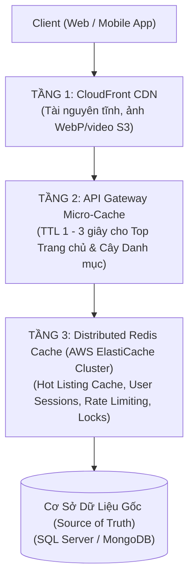
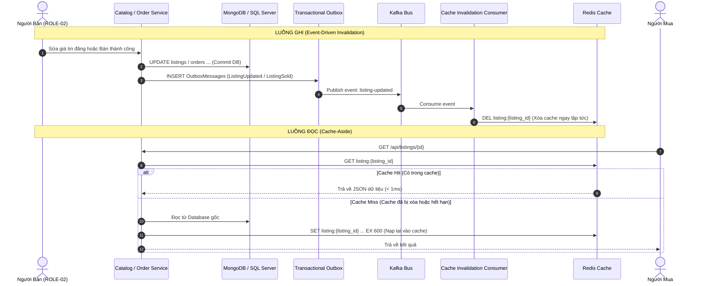

# Chiến Lược Caching & Mô Hình Đọc CQRS — Caching & Read Model Strategy

| Tài liệu | Chiến Lược Bộ Nhớ Đệm Đa Tầng & Mô Hình Đọc CQRS (Caching & CQRS) |
| :--- | :--- |
| **Dự án** | Nền tảng Thương mại Điện tử Đồ cũ C2C ReMarket |
| **Mã tài liệu** | `DOC-BA-05-CAC` |
| **Phiên bản** | v1.0 |
| **Trạng thái** | Chấp thuận (Approved) |
| **Phân hệ cha** | [docs/BA/05_domain-and-data/README.md](file:///d:/remarket-platform-system/docs/BA/05_domain-and-data/README.md) |
| **Liên kết truy vết** | [open-questions-and-decisions.md](file:///d:/remarket-platform-system/docs/BA/02_business-analysis/open-questions-and-decisions.md) (`DEC-DIR-03`, `DEC-DIR-06`, `Q-DATA-05`), [screen-inventory.md](file:///d:/remarket-platform-system/docs/BA/04_product-and-ux/screen-inventory.md) (`SCR-ADM-03`, `SCR-ADM-08`) |

---

## 1. Kiến Trúc Bộ Nhớ Đệm Đa Tầng (Multi-Layer Caching Architecture)

Để đạt mục tiêu thời gian phản hồi trang dưới **500ms cho 95% yêu cầu đọc (`NFR-PERF-01`)**, hệ thống triển khai kiến trúc Caching 3 tầng:



### 1.1. Bảng Quy Hoạch Không Gian Khóa Redis (Redis Key Namespace Design)

| Key Pattern | Cấu Trúc Dữ Liệu Redis | Thời Gian Sống (TTL) | Mục Đích Nghiệp Vụ & Quy Tắc Quản Lý |
| :--- | :--- | :---: | :--- |
| `listing:{listing_id}` | `String (JSON)` | 10 phút + Jitter | Cache thông tin chi tiết tin đăng đồ cũ phục vụ xem nhanh. |
| `listing:view_count:{id}` | `String (INCRBY)` | Vĩnh viễn | Bộ đếm lượt xem tin đăng; định kỳ 1 phút flush về MongoDB 1 lần. |
| `lock:listing:{listing_id}` | `String` | 15 phút (900s) | Distributed Lock chặn giữ chỗ đồng thời tại biên (`INV-01`). |
| `ryow:user:{user_id}` | `String (Boolean)` | 3 giây | Cờ Read-Your-Own-Writes định tuyến đọc về Primary DB. |
| `cart:{buyer_id}` | `Hash` | 30 ngày | Lưu danh sách món đồ quan tâm trong giỏ hàng (`BR-ORD-004`). |
| `ratelimit:ip:{ip}:{endpoint}` | `String (INCR)` | 60 giây | Giới hạn tần suất gọi API (VD: tối đa 60 requests/phút). |
| `session:{token_hash}` | `String (JSON)` | 24 giờ | Quản lý phiên đăng nhập và danh sách quyền hạn. |

- **Chính sách Giải phóng Bộ nhớ (Eviction Policy):** Cấu hình `volatile-lru` trên cụm Redis, chỉ tự động giải phóng các khóa có đặt thời hạn `TTL` khi bộ nhớ RAM đạt ngưỡng 90%, bảo vệ an toàn cho các cấu trúc không hết hạn.

---

## 2. Chiến Lược Đồng Bộ & Vô Hiệu Hóa Cache (Cache Invalidation)

Hệ thống kết hợp mẫu **Cache-Aside (Lazy Loading)** khi Đọc và **Event-Driven Invalidation** khi Ghi:



---

## 3. Giải Pháp Kỹ Thuật Chống 3 Sự Cố Kinh Điển Của Hệ Thống Cache

### 3.1. Chống Sập Do Đổ Xô Đọc Dữ Liệu Hết Hạn (Cache Stampede / Thundering Herd)
- **Kịch bản sự cố:** Một tin đăng đồ cũ cực hot (iPhone giá hời) có 10.000 người dùng liên tục bấm refresh xem tin. Đúng thời điểm khóa `listing:{id}` trên Redis hết hạn TTL, 10.000 requests đồng loạt gặp `Cache Miss` và cùng tràn xuống MongoDB để truy vấn, làm nghẽn CPU và sập CSDL trong tích tắc!
- **Giải pháp: Khóa Phân Tán Tái Tạo Cache (Distributed Mutex Lock):**
  - Chỉ duy nhất request đầu tiên gặp Cache Miss được cấp quyền lấy khóa `lock:rebuild:listing:{id}` để truy vấn Database và nạp lại Cache.
  - 9.999 requests còn lại không được đánh vào Database, mà phải tạm dừng ngủ 50ms hoặc sử dụng dữ liệu cũ ngắn hạn (Stale-while-revalidate).

```csharp
public async Task<ListingDto> GetListingAsync(string listingId)
{
    var cacheKey = $"listing:{listingId}";
    var cached = await _redis.StringGetAsync(cacheKey);
    if (!cached.IsNullOrEmpty) return JsonSerializer.Deserialize<ListingDto>(cached);

    // Dùng Mutex Lock: Chỉ 1 request được quyền truy vấn DB để tái tạo cache
    var lockKey = $"lock:rebuild:{listingId}";
    if (await _redis.StringSetAsync(lockKey, "locked", TimeSpan.FromSeconds(5), When.NotExists))
    {
        try {
            var dbData = await _mongoDb.FindListingByIdAsync(listingId);
            await _redis.StringSetAsync(cacheKey, JsonSerializer.Serialize(dbData), TimeSpan.FromMinutes(10));
            return dbData;
        } finally {
            await _redis.KeyDeleteAsync(lockKey);
        }
    }
    // Các luồng khác chờ 50ms và đọc lại từ cache đã được tái tạo
    await Task.Delay(50);
    return await GetListingAsync(listingId);
}
```

---

### 3.2. Chống Xuyên Thủng Cache Bởi ID Ảo (Cache Penetration)
- **Kịch bản sự cố:** Kẻ tấn công liên tục gửi hàng triệu request với các mã không tồn tại (VD: `GET /api/listings/LST-FAKE-999999`). Do ID ảo không có trong Cache, toàn bộ request đều xuyên thẳng vào Database, ép CSDL thực hiện Table Scan tìm kiếm vô vọng.
- **Giải pháp Phòng Thủ 3 Lớp:**
  1. **Kiểm tra cú pháp tại Gateway:** Kiểm tra định dạng ULID hợp lệ (26 ký tự Crockford Base32). Bác bỏ ngay mã sai định dạng tại API Gateway.
  2. **Bloom Filter:** Duy trì một bộ lọc Bloom Filter trên Redis chứa toàn bộ các `ListingId` thực tế đang tồn tại. Nếu Bloom Filter xác nhận một ID chắc chắn không tồn tại, từ chối ngay lập tức mà không gọi CSDL.
  3. **Null-Object Caching:** Nếu một ID hợp lệ được truy vấn vào DB nhưng không thấy kết quả, lưu ngay vào Redis giá trị rỗng `{ "exists": false }` với thời gian sống ngắn `TTL = 60s`.

---

### 3.3. Chống Tuyết Lở Do Hết Hạn Đồng Loạt (Cache Avalanche)
- **Kịch bản sự cố:** Vào lúc 08:00 sáng, hệ thống chạy batch job nạp 500.000 tin đăng vào Cache với cùng một thời hạn sống `TTL = 3600s` (1 giờ). Đúng 09:00:00 sáng, toàn bộ 500.000 khóa đồng loạt biến mất khỏi Redis → Hàng triệu request ập xuống CSDL cùng một giây gây sập toàn hệ thống.
- **Giải pháp: Bổ Sung Nhiễu Ngẫu Nhiên (Random TTL Jitter):**
  - Mọi câu lệnh nạp Cache đều bắt buộc cộng thêm một độ lệch ngẫu nhiên từ 10% đến 20%:
  $$\text{Actual\_TTL} = \text{Base\_TTL} + \text{random}(0, \text{Jitter\_Window})$$
  - Ví dụ: `Base_TTL = 600s` (10 phút) thì TTL thực tế sẽ dao động ngẫu nhiên từ `600s` đến `720s`. Thời điểm hết hạn của các khóa bị phân tán đều trên trục thời gian, triệt tiêu hoàn toàn nguy cơ sập đòn bẩy.

---

## 4. Mô Hình CQRS & Read Model 360° Cho Màn Hình Support (`SCR-ADM-03`)

### 4.1. Sự Cần Thiết Của Mô Hình CQRS (Command Query Responsibility Segregation)
Màn hình Bàn Tra cứu Giao dịch 360° của Chuyên viên Hỗ trợ (`SCR-ADM-03`) đòi hỏi hiển thị đồng thời:
- Trạng thái Đơn hàng và Snapshot sản phẩm (từ `OrderDB` - SQL Server).
- Trạng thái Thanh toán, Mã giao dịch ngân hàng và Quỹ Escrow (từ `PaymentDB` - SQL Server).
- Trạng thái Vận đơn và Checkpoints lộ trình thực tế (từ `ShippingDB` - MongoDB).
- Danh tính Buyer, Seller và Lịch sử vi phạm (từ `IdentityDB` & `TrustDB`).

Nếu thực hiện truy vấn trực tiếp bằng cách gọi API phân tán hoặc JOIN xuyên dịch vụ, hệ thống sẽ gặp các vấn đề: Độ trễ cao (> 3 giây), tăng tải cho các CSDL giao dịch cốt lõi và sập trang nếu 1 trong các dịch vụ phụ trợ gặp sự cố.

### 4.2. Kiến Trúc Đồng Bộ Bản Chiếu `Order360View`

```mermaid
flowchart TD
    subgraph WRITES["Các Dịch Vụ Giao Dịch Gốc (Command Side)"]
        ORD_SVC["OrderService (SQL Server)"]
        PAY_SVC["PaymentService (SQL Server)"]
        SHP_SVC["ShippingService (MongoDB)"]
    end

    ORD_SVC -->|Event: OrderConfirmed| KAFKA["Kafka Event Bus"]
    PAY_SVC -->|Event: PaymentCaptured| KAFKA
    SHP_SVC -->|Event: TrackingUpdated| KAFKA

    KAFKA --> PROJECTION_WORKER["360 Projection Consumer Worker"]
    
    PROJECTION_WORKER -->|Async Upsert| READ_STORE[("Read Model: Order360View\n(MongoDB / Elastic)\nĐã Tổng Hợp Sẵn Toàn Bộ Dữ Liệu 360°")]
    
    SUPPORT_UI["Bàn Tra Cứu Support\n(SCR-ADM-03)"] -->|Truy Vấn 1 Lần (< 20ms)| READ_STORE
```

### 4.3. Bộ Dò Lệch Pha Trạng Thái Đa Miền (Out-of-Sync Detector - `SCR-ADM-08`)
- **Nhiệm vụ:** Background Job định kỳ 30 giây quét `Order360View` để phát hiện các đơn hàng có trạng thái không đồng nhất giữa các miền:
  - Trường hợp cảnh báo đỏ: `PaymentState = 'Captured'` (Đã trừ tiền ngân hàng) nhưng `OrderState = 'Created'` (Đơn chưa xác nhận do lỗi mạng Saga) kéo dài quá **60 giây**.
  - Tự động phát cảnh báo lên màn hình Giám sát Vận hành (`SCR-ADM-08`) và kích hoạt quy trình bù trừ tự động hoặc cờ gắn vé can thiệp thủ công cho `ROLE-06`.

