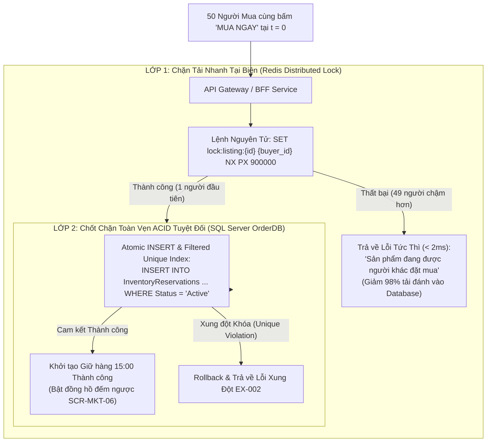
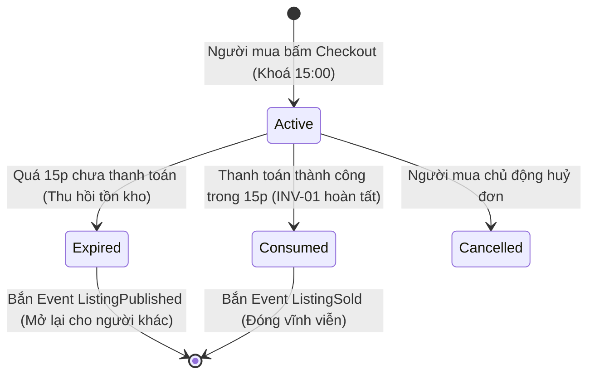
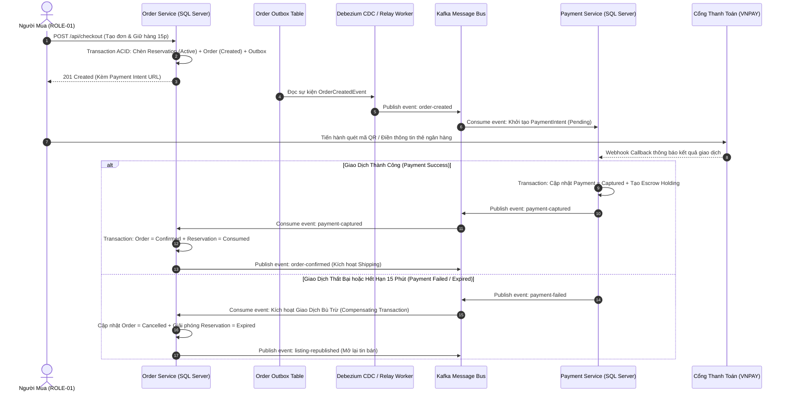

# Kiểm Soát Đồng Thời, Khóa Tồn Kho & Giao Dịch Phân Tán — Concurrency, Locking & Sagas

| Tài liệu | Kiểm Soát Đồng Thời, Khóa Tồn Kho & Giao Dịch Phân Tán (Concurrency & Sagas) |
| :--- | :--- |
| **Dự án** | Nền tảng Thương mại Điện tử Đồ cũ C2C ReMarket |
| **Mã tài liệu** | `DOC-BA-05-CON` |
| **Phiên bản** | v1.0 |
| **Trạng thái** | Chấp thuận (Approved) |
| **Phân hệ cha** | [docs/BA/05_domain-and-data/README.md](file:///d:/remarket-platform-system/docs/BA/05_domain-and-data/README.md) |
| **Liên kết truy vết** | [domain-model.md](file:///d:/remarket-platform-system/docs/BA/05_domain-and-data/domain-model.md), [business-rules.md](file:///d:/remarket-platform-system/docs/BA/02_business-analysis/business-rules.md) (`BR-ORD-003`), [functional-requirements.md](file:///d:/remarket-platform-system/docs/BA/03_requirements/functional-requirements.md) (`INV-01`, `INV-03`, `INV-04`) |

---

## 1. Giải Quyết Bài Toán Cốt Lõi `INV-01`: Chống Bán Trùng Hàng Đơn Chiếc (`Stock = 1`)

Khác với hàng hóa thông thường có số lượng tồn kho lớn, sản phẩm C2C đồ cũ tồn tại **duy nhất 1 món hàng vật lý** (`Stock = 1`). Khi một món đồ giá tốt xuất hiện, có thể có 50 người cùng bấm nút "Mua ngay" tại cùng một giây.

### 1.1. Kiến Trúc Phòng Thủ 2 Lớp (Two-Tier Reservation Guard)



### 1.2. Phân Tích So Sánh: Optimistic Locking vs Pessimistic Locking
Tại sao ReMarket **không sử dụng Pessimistic Lock dài hạn (`UPDLOCK, HOLDLOCK`)** trong suốt 15 phút người dùng ở màn hình Checkout?
- **Pessimistic Locking dài hạn:** Mở một Transaction và giữ khóa dòng trên CSDL suốt 15 phút chờ người dùng quét mã QR thanh toán.
  - *Hậu quả tai hại:* Chiếm dụng toàn bộ Connection Pool của dịch vụ, gây nghẽn kết nối diện rộng (Connection Pool Starvation), làm sập các luồng giao dịch khác và gây Deadlock dây chuyền.
- **Giải Pháp Chuẩn Của ReMarket: Atomic State Transition & Optimistic Concurrency:**
  - Khóa vật lý trên CSDL chỉ tồn tại trong **vài mili-giây** lúc thực thi câu lệnh chèn bản ghi giữ chỗ. Sau khi chèn xong, Transaction lập tức `COMMIT` và giải phóng toàn bộ khóa CSDL.
  - Tính toàn vẹn 15 phút được duy trì thông qua dữ liệu logic: Cột `ExpiresAt = SYSUTCDATETIME() + 15 phút` kết hợp ràng buộc **Filtered Unique Index** trên SQL Server (`UQ_Active_Listing_Reservation` - chỉ cho phép duy nhất 1 bản ghi `Status = 'Active'` cho một `ListingId`).

```sql
-- Lệnh chốt chặn ACID giữ chỗ 15 phút (Chạy trong Transaction cực ngắn < 5ms)
BEGIN TRANSACTION;

-- Kiểm tra xem đã có ai giữ chỗ hoặc mua sản phẩm này chưa
IF EXISTS (
    SELECT 1 FROM InventoryReservations WITH (UPDLOCK, HOLDLOCK)
    WHERE ListingId = @ListingId AND Status IN ('Active', 'Consumed')
)
BEGIN
    ROLLBACK TRANSACTION;
    THROW 50001, 'ERR_LISTING_ALREADY_RESERVED_OR_SOLD', 1;
END

-- Chèn bản ghi giữ chỗ độc quyền 15 phút
INSERT INTO InventoryReservations (
    ReservationId, ListingId, BuyerId, ReservedAt, ExpiresAt, Status
) VALUES (
    @ReservationId, @ListingId, @BuyerId, SYSUTCDATETIME(), DATEADD(minute, 15, SYSUTCDATETIME()), 'Active'
);

-- Ghi bản tin Outbox để đồng bộ sang Redis & Search Index
INSERT INTO OutboxMessages (
    MessageId, AggregateType, AggregateId, EventType, PayloadJSON, OccurredOn
) VALUES (
    @MsgId, 'Listing', @ListingId, 'ListingReservedEvent', @PayloadJSON, SYSUTCDATETIME()
);

COMMIT TRANSACTION;
```

---

## 2. Thiết Kế Cơ Chế Hết Hạn Giữ Hàng 15 Phút & Tự Động Thu Hồi (`BR-ORD-003`)

Hệ thống kết hợp 2 cơ chế đánh giá trạng thái song song để đảm bảo giải phóng tồn kho chính xác từng giây:



1. **Cơ Chế Thụ Động (Lazy Evaluation):** Mỗi khi có bất kỳ truy vấn nào đọc thông tin tin đăng hoặc khi người dùng bấm nút "Xác nhận thanh toán" tại `SCR-MKT-06`, hệ thống kiểm tra ngay điều kiện:
   $$\text{IF } \texttt{SYSUTCDATETIME()} > \texttt{ExpiresAt} \implies \text{Trạng thái lập tức bị coi là } \texttt{Expired}$$
2. **Cơ Chế Chủ Động (Active Background Sweeper Worker):**
   - Một tiến trình Worker ngầm chạy định kỳ **15 giây một lần**, quét Filtered Index `IX_Reservations_Active_Expiry` để tìm các đơn giữ hàng đã quá 15 phút mà chưa thanh toán:
   ```sql
   -- Worker thu hồi các đơn giữ chỗ quá hạn
   UPDATE TOP (100) InventoryReservations
   SET Status = 'Expired'
   OUTPUT inserted.ReservationId, inserted.ListingId, inserted.BuyerId
   WHERE Status = 'Active' AND ExpiresAt < SYSUTCDATETIME();
   ```
   - Lệnh `UPDATE` tự động sinh sự kiện `ReservationExpiredEvent` ghi vào `OutboxMessages` để thông báo cho `CatalogService` chuyển tin đăng về lại trạng thái `Published` và gửi thông báo `MOD-EXP-01` về trình duyệt của Buyer.

---

## 3. Quản Lý Giao Dịch Phân Tán (Saga Pattern & Outbox)

Do kiến trúc Database-per-Service cấm Distributed Transactions (2PC), các quy trình nghiệp vụ xuyên nhiều dịch vụ được điều phối thông qua **Orchestration-based Saga**.

### 3.1. Luồng Giao Dịch Đặt Hàng & Thanh Toán (Checkout & Payment Saga)



### 3.2. Đảm Bảo Tính Bất Khả Trùng Lặp (Idempotent Consumer & Inbox Pattern - `INV-03`)
Để đảm bảo bất biến `INV-03` (xử lý trùng lặp Webhook hoặc Consumer nhận 2 lần một bản tin Kafka không gây lỗi nghiệp vụ):
- Mỗi microservice duy trì bảng `InboxMessages`:
  ```sql
  CREATE TABLE InboxMessages (
      MessageId VARCHAR(64) NOT NULL,              -- IdempotencyKey từ Sender
      ConsumerName VARCHAR(50) NOT NULL,
      ReceivedAt DATETIME2(3) NOT NULL DEFAULT SYSUTCDATETIME(),
      CONSTRAINT PK_InboxMessages PRIMARY KEY (MessageId, ConsumerName)
  );
  ```
- Khi nhận sự kiện, Consumer bắt đầu một Transaction nội bộ: Chèn `MessageId` vào `InboxMessages`. Nếu vi phạm khóa chính trùng lặp (`Primary Key Violation 2627`), Consumer lập tức `ACK` bỏ qua bản tin và không xử lý lại nghiệp vụ.

---

## 4. Cấp Độ Cô Lập Giao Dịch CSDL (SQL Server Isolation Levels)

Để giải quyết bài toán xung đột khóa giữa luồng Ghi giao dịch và luồng Đọc báo cáo:
- Mọi CSDL quan hệ trong hệ sinh thái ReMarket đều bắt buộc kích hoạt chế độ **`READ_COMMITTED_SNAPSHOT` (RCSI)**:
  ```sql
  ALTER DATABASE OrderDB SET READ_COMMITTED_SNAPSHOT ON WITH ROLLBACK IMMEDIATE;
  ALTER DATABASE PaymentDB SET READ_COMMITTED_SNAPSHOT ON WITH ROLLBACK IMMEDIATE;
  ```
- **Lợi ích kỹ thuật vượt trội:**
  - **Đọc không khóa Ghi, Ghi không khóa Đọc:** Các câu lệnh `SELECT` tra cứu của Chuyên viên Hỗ trợ (`SCR-ADM-03`) sử dụng phiên bản bản ghi trong `tempdb` (Row Versioning), hoàn toàn không dựng Shared Lock (`S-Lock`).
  - Triệt tiêu 100% nguy cơ Deadlock giữa luồng Người mua đang chèn bản ghi đặt hàng và luồng Người bán đang đọc danh sách đơn bán!

