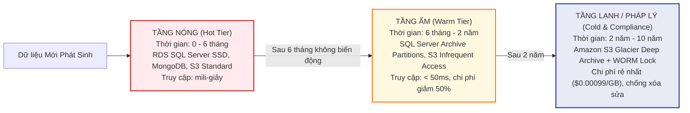
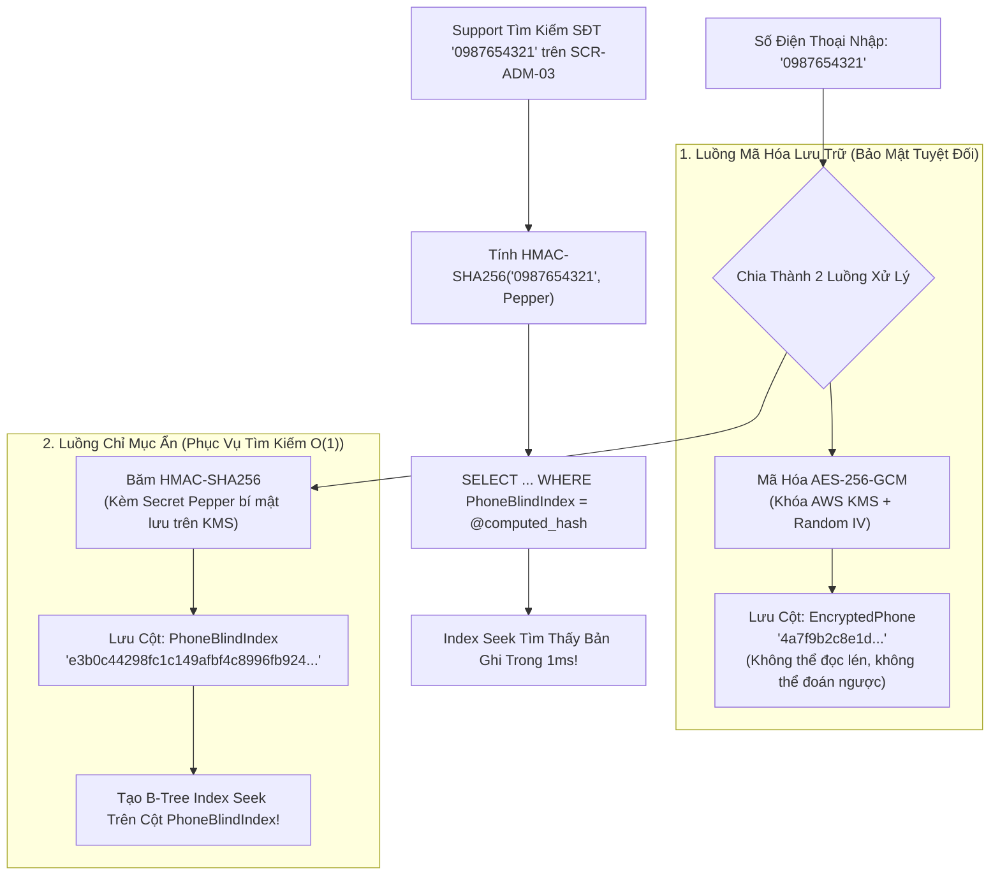
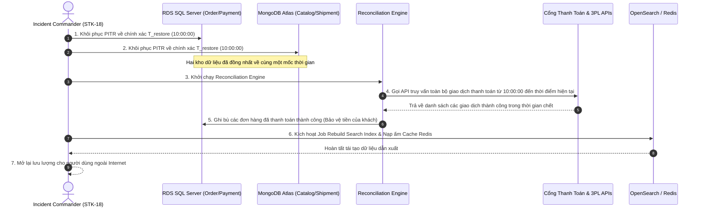

# Vòng Đời Dữ Liệu, Bảo Mật PII & Sao Lưu Phục Hồi — Data Lifecycle & DR

| Tài liệu | Quản Lý Vòng Đời Dữ Liệu, Mã Hóa PII & Chiến Lược Phục Hồi Thảm Họa (DR) |
| :--- | :--- |
| **Dự án** | Nền tảng Thương mại Điện tử Đồ cũ C2C ReMarket |
| **Mã tài liệu** | `DOC-BA-05-LIF` |
| **Phiên bản** | v1.0 |
| **Trạng thái** | Chấp thuận (Approved) |
| **Phân hệ cha** | [docs/BA/05_domain-and-data/README.md](file:///d:/remarket-platform-system/docs/BA/05_domain-and-data/README.md) |
| **Liên kết truy vết** | [open-questions-and-decisions.md](file:///d:/remarket-platform-system/docs/BA/02_business-analysis/open-questions-and-decisions.md) (`Q-DATA-07`, `Q-DR-01..05`), [non-functional-requirements.md](file:///d:/remarket-platform-system/docs/BA/03_requirements/non-functional-requirements.md) (`NFR-SEC-04`, `NFR-PRV-01`, `NFR-REC-01`) |

---

## 1. Phân Tầng Lưu Trữ Theo Vòng Đời Dữ Liệu (Data Tiering Architecture)

Nhằm tối ưu hóa chi phí lưu trữ đám mây (`NFR-COST-01`) nhưng vẫn tuân thủ nghiêm ngặt Luật Thương mại điện tử và Luật Kế toán về thời hạn lưu trữ chứng từ (tối thiểu 5 đến 10 năm), dữ liệu ReMarket được quản trị qua 3 tầng lưu trữ:

### Bảng Chính Sách Phân Tầng & Lưu Giữ Chi Tiết

| Phân Loại Dữ Liệu | Tầng Nóng (Hot Tier) | Tầng Ấm (Warm Tier) | Tầng Lạnh (Cold Tier) | Chính Sách Lưu Giữ & Hủy Dữ Liệu |
| :--- | :--- | :--- | :--- | :--- |
| **Đơn hàng & Snapshot** (`Orders`, `Snapshots`) | 0 – 6 tháng trên `OrderDB` | 6 tháng – 2 năm (Chuyển sang `Orders_Archive` partition) | 2 năm – 10 năm trên S3 Glacier | Lưu trữ 10 năm theo luật kế toán. Sau 10 năm xóa an toàn. |
| **Nhật ký Thanh toán** (`PaymentIntents`, `Escrow`) | 0 – 12 tháng trên `PaymentDB` | 1 – 5 năm trên Partition lưu trữ | 5 – 10 năm trên S3 Glacier WORM | Bắt buộc lưu vết kiểm toán tài chính 10 năm. |
| **Ảnh & Video Sản phẩm** (`Listing Media`) | 0 – 3 tháng trên S3 Standard | 3 tháng – 12 tháng (S3 One Zone-IA) | 1 năm – 3 năm (S3 Glacier Flexible) | Xóa vĩnh viễn sau 3 năm đối với các tin đã bán/hủy. |
| **Bằng Chứng Tranh Chấp** (`Dispute Evidences`) | 0 – 12 tháng trên S3 Standard | 1 – 3 năm trên S3 Standard-IA | 3 – 5 năm trên S3 Glacier WORM | Lưu giữ 5 năm để phục vụ đối soát khiếu nại pháp lý. |
| **Log Kiểm Toán Mở PII** (`SupportPIIAuditLogs`)| 0 – 12 tháng trên `TrustDB` | 1 – 3 năm trên Partition lưu trữ | 3 – 7 năm trên S3 Glacier WORM | **Cấm xóa sửa (Immutability)** theo quy chế an ninh sàn. |

---

## 2. Chính Sách Xóa, Ẩn Danh Hóa & Kỹ Thuật Bảo Mật PII (`NFR-SEC-04`)

### 2.1. Quy Tắc Cấm Xóa Vật Lý (No Hard Delete Rule)
- Tuyệt đối **không thực hiện xóa vật lý (`DELETE FROM ...`)** đối với bất kỳ bản ghi nào đã phát sinh giao dịch tài chính hoặc liên kết với đơn hàng (`Orders`, `PaymentTransactions`, `Shipments`).
- Mọi thao tác hủy tin hoặc xóa tài khoản đều sử dụng trạng thái logic (`Status = 'Archived'`, `IsDeleted = true`) nhằm bảo tồn tính toàn vẹn của sổ cái đối soát.

### 2.2. Kỹ Thuật Ẩn Danh Hóa Dữ Liệu Định Danh (Crypto-Shredding & Anonymization)
Khi người dùng thực hiện quyền yêu cầu xóa tài khoản cá nhân (Right to be Forgotten):
1. **Phân rã khóa mã hóa (Crypto-Shredding):** Hệ thống hủy bỏ khóa mã hóa riêng của người dùng đó lưu trên AWS KMS. Toàn bộ dữ liệu PII được mã hóa bằng khóa này sẽ vĩnh viễn trở thành chuỗi nhị phân vô nghĩa không thể giải mã.
2. **Ẩn danh hóa trên các bảng giao dịch lịch sử:**
   - Trường họ tên ghi đè thành: `[NGƯỜI DÙNG ĐÃ XÓA]`.
   - Trường số điện thoại ghi đè thành: `[ANONYMIZED]`.
   - Trường email ghi đè thành: `anonymized_{ulid}@deleted.remarket.local`.
   - Giữ nguyên số tiền, ngày giờ giao dịch và mã đơn hàng phục vụ báo cáo tài chính.

### 2.3. Kỹ Thuật Mã Hóa Mức Cột Kèm Chỉ Mục Ẩn (Field-Level Encryption & Blind Index)

#### Bài Toán Nghiệp Vụ Hóc Búa:
Theo quy định bảo mật `NFR-SEC-04`, số điện thoại và email của khách hàng phải được **mã hóa bảo vệ (AES-256-GCM)** trong cơ sở dữ liệu để chống lộ lọt nếu bị hacker đánh cắp bản backup CSDL. Tuy nhiên, Chuyên viên Hỗ trợ (`ROLE-04`) trên màn hình Tra cứu 360° (`SCR-ADM-03`) bắt buộc phải **tìm kiếm chính xác đơn hàng theo Số Điện Thoại** khách gọi vào!
- Nếu dùng thuật toán mã hóa ngẫu nhiên thông thường (có Salt/IV ngẫu nhiên), hai lần mã hóa cùng một SĐT sẽ cho ra 2 chuỗi khác nhau, khiến CSDL không thể dùng `WHERE phone = @encrypted_phone` hoặc đánh Index!

#### Giải Pháp Kiến Trúc: Blind Index (HMAC-SHA256)

- **Độ an toàn:** Kẻ tấn công dù có toàn bộ dữ liệu CSDL cũng không thể giải mã `PhoneBlindIndex` thành số điện thoại ban đầu vì hàm băm là một chiều và khóa Pepper bí mật được bảo vệ độc lập bên trong dịch vụ bảo mật AWS KMS.

---

## 3. Chiến Lược Sao Lưu, Point-in-Time Recovery & Khôi Phục Thảm Họa (DR)

### 3.1. Ma Trận Mục Tiêu RPO & RTO Theo Phân Cấp Dữ Liệu (`Q-DR-01..05`)

| Phân Cấp Dữ Liệu (Tier) | Hệ Thống Lưu Trữ | Cam Kết RPO (Mất dữ liệu tối đa) | Cam Kết RTO (Thời gian khôi phục tối đa) | Phương Thức Sao Lưu & Khôi Phục |
| :--- | :--- | :---: | :---: | :--- |
| **Tier 0: Giao Dịch & Tài Chính** | `OrderDB`, `PaymentDB` (SQL Server) | **RPO = 0** (Multi-AZ Sync) / **< 5 phút** (PITR) | **RTO < 30 phút** | RDS Automated Snapshots hàng ngày + Transaction Log Backup liên tục mỗi 5 phút (Point-in-Time Recovery). |
| **Tier 1: Tin Đăng & Danh Tính** | `CatalogDB` (MongoDB), `IdentityDB` | **RPO < 15 phút** | **RTO < 2 giờ** | Oplog Continuous Backup + Snapshot mỗi 6 giờ. |
| **Tier 2: Tệp Tin Đa Phương Tiện** | Amazon S3 Media Buckets | **RPO = 0** | **RTO < 1 giờ** | Bật S3 Versioning + S3 Cross-Region Replication (CRR) sang vùng dự phòng. |
| **Tier 3: Dữ Liệu Dẫn Xuất** | OpenSearch Index, Redis Cache | **RPO: Không áp dụng** (Dữ liệu dẫn xuất) | **RTO < 4 giờ** | Không cần backup định kỳ; Tự động tái tạo (Rebuild) từ dữ liệu gốc của Tier 0 và Tier 1. |

---

### 3.2. Quy Trình Khôi Phục Nhất Quán Đa Kho Dữ Liệu (Cross-Store Recovery & Reconciliation)

Khi xảy ra thảm họa nghiêm trọng buộc phải khôi phục hệ thống về thời điểm trong quá khứ ($T_{\text{restore}} = 10:00:00$):

