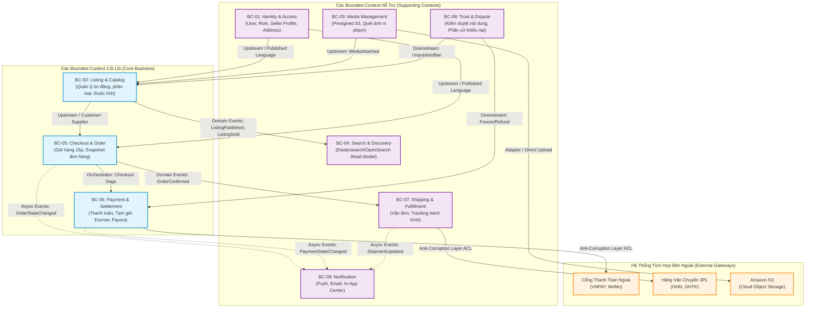
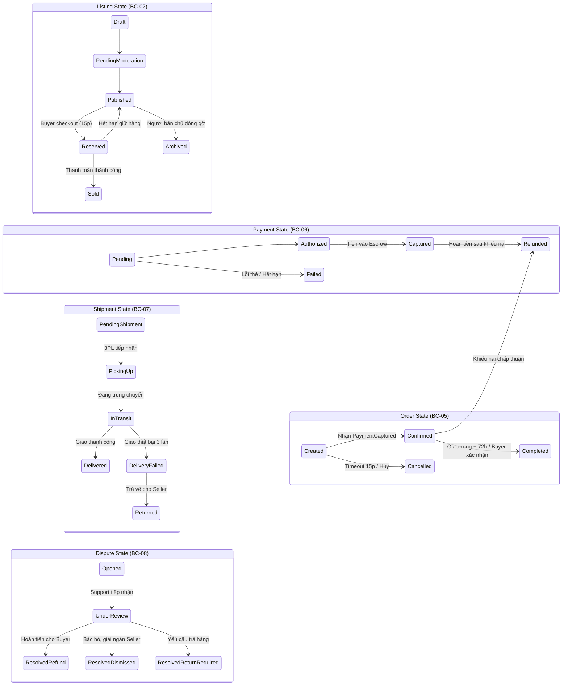

# Mô Hình Miền Nghiệp Vụ — Domain Model (DDD Specification)

| Tài liệu | Đặc tả Mô hình Miền Nghiệp vụ (Domain-Driven Design Specification) |
| :--- | :--- |
| **Dự án** | Nền tảng Thương mại Điện tử Đồ cũ C2C ReMarket |
| **Mã tài liệu** | `DOC-BA-05-DOM` |
| **Phiên bản** | v1.0 |
| **Trạng thái** | Chấp thuận (Approved) |
| **Phân hệ cha** | [docs/BA/05_domain-and-data/README.md](file:///d:/remarket-platform-system/docs/BA/05_domain-and-data/README.md) |
| **Liên kết truy vết** | [scope-and-boundaries.md](file:///d:/remarket-platform-system/docs/BA/00_project-context/scope-and-boundaries.md), [glossary.md](file:///d:/remarket-platform-system/docs/BA/00_project-context/glossary.md), [business-rules.md](file:///d:/remarket-platform-system/docs/BA/02_business-analysis/business-rules.md), [functional-requirements.md](file:///d:/remarket-platform-system/docs/BA/03_requirements/functional-requirements.md) |

---

## 1. Tổng Quan & Các Nguyên Tắc Thiết Kế Miền (Domain Principles)

Hệ thống ReMarket được thiết kế theo phương pháp **Domain-Driven Design (DDD)** dành cho kiến trúc Microservices phân tán, đáp ứng đặc thù thị trường C2C đồ cũ:
1. **Mỗi món hàng là duy nhất (`Unique SKU / Stock = 1` - `INV-01`):** Khác với thương mại điện tử thông thường có tồn kho nhiều số lượng, một tin đăng đồ cũ chỉ có duy nhất 1 đơn vị hàng hóa vật lý. Ranh giới Aggregate phải đảm bảo không bao giờ xảy ra bán trùng (Over-selling/Race condition).
2. **Ranh giới Bất Biến Giao dịch Độc Lập (Transactional Boundary):** Mỗi Aggregate chỉ đảm bảo tính toàn vẹn ACID trong phạm vi của chính nó. Không tồn tại Transaction xuyên Aggregate hay xuyên Bounded Context. Mọi tương tác xuyên miền đều thực hiện thông qua **Domain Events** và mô hình **Eventual Consistency** (Nhất quán sau cùng).
3. **Chỉ Tham Chiếu Bằng Định Danh Toàn Cục (Reference by Global ID Only):** Một Aggregate tuyệt đối không chứa tham chiếu trực tiếp đến đối tượng của Aggregate khác. Mọi quan hệ liên kết đều sử dụng mã định danh bất biến chuẩn **ULID / UUIDv7** (có thứ tự thời gian, chống đoán ID).
4. **Tách Biệt Bounded Contexts Nguồn Chuẩn (Source of Truth) và Dẫn Xuất (Derived/Read Models - `INV-02`):** `ListingContext`, `OrderContext`, `PaymentContext` sở hữu dữ liệu gốc bất biến. `SearchContext` và `NotificationContext` hoàn toàn là dữ liệu dẫn xuất được đồng bộ bất đồng bộ.

---

## 2. Bản Đồ Ngữ Cảnh Miền (Bounded Contexts & Context Map)

Hệ thống ReMarket phân rã thành **9 Bounded Contexts** độc lập:

### 2.1. Phân Tích Quan Hệ Context (Strategic DDD Patterns)
- **Anti-Corruption Layer (ACL):**
  - Giữa `Payment & Settlement` và các Cổng thanh toán (VNPAY, MoMo) nhằm chuyển đổi định dạng request/callback đặc thù của ngân hàng sang mô hình chuẩn nội bộ (`PaymentIntent`, `PaymentTransactionEvent`).
  - Giữa `Shipping & Fulfillment` và các đối tác vận chuyển 3PL (GHN, GHTK) theo quyết định `DEC-DIR-05`.
- **Customer-Supplier / Upstream-Downstream:**
  - `OrderContext` là Customer của `ListingContext`: Order yêu cầu khóa giữ hàng (`Hold Reservation`); Listing xác nhận hoặc từ chối do xung đột tồn kho.
  - `PaymentContext` là Downstream của `OrderContext`: Nhận lệnh khởi tạo thanh toán theo bảng phân tích chi phí từ Order.
- **Published Language / Domain Events:**
  - Các sự kiện miền chuẩn hóa (`ListingPublishedEvent`, `OrderConfirmedEvent`, `ShipmentDeliveredEvent`) làm giao thức chung để `SearchContext` và `NotificationContext` tiêu thụ.

---

## 3. Đặc Tả Chi Tiết Từng Bounded Context

### 3.1. `BC-01: Identity & Access Context`
- **Mục tiêu:** Quản lý danh tính người dùng, hồ sơ người bán (KYC), sổ địa chỉ và vai trò truy cập (`ROLE-00` đến `ROLE-06`).
- **Aggregates:**
  - **`UserAggregate` (Aggregate Root: `User`):**
    - *Entities:* `User`, `SellerProfile`, `UserAddress`.
    - *Value Objects:* `EmailAddress`, `PhoneNumber` (hỗ trợ che giấu PII), `FullName`, `AddressDetail` (Tỉnh/Huyện/Xã/Đường), `BankAccount` (Tên ngân hàng, Số tài khoản, Chủ tài khoản), `KYCStatus` (`Unverified`, `Pending`, `Verified`, `Rejected`).
    - *Bất biến (Invariants):* Mỗi tài khoản có duy nhất 1 số điện thoại xác thực; Địa chỉ mặc định chỉ có duy nhất 1 địa chỉ tại một thời điểm.

---

### 3.2. `BC-02: Listing & Catalog Context`
- **Mục tiêu:** Quản lý vòng đời tin đăng đồ cũ, phân cấp danh mục, bảng khai báo tình trạng và khuyết điểm sản phẩm.
- **Aggregates:**
  - **`ListingAggregate` (Aggregate Root: `Listing`):**
    - *Entities:* `Listing`, `ListingPhoto`, `DynamicAttributeValue`.
    - *Value Objects:* `Money` (Số tiền `DECIMAL(18,2)` + Đơn vị `VND`), `ConditionGrade` (`COND-NEW`, `COND-EXC`, `COND-GOOD`, `COND-FAIR`, `COND-PART` - `BR-PRO-001`), `DefectDisclosure` (mô tả vết xước, phụ kiện thiếu, ảnh chụp cận cảnh khuyết điểm), `SerialMasked` (số IMEI/Serial đã che 4 số cuối), `PackageDimension` (Dài x Rộng x Cao cm, Khối lượng gram).
    - *Máy trạng thái Listing:* `Draft` → `PendingModeration` → `Published` ↔ `Reserved` → `Sold` (hoặc `Archived`, `Rejected`).
    - *Bất biến (Invariants):* Chỉ tin đăng ở trạng thái `Published` mới được phép giữ chỗ (`Reserved`) hoặc hiển thị trong kết quả tìm kiếm công khai; Tin đăng đã chuyển sang `Sold` là bất biến, không thể sửa đổi giá hoặc tình trạng.
  - **`CategoryAggregate` (Aggregate Root: `Category`):**
    - *Entities:* `Category`, `CategoryAttributeDefinition`.
    - *Value Objects:* `CategoryPath` (Materialized path: `/electronics/phones/iphone`), `AttributeDataType` (Text, Number, Dropdown, Multi-select).

---

### 3.3. `BC-03: Media Management Context`
- **Mục tiêu:** Quản lý quy trình cấp phép tải ảnh trực tiếp lên Amazon S3 qua Presigned URL (`FR-MED-01..03`) và điều phối xử lý kiểm duyệt hình ảnh.
- **Aggregates:**
  - **`MediaAssetAggregate` (Aggregate Root: `MediaAsset`):**
    - *Entities:* `MediaAsset`.
    - *Value Objects:* `S3StorageKey`, `FileHash` (SHA-256 chống tải ảnh trùng), `MimeType`, `ImageDimensions`, `ModerationStatus` (`Clean`, `FlaggedViolent`, `FlaggedAdult`).

---

### 3.4. `BC-04: Search & Discovery Context (Read-Only Derived Model)`
- **Mục tiêu:** Cung cấp trải nghiệm tìm kiếm toàn văn tiếng Việt, lọc đa diện (Faceted filter) và sắp xếp tối ưu cho đồ cũ.
- **Mô hình tài liệu (Read Model):**
  - `ListingSearchDocument`: Chứa thông tin phẳng gồm Tiêu đề, Mô tả đã chuẩn hóa tiếng Việt, Danh mục cha-con, Khoảng giá, Tình trạng `ConditionGrade`, Tọa độ địa lý người bán (`geo_point`), Điểm uy tín người bán, và nhãn khả dụng (`is_available = true` khi `Published`).
  - *Nguyên tắc:* Dữ liệu chỉ dùng để đọc (`Read Model`). Quyết định mua hàng tại bước Checkout bắt buộc kiểm tra trực tiếp sang `ListingContext` (Source of Truth).

---

### 3.5. `BC-05: Checkout & Order Context`
- **Mục tiêu:** Chốt chặn giao dịch giữ hàng độc quyền 15 phút, tính toán bảng giá minh bạch, lưu trữ snapshot sản phẩm bất biến và điều phối Saga đặt hàng.
- **Aggregates:**
  - **`ReservationAggregate` (Aggregate Root: `InventoryReservation`):**
    - *Entities:* `InventoryReservation`.
    - *Value Objects:* `ListingId`, `BuyerId`, `ReservedAt`, `ExpiresAt` (`ReservedAt + 15 phút` - `BR-ORD-003`), `ReservationStatus` (`Active`, `Consumed`, `Expired`, `Cancelled`).
    - *Bất biến Cốt lõi (`INV-01`):* Tại một thời điểm, chỉ tồn tại duy nhất **1 bản ghi Reservation ở trạng thái `Active`** cho một `ListingId`. Mọi yêu cầu giữ chỗ đồng thời thứ 2 phải lập tức bị chặn.
  - **`OrderAggregate` (Aggregate Root: `Order`):**
    - *Entities:* `Order`, `ImmutableListingSnapshot` (`BR-ORD-009`), `OrderStateLog`.
    - *Value Objects:* `PriceBreakdown` (Tiền hàng + Phí bảo vệ người mua `BR-PAY-010` + Phí vận chuyển - Giảm giá = Tổng thanh toán), `ShippingAddressSnapshot` (sao chép bất biến địa chỉ lúc đặt hàng), `OrderStatus` (`Created` → `Confirmed` → `Completed` / `Cancelled` / `Refunded`).
    - *Bất biến (Invariants):* Một đơn hàng C2C chỉ chứa sản phẩm từ duy nhất 1 người bán (`Q-BIZ-10`); Sau khi đơn hàng đã tạo, `ImmutableListingSnapshot` không bao giờ bị thay đổi dù người bán có sửa đổi thông tin gì sau đó.

---

### 3.6. `BC-06: Payment & Settlement Context`
- **Mục tiêu:** Quản lý giao dịch thanh toán trực tuyến, giữ tiền tạm giữ bảo vệ (Escrow Account), ra lệnh hoàn tiền và điều phối giải ngân định kỳ (`Batch Payout`).
- **Aggregates:**
  - **`PaymentIntentAggregate` (Aggregate Root: `PaymentIntent`):**
    - *Entities:* `PaymentIntent`, `PaymentTransaction`, `ExternalGatewayLog`.
    - *Value Objects:* `GatewayProvider` (VNPAY, MoMo), `IdempotencyKey` (Chống trừ tiền 2 lần - `INV-03`), `PaymentStatus` (`Pending` → `Authorized` → `Captured` / `Refunded` / `Failed`).
  - **`EscrowAccountAggregate` (Aggregate Root: `EscrowEntry`):**
    - *Entities:* `EscrowEntry`, `SettlementBatch`.
    - *Value Objects:* `OrderId`, `SellerId`, `NetSellerAmount` (Số tiền nhận ròng sau trừ phí sàn), `ReleaseHoldUntil` (Thời điểm giao hàng thành công + 72 giờ - `BR-PAY-007`), `EscrowStatus` (`Holding`, `Released`, `FrozenByDispute`, `RefundedToBuyer`).
    - *Bất biến (Invariants):* Tiền tạm giữ chỉ được chuyển sang `Released` khi thỏa mãn 2 điều kiện: Đơn hàng ở trạng thái `Delivered` quá 72 giờ HOẶC Buyer bấm "Đã nhận hàng" sớm, VÀ không có hồ sơ tranh chấp `Dispute` nào đang mở (`BR-PAY-007`).

---

### 3.7. `BC-07: Shipping & Fulfillment Context`
- **Mục tiêu:** Giao tiếp với đối tác vận chuyển 3PL qua Adapter (`DEC-DIR-05`), cấp mã tracking, cập nhật trạng thái giao nhận và quản lý khiếu nại giao trễ.
- **Aggregates:**
  - **`ShipmentAggregate` (Aggregate Root: `Shipment`):**
    - *Entities:* `Shipment`, `TrackingCheckpoint`.
    - *Value Objects:* `CarrierProvider` (GHN, GHTK), `TrackingNumber`, `ShippingFeeActual`, `PackageWeightGram`, `ShipmentStatus` (`Pending` → `PickingUp` → `InTransit` → `Delivered` / `DeliveryFailed` / `Returned`).
    - *Bất biến (Invariants):* Chỉ được phép tạo vận đơn khi `Order` đã chuyển sang `Confirmed` (tiền thanh toán đã vào Escrow - `BR-SHP-001`); Địa chỉ giao hàng của người mua chỉ được công bố cho người bán sau mốc này (`BR-SEC-004`).

---

### 3.8. `BC-08: Trust, Moderation & Dispute Context`
- **Mục tiêu:** Quản lý hàng đợi kiểm duyệt tin đăng, xử lý báo cáo vi phạm nội dung và phân xử tranh chấp hoàn tiền giữa Buyer và Seller.
- **Aggregates:**
  - **`ModerationTicketAggregate` (Aggregate Root: `ModerationTicket`):**
    - *Entities:* `ModerationTicket`, `ViolationEvidence`.
    - *Value Objects:* `FlaggedReason` (Từ khóa cấm, Nghi vấn hàng giả, Báo cáo từ cộng đồng), `ModerationVerdict` (`Approved`, `RejectedWithReason`, `SellerWarned`).
  - **`DisputeCaseAggregate` (Aggregate Root: `DisputeCase`):**
    - *Entities:* `DisputeCase`, `DisputeEvidence` (Ảnh/Video unboxing lúc nhận hàng của Buyer vs Ảnh đăng bán của Seller), `ArbitrationDecision`.
    - *Value Objects:* `DisputeReason` (Hàng không đúng mô tả, Hàng lỗi ẩn không khai báo, Hàng vỡ do vận chuyển), `DisputeStatus` (`Opened` → `UnderReview` → `ResolvedRefund` / `ResolvedDismissed` / `ResolvedReturnRequired`).
    - *Bất biến (Invariants):* Mở tranh chấp lập tức kích hoạt sự kiện `DisputeOpenedEvent` khiến `EscrowEntry` tương ứng bị khóa trạng thái `FrozenByDispute`, ngăn chặn toàn bộ tiến trình payout tự động (`BR-DSP-002`).

---

### 3.9. `BC-09: Notification Context`
- **Mục tiêu:** Điều phối gửi thông báo đa kênh (In-app Bell, Push Notification, Email) dựa trên các sự kiện miền từ các Bounded Contexts khác.
- **Aggregates:**
  - **`NotificationAggregate` (Aggregate Root: `Notification`):**
    - *Entities:* `Notification`.
    - *Value Objects:* `RecipientId`, `Channel` (InApp, Email, Push), `NotificationType` (OrderUpdate, PaymentReceipt, HoldReminder, SecurityAlert), `ReadStatus` (`Unread`, `Read`), `DeepLinkUrl`.

---

## 4. Ánh Xạ 5 Máy Trạng Thái Chuẩn & 5 Bất Biến Miền (`INV-01..05`)

### 4.1. Ma Trận Ánh Xạ 5 Máy Trạng Thái Sang Bounded Contexts
Đảm bảo đồng nhất 100% với định nghĩa trong [glossary.md](file:///d:/remarket-platform-system/docs/BA/00_project-context/glossary.md) §3:

### 4.2. Danh Sách 5 Bất Biến Miền Bắt Buộc Tuân Thủ (`INV-01..05`)
- **`INV-01` (Chống Bán Trùng Đồ Cũ):** Không một món hàng nào (`Listing`) có thể được giữ chỗ bởi 2 người mua cùng lúc (`Unique Reservation`). Khi một `Reservation` ở trạng thái `Active`, mọi yêu cầu khác đối với món hàng đó đều bị từ chối tức thì.
- **`INV-02` (Độc Lập 3 Miền Trạng Thái):** Hệ thống không bao giờ gộp hoặc giả định trạng thái của nhau. `Order = Confirmed` chỉ khi có sự kiện thực tế `Payment = Captured`. Nếu cổng thanh toán phản hồi `Pending`, Order vẫn giữ `Created` và giao diện phải phản ánh đúng sự thật này (`NFR-USA-03`).
- **`INV-03` (Bảo Toàn Tính Idempotency):** Xử lý lặp lại cùng một Webhook thanh toán từ ngân hàng hoặc cùng một thao tác bấm nút "Xác nhận thanh toán / Hoàn tiền" không bao giờ tạo ra bản ghi trừ/cộng tiền thứ hai.
- **`INV-04` (Đóng Băng Tiền Khi Có Tranh Chấp):** Khi có sự kiện `DisputeOpenedEvent`, tài khoản tạm giữ Escrow liên quan lập tức chuyển sang `FrozenByDispute`. Tiền không thể giải ngân cho Người bán cho đến khi có phán quyết cuối cùng từ Chuyên viên Hỗ trợ (`ROLE-04`).
- **`INV-05` (Bất Biến Hồ Sơ Giao Dịch Đã Chốt):** Sau khi đơn hàng được tạo thành công, toàn bộ dữ liệu mô tả, ảnh, giá bán và tình trạng sản phẩm được cố định trong `ImmutableListingSnapshot`. Người bán hoặc quản trị viên không thể sửa đổi nội dung này nhằm bảo vệ căn cứ pháp lý đối soát.

