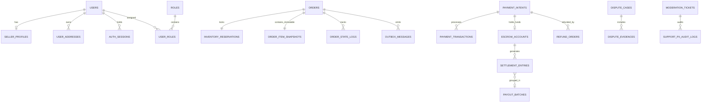

# Mô Hình Quan Hệ Thực Thể — Entity-Relationship Model (Polyglot ERD)

| Tài liệu | Đặc tả Mô hình Dữ liệu Vật lý & Logic (Polyglot ERD & Document Schemas) |
| :--- | :--- |
| **Dự án** | Nền tảng Thương mại Điện tử Đồ cũ C2C ReMarket |
| **Mã tài liệu** | `DOC-BA-05-ERD` |
| **Phiên bản** | v1.0 |
| **Trạng thái** | Chấp thuận (Approved) |
| **Phân hệ cha** | [docs/BA/05_domain-and-data/README.md](file:///d:/remarket-platform-system/docs/BA/05_domain-and-data/README.md) |
| **Liên kết truy vết** | [domain-model.md](file:///d:/remarket-platform-system/docs/BA/05_domain-and-data/domain-model.md), [business-rules.md](file:///d:/remarket-platform-system/docs/BA/02_business-analysis/business-rules.md), [open-questions-and-decisions.md](file:///d:/remarket-platform-system/docs/BA/02_business-analysis/open-questions-and-decisions.md) (`DEC-DIR-01..03`) |

---

## 1. Triết Lý Thiết Kế Schema Trong Hệ Thống Phân Tán

### 1.1. Nguyên Tắc Database-per-Service
Theo định hướng kiến trúc Microservices và quyết định `DEC-DIR-06`, mỗi dịch vụ sở hữu cơ sở dữ liệu riêng biệt:
- **Tuyệt đối không có Foreign Key vật lý xuyên Database:** Các bảng giữa các microservice chỉ liên kết logic thông qua mã định danh bất biến toàn cục.
- **Không sử dụng Cross-Database Queries hoặc Distributed Transactions (2PC):** Đảm bảo tính độc lập khi triển khai, cô lập vùng ảnh hưởng khi gặp sự cố (Fault Isolation) và cho phép scale độc lập từng cơ sở dữ liệu.

### 1.2. Chiến Lược Sinh Khóa Chính Kép (Dual-Key Strategy)
Trên hệ quản trị CSDL quan hệ **SQL Server**, việc sử dụng trực tiếp chuỗi ngẫu nhiên (UUIDv4) làm Clustered Primary Key dẫn đến hiện tượng **Phân mảnh Index nghiêm trọng (Index Fragmentation)** và **Tách trang liên tục (Page Splits)** khi số lượng bản ghi tăng cao. ReMarket chuẩn hóa chiến lược Dual-Key:
1. **Khóa Vật lý Nội bộ (`InternalId` - Clustered PK):** Sử dụng kiểu `BIGINT IDENTITY(1,1)` tăng dần liên tục. Khóa này chỉ dùng nội bộ trong CSDL của chính microservice đó để phục vụ đánh Clustered Index tối ưu dung lượng B-Tree trong bộ nhớ đệm (Buffer Pool).
2. **Khóa Định danh Công khai (`PublicId` - Non-Clustered Unique Key):** Sử dụng định dạng **ULID (Universally Unique Lexicographically Sortable Identifier)** hoặc **UUIDv7** (128-bit nhúng dấu thời gian mili-giây ở đầu). Khóa này dùng để hiển thị trên giao diện người dùng (URL, API Request/Response) và gửi qua các bản tin sự kiện Kafka/Outbox, ngăn chặn triệt để hành vi đoán ID tuần tự (`Insecure Direct Object References - IDOR`).

---

## 2. Mô Hình Dữ Liệu SQL Server (Relational Transaction Stores)

Cụm SQL Server phụ trách các miền đòi hỏi tính toàn vẹn ACID tuyệt đối, ghi nhật ký giao dịch và sổ cái đối soát tài chính (`DEC-DIR-01`).



### 2.1. Phân Hệ Cơ Sở Dữ Liệu `OrderDB`
Đảm bảo bất biến `INV-01` (chống bán trùng) và `INV-05` (snapshot bất biến).

```sql
-- Bảng InventoryReservations: Chốt chặn khóa giữ hàng 15 phút (INV-01)
CREATE TABLE InventoryReservations (
    InternalId BIGINT IDENTITY(1,1) NOT NULL,
    ReservationId VARCHAR(26) NOT NULL,            -- Public ULID
    ListingId VARCHAR(26) NOT NULL,                -- Reference sang CatalogDB
    BuyerId VARCHAR(26) NOT NULL,                  -- Reference sang IdentityDB
    ReservedAt DATETIME2(3) NOT NULL,
    ExpiresAt DATETIME2(3) NOT NULL,              -- ReservedAt + 15 phút (BR-ORD-003)
    Status VARCHAR(20) NOT NULL,                  -- Active, Consumed, Expired, Cancelled
    RowVersion ROWVERSION NOT NULL,               -- Optimistic Concurrency Control
    CreatedAt DATETIME2(3) NOT NULL DEFAULT SYSUTCDATETIME(),
    CONSTRAINT PK_InventoryReservations PRIMARY KEY CLUSTERED (InternalId),
    CONSTRAINT UQ_InventoryReservations_PublicId UNIQUE (ReservationId)
);
-- Unique Index có điều kiện: Tại 1 thời điểm chỉ có 1 Reservation Active cho 1 món hàng
CREATE UNIQUE NONCLUSTERED INDEX UQ_Active_Listing_Reservation
ON InventoryReservations(ListingId)
WHERE Status = 'Active';

-- Bảng Orders: Quản lý vòng đời đơn hàng
CREATE TABLE Orders (
    InternalId BIGINT IDENTITY(1,1) NOT NULL,
    OrderId VARCHAR(26) NOT NULL,                  -- Public ULID (ORD-...)
    BuyerId VARCHAR(26) NOT NULL,
    SellerId VARCHAR(26) NOT NULL,
    ListingId VARCHAR(26) NOT NULL,
    ReservationId VARCHAR(26) NOT NULL,
    ItemPrice DECIMAL(18,2) NOT NULL,
    BuyerProtectionFee DECIMAL(18,2) NOT NULL,    -- BR-PAY-010
    ShippingFee DECIMAL(18,2) NOT NULL,
    DiscountAmount DECIMAL(18,2) NOT NULL DEFAULT 0.00,
    TotalAmount DECIMAL(18,2) NOT NULL,
    CurrencyCode CHAR(3) NOT NULL DEFAULT 'VND',
    OrderStatus VARCHAR(20) NOT NULL,             -- Created, Confirmed, Completed, Cancelled, Refunded
    DeliveryMethod VARCHAR(20) NOT NULL,          -- Standard3PL, Pickup
    RowVersion ROWVERSION NOT NULL,
    CreatedAt DATETIME2(3) NOT NULL DEFAULT SYSUTCDATETIME(),
    UpdatedAt DATETIME2(3) NOT NULL DEFAULT SYSUTCDATETIME(),
    CONSTRAINT PK_Orders PRIMARY KEY CLUSTERED (InternalId),
    CONSTRAINT UQ_Orders_PublicId UNIQUE (OrderId)
);

-- Bảng OrderItemSnapshots: Snapshot bất biến (INV-05, BR-ORD-009)
CREATE TABLE OrderItemSnapshots (
    InternalId BIGINT IDENTITY(1,1) NOT NULL,
    OrderId VARCHAR(26) NOT NULL,
    TitleAtPurchase NVARCHAR(255) NOT NULL,
    DescriptionAtPurchase NVARCHAR(MAX) NOT NULL,
    ConditionGrade VARCHAR(20) NOT NULL,
    DefectDisclosureJSON NVARCHAR(MAX) NOT NULL,   -- Lưu toàn bộ khuyết điểm đã khai báo
    SerialIMEIMasked VARCHAR(50) NULL,
    PhotosSnapshotJSON NVARCHAR(MAX) NOT NULL,     -- Danh sách URLs ảnh S3 lúc mua
    PriceAtPurchase DECIMAL(18,2) NOT NULL,
    SnapshotCreatedAt DATETIME2(3) NOT NULL DEFAULT SYSUTCDATETIME(),
    CONSTRAINT PK_OrderItemSnapshots PRIMARY KEY CLUSTERED (InternalId),
    CONSTRAINT UQ_OrderItemSnapshots_OrderId UNIQUE (OrderId)
);

-- Bảng Transactional Outbox (Hỗ trợ Saga & Message Relay)
CREATE TABLE OutboxMessages (
    InternalId BIGINT IDENTITY(1,1) NOT NULL,
    MessageId VARCHAR(26) NOT NULL,
    AggregateType VARCHAR(50) NOT NULL,            -- Order, Reservation
    AggregateId VARCHAR(26) NOT NULL,
    EventType VARCHAR(100) NOT NULL,               -- OrderCreatedEvent, OrderConfirmedEvent
    PayloadJSON NVARCHAR(MAX) NOT NULL,
    OccurredOn DATETIME2(3) NOT NULL,
    ProcessedAt DATETIME2(3) NULL,
    RetryCount INT NOT NULL DEFAULT 0,
    LastError NVARCHAR(MAX) NULL,
    CONSTRAINT PK_OutboxMessages PRIMARY KEY CLUSTERED (InternalId)
);
```

---

### 2.2. Phân Hệ Cơ Sở Dữ Liệu `PaymentDB`
Đảm bảo tính bất biến của sổ cái kế toán và xử lý tạm giữ quỹ Escrow (`BR-PAY-007`).

```sql
-- Bảng PaymentIntents: Ý định thanh toán
CREATE TABLE PaymentIntents (
    InternalId BIGINT IDENTITY(1,1) NOT NULL,
    PaymentIntentId VARCHAR(26) NOT NULL,
    OrderId VARCHAR(26) NOT NULL,
    BuyerId VARCHAR(26) NOT NULL,
    Amount DECIMAL(18,2) NOT NULL,
    CurrencyCode CHAR(3) NOT NULL DEFAULT 'VND',
    GatewayProvider VARCHAR(20) NOT NULL,          -- VNPAY, MOMO
    IdempotencyKey VARCHAR(64) NOT NULL,          -- INV-03 chống trừ tiền 2 lần
    PaymentStatus VARCHAR(20) NOT NULL,           -- Pending, Authorized, Captured, Refunded, Failed
    GatewayTransactionId VARCHAR(100) NULL,       -- Mã GD trả về từ ngân hàng
    CreatedAt DATETIME2(3) NOT NULL DEFAULT SYSUTCDATETIME(),
    ExpiresAt DATETIME2(3) NOT NULL,
    CONSTRAINT PK_PaymentIntents PRIMARY KEY CLUSTERED (InternalId),
    CONSTRAINT UQ_PaymentIntents_Idempotency UNIQUE (IdempotencyKey)
);

-- Bảng EscrowAccounts: Tài khoản giữ tiền bán hàng đồ cũ (Escrow)
CREATE TABLE EscrowAccounts (
    InternalId BIGINT IDENTITY(1,1) NOT NULL,
    EscrowId VARCHAR(26) NOT NULL,
    OrderId VARCHAR(26) NOT NULL,
    SellerId VARCHAR(26) NOT NULL,
    GrossAmount DECIMAL(18,2) NOT NULL,
    PlatformFeeAmount DECIMAL(18,2) NOT NULL,      -- Phí hoa hồng sàn 3-5%
    BuyerProtectionFee DECIMAL(18,2) NOT NULL,
    NetSellerAmount DECIMAL(18,2) NOT NULL,        -- Tiền thực nhận của Seller
    EscrowStatus VARCHAR(20) NOT NULL,            -- Holding, Released, FrozenByDispute, Refunded
    ReleaseHoldUntil DATETIME2(3) NULL,           -- DeliveredAt + 72h (BR-PAY-007)
    CreatedAt DATETIME2(3) NOT NULL DEFAULT SYSUTCDATETIME(),
    SettledAt DATETIME2(3) NULL,
    CONSTRAINT PK_EscrowAccounts PRIMARY KEY CLUSTERED (InternalId),
    CONSTRAINT UQ_EscrowAccounts_OrderId UNIQUE (OrderId)
);
```

---

### 2.3. Phân Hệ Cơ Sở Dữ Liệu `TrustSupportDB`
Quản lý khiếu nại tranh chấp và ghi nhận nhật ký kiểm toán truy cập PII (`FR-SUP-02`).

```sql
-- Bảng DisputeCases: Hồ sơ tranh chấp
CREATE TABLE DisputeCases (
    InternalId BIGINT IDENTITY(1,1) NOT NULL,
    DisputeId VARCHAR(26) NOT NULL,
    OrderId VARCHAR(26) NOT NULL,
    BuyerId VARCHAR(26) NOT NULL,
    SellerId VARCHAR(26) NOT NULL,
    DisputeReason VARCHAR(50) NOT NULL,
    DisputeStatus VARCHAR(30) NOT NULL,           -- Opened, UnderReview, ResolvedRefund, ResolvedDismissed
    BuyerClaimDetails NVARCHAR(MAX) NOT NULL,
    SellerResponse NVARCHAR(MAX) NULL,
    ArbitratorStaffId VARCHAR(26) NULL,           -- ROLE-04 Support Agent
    ArbitrationDecision NVARCHAR(MAX) NULL,
    RefundAmount DECIMAL(18,2) NULL,
    OpenedAt DATETIME2(3) NOT NULL DEFAULT SYSUTCDATETIME(),
    ResolvedAt DATETIME2(3) NULL,
    CONSTRAINT PK_DisputeCases PRIMARY KEY CLUSTERED (InternalId)
);

-- Bảng SupportPIIAuditLogs: Nhật ký kiểm toán mở khóa PII (FR-SUP-02, BR-SEC-003)
CREATE TABLE SupportPIIAuditLogs (
    InternalId BIGINT IDENTITY(1,1) NOT NULL,
    AuditId VARCHAR(26) NOT NULL,
    StaffId VARCHAR(26) NOT NULL,                  -- ROLE-04
    TargetUserId VARCHAR(26) NOT NULL,
    TicketId VARCHAR(50) NOT NULL,
    AccessReason VARCHAR(100) NOT NULL,
    FieldsAccessed NVARCHAR(255) NOT NULL,        -- SĐT, Địa chỉ, Email
    IpAddress VARCHAR(45) NOT NULL,
    AccessedAt DATETIME2(3) NOT NULL DEFAULT SYSUTCDATETIME(),
    CONSTRAINT PK_SupportPIIAuditLogs PRIMARY KEY CLUSTERED (InternalId)
);
```

---

## 3. Mô Hình Dữ Liệu MongoDB (Document & High-Velocity Stores)

Cụm MongoDB phụ trách các miền có cấu trúc dữ liệu đa dạng theo ngành hàng, mảng thuộc tính động lồng nhau hoặc tần suất ghi sự kiện cao (`DEC-DIR-02`).

### 3.1. Phân Hệ Cơ Sở Dữ Liệu `CatalogDB`

#### Collection `listings`: Áp dụng Attribute Pattern & Extended Reference Pattern
Mỗi mặt hàng đồ cũ có các thuộc tính kỹ thuật rất khác nhau (Laptop có RAM, CPU; Điện thoại có Dung lượng, Pin, IMEI; Thời trang có Size, Chất liệu). Cấu trúc Schema:

```json
{
  "_id": "01HXYZ1234567890ABCDEF01",
  "listing_id": "LST-20261112-0091",
  "seller": {
    "seller_id": "USR-8812",
    "display_name": "Trần Văn B",
    "reputation_score": 4.8,
    "is_kyc_verified": true
  },
  "title": "iPhone 12 Pro Max 128GB Xanh Pacific Bản VN/A",
  "slug": "iphone-12-pro-max-128gb-xanh-pacific-lst-0091",
  "category_id": "CAT-PHONE-IPHONE",
  "category_path": "/electronics/phones/iphone",
  "pricing": {
    "original_retail_price": 24000000,
    "listing_price": 11500000,
    "currency": "VND"
  },
  "condition": {
    "grade": "COND-GOOD",
    "percentage_estimate": 88,
    "defects": [
      {"type": "COSMETIC", "description": "Viền dưới góc phải cấn nhẹ do va chạm chìa khóa", "severity": "MINOR"},
      {"type": "BATTERY", "description": "Dung lượng pin thực tế còn 82%", "severity": "NORMAL"}
    ],
    "serial_masked": "35689102****123"
  },
  "dynamic_attributes": [
    {"k": "brand", "v": "Apple", "u": null},
    {"k": "storage_capacity", "v": 128, "u": "GB"},
    {"k": "color", "v": "Pacific Blue", "u": null},
    {"k": "origin_model", "v": "VN/A", "u": null}
  ],
  "media_gallery": [
    {"media_id": "MED-01", "url": "https://s3.ap-southeast-1.amazonaws.com/remarket-media/listings/img1.webp", "is_cover": true, "display_order": 1},
    {"media_id": "MED-02", "url": "https://s3.ap-southeast-1.amazonaws.com/remarket-media/listings/img2.webp", "is_cover": false, "display_order": 2}
  ],
  "package_spec": {
    "weight_gram": 450,
    "dimension_cm": {"length": 18, "width": 10, "height": 5}
  },
  "status": "Published",
  "view_count": 142,
  "created_at": "2026-11-12T06:30:00Z",
  "updated_at": "2026-11-12T06:45:00Z"
}
```

#### Collection `categories`: Áp dụng Materialized Paths
Hỗ trợ truy vấn toàn bộ cây danh mục con chỉ bằng 1 thao tác Regex/Prefix match:

```json
{
  "_id": "CAT-PHONE-IPHONE",
  "name": "Điện thoại iPhone",
  "parent_id": "CAT-PHONES",
  "path": "/electronics/phones/iphone",
  "level": 3,
  "attribute_definitions": [
    {"code": "storage_capacity", "label": "Dung lượng bộ nhớ", "data_type": "NUMBER", "unit": "GB", "required": true, "is_facet": true},
    {"code": "origin_model", "label": "Mã xuất xứ", "data_type": "DROPDOWN", "options": ["VN/A", "LL/A", "ZA/A", "Khác"], "required": true, "is_facet": true}
  ],
  "is_active": true
}
```

---

### 3.2. Phân Hệ Cơ Sở Dữ Liệu `ShippingDB`

#### Collection `shipments`: Áp dụng Subset / Bucket Pattern cho Lịch sử Hành trình
Lưu trữ thông tin vận đơn và toàn bộ checkpoint tracking nhận về từ Webhook của đơn vị 3PL (`GHN`, `GHTK`):

```json
{
  "_id": "SHP-20261112-8821",
  "order_id": "ORD-20261112-9812",
  "carrier": {
    "code": "GHN",
    "name": "Giao Hàng Nhanh",
    "tracking_number": "TRK-VN89127812"
  },
  "sender": {
    "seller_id": "USR-8812",
    "pickup_address": "45 Lê Lợi, Phường Bến Nghé, Quận 1, TP.HCM"
  },
  "recipient": {
    "buyer_id": "USR-1029",
    "full_name": "Nguyễn Văn A",
    "phone": "0987654321",
    "shipping_address": "123 Đường Nguyễn Trãi, Phường 2, Quận 5, TP.HCM"
  },
  "status": "InTransit",
  "tracking_events": [
    {"checkpoint_time": "2026-11-12T14:00:00Z", "status": "OrderCreated", "description": "Đơn hàng đã được tạo trên hệ thống GHN", "location": "Quận 1"},
    {"checkpoint_time": "2026-11-13T09:15:20Z", "status": "PickedUp", "description": "Shipper đã lấy kiện hàng từ Người bán", "location": "Bưu cục Bến Nghé"},
    {"checkpoint_time": "2026-11-13T16:30:00Z", "status": "InTransit", "description": "Kiện hàng đang luân chuyển tại Kho trung chuyển Tân Bình", "location": "Kho Tân Bình"}
  ],
  "estimated_delivery_date": "2026-11-15T18:00:00Z",
  "created_at": "2026-11-12T13:46:00Z"
}
```

---

## 4. Bảng Đối Soát Tổng Thể Thực Thể ↔ Công Nghệ Lưu Trữ

| Thực thể nghiệp vụ | Bounded Context | Hệ Quản Trị CSDL | Cơ sở kỹ thuật lựa chọn (Design Rationale) |
| :--- | :--- | :--- | :--- |
| `Users`, `Roles`, `Addresses` | `BC-01 Identity` | **SQL Server (`IdentityDB`)** | Dữ liệu quan hệ chặt chẽ, RBAC, toàn vẹn định danh. |
| `Listings`, `Categories` | `BC-02 Catalog` | **MongoDB (`CatalogDB`)** | Schema thuộc tính động theo từng danh mục, mảng ảnh lồng nhau. |
| `Reservations`, `Orders`, `Snapshots` | `BC-05 Order` | **SQL Server (`OrderDB`)** | Giao dịch ACID giữ chỗ `Stock = 1`, khóa lạc quan, Snapshot bất biến. |
| `PaymentIntents`, `EscrowAccounts` | `BC-06 Payment` | **SQL Server (`PaymentDB`)** | Nghiệp vụ sổ cái tài chính, tính Idempotency, khóa giải ngân. |
| `Shipments`, `TrackingEvents` | `BC-07 Shipping` | **MongoDB (`ShippingDB`)** | Ghi nhận chuỗi sự kiện tracking liên tục dạng Document. |
| `Disputes`, `AuditLogs` | `BC-08 Trust` | **SQL Server (`TrustDB`)** | Lưu vết kiểm toán bất biến phục vụ tuân thủ pháp lý. |
| `ListingSearchDocuments` | `BC-04 Search` | **OpenSearch / Elasticsearch** | Inverted Index, tìm kiếm toàn văn tiếng Việt, Faceted Aggregations. |

