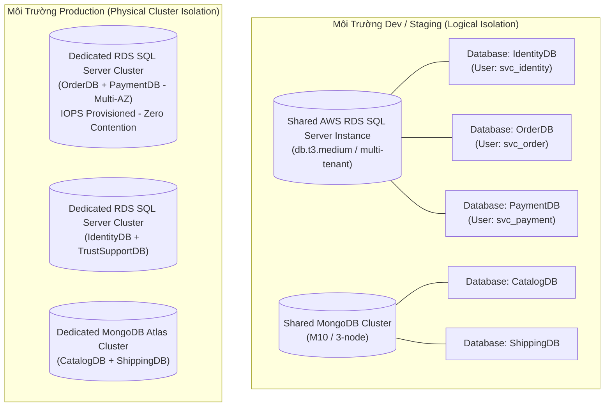

# Kiến Trúc Đa Cơ Sở Dữ Liệu — Polyglot Persistence Architecture

| Tài liệu | Kiến Trúc Lưu Trữ Đa CSDL & Quản Trị Kết Nối (Polyglot Persistence) |
| :--- | :--- |
| **Dự án** | Nền tảng Thương mại Điện tử Đồ cũ C2C ReMarket |
| **Mã tài liệu** | `DOC-BA-05-PLY` |
| **Phiên bản** | v1.0 |
| **Trạng thái** | Chấp thuận (Approved) |
| **Phân hệ cha** | [docs/BA/05_domain-and-data/README.md](file:///d:/remarket-platform-system/docs/BA/05_domain-and-data/README.md) |
| **Liên kết truy vết** | [open-questions-and-decisions.md](file:///d:/remarket-platform-system/docs/BA/02_business-analysis/open-questions-and-decisions.md) (`DEC-DIR-01..04`, `Q-DATA-01..04`), [non-functional-requirements.md](file:///d:/remarket-platform-system/docs/BA/03_requirements/non-functional-requirements.md) (`NFR-DAT-*`, `NFR-COST-*`) |

---

## 1. Cơ Sở Lựa Chọn & Ma Trận Phân Bổ Công Nghệ Lưu Trữ (Polyglot Matrix)

Không có một hệ quản trị cơ sở dữ liệu duy nhất nào đáp ứng tối ưu toàn bộ các tiêu chí của sàn C2C đồ cũ (từ giao dịch giữ hàng ACID nghiêm ngặt, tìm kiếm toàn văn tiếng Việt, đến lưu trữ ảnh và thuộc tính động đa dạng). ReMarket áp dụng chiến lược **Polyglot Persistence** dựa trên phân tích đánh đổi kỹ thuật (Trade-off Analysis):

```mermaid
graph TD
    classDef sql fill:#e3f2fd,stroke:#1565c0,stroke-width:2px;
    classDef mongo fill:#e8f5e9,stroke:#2e7d32,stroke-width:2px;
    classDef redis fill:#ffebee,stroke:#c62828,stroke-width:2px;
    classDef search fill:#fff8e1,stroke:#f57f17,stroke-width:2px;
    classDef s3 fill:#f3e5f5,stroke:#7b1fa2,stroke-width:2px;

    REQ["Hệ Thống Dữ Liệu ReMarket"] --> SQL["SQL Server (RDS Multi-AZ)\nACID, Pessimistic/Optimistic Locking"]:::sql
    REQ --> MONGO["MongoDB (Atlas / EC2 Cluster)\nDocument Model, Dynamic Schema"]:::mongo
    REQ --> REDIS["Redis (AWS ElastiCache)\nSub-millisecond In-Memory"]:::redis
    REQ --> SEARCH["OpenSearch / Elasticsearch\nInverted Index, Faceted Search"]:::search
    REQ --> S3["Amazon S3\nObject Storage, 99.999999999% Durability"]:::s3

    SQL --> W_ORD["Order & 15m Reservation (INV-01)"]
    SQL --> W_PAY["Payment & Escrow Holding (BR-PAY-007)"]
    SQL --> W_TRU["Audit Trail & PII Logs (FR-SUP-02)"]

    MONGO --> W_CAT["Listing & Dynamic Attributes"]
    MONGO --> W_SHP["Shipment Tracking Checkpoints"]
    MONGO --> W_NTF["Notification History"]

    REDIS --> W_LOCK["Distributed Lock (Pre-check)"]
    REDIS --> W_SESS["User Session & Rate Limiting"]
    REDIS --> W_CACHE["Hot Listing Read Cache"]

    SEARCH --> W_QUERY["Search Vietnamese Text & Geo Filter"]

    S3 --> W_IMG["Listing Photos & Unboxing Videos"]
    S3 --> W_ARCH["Database Backup Archives (PITR)"]
```



### Bảng Ma Trận So Sánh Kỹ Thuật

| Công Nghệ CSDL | Miền Nghiệp Vụ Phụ Trách | Phù Hợp Kỹ Thuật (Why Best Fit) | Đánh Đổi / Hạn Chế (Trade-offs) |
| :--- | :--- | :--- | :--- |
| **SQL Server** (`DEC-DIR-01`) | `OrderDB`, `PaymentDB`, `IdentityDB`, `TrustSupportDB` | - Giao dịch ACID mạnh mẽ, hỗ trợ khóa đồng thời chống oversell `Stock=1` (`INV-01`).<br>- Khả năng kiểm toán, hỗ trợ `ROWVERSION` và `OUTPUT clause` cho Outbox pattern.<br>- Sổ cái tài chính minh bạch cho quỹ Escrow. | - Khó mở rộng ghi ngang (Scale-out Writes).<br>- Chi phí bản quyền và tài nguyên compute cao hơn NoSQL. |
| **MongoDB** (`DEC-DIR-02`) | `CatalogDB`, `ShippingDB`, `NotificationDB` | - Schema linh hoạt (Attribute Pattern) chứa thuộc tính động của hàng triệu mã hàng cũ.<br>- Khả năng nhúng danh sách ảnh, mảng khuyết điểm và sự kiện tracking trong 1 document.<br>- Ghi thông lượng cao (High write-throughput). | - Không hỗ trợ ACID xuyên document/collection hiệu quả.<br>- Dễ bị phình to kích thước document nếu không kiểm soát mảng lồng. |
| **Redis (ElastiCache)** (`DEC-DIR-03`) | Toàn hệ thống (Caching, Distributed Locks, Session) | - Độ trễ cực thấp (< 1ms).<br>- Hỗ trợ lệnh nguyên tử (`SET NX EX`) cho Distributed Lock và Token Bucket Rate Limiting. | - Bộ nhớ RAM đắt đỏ.<br>- Dữ liệu có tính chất tạm thời, không dùng làm Source of Truth giao dịch. |
| **OpenSearch** | `SearchContext` | - Tìm kiếm toàn văn (Inverted Index), phân tích tiếng Việt (Vietnamese Analyzer).<br>- Tính toán bộ lọc đa diện (Faceted Aggregations) và lọc bán kính địa lý (`geo_point`). | - Dữ liệu trễ theo chu kỳ đồng bộ (Eventual consistency).<br>- Không dùng cho quyết định đặt hàng tại checkout. |
| **Amazon S3** (`DEC-DIR-03`) | Lưu trữ Media, Bằng chứng khiếu nại, Backup | - Độ bền vững 11 số 9 (99.999999999%).<br>- Cấp phép tải trực tiếp qua Presigned URL (`FR-MED-01..03`), giảm tải 100% cho application server.<br>- Chi phí lưu trữ cực rẻ với Lifecycle Glacier. | - Độ trễ truy cập cao hơn CSDL (vài chục ms).<br>- Tính nhất quán đọc sau ghi (Read-after-write consistency). |

---

## 2. Mô Hình Cô Lập Dữ Liệu (Isolation Topology - Giải Quyết `Q-DATA-04`)

Nhằm cân bằng giữa **chi phí hạ tầng (`NFR-COST-01`)** và **tính độc lập cô lập sự cố (Blast Radius Isolation)**, hệ thống áp dụng kiến trúc cô lập theo từng môi trường:



1. **Môi trường Demo / Dev / Staging (Logical Isolation):**
   - Triển khai chung 1 RDS Instance và 1 MongoDB Cluster để tối ưu chi phí.
   - **Cô lập nghiêm ngặt ở tầng CSDL & Phân quyền:** Mỗi microservice sở hữu CSDL riêng biệt (`OrderDB`, `PaymentDB`), kết nối bằng Database User riêng. User của `OrderService` bị cấm hoàn toàn quyền `SELECT/UPDATE` trên `PaymentDB`.
2. **Môi trường Production (Physical Cluster Isolation):**
   - Tách riêng cụm RDS Multi-AZ độc lập cho 2 dịch vụ nhạy cảm nhất là `OrderService` và `PaymentService` nhằm cô lập 100% tài nguyên CPU/RAM/IOPS, bảo vệ luồng giao dịch thanh toán không bị ảnh hưởng bởi các truy vấn tra cứu nội bộ của các dịch vụ khác.

---

## 3. Quản Trị Kết Nối & Chống Quá Tải CSDL (Connection Management & Resiliency)

### 3.1. Phân Bổ Connection Pooling Theo Tầng
Hiện tượng nghẽn CSDL trong hệ thống Microservices thường bắt nguồn từ việc mỗi pod tự động mở quá nhiều kết nối rảnh rỗi (Idle connections), vượt quá ngưỡng chịu tải `max_connections` của database engine.

- **Công thức tính toán Connection Pool cho Microservice:**
  $$\text{Max DB Connections} \ge \sum (\text{Max Replicas Pod} \times \text{Max Pool Size per Pod}) + \text{Admin Reserve}$$
- **Quy chuẩn cấu hình Connection Pool:**
  - `OrderService` (Dịch vụ tải cao, phản hồi nhanh): `Min Pool Size = 10`, `Max Pool Size = 30` (trên mỗi pod replica).
  - `PaymentService`: `Min Pool Size = 5`, `Max Pool Size = 20`.
  - `Connection Lifetime`: Tối đa 30 phút để tự động giải phóng kết nối cũ.
  - `Connection Timeout`: 3 giây (Fail-fast thay vì treo chờ tài nguyên).

### 3.2. Cấu Trúc Thứ Bậc Thời Gian Chờ (Timeout Hierarchy)
Để ngăn chặn hiện tượng treo luồng đồng loạt (Thread Starvation) gây đổ vỡ dây chuyền (Cascading Failure):

```
+-------------------------------------------------------------+
| API Gateway Timeout               : 15.0 giây               |
+-------------------------------------------------------------+
    |
    v
+---------------------------------------------------------+
| Backend / BFF Service Timeout     : 10.0 giây           |
+---------------------------------------------------------+
    |
    v
+-----------------------------------------------------+
| Microservice Command Timeout      : 5.0 giây        |
+-----------------------------------------------------+
    |
    v
+-------------------------------------------------+
| Database Query Timeout            : 2.0 giây    |
+-------------------------------------------------+
    |
    v
+---------------------------------------------+
| Lock Acquisition Timeout          : 1.0 giây|
+---------------------------------------------+
```

### 3.3. Cơ Chế Ngắt Mạch & Thử Lại (Circuit Breaker & Retry with Jitter)
- Áp dụng mẫu **Circuit Breaker** (Polly / Resilience4j) tại tầng Data Access:
  - Nếu tỷ lệ lỗi kết nối hoặc query timeout vượt quá **50% trong cửa sổ 10 giây**, Circuit Breaker chuyển sang trạng thái `Open`.
  - Mọi request mới đến CSDL lập tức bị từ chối với mã lỗi `503 Service Unavailable` hoặc fallback đọc dữ liệu từ Cache, không gửi thêm truy vấn gây quá tải cho Database.
  - Sau thời gian nghỉ 15 giây, chuyển sang `Half-Open` để thử nghiệm 5 request đầu tiên trước khi khôi phục hoàn toàn.
- **Retry Strategy:** Chỉ áp dụng Retry đối với các lỗi mạng tạm thời (Transient Errors / Deadlock 1205). Bắt buộc áp dụng thuật toán **Exponential Backoff kèm Full Jitter**:
  $$T_{\text{wait}} = \text{random}(0, \min(T_{\text{max}}, T_{\text{base}} \times 2^{\text{attempt}}))$$

