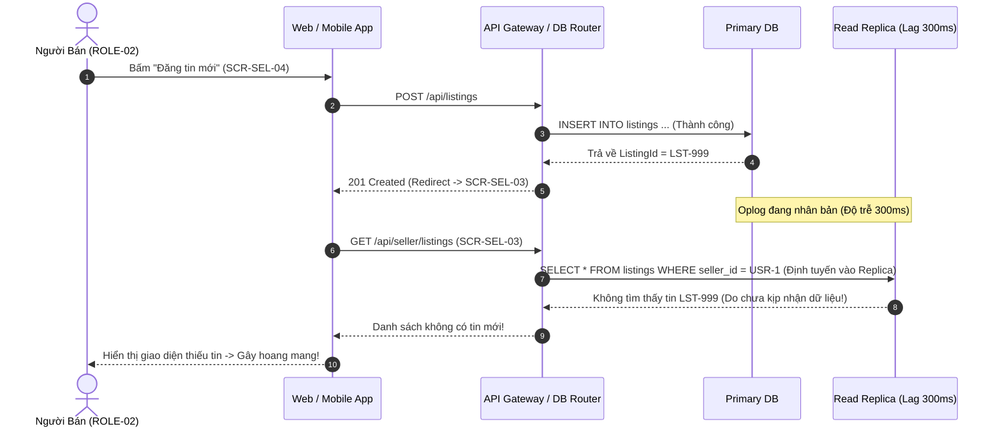
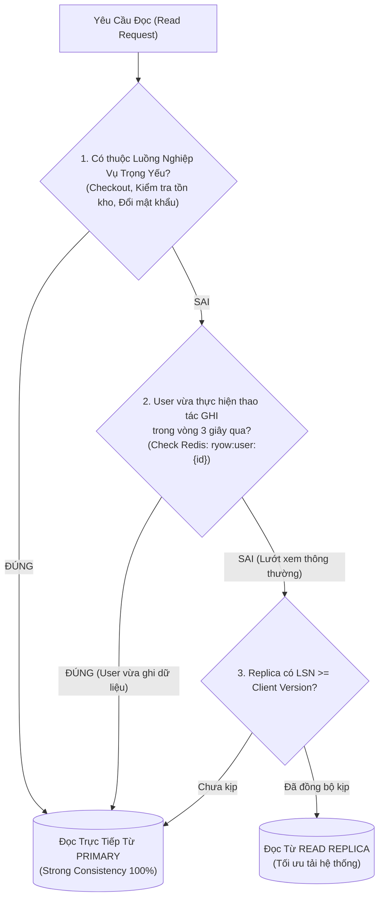

# Nhân Bản, Sẵn Sàng Cao & Nhất Quán Dữ Liệu — Replication & Consistency

| Tài liệu | Kiến Trúc Nhân Bản, Tính Sẵn Sàng Cao & Nhất Quán Dữ Liệu (HA & Replication) |
| :--- | :--- |
| **Dự án** | Nền tảng Thương mại Điện tử Đồ cũ C2C ReMarket |
| **Mã tài liệu** | `DOC-BA-05-REP` |
| **Phiên bản** | v1.0 |
| **Trạng thái** | Chấp thuận (Approved) |
| **Phân hệ cha** | [docs/BA/05_domain-and-data/README.md](file:///d:/remarket-platform-system/docs/BA/05_domain-and-data/README.md) |
| **Liên kết truy vết** | [open-questions-and-decisions.md](file:///d:/remarket-platform-system/docs/BA/02_business-analysis/open-questions-and-decisions.md) (`DEC-DIR-01..02`, `Q-DR-01`), [non-functional-requirements.md](file:///d:/remarket-platform-system/docs/BA/03_requirements/non-functional-requirements.md) (`NFR-AVL-01`, `NFR-CON-01..03`, `NFR-REC-01`) |

---

## 1. Kiến Trúc Nhân Bản & Tính Sẵn Sàng Cao (High Availability Topology)

Để đáp ứng mục tiêu sẵn sàng **99.9% (`NFR-AVL-01`)** và chỉ số phục hồi **RPO = 0 đối với dữ liệu giao dịch tài chính (`NFR-REC-01`)**, hệ thống triển khai kiến trúc đa vùng khả dụng (Multi-AZ):

```mermaid
flowchart TB
    subgraph AWS_REGION["AWS Region (ap-southeast-1 Singapore)"]
        subgraph AZ_A["Availability Zone A"]
            SQL_PRI[("SQL Server: Primary Instance\n(Đọc / Ghi chính)")]
            MNG_PRI[("MongoDB: Primary Node\n(Ghi nhận Document)")]
        end

        subgraph AZ_B["Availability Zone B"]
            SQL_STB[("SQL Server: Sync Standby\n(Always On / Tự động Failover)")]
            MNG_SEC1[("MongoDB: Secondary Node 1\n(Nhân bản dữ liệu)")]
        end

        subgraph AZ_C["Availability Zone C"]
            SQL_REP[("SQL Server: Async Read Replica\n(Tra cứu / Báo cáo đối soát)")]
            MNG_SEC2[("MongoDB: Secondary Node 2\n(Bầu chọn Arbitrage)")]
        end
    end

    %% SQL Server Replication
    SQL_PRI -->|Synchronous Replication (RPO = 0)| SQL_STB
    SQL_PRI -.->|Asynchronous Replication| SQL_REP

    %% MongoDB Replication
    MNG_PRI -->|Oplog Replication (w: majority)| MNG_SEC1
    MNG_PRI -->|Oplog Replication| MNG_SEC2

    CLIENT["Client API / Services"] -->|Write Commands| SQL_PRI
    CLIENT -->|Write Documents| MNG_PRI
    CLIENT -.->|Read Queries (Reporting/Search)| SQL_REP
```

### 1.1. Cấu Hình Sẵn Sàng Cao Cho SQL Server (RDS Multi-AZ)
- **Cơ chế Commit Đồng Bộ (Synchronous Replication):** Một transaction chỉ được coi là thành công (`COMMIT`) khi Transaction Log đã được ghi nhận an toàn trên cả Node Primary (ở `AZ-a`) và Node Standby (ở `AZ-b`). Đảm bảo nếu toàn bộ Trung tâm dữ liệu `AZ-a` bị mất điện hoặc hỏa hoạn, **không một byte dữ liệu giao dịch nào bị mất (`RPO = 0`)**.
- **Chuyển Đổi Dự Phòng Tự Động (Automatic Failover):** Khi Primary gặp sự cố, hệ thống tự động cập nhật bản ghi DNS nội bộ để trỏ lưu lượng sang Standby trong vòng **dưới 60 giây (`RTO < 60s`)**.
- **Asynchronous Read Replica:** Node tại `AZ-c` chỉ nhận nhân bản bất đồng bộ, chuyên phục vụ tác vụ đọc nặng của Chuyên viên Hỗ trợ (`SCR-ADM-03`) và đối soát thanh toán định kỳ.

### 1.2. Cấu Hình Replica Set Cho MongoDB (3-Node Multi-AZ)
- Phân bổ 3 node trên 3 Availability Zones độc lập (`1 Primary + 2 Secondaries`).
- **Ma trận Cấu hình Write Concern & Read Concern theo Nghiệp vụ:**

| Phân Loại Nghiệp Vụ | Thao Tác CSDL Điển Hình | Cấu Hình Write Concern | Cấu Hình Read Concern | Ý Nghĩa Kỹ Thuật |
| :--- | :--- | :---: | :---: | :--- |
| **Giao dịch Trọng Yếu** | Đánh dấu tin đã bán (`Sold`), Khóa tài khoản vi phạm | `w: "majority", j: true` | `readConcern: "majority"` | Bắt buộc ghi nhận trên đa số node và đã flush xuống đĩa (`journal = true`). Chống mất dữ liệu khi Primary sập ngay sau khi ghi. |
| **Dữ liệu Vận Chuyển** | Thêm checkpoint hành trình vận đơn từ 3PL | `w: "majority", j: false` | `readConcern: "local"` | Đảm bảo đa số node đã nhận, tối ưu tốc độ ghi bằng cách flush journal bất đồng bộ. |
| **Ghi Nhận Log / Thống Kê**| Tăng số lượt xem tin (`view_count`), log tracking | `w: 1` | `readConcern: "local"` | Phản hồi ngay khi Primary nhận được bản tin, tối đa hóa thông lượng ghi. |

---

## 2. Chiến Lược Tách Đọc / Ghi (Read / Write Splitting)

Nhằm giảm tải cho Primary Database, hệ thống phân luồng truy vấn thông qua Data Access Layer / ORM:
- **Write Operations (`INSERT, UPDATE, DELETE`):** Định tuyến 100% vào `Primary Instance`.
- **Read Operations (`SELECT` phục vụ báo cáo, danh sách công khai):** Định tuyến sang các `Read Replicas`.

---

## 3. Giải Quyết Bài Toán Độ Trễ Nhân Bản (Replication Lag Dilemma)

### 3.1. Phân Tích Kịch Bản Lỗi Thực Tế Ngoài Môi Trường Phân Tán
Nhân bản từ Primary sang Read Replica là **bất đồng bộ (Asynchronous)** với độ trễ thông thường từ 50ms đến 500ms (hoặc vài giây khi mạng nghẽn).
- **Kịch bản lỗi:**
  1. Người bán vừa hoàn tất Wizard Đăng tin (`SCR-SEL-04`), trình duyệt nhận phản hồi thành công và lập tức chuyển hướng (Redirect) sang trang Kho tin đăng (`SCR-SEL-03`).
  2. Trang `SCR-SEL-03` gửi request đọc danh sách tin, Router định tuyến vào `Read Replica`.
  3. Do Read Replica đang bị trễ 300ms so với Primary, bản ghi tin mới vừa tạo **chưa kịp nhân bản tới Replica**.
  4. Giao diện Người bán hiển thị danh sách trống! Người bán hoang mang tưởng lỗi nên bấm đăng lại lần 2 → Gây trùng lặp tin đăng.



---

### 3.2. Ba Kỹ Thuật Giải Quyết Triệt Để Của ReMarket

Để giải quyết triệt để lỗi trải nghiệm trên mà vẫn duy trì khả năng tách đọc/ghi, hệ thống áp dụng đồng thời 3 chiến thuật:



#### 1. Chiến Thuật 1: Read-Your-Own-Writes (RYOW) Qua Sticky Primary Routing
- **Nguyên lý:** Mỗi khi một User thực hiện lệnh Ghi thành công (`POST`, `PUT`, `DELETE`), API Gateway / BFF lập tức ghi một cờ ngắn hạn lên Redis:
  $$\text{Key: } \texttt{ryow:user:\{user\_id\}}, \quad \text{Value: } \texttt{true}, \quad \text{TTL: } 3 \text{ giây}$$
- Trong vòng 3 giây tiếp theo, bất kỳ truy vấn Đọc (`GET`) nào phát sinh từ chính `user_id` đó đều được DB Router ép buộc định tuyến thẳng vào **`Primary Database`**.
- Sau 3 giây (khi dữ liệu chắc chắn đã nhân bản xong sang toàn bộ Read Replicas), cờ trên Redis tự động biến mất, các truy vấn sau đó quay trở lại đọc từ Read Replicas.

#### 2. Chiến Thuật 2: Theo Dõi Phiên Bản Đơn Điệu (Monotonic Reads qua LSN / Version Header)
- Khi thực hiện lệnh Ghi, Primary trả về mã số phiên bản giao dịch (`Log Sequence Number - LSN` trên SQL Server hoặc `ClusterTime` trên MongoDB). Client lưu mã này vào Header `X-Last-Known-LSN`.
- Khi đọc từ Read Replica, DB Router so sánh LSN của Replica với LSN trong Header. Nếu Replica có LSN thấp hơn (chưa bắt kịp phiên bản của Client), Router tự động fallback định tuyến sang Primary.

#### 3. Chiến Thuật 3: Tuyến Đường Trọng Yếu Bắt Buộc Đọc Primary (Critical Path Always-On-Primary)
- Các truy vấn quyết định tính sống còn của giao dịch tuyệt đối không được đọc qua Replica:
  - Trang Chi tiết sản phẩm (`SCR-MKT-03`): Kiểm tra trạng thái tồn kho thực tế (`Published` vs `Reserved` vs `Sold`).
  - Trang Checkout (`SCR-MKT-06`): Kiểm tra trạng thái hiệu lực của Reservation 15 phút.
  - Màn hình xác thực đăng nhập và đổi mật khẩu tài khoản (`SCR-MKT-12`).

