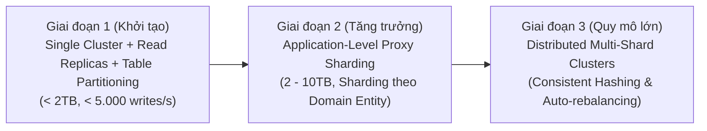
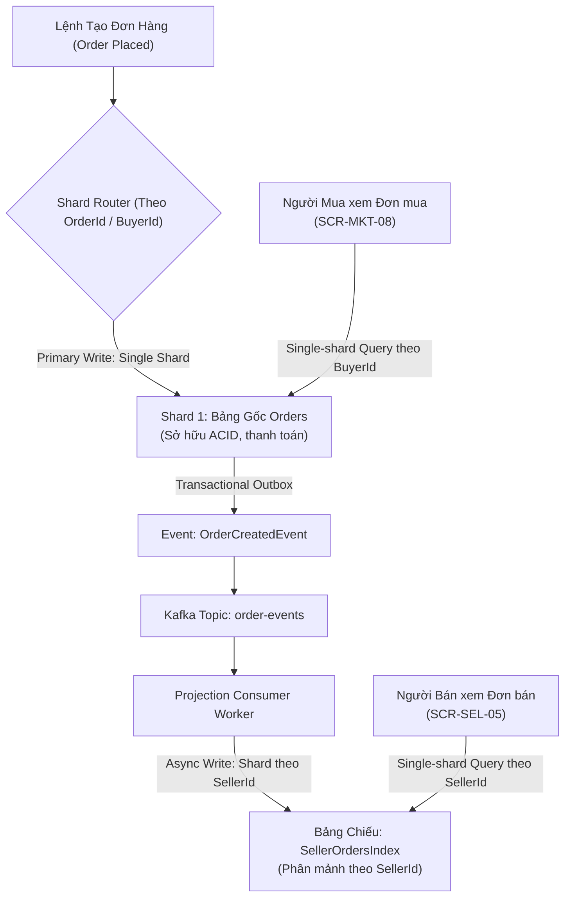

# Chiến Lược Phân Mảnh & Phân Vùng — Sharding & Partitioning Strategy

| Tài liệu | Chiến Lược Phân Vùng Bảng & Phân Mảnh Cơ Sở Dữ Liệu (Sharding & Partitioning) |
| :--- | :--- |
| **Dự án** | Nền tảng Thương mại Điện tử Đồ cũ C2C ReMarket |
| **Mã tài liệu** | `DOC-BA-05-SHD` |
| **Phiên bản** | v1.0 |
| **Trạng thái** | Chấp thuận (Approved) |
| **Phân hệ cha** | [docs/BA/05_domain-and-data/README.md](file:///d:/remarket-platform-system/docs/BA/05_domain-and-data/README.md) |
| **Liên kết truy vết** | [entity-relationship-model.md](file:///d:/remarket-platform-system/docs/BA/05_domain-and-data/entity-relationship-model.md), [non-functional-requirements.md](file:///d:/remarket-platform-system/docs/BA/03_requirements/non-functional-requirements.md) (`NFR-SCAL-01..02`, `NFR-DAT-01`) |

---

## 1. Phân Vùng Dọc (Vertical Partitioning & Table Splitting)

### 1.1. Mục Tiêu Tối Ưu Hóa Bộ Nhớ Đệm (RAM Buffer Pool)
Trên SQL Server, đơn vị đọc ghi đĩa cơ bản là Data Page cố định kích thước **8KB**.
- **Vấn đề:** Nếu một bảng chứa các cột dữ liệu lớn (`NVARCHAR(MAX)` chứa JSON, mô tả dài, payload webhook thô), kích thước của một dòng (Row Size) có thể lên tới 4KB – 8KB. Khi đó, một Data Page 8KB chỉ chứa được 1 đến 2 dòng. Hậu quả là bộ nhớ đệm RAM Buffer Pool nhanh chóng bị tràn ngập bởi dữ liệu tĩnh ít khi dùng đến, đẩy các dòng giao dịch nóng ra khỏi bộ nhớ (Cache Churn) và làm tăng vọt IOPS đọc đĩa.
- **Chiến lược Phân vùng Dọc của ReMarket:** Tách các bảng lớn thành 2 bảng có quan hệ 1-1:
  1. **Bảng Giao Dịch Nóng (Hot Transaction Table):** Chỉ chứa các cột số liệu, mã ID và trạng thái có kích thước cố định (Row Size < 200 bytes). Một Data Page 8KB chứa được hơn 40 dòng dữ liệu nóng, giúp tăng hiệu quả bộ đệm RAM lên gấp 20 lần.
  2. **Bảng Dữ Liệu Tĩnh / Payload (Cold/Payload Table):** Chứa các cột văn bản dài và JSON snapshot, chỉ được truy vấn khi người dùng bấm vào trang chi tiết đơn hàng (`SCR-MKT-09`).

```
+-----------------------------------------------------------------------------------+
| BẢNG GỐC CHƯA TÁCH (Orders): Row Size ~ 3.500 bytes -> 1 Trang 8KB chỉ chứa 2 dòng|
+-----------------------------------------------------------------------------------+
                                         |
                                         v (Áp dụng Vertical Partitioning)
+-----------------------------------------------+   +-------------------------------+
| BẢNG NÓNG (Orders):                           |   | BẢNG LẠNH (OrderItemSnapshots):|
| - OrderId, BuyerId, SellerId, TotalAmount...  |   | - OrderId (FK 1-1)            |
| - Row Size: ~ 180 bytes                       |   | - TitleAtPurchase, Desc...    |
| -> 1 Trang 8KB chứa 42 dòng giao dịch!        |   | - PhotosSnapshotJSON...       |
+-----------------------------------------------+   +-------------------------------+
```

---

## 2. Phân Vùng Bảng Ngang Trong Một Cụm (SQL Server Table Partitioning)

### 2.1. Thiết Kế Partition Function & Scheme Theo Tháng
Áp dụng cho các bảng có tốc độ tăng trưởng dữ liệu cao: `Orders`, `PaymentTransactions`, `OutboxMessages`, `SupportPIIAuditLogs`.
- Dữ liệu được phân vùng ngang (Horizontal Partitioning) tự động theo dải thời gian tháng (`Range RIGHT` trên cột `CreatedAt` / `OccurredOn`).

```sql
-- 1. Tạo Partition Function theo từng tháng của năm 2026 - 2027
CREATE PARTITION FUNCTION PF_Orders_Monthly (DATETIME2(3))
AS RANGE RIGHT FOR VALUES (
    '2026-01-01 00:00:00.000',
    '2026-02-01 00:00:00.000',
    '2026-03-01 00:00:00.000',
    '2026-04-01 00:00:00.000',
    '2026-05-01 00:00:00.000',
    '2026-06-01 00:00:00.000',
    '2026-07-01 00:00:00.000',
    '2026-08-01 00:00:00.000',
    '2026-09-01 00:00:00.000',
    '2026-10-01 00:00:00.000',
    '2026-11-01 00:00:00.000',
    '2026-12-01 00:00:00.000'
);

-- 2. Tạo Partition Scheme ánh xạ vào các Filegroups lưu trữ
CREATE PARTITION SCHEME PS_Orders_Monthly
AS PARTITION PF_Orders_Monthly
ALL TO ([PRIMARY]);
```

### 2.2. Kỹ Thuật Partition Elimination & Cửa Sổ Trượt (Sliding Window SWITCH)
1. **Partition Elimination:** Khi truy vấn có điều kiện lọc theo thời gian (VD: `WHERE CreatedAt >= '2026-11-01' AND CreatedAt < '2026-12-01'`), Query Optimizer của SQL Server lập tức bỏ qua 11 phân vùng còn lại và chỉ đọc phân vùng của tháng 11, giảm 92% khối lượng quét I/O.
2. **Lưu Trữ Bằng Lệnh `SWITCH PARTITION` (Zero-Downtime Archiving):**
   - Thay vì chạy lệnh `DELETE FROM Orders WHERE CreatedAt < '2025-01-01'` (gây khóa bảng kéo dài, ghi đầy Transaction Log và làm nghẽn hệ thống), hệ thống sử dụng lệnh chuyển đổi con trỏ metadata:
   ```sql
   -- Chuyển toàn bộ phân vùng tháng 1 năm cũ sang bảng lưu trữ Archive trong 0 mili-giây
   ALTER TABLE Orders SWITCH PARTITION 1 TO Orders_Archive PARTITION 1;
   ```

---

## 3. Chiến Lược Phân Mảnh Đa Node (Horizontal Database Sharding)

### 3.1. Ngưỡng Kích Hoạt Phân Mảnh (Sharding Thresholds)
Hệ thống tuân thủ nguyên tắc không phân mảnh sớm (Avoid Premature Sharding). Sharding đa node chỉ được kích hoạt khi hệ thống đạt các ngưỡng sau:
- Dung lượng một cụm CSDL vượt quá **2 TB**.
- Tần suất ghi (Write IOPS) vượt quá **80% công suất tối đa của RDS Provisioned IOPS** trong 3 ngày liên tiếp.
- Kỹ thuật Read Replicas và Table Partitioning không còn đủ giải quyết nghẽn ghi.



---

### 3.2. Giải Quyết Bài Toán Kinh Điển Của E-Commerce Sharding (Buyer vs Seller Dilemma)

Trong sàn C2C đồ cũ, đây là thách thức kiến trúc nghiêm trọng nhất khi phân mảnh bảng `Orders`:
- **Nếu chọn `BuyerId` làm Shard Key:**
  - *Ưu điểm:* Người mua truy vấn "Đơn mua của tôi" (`SCR-MKT-08`) cực nhanh vì toàn bộ đơn của 1 Buyer nằm trọn vẹn trên 1 Shard (**Single-Shard Query**).
  - *Nhược điểm chết người:* Người bán truy vấn "Đơn bán của tôi" (`SCR-SEL-05` theo `SellerId`) sẽ không biết đơn nằm ở đâu, buộc Router phải gửi truy vấn tới tất cả các Shard (**Scatter-Gather Query**) rồi gom dữ liệu lại, gây nghẽn toàn bộ cụm CSDL!
- **Nếu chọn `SellerId` làm Shard Key:** Ngược lại, trang của Người mua sẽ bị lỗi Scatter-Gather.



#### Giải Pháp Chuẩn Hóa Của ReMarket:
1. **Bảng Giao Dịch Gốc (`Orders`):** Được Shard theo **`OrderId`** (trong đó 4 ký tự đầu của ULID nhúng mã Shard ID) hoặc theo `BuyerId`. Đảm bảo luồng Checkout và cập nhật trạng thái thanh toán diễn ra gọn gàng trong 1 Shard duy nhất.
2. **Bản Chiếu Đơn Hàng Theo Người Bán (`SellerOrdersIndex` - CQRS Projection):**
   - Xây dựng một bảng riêng chuyên phục vụ Kênh Người Bán (`SCR-SEL-05`), được Shard theo **`SellerId`**.
   - Bảng này được đồng bộ bất đồng bộ thông qua sự kiện Kafka/Outbox (`OrderCreatedEvent`, `OrderConfirmedEvent`).
   - Kết quả: Cả Người mua lẫn Người bán đều thực hiện **Single-Shard Query 100%**, triệt tiêu hoàn toàn truy vấn Scatter-Gather trên môi trường Production!

---

### 3.3. Xử Lý Hiện Tượng Shard Quá Tải Do Người Bán Nổi Tiếng (Hot-Shard / Celebrity Seller)
- **Hiện tượng:** Một Người bán chuyên nghiệp hoặc KOL đồ cũ có hàng nghìn đơn hàng và hàng vạn lượt xem đồng thời, khiến Shard chứa dữ liệu của người bán đó bị quá tải CPU trong khi các Shard khác rảnh rỗi.
- **Chiến thuật xử lý 2 Lớp:**
  1. **Lớp Caching (Shielding):** 99% lượt đọc danh sách tin đang bán của người bán nổi tiếng được chặn và phục vụ trực tiếp từ Redis Cache (TTL = 60s kèm Invalidation).
  2. **Key Salting:** Đối với các tài khoản đặc biệt có lưu lượng quá lớn, Shard Key được gắn thêm hậu tố ngẫu nhiên: `seller_id#0`, `seller_id#1` ... `seller_id#N` để chia đều dữ liệu của một seller sang nhiều node khác nhau.

---

### 3.4. Chiến Lược Tái Phân Mảnh Không Gián Đoạn (Zero-Downtime Resharding)
Khi cần mở rộng từ $N$ Shards lên $2N$ Shards:
1. Áp dụng thuật toán **Consistent Hashing với 256 Virtual Nodes** cho mỗi Node vật lý để dữ liệu phân bổ đều trên vòng tròn băm.
2. Thiết lập quy trình di trú dữ liệu 4 bước:
   - *Bước 1:* Thêm Node mới vào cụm Shard.
   - *Bước 2 (Dual-Writing):* Tầng Routing ghi đồng thời vào cả Node cũ và Node mới.
   - *Bước 3 (Backfill):* Background Job sao chép toàn bộ dữ liệu lịch sử từ Node cũ sang Node mới dựa trên Change Data Capture (CDC).
   - *Bước 4 (Cut-over):* Chuyển quyền đọc sang Node mới và dọn dẹp phân vùng cũ.

