# Mục 06 — Kiến Trúc Dịch Vụ Microservices & Tích Hợp Hệ Thống (Microservices & Cloud)

| Tài liệu | Tổng Quan Kiến Trúc Dịch Vụ Microservices, Tích Hợp & Điện Toán Đám Mây AWS |
| :--- | :--- |
| **Dự án** | Nền tảng Thương mại Điện tử Đồ cũ C2C ReMarket |
| **Mã tài liệu** | `DOC-BA-06-README` |
| **Phiên bản** | v1.0 |
| **Trạng thái** | Chấp thuận (Approved) |
| **Phân hệ cha** | [Bộ Tài Liệu Phân Tích Nghiệp Vụ ReMarket (docs/BA)](file:///d:/remarket-platform-system/docs/BA/README.md) |

---

## 1. Mục Đích & Phạm Vi Phân Hệ 06

Phân hệ **06: Microservices & Integrations** hiện thực hóa toàn bộ các phân tích nghiệp vụ, mô hình dữ liệu và đặc tả trải nghiệm sản phẩm (thuộc các phần `02`, `03`, `04`, `05`) thành **Bản Thiết Kế Kiến Trúc Dịch Vụ Phân Tán (Distributed System Architecture) & Hạ Tầng Điện Toán Đám Mây AWS** hoàn chỉnh.

Phân hệ 06 giải quyết các bài toán kiến trúc kỹ thuật cốt lõi:
1. **Kiến Trúc Microservices Phân Tách Rạch Ròi:** 9 Core Microservices (`SVC-01..09`) ánh xạ chính xác 1-1 với 9 Bounded Contexts của Domain Model, bảo vệ nguyên tắc *Database-per-Service* và 5 quy tắc chống phân tán giả cầy (Anti-Distributed Monolith).
2. **Hợp Đồng Giao Tiếp Hai Tầng (Dual-Protocol Contracts):**
   - Tầng Public Client: RESTful JSON trên nền tảng HTTPS/TLS 1.3 qua API Gateway, kiểm soát JWT + RBAC/ABAC và khóa `Idempotency-Key` (`INV-03`).
   - Tầng Nội Bộ: **gRPC Protobuf** cho truy vấn đồng bộ tốc độ cao và **Apache Kafka** cho giao tiếp hướng sự kiện bất đồng bộ (28 Domain Events chuẩn CloudEvents).
3. **Tích Hợp Đối Tác Ngoài Qua Adapter & ACL (`DEC-DIR-05`):** Cô lập hoàn toàn logic nghiệp vụ khỏi giao diện riêng của VNPAY, MoMo (chữ ký số HMAC-SHA512, IPN, QueryDR) và GHN, GHTK (chuẩn hóa 6 trạng thái giao nhận và Carrier Simulator).
4. **Khả Năng Chịu Lỗi & Bảo Mật Hạ Tầng AWS Cloud:** Timeout Budget, Circuit Breaker, Bulkhead Isolation, Rate Limiting; Mạng VPC 3 lớp (Public, Private App, Isolated Data Subnets); Mô hình Observability 3 trụ cột (OpenTelemetry Tracing W3C, Structured Logging tự động che PII) và Động cơ Đối soát Tự động 3 chiều (`Reconciliation Engine`).

---

## 2. Cấu Trúc Bộ Tài Liệu 10 File Thành Phần

Thư mục `docs/BA/06_microservices-and-integrations/` bao gồm **10 tài liệu kỹ thuật chuyên sâu**:

```
docs/BA/06_microservices-and-integrations/
├── README.md                                          # Tài liệu chỉ mục & ma trận truy vết tổng thể
├── system-context.md                                  # Bối cảnh hệ thống, C4 Level 1 & 2, Luồng North-South & East-West
├── service-catalog.md                                 # Danh mục 9 Microservices + Gateway, Datastore sở hữu, SLO & Scaling
├── service-boundaries.md                              # Ranh giới sở hữu (Owns vs Never Owns), 5 quy tắc chống Monolith
├── api-requirements.md                                # Hợp đồng REST/gRPC APIs, RBAC/ABAC, Idempotency, RFC 7807
├── event-catalog.md                                   # 28 Domain Events, CloudEvents, Kafka Topics, Partition Keys, DLQ
├── external-integrations.md                           # Tích hợp VNPAY/MoMo, GHN/GHTK 3PL qua Ports & Adapters / ACL, S3
├── resilience-fault-tolerance-and-rate-limiting.md    # Circuit Breaker, Bulkhead, Timeout Budget, Rate Limiting, Graceful Fallback
├── aws-cloud-and-network-architecture.md              # AWS Multi-AZ 4-Tier VPC, ALB, EKS, RDS, ElastiCache, S3, KMS
├── network-firewall-and-waf-security.md               # Phòng thủ đa tầng: AWS WAF v2, AWS Network Firewall, NACLs, SGs
└── observability-tracing-and-reconciliation.md        # OpenTelemetry Tracing, RED Metrics, P1..P3 Alerts, 3-Way Reconciliation
```

### Bảng Tóm Tắt Nhiệm Vụ Kỹ Thuật Của Từng Tài Liệu:

| STT | Tên Tài Liệu | Trọng Tâm Thiết Kế Kỹ Thuật | Đầu Ra Cốt Lõi |
| :---: | :--- | :--- | :--- |
| 1 | [system-context.md](file:///d:/remarket-platform-system/docs/BA/06_microservices-and-integrations/system-context.md) | Kiến trúc tổng thể theo mô hình C4 Model. | - C4 Level 1 (System Context) & Level 2 (Containers).<br>- Phân luồng lưu lượng North-South & East-West. |
| 2 | [service-catalog.md](file:///d:/remarket-platform-system/docs/BA/06_microservices-and-integrations/service-catalog.md) | Danh mục chi tiết 10 thành phần dịch vụ. | - Bảng đặc tả `SVC-00` đến `SVC-09`.<br>- Phân bổ Tech Stack, CSDL độc quyền, chỉ số SLO và Auto-scaling. |
| 3 | [service-boundaries.md](file:///d:/remarket-platform-system/docs/BA/06_microservices-and-integrations/service-boundaries.md) | Phân định ranh giới trách nhiệm & chống Monolith. | - Ma trận Owns vs Never Owns.<br>- 5 quy tắc chống Distributed Monolith.<br>- Ma trận quyết định giao tiếp Đồng bộ vs Bất đồng bộ. |
| 4 | [api-requirements.md](file:///d:/remarket-platform-system/docs/BA/06_microservices-and-integrations/api-requirements.md) | Đặc tả giao diện lập trình ứng dụng (API Contracts). | - Danh mục APIs bao phủ 27 màn hình `SCR-*`.<br>- Header Idempotency-Key (`INV-03`), Phân trang con trỏ, RFC 7807.<br>- Mẫu JSON Payload thực tế cho Checkout, Webhook, Reveal PII. |
| 5 | [event-catalog.md](file:///d:/remarket-platform-system/docs/BA/06_microservices-and-integrations/event-catalog.md) | Kiến trúc giao tiếp hướng sự kiện (EDA). | - Chuẩn CloudEvents Envelope.<br>- Quy tắc Partition Key bảo toàn thứ tự (`listing_id`, `order_id`).<br>- Danh mục 28 Events (`EVT-01..28`), Retry Topics và DLQ. |
| 6 | [external-integrations.md](file:///d:/remarket-platform-system/docs/BA/06_microservices-and-integrations/external-integrations.md) | Tích hợp đối tác ngoài qua Ports & Adapters / ACL. | - Cổng thanh toán VNPAY/MoMo (Ký số HMAC, IPN Webhook, QueryDR).<br>- Đối tác 3PL GHN/GHTK (Ánh xạ 6 trạng thái chuẩn & Simulator).<br>- Amazon S3 Presigned PUT URLs (5 phút, tối đa 10MB). |
| 7 | [resilience-fault-tolerance-and-rate-limiting.md](file:///d:/remarket-platform-system/docs/BA/06_microservices-and-integrations/resilience-fault-tolerance-and-rate-limiting.md) | Khả năng chịu lỗi và kiểm soát lưu lượng phân tán. | - Timeout Budget & Deadline Propagation.<br>- Circuit Breaker & Bulkhead Isolation.<br>- Rate Limiting đa tầng trên Redis & Ma trận Graceful Degradation. |
| 8 | [aws-cloud-and-network-architecture.md](file:///d:/remarket-platform-system/docs/BA/06_microservices-and-integrations/aws-cloud-and-network-architecture.md) | Hạ tầng đám mây AWS Cloud & Mạng bảo mật. | - Kiến trúc Multi-AZ 4-Tier VPC (Firewall, Public, Private App, Isolated Data).<br>- CloudFront CDN, AWS WAF, ALB, EKS, RDS Multi-AZ, ElastiCache.<br>- Bảo mật Zero-Trust: Security Groups, KMS, Secrets Manager, IRSA. |
| 9 | [network-firewall-and-waf-security.md](file:///d:/remarket-platform-system/docs/BA/06_microservices-and-integrations/network-firewall-and-waf-security.md) | Tường lửa mạng AWS Network Firewall & WAF v2. | - Phòng thủ 5 tầng: Edge WAF, Network Firewall DPI Suricata, NACLs, SGs, mTLS.<br>- 10 bộ quy tắc WAF WebACL, Rate Limiting 50 req/5m cho Checkout.<br>- Egress Domain Filtering chặn rò rỉ dữ liệu, Auto-Mitigation Blacklist. |
| 10 | [observability-tracing-and-reconciliation.md](file:///d:/remarket-platform-system/docs/BA/06_microservices-and-integrations/observability-tracing-and-reconciliation.md) | Khả năng quan sát & Động cơ đối soát tự động. | - Structured Logging (che PII), RED Metrics, OpenTelemetry Tracing.<br>- Ma trận cảnh báo P1/P2/P3.<br>- Động cơ đối soát 3 chiều: Thời gian thực (1 phút) & Cuối ngày (T+1). |

---

## 3. Quy Ước Mã Định Danh Trong Phân Hệ 06

| Tiền Tố Mã | Ý Nghĩa Ngữ Nghĩa | Ví Dụ Điển Hình |
| :--- | :--- | :--- |
| `SVC-xx` | Dịch vụ Microservice trong hệ thống | `SVC-00` (API Gateway), `SVC-05` (OrderService), `SVC-06` (PaymentService) |
| `API-xxx-xx` | Giao diện API Endpoint theo phân hệ | `API-ORD-02` (Checkout API), `API-PAY-02` (VNPAY Webhook API) |
| `EVT-xx` | Bản tin Sự kiện Miền (Domain / Integration Event) | `EVT-08` (`ListingSoldEvent`), `EVT-16` (`PaymentCapturedEvent`) |
| `ADP-xx` | Bộ chuyển đổi tích hợp ngoài (Integration Adapter) | `ADP-VNPAY` (VNPAY Adapter), `ADP-GHN` (Giao Hàng Nhanh Adapter) |
| `RES-xx` | Chính sách chịu lỗi & kiểm soát lưu lượng | `RES-CB` (Circuit Breaker), `RES-BH` (Bulkhead), `RES-RL` (Rate Limit) |

---

## 4. Ma Trận Truy Vết Hai Chiều (Bidirectional Traceability Matrix)

```mermaid
flowchart LR
    subgraph UPSTREAM["Đầu Vào Kiến Trúc (Upstream Inputs)"]
        DOC_02["02_business-analysis:\nDEC-DIR-01..06, Q-OPS-*, Q-DATA-*"]
        DOC_03["03_requirements:\nFR-*, INV-01..05, NFR-PERF/AVL/SEC/OBS"]
        DOC_04["04_product-and-ux:\nSCR-MKT-*, SCR-SEL-*, SCR-ADM-*"]
        DOC_05["05_domain-and-data:\nBC-01..09, Polyglot DBs, Sagas, Cache"]
    end

    subgraph SEC_06["Mục 06: Microservices & Integrations (Hiện Tại)"]
        SYS_CTX["system-context.md & service-catalog.md"]
        SYS_BND["service-boundaries.md & api-requirements.md"]
        SYS_EVT["event-catalog.md & external-integrations.md"]
        SYS_OPS["resilience, aws-cloud, observability"]
    end

    subgraph DOWNSTREAM["Đầu Ra Kế Hoạch & Kiểm Thử (Downstream Outputs)"]
        DOC_07["07_backlog-and-release:\nEpics, Features, Story Mapping,\nRelease Milestones"]
        DOC_08["08_validation-and-governance:\nIntegration Test Suites, Chaos Testing,\nAudit & Governance Sign-off"]
    end

    UPSTREAM --> SEC_06
    SEC_06 --> DOWNSTREAM
```



### Bảng Đối Chiếu Nguồn Nghiệp Vụ Cốt Lõi (Upstream Traceability)

| Quyết Định / Bất Biến Nghiệp Vụ | Căn Cứ Đầu Vào | Thành Phần Kiến Trúc Mục 06 Hiện Thực Hóa |
| :--- | :--- | :--- |
| **Định hướng Adapter Pattern cho 3PL** | `DEC-DIR-05`, `Q-OPS-03..04` | [external-integrations.md](file:///d:/remarket-platform-system/docs/BA/06_microservices-and-integrations/external-integrations.md) (§3 - `GHNAdapter`, `GHTKAdapter` & `CarrierSimulator`). |
| **Đa kênh giao diện dùng chung API Gateway** | `DEC-DIR-06`, `Q-BIZ-15` | [system-context.md](file:///d:/remarket-platform-system/docs/BA/06_microservices-and-integrations/system-context.md) (§2) & [service-catalog.md](file:///d:/remarket-platform-system/docs/BA/06_microservices-and-integrations/service-catalog.md) (`SVC-00 API Gateway`). |
| **Chống Bán Trùng Hàng Đơn Chiếc (`INV-01`)** | `BR-ORD-003`, `FR-CHK-03` | [api-requirements.md](file:///d:/remarket-platform-system/docs/BA/06_microservices-and-integrations/api-requirements.md) (`API-ORD-02`) & [event-catalog.md](file:///d:/remarket-platform-system/docs/BA/06_microservices-and-integrations/event-catalog.md) (`EVT-09..10`). |
| **Bảo Toàn Tính Bất Khả Trùng Lặp (`INV-03`)** | `BR-PAY-004`, `FR-PAY-04` | [api-requirements.md](file:///d:/remarket-platform-system/docs/BA/06_microservices-and-integrations/api-requirements.md) (Header `Idempotency-Key`) & [external-integrations.md](file:///d:/remarket-platform-system/docs/BA/06_microservices-and-integrations/external-integrations.md) (§2.2). |
| **Đóng Băng Tiền Tạm Giữ Khi Khiếu Nại (`INV-04`)**| `BR-DSP-002`, `FR-DSP-02` | [event-catalog.md](file:///d:/remarket-platform-system/docs/BA/06_microservices-and-integrations/event-catalog.md) (`EVT-26 DisputeOpenedEvent` $\to$ Đóng băng Escrow). |
| **Bàn Tra Cứu 360° & Mở Khóa PII Có Kiểm Toán** | `FR-SUP-01..03`, `SCR-ADM-03` | [api-requirements.md](file:///d:/remarket-platform-system/docs/BA/06_microservices-and-integrations/api-requirements.md) (`API-TRU-04..05`) & [observability-tracing-and-reconciliation.md](file:///d:/remarket-platform-system/docs/BA/06_microservices-and-integrations/observability-tracing-and-reconciliation.md). |
| **Cam Kết Độ Sẵn Sàng 99.9% & RPO/RTO** | `NFR-AVL-01`, `NFR-REC-01` | [aws-cloud-and-network-architecture.md](file:///d:/remarket-platform-system/docs/BA/06_microservices-and-integrations/aws-cloud-and-network-architecture.md) & [resilience-fault-tolerance-and-rate-limiting.md](file:///d:/remarket-platform-system/docs/BA/06_microservices-and-integrations/resilience-fault-tolerance-and-rate-limiting.md). |
| **Đối Soát Tự Động 3 Chiều Đa Miền** | `Q-OPS-06`, `Q-DR-05`, `SCR-ADM-08`| [observability-tracing-and-reconciliation.md](file:///d:/remarket-platform-system/docs/BA/06_microservices-and-integrations/observability-tracing-and-reconciliation.md) (§3 - Near real-time & T+1 Settlement Engine). |

