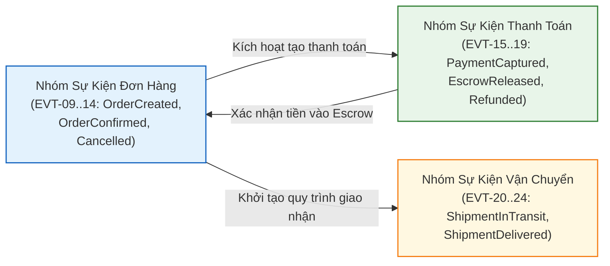
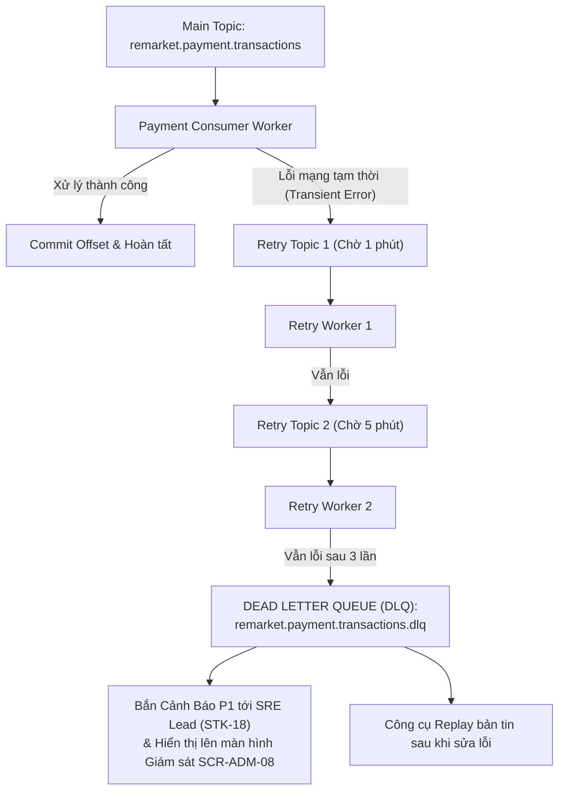

# Danh Mục Sự Kiện Miền — Event Catalog & Message Bus Architecture

| Tài liệu | Danh Mục Sự Kiện Miền & Kiến Trúc Apache Kafka (Event Catalog & Event-Driven Architecture) |
| :--- | :--- |
| **Dự án** | Nền tảng Thương mại Điện tử Đồ cũ C2C ReMarket |
| **Mã tài liệu** | `DOC-BA-06-EVT` |
| **Phiên bản** | v1.0 |
| **Trạng thái** | Chấp thuận (Approved) |
| **Phân hệ cha** | [docs/BA/06_microservices-and-integrations/README.md](file:///d:/remarket-platform-system/docs/BA/06_microservices-and-integrations/README.md) |
| **Liên kết truy vết** | [domain-model.md](file:///d:/remarket-platform-system/docs/BA/05_domain-and-data/domain-model.md), [concurrency-locking-and-distributed-transactions.md](file:///d:/remarket-platform-system/docs/BA/05_domain-and-data/concurrency-locking-and-distributed-transactions.md), [non-functional-requirements.md](file:///d:/remarket-platform-system/docs/BA/03_requirements/non-functional-requirements.md) (`NFR-REL-01..02`) |

---

## 1. Chuẩn Phong Bì Sự Kiện (CloudEvents Specification)

Toàn bộ các sự kiện bất đồng bộ lưu thông trên Message Bus (Apache Kafka / AWS MSK) đều tuân thủ định dạng phong bì tiêu chuẩn quốc tế **CloudEvents v1.0 JSON Format**:

```json
{
  "specversion": "1.0",
  "id": "01HXYZ981274019283746190AB",
  "source": "/services/order-service",
  "type": "vn.remarket.order.OrderConfirmedEvent",
  "datacontenttype": "application/json",
  "time": "2026-11-12T13:45:01.450Z",
  "partition_key": "ORD-20261112-9812",
  "correlation_id": "4bf92f35-77b3-4da6-a3ce-929d0e0e4736",
  "traceparent": "00-4bf92f3577b34da6a3ce929d0e0e4736-00f067aa0ba902b7-01",
  "data": {
    "order_id": "ORD-20261112-9812",
    "buyer_id": "USR-1029",
    "seller_id": "USR-8812",
    "listing_id": "01HXYZ1234567890ABCDEF01",
    "total_amount": 11585000.00,
    "currency": "VND",
    "confirmed_at": "2026-11-12T13:45:01.000Z"
  }
}
```

---

## 2. Kiến Trúc Kafka Topic & Quy Tắc Chọn Partition Key (Ordering Guarantee)

### 2.1. Tầm Quan Trọng Tuyệt Đối Của Thứ Tự Sự Kiện (Message Ordering)
Trong một hệ thống phân tán, nếu 2 sự kiện liên tiếp của cùng một món hàng rơi vào 2 Kafka Partitions khác nhau, Consumer chạy trên 2 pod khác nhau có thể tiêu thụ sai thứ tự:
- **Kịch bản lỗi:** Sự kiện `ReservationExpiredEvent` (mở lại hàng) được xử lý **trước** sự kiện `ReservationCreatedEvent` (khóa hàng) → Dẫn tới sau cùng món hàng bị khóa vĩnh viễn dù khách đã hủy!
- **Giải pháp: Quy Tắc Vàng Về Partition Key:**
  1. Mọi sự kiện thuộc vòng đời của Tin đăng (`Listing`): **Bắt buộc dùng `listing_id` làm Partition Key**.
  2. Mọi sự kiện thuộc vòng đời của Đơn hàng, Thanh toán, Vận chuyển và Tranh chấp: **Bắt buộc dùng `order_id` làm Partition Key**.
  - Kafka cam kết toàn bộ các sự kiện có cùng Partition Key sẽ luôn đi vào **duy nhất 1 Partition** và được tiêu thụ **chính xác 100% theo thứ tự thời gian mili-giây** (`Strict FIFO Per Entity`).

---

## 3. Bảng Danh Mục 28 Sự Kiện Miền Toàn Hệ Thống (`EVT-01` Đến `EVT-28`)



| Mã Event | Tên Sự Kiện Miền | Kafka Topic | Partition Key | Dịch Vụ Phát (Producer) | Dịch Vụ Nhận (Consumers) & Hành Vi Tương Ứng |
| :--- | :--- | :--- | :--- | :--- | :--- |
| `EVT-01` | `UserRegisteredEvent` | `remarket.identity.users` | `user_id` | `IdentityService` | `NotificationService` (Gửi email chào mừng). |
| `EVT-02` | `SellerVerifiedEvent` | `remarket.identity.sellers` | `user_id` | `IdentityService` | `CatalogService` (Gắn huy hiệu uy tín), `NotificationService`. |
| `EVT-03` | `AccountLockedEvent` | `remarket.identity.users` | `user_id` | `IdentityService` | `CatalogService` (Ẩn toàn bộ tin đăng của Seller), `Gateway` (Xóa token). |
| `EVT-04` | `ListingCreatedEvent` | `remarket.catalog.listings` | `listing_id` | `CatalogService` | `TrustSupportService` (Gắn cờ kiểm duyệt nếu có từ khóa nghi vấn). |
| `EVT-05` | `ListingUpdatedEvent` | `remarket.catalog.listings` | `listing_id` | `CatalogService` | `SearchService` (Cập nhật OpenSearch), `Cache Invalidator` (Xóa Redis). |
| `EVT-06` | `ListingPublishedEvent` | `remarket.catalog.listings` | `listing_id` | `CatalogService` | `SearchService` (Index công khai lên sàn), `NotificationService`. |
| `EVT-07` | `ListingArchivedEvent` | `remarket.catalog.listings` | `listing_id` | `CatalogService` | `SearchService` (Xóa khỏi kết quả tìm kiếm), `Cache Invalidator`. |
| `EVT-08` | `ListingSoldEvent` | `remarket.catalog.listings` | `listing_id` | `CatalogService` | `SearchService` (Đánh dấu Đã bán), `Cache Invalidator` (DEL key). |
| `EVT-09` | `ReservationCreatedEvent` | `remarket.order.reservations`| `listing_id` | `OrderService` | `CatalogService` (Chuyển trạng thái tin `Reserved`), `SearchService`. |
| `EVT-10` | `ReservationExpiredEvent` | `remarket.order.reservations`| `listing_id` | `OrderService` | `CatalogService` (Mở lại tin sang `Published`), `NotificationService` (Báo Buyer). |
| `EVT-11` | `OrderCreatedEvent` | `remarket.order.orders` | `order_id` | `OrderService` | `PaymentService` (Khởi tạo `PaymentIntent`), `TrustSupportService` (CQRS). |
| `EVT-12` | `OrderConfirmedEvent` | `remarket.order.orders` | `order_id` | `OrderService` | `ShippingService` (Khởi tạo vận đơn), `CatalogService` (Chuyển tin sang `Sold`). |
| `EVT-13` | `OrderCompletedEvent` | `remarket.order.orders` | `order_id` | `OrderService` | `PaymentService` (Kích hoạt giải ngân Escrow cho Seller), `NotificationService`. |
| `EVT-14` | `OrderCancelledEvent` | `remarket.order.orders` | `order_id` | `OrderService` | `PaymentService` (Hủy intent), `CatalogService` (Mở lại tin bán). |
| `EVT-15` | `PaymentPendingEvent` | `remarket.payment.transactions`| `order_id` | `PaymentService` | `OrderService` (Duy trì trạng thái chờ ngân hàng đối soát). |
| `EVT-16` | `PaymentCapturedEvent` | `remarket.payment.transactions`| `order_id` | `PaymentService` | `OrderService` (Chuyển `Confirmed`), `NotificationService` (Báo Seller có đơn mới). |
| `EVT-17` | `PaymentFailedEvent` | `remarket.payment.transactions`| `order_id` | `PaymentService` | `OrderService` (Kích hoạt Saga bù trừ hủy đơn), `NotificationService`. |
| `EVT-18` | `EscrowReleasedEvent` | `remarket.payment.escrow` | `order_id` | `PaymentService` | `NotificationService` (Báo Seller tiền đã được cộng vào số dư giải ngân). |
| `EVT-19` | `PaymentRefundedEvent` | `remarket.payment.transactions`| `order_id` | `PaymentService` | `OrderService` (Chuyển Order sang `Refunded`), `NotificationService`. |
| `EVT-20` | `ShipmentCreatedEvent` | `remarket.shipping.shipments` | `order_id` | `ShippingService` | `OrderService` (Ghi nhận mã tracking), `NotificationService` (Báo Buyer). |
| `EVT-21` | `ShipmentPickedUpEvent`| `remarket.shipping.shipments` | `order_id` | `ShippingService` | `OrderService` (Cập nhật tiến trình), `TrustSupportService` (360 View). |
| `EVT-22` | `ShipmentInTransitEvent`| `remarket.shipping.shipments`| `order_id` | `ShippingService` | `TrustSupportService` (Cập nhật lộ trình thời gian thực). |
| `EVT-23` | `ShipmentDeliveredEvent`| `remarket.shipping.shipments`| `order_id` | `ShippingService` | `PaymentService` (Kích hoạt đồng hồ 72h giải ngân - `BR-PAY-007`), `Notif`. |
| `EVT-24` | `ShipmentFailedEvent` | `remarket.shipping.shipments` | `order_id` | `ShippingService` | `TrustSupportService` (Tạo vé hỗ trợ giao hàng thất bại), `OrderService`. |
| `EVT-25` | `ListingFlaggedEvent` | `remarket.trust.moderation` | `listing_id` | `TrustSupportService` | `CatalogService` (Tạm ẩn tin khỏi sàn), `NotificationService`. |
| `EVT-26` | `DisputeOpenedEvent` | `remarket.trust.disputes` | `order_id` | `TrustSupportService` | `PaymentService` (**Đóng băng quỹ Escrow ngay lập tức - `INV-04`**). |
| `EVT-27` | `DisputeRefundApproved` | `remarket.trust.disputes` | `order_id` | `TrustSupportService` | `PaymentService` (Thực hiện lệnh hoàn tiền cho Buyer qua cổng thanh toán). |
| `EVT-28` | `DisputeDismissedEvent`| `remarket.trust.disputes` | `order_id` | `TrustSupportService` | `PaymentService` (Giải tỏa đóng băng, tiếp tục giải ngân cho Seller). |

---

## 4. Xử Lý Lỗi Bất Đồng Bộ, Retry Topics & Dead Letter Queue (DLQ)

Hệ thống triển khai cơ chế **Non-blocking Dead Letter Topic** nhằm đảm bảo một bản tin bị lỗi không làm nghẽn toàn bộ hàng đợi của các bản tin khác:



- **Quy tắc:** Bản tin chỉ được đẩy vào DLQ sau khi đã thử lại 3 lần qua các khoảng nghỉ `1 phút` → `5 phút` → `15 phút` (Exponential Backoff).
- Mọi bản tin rơi vào DLQ đều kích hoạt cảnh báo mức **P1 (Critical)** tới kênh trực ban SRE và hiển thị cờ trên màn hình Vận hành Kỹ thuật (`SCR-ADM-08`).

