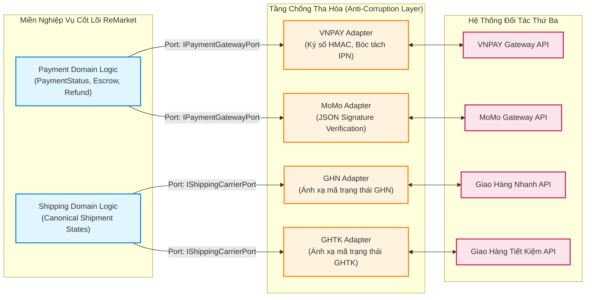
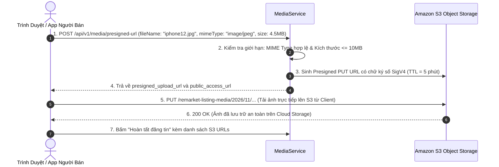

# Thiết Kế Tích Hợp Hệ Thống Ngoài — External Integrations & Adapters

| Tài liệu | Đặc Tả Tích Hợp Đối Tác Ngoài & Tầng Chống Tha Hóa (Adapters & ACL) |
| :--- | :--- |
| **Dự án** | Nền tảng Thương mại Điện tử Đồ cũ C2C ReMarket |
| **Mã tài liệu** | `DOC-BA-06-EXT` |
| **Phiên bản** | v1.0 |
| **Trạng thái** | Chấp thuận (Approved) |
| **Phân hệ cha** | [docs/BA/06_microservices-and-integrations/README.md](file:///d:/remarket-platform-system/docs/BA/06_microservices-and-integrations/README.md) |
| **Liên kết truy vết** | [open-questions-and-decisions.md](file:///d:/remarket-platform-system/docs/BA/02_business-analysis/open-questions-and-decisions.md) (`DEC-DIR-05`, `Q-OPS-04..05`), [service-catalog.md](file:///d:/remarket-platform-system/docs/BA/06_microservices-and-integrations/service-catalog.md), [business-rules.md](file:///d:/remarket-platform-system/docs/BA/02_business-analysis/business-rules.md) (`BR-PAY-*`, `BR-SHP-*`) |

---

## 1. Nguyên Tắc Kiến Trúc Tích Hợp (Ports & Adapters / ACL)

Theo quyết định định hướng kiến trúc `DEC-DIR-05`, toàn bộ các kết nối ra hệ thống bên ngoài (Cổng thanh toán, Đối tác vận chuyển, Cloud Storage) đều bắt buộc triển khai theo mẫu **Ports and Adapters (Kiến trúc Lục giác - Hexagonal Architecture)** kết hợp tầng **Anti-Corruption Layer (ACL)**:

- **Lợi ích kiến trúc:** Miền nghiệp vụ nội bộ hoàn toàn thuần khiết (Pure Domain), độc lập với bất kỳ thay đổi nào về giao thức, định dạng request hay mã lỗi riêng của từng ngân hàng và đơn vị vận chuyển.

---

## 2. Tích Hợp Cổng Thanh Toán Trực Tuyến (`VNPAY`, `MoMo`)

### 2.1. Quy Trình Khởi Tạo & Ký Số Thanh Toán (Payment URL Generation)
- **Chuẩn mã hóa:** Sử dụng giải thuật băm **HMAC-SHA512** với Secret Key được lưu an toàn trong AWS Secrets Manager.
- **Dữ liệu ký số:** Chuỗi nối các tham số đã sắp xếp theo thứ tự bảng chữ cái (Alphabetical Order):
  $$\text{SignData} = \texttt{"vnp\_Amount="} + A + \texttt{"&vnp\_Command="} + C + \dots + \texttt{"&vnp\_TxnRef="} + T$$
  $$\text{vnp\_SecureHash} = \text{HMAC-SHA512}(\text{SecretKey}, \text{SignData})$$

### 2.2. Xử Lý IPN / Webhook An Toàn 5 Bước (Secure Webhook Verification)
Khi ngân hàng gọi vào Endpoint `POST /api/v1/webhooks/payment/vnpay`:
1. **Kiểm tra IP Whitelist:** Xác thực IP gửi đến thuộc dải IP công bố của đối tác VNPAY/MoMo.
2. **Kiểm tra Chữ ký số:** Tính toán lại chữ ký số HMAC từ payload nhận được và so sánh với `vnp_SecureHash`. Bác bỏ ngay nếu không khớp chữ ký (nguy cơ bị giả mạo).
3. **Kiểm tra Idempotency (`INV-03`):** Tra cứu bảng `PaymentIntents` theo `IdempotencyKey`. Nếu giao dịch đã ở trạng thái `Captured` hoặc `Refunded`, trả về ngay mã phản hồi `RspCode: "02" (Order already confirmed)` mà không xử lý lại.
4. **Kiểm tra Toàn vẹn Số tiền:** Đối chiếu `vnp_Amount` với `Amount` trong cơ sở dữ liệu. Bác bỏ nếu số tiền thanh toán không khớp với giá trị đơn hàng.
5. **Cập nhật Trạng thái & Bắn Sự kiện:** Chuyển `PaymentStatus = 'Captured'`, tạo tài khoản tạm giữ `EscrowAccounts`, và ghi bản tin `PaymentCapturedEvent` vào bảng Outbox.

### 2.3. Cơ Chế Chủ Động Đối Soát Trực Tiếp (QueryDR Fallback - `EX-005`)
- **Tình huống:** Người mua thanh toán xong trên ứng dụng ngân hàng và quay lại sàn tại màn hình `SCR-MKT-07`, nhưng đường truyền Webhook từ ngân hàng về sàn bị nghẽn quá **60 giây**.
- **Cơ chế xử lý:**
  - Hệ thống kích hoạt Background Worker gọi trực tiếp vào API **QueryDR (Query Transaction Status)** của ngân hàng để truy vấn kết quả tức thì.
  - Sau khi lấy được trạng thái thành công, hệ thống chủ động cập nhật CSDL và gửi thông báo qua WebSocket để làm mới màn hình `SCR-MKT-07` của khách hàng mà không cần chờ Webhook.

---

## 3. Tích Hợp Đối Tác Vận Chuyển 3PL (`GHN`, `GHTK`)

### 3.1. Bảng Chuẩn Hóa Trạng Thái Vận Chuyển (Canonical State Mapping)
Mỗi đơn vị chuyển phát sử dụng hệ thống mã trạng thái hoàn toàn khác nhau. Tầng ACL chịu trách nhiệm chuẩn hóa về **đúng 6 trạng thái nghiệp vụ chuẩn của ReMarket** (khớp 100% với [glossary.md](file:///d:/remarket-platform-system/docs/BA/00_project-context/glossary.md) §3):

| Trạng Thái Chuẩn ReMarket | Mã Trạng Thái Giao Hàng Nhanh (GHN) | Mã Trạng Thái GHTK | Hành Động Kích Hoạt Trên Hệ Thống |
| :--- | :--- | :--- | :--- |
| `PendingShipment` | `ready_to_pick` | `1` (Chưa tiếp nhận) | Người bán vừa tạo vận đơn, chờ shipper tới lấy hàng. |
| `PickingUp` | `picking`, `storing` | `2` (Đang lấy hàng), `3` (Đã lấy) | Shipper đã lấy kiện hàng từ tay người bán. |
| `InTransit` | `sorting`, `transporting`, `delivering` | `4` (Đang luân chuyển), `12` (Đang giao) | Kiện hàng đang luân chuyển giữa các kho hoặc đang trên đường giao. |
| `Delivered` | `delivered` | `5` (Đã giao hàng / Chưa đối soát), `6` | **Kích hoạt đồng hồ đếm ngược 72h giải ngân Escrow (`BR-PAY-007`)**. |
| `DeliveryFailed` | `delivery_fail`, `waiting_to_return` | `9` (Không giao được), `10` | Bắn thông báo hỗ trợ cho người bán và người mua. |
| `Returned` | `returned` | `11` (Đã trả hàng cho shop) | Kiện hàng trả về cho Người bán do Buyer không nhận. |

### 3.2. Cơ Chế Chống Webhook Đến Sai Thứ Tự (Out-of-Order Webhook Protection)
- Trong môi trường mạng, Webhook báo `InTransit` có thể đến sau Webhook báo `Delivered`.
- **Luật bảo vệ:** Dịch vụ `ShippingService` áp dụng ma trận kiểm tra tính hợp lệ của bước chuyển trạng thái (State Machine Guard). Nếu vận đơn đã ở trạng thái `Delivered`, mọi Webhook báo các trạng thái trước đó (`PickingUp`, `InTransit`) sẽ bị bỏ qua và ghi log cảnh báo, ngăn chặn việc giật lùi trạng thái đơn hàng.

### 3.3. Bộ Mô Phỏng Vận Chuyển (Carrier Webhook Simulator)
Để phục vụ việc kiểm thử tự động, tích hợp CI/CD và môi trường Staging khi không thể có Shipper thật đi giao đồ:
- Xây dựng module `CarrierSimulator`: Cung cấp giao diện giả lập cho phép Tester hoặc Developer chọn một mã vận đơn và bấm nút kích hoạt các sự kiện Webhook (`Simulate Picked Up`, `Simulate Delivered`) đẩy thẳng vào Endpoint Webhook của sàn.

---

## 4. Tích Hợp Amazon S3 Cấp Phép Tải Ảnh Trực Tiếp (`FR-MED-01..03`)

Để giảm 100% tải xử lý tệp tin nhị phân nặng trên Application Server:

