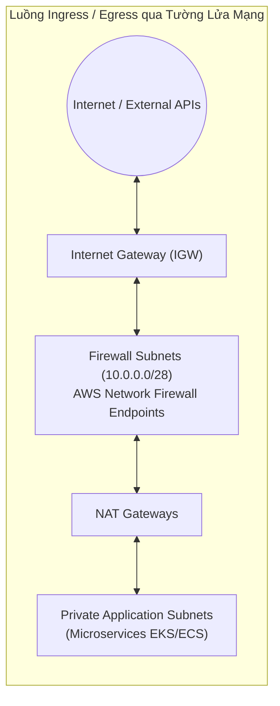
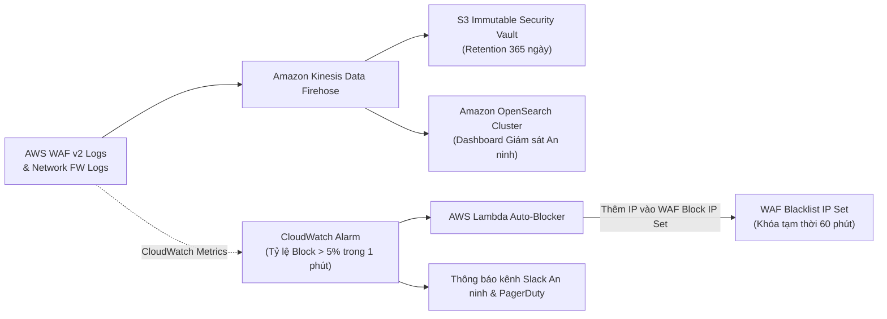

# Kiến Trúc Tường Lửa Mạng (Firewall) & Tường Lửa Ứng Dụng Web (WAF) – ReMarket

## Thông tin tài liệu

| Thuộc tính | Giá trị |
|---|---|
| Dự án | ReMarket – Nền tảng Thương mại Điện tử Đồ cũ C2C/B2C Phân tán |
| Tài liệu | Đặc tả Kiến trúc Phòng thủ Đa tầng: AWS WAF v2, AWS Network Firewall, NACLs & Security Groups |
| Mã tài liệu | `DOC-BA-06-FW-WAF` |
| Phiên bản | 1.0 |
| Trạng thái | Hoàn thiện (Baseline cho Thiết kế Bảo mật Hạ tầng & Tuân thủ An ninh Mạng) |
| Ngày cập nhật | 12/11/2026 |
| Phân hệ cha | [docs/BA/06_microservices-and-integrations/README.md](file:///d:/remarket-platform-system/docs/BA/06_microservices-and-integrations/README.md) |
| Liên kết truy vết | `03_requirements/non-functional-requirements.md` (`NFR-SEC-01..08`), `06_microservices-and-integrations/aws-cloud-and-network-architecture.md`, `08_validation-and-governance/non-functional-and-resilience-validation-plan.md` |

---

## 1. Tổng quan Chiến lược Phòng thủ Đa tầng (Defense-in-Depth Security)

Hệ thống ReMarket vận hành các giao dịch tài chính ký quỹ (Escrow) và dữ liệu cá nhân nhạy cảm (PII, CCCD, thông tin ngân hàng), do đó hạ tầng mạng được bảo vệ bởi mô hình **Phòng thủ Đa tầng 5 Lớp (5-Layer Defense-in-Depth)**:

```mermaid
flowchart TD
    INTERNET(("Internet Clients & Webhooks")) --> L1

    subgraph EDGE ["LỚP 1: TƯỜNG LỬA ỨNG DỤNG WEB BIÊN (EDGE WAF v2)"]
        L1["Amazon CloudFront CDN + AWS WAF v2 WebACL\n- Chống DDoS Lớp 3/4/7 (AWS Shield Standard)\n- Geo-blocking: Chỉ chấp nhận IP từ Việt Nam (VN)\n- Managed Rules: Common, Bad Inputs, SQLi, IP Reputation\n- Custom Rate-Limiting: 50 req/5m cho Checkout, 300 req/5m toàn sàn"]
    end

    L1 -->|Lưu lượng hợp lệ| L2

    subgraph PERIMETER ["LỚP 2: TƯỜNG LỬA MẠNG TRUNG TÂM (AWS NETWORK FIREWALL)"]
        L2["AWS Network Firewall (Đặt tại Firewall Subnets)\n- Stateful Packet Inspection (SPI) tốc độ cao\n- Deep Packet Inspection (DPI) dựa trên mã nguồn Suricata\n- Egress Domain Filtering: Chỉ cho phép gọi các Domain PSP/3PL trong Whitelist\n- Intrusion Detection & Prevention System (IDS/IPS)"]
    end

    L2 -->|Gói tin an toàn| L3

    subgraph SUBNET_GATE ["LỚP 3: TƯỜNG LỬA TẦNG MẠNG CON (STATELESS NACLs)"]
        L3["Network Access Control Lists (NACLs)\n- Stateless Packet Filtering chặn dải IP độc hại đã biết\n- Ranh giới kiểm soát giữa Public, Private Compute và Isolated Data Subnets"]
    end

    L3 -->|Chuyển tiếp ALB| L4

    subgraph HOST_GATE ["LỚP 4: TƯỜNG LỬA MÁY CHỦ ẢO (STATEFUL SECURITY GROUPS)"]
        L4["VPC Security Groups (Zero-Trust Micro-segmentation)\n- sg_alb: Chỉ nhận kết nối HTTPS 443 từ CloudFront Prefix List\n- sg_gateway: Chỉ nhận HTTP 8080 từ sg_alb\n- sg_microservices: Chỉ nhận kết nối nội bộ từ Gateway hoặc mTLS giữa các pod\n- sg_rds: Chỉ cho phép duy nhất OrderDB, PaymentDB, IdentityDB kết nối cổng 1433"]
    end

    L4 --> L5

    subgraph APP_WAF ["LỚP 5: TƯỜNG LỬA NỘI BỘ TẠI ALB & API GATEWAY"]
        L5["Application-Level WAF & Mutual TLS (mTLS)\n- WAF gắn trực tiếp tại Application Load Balancer (ALB)\n- IP Whitelisting bắt buộc cho Endpoint Webhook của VNPAY/MoMo\n- Xác thực chữ ký số HMAC-SHA512 trên từng payload"]
    end

    classDef l1 fill:#ffebee,stroke:#c62828,stroke-width:2px;
    classDef l2 fill:#fff3e0,stroke:#e65100,stroke-width:2px;
    classDef l3 fill:#fffde7,stroke:#f57f17,stroke-width:2px;
    classDef l4 fill:#e8f5e9,stroke:#2e7d32,stroke-width:2px;
    classDef l5 fill:#e3f2fd,stroke:#1565c0,stroke-width:2px;
    class L1 l1;
    class L2 l2;
    class L3 l3;
    class L4 l4;
    class L5 l5;
```



---

## 2. Đặc tả Chi tiết Tường lửa Ứng dụng Web (AWS WAF v2)

AWS WAF v2 được cấu hình theo mô hình bảo vệ kép: triển khai tại **Amazon CloudFront** (tầng biên CDN) để chặn đứng các cuộc tấn công ngay ngoài rìa, và gắn tại **Application Load Balancer (ALB)** để kiểm soát chuyên sâu các API nhạy cảm.

### 2.1. Cấu hình WebACL & Các Bộ Quy tắc Quản trị (Managed Rule Groups)
Độ ưu tiên thực thi quy tắc (Rule Priority) được sắp xếp chặt chẽ từ trên xuống dưới:

| Độ Ưu Tiên | Tên Bộ Quy Tắc (Rule Group) | Nhà Cung Cấp | Loại Quy Tắc | Hành Vi Xử Lý (Action) | Mục Tiêu Bảo Vệ |
|:---:|---|---|---|:---:|---|
| **1** | `AWSManagedRulesAmazonIpReputationList` | AWS | Managed | **BLOCK (403)** | Chặn các địa chỉ IP nằm trong danh sách đen toàn cầu (Botnets, Tor exit nodes, dải IP phát tán spam/mã độc). |
| **2** | `AWSManagedRulesAnonymousIpList` | AWS | Managed | **BLOCK (403)** | Chặn các kết nối từ VPN ẩn danh, Hosting providers không hợp lệ, Proxies che giấu danh tính người mua. |
| **3** | `ReMarket-GeoBlocking-Rule` | ReMarket Custom | Custom | **BLOCK (403)** | **Chỉ cho phép lưu lượng truy cập từ Việt Nam (`CountryCode = VN`)** đối với các trang giao dịch người dùng. Các quốc gia khác bị chặn mặc định trừ webhook được whitelist. |
| **4** | `AWSManagedRulesCommonRuleSet` (CRS) | AWS | Managed | **BLOCK (403)** | Bảo vệ chống các lỗ hổng OWASP Top 10: XSS, LFI/RFI, Directory Traversal, HTTP Request Smuggling, Command Injection. |
| **5** | `AWSManagedRulesKnownBadInputsRuleSet` | AWS | Managed | **BLOCK (403)** | Chặn các mẫu payload bất thường, mã khai thác Log4j, Spring4Shell, invalid URI encodings. |
| **6** | `AWSManagedRulesSQLiRuleSet` | AWS | Managed | **BLOCK (403)** | Chặn các chuỗi tấn công SQL Injection trên URI, Query String, Request Body và Headers nhắm vào `IdentityDB`, `OrderDB`, `PaymentDB`. |
| **7** | `ReMarket-Checkout-RateLimit-Rule` | ReMarket Custom | Rate-based | **BLOCK (429)** | Giới hạn tối đa **50 requests / 5 phút trên một IP** cho endpoint `/api/v1/checkout/*` (Chống bot càn quét giữ chỗ đồ độc bản). |
| **8** | `ReMarket-Auth-RateLimit-Rule` | ReMarket Custom | Rate-based | **BLOCK (429)** | Giới hạn tối đa **20 requests / 5 phút trên một IP** cho endpoint `/api/v1/auth/login` và `/verify-otp` (Chống Brute-force mật khẩu/OTP). |
| **9** | `ReMarket-Global-RateLimit-Rule` | ReMarket Custom | Rate-based | **BLOCK (429)** | Giới hạn tối đa **1.000 requests / 5 phút trên một IP** cho toàn bộ các endpoint khác (Chống DoS ứng dụng). |
| **10** | `ReMarket-Payment-Webhook-Guard` | ReMarket Custom | Custom Condition | **ALLOW / BLOCK** | Kiểm tra nghiêm ngặt endpoint `/api/v1/webhook/*`: Chỉ cho phép kết nối nếu IP nguồn nằm trong dải CIDR được PSP cung cấp VÀ có chứa chữ ký số `X-Signature` hợp lệ. |

### 2.2. Chi tiết Custom Rules cho Hệ thống Thương mại Điện tử ReMarket

#### Quy tắc A: Bảo vệ Khóa Giữ chỗ Đồ Độc bản (`ReMarket-Checkout-RateLimit-Rule`)
- **Vấn đề giải quyết:** Kẻ xấu sử dụng bot gửi hàng trăm request đồng thời để chiếm giữ món đồ cũ độc vị trong 15 phút, gây tê liệt việc bán hàng (`INV-01`).
- **Cấu hình WAF:**
  ```json
  {
    "Name": "ReMarket-Checkout-RateLimit-Rule",
    "Priority": 7,
    "Action": { "Block": { "CustomResponse": { "ResponseCode": 429, "CustomResponseBodyKey": "rate-limit-body" } } },
    "Statement": {
      "RateBasedStatement": {
        "Limit": 50,
        "EvaluationWindowSec": 300,
        "AggregateKeyType": "IP",
        "ScopeDownStatement": {
          "ByteMatchStatement": {
            "SearchString": "/api/v1/checkout/",
            "FieldToMatch": { "UriPath": {} },
            "TextTransformations": [{ "Priority": 0, "Type": "LOWERCASE" }],
            "PositionalConstraint": "STARTS_WITH"
          }
        }
      }
    }
  }
  ```

#### Quy tắc B: Bảo vệ Webhook Thanh toán (`ReMarket-Payment-Webhook-Guard`)
- **Vấn đề giải quyết:** Ngăn chặn kẻ gian giả mạo máy chủ VNPAY/MoMo để gửi Webhook thanh toán giả (`INV-02`).
- **Cấu hình WAF:**
  - Nếu URI bắt đầu bằng `/api/v1/webhook/psp/`:
    - **Điều kiện 1:** Địa chỉ IP gửi đến **bắt buộc** phải thuộc dải IP Whitelist của VNPAY/MoMo (sử dụng AWS WAF IP Set `ipset-psp-partners`).
    - **Điều kiện 2:** Bắt buộc phải có header `X-Signature` với độ dài tối thiểu 64 ký tự (chữ ký số HMAC-SHA512).
    - **Hành vi:** Nếu vi phạm một trong hai điều kiện trên, WAF lập tức trả về `HTTP 403 Forbidden` trước khi request chạm vào máy chủ `SVC-06 Payment Service`.

---

## 3. Đặc tả Chi tiết Tường lửa Mạng (AWS Network Firewall)

Khác với WAF chỉ phân tích lưu lượng HTTP/HTTPS tầng ứng dụng (Lớp 7), **AWS Network Firewall** cung cấp năng lực kiểm soát gói tin chuyên sâu ở Tầng Giao vận & Mạng (Lớp 3, 4, 7) cho toàn bộ VPC:



### 3.1. Vị trí Đặt Tường lửa trong Cấu trúc Mạng (Ingress Routing / Inspection Subnet)
- AWS Network Firewall được triển khai trên các **Firewall Subnets chuyên dụng** (`10.0.0.0/28`, `10.0.0.16/28`, `10.0.0.32/28`) nằm giữa Internet Gateway / NAT Gateway và các Subnet nội bộ.
- Mọi gói tin đi vào (Ingress) hoặc đi ra ngoài (Egress) đều bị buộc phải đi xuyên qua Firewall Endpoints thông qua kỹ thuật **VPC Ingress Routing** trước khi được chuyển tiếp.

### 3.2. Động cơ Quy tắc Trạng thái (Stateful Rules Engine dựa trên Suricata)

#### A. Quy tắc Kiểm soát Tên miền Đi Ra (Egress Domain Filtering Whitelist)
- **Mục tiêu An ninh:** Ngăn chặn tuyệt đối các mã độc nội bộ (nếu bị lây nhiễm) kết nối ra máy chủ điều khiển Command & Control (C2) hoặc đánh cắp dữ liệu khách hàng (Data Exfiltration).
- **Chính sách:** Các container trong Private Subnet **chỉ được phép gọi ra ngoài Internet tới đúng các domain nằm trong danh sách trắng (Whitelist)**:
  - Cổng thanh toán: `*.vnpay.vn`, `*.momo.vn`, `api.vietqr.io`.
  - Hãng vận chuyển 3PL: `*.ghn.vn`, `*.ghtk.vn`.
  - AWS Endpoints nội bộ vùng: `*.ap-southeast-1.amazonaws.com`.
  - Dịch vụ SMS/Email: `*.zalo.me`, `*.esms.vn`.
  - **Mọi kết nối outbound tới các địa chỉ IP hoặc tên miền lạ ngoài danh sách trên đều bị Drop (chặn lặng lẽ) và ghi log cảnh báo mức Critical**.

#### B. Động cơ Phát hiện & Ngăn chặn Xâm nhập (IDS/IPS Signatures)
- Tích hợp bộ quy tắc chữ ký tấn công nguồn mở Suricata và các bộ luật được AWS cập nhật hàng ngày:
  - Chặn quét cổng (Port Scanning detection).
  - Chặn tấn công giao thức TLS/SSL giả mạo hoặc sử dụng thuật toán mã hóa cổ lỗ sĩ (SSLv3, TLS 1.0, TLS 1.1).
  - Phát hiện và bẻ gãy các gói tin TCP bất thường (SYN Flood, Teardrop attack, Malformed TCP flags).

---

## 4. Tường lửa Phân vùng Mạng Nội bộ (Network ACLs & Security Groups)

### 4.1. Network ACLs (Tường lửa Stateless cấp Subnet)
Network ACLs đóng vai trò là "lớp áo giáp cứng" cấp dải mạng, lọc nhanh các gói tin độc hại mà không tiêu tốn tài nguyên máy chủ:
- **NACL Public Subnets:** Chỉ mở Inbound cổng 443 (HTTPS) và dải cổng tạm thời (Ephemeral Ports 1024-65535) cho phản hồi kết nối; chặn hoàn toàn cổng 22 (SSH), 3389 (RDP) và các cổng cơ sở dữ liệu.
- **NACL Private Compute Subnets:** Chỉ nhận kết nối Inbound từ dải IP của Public Subnet và VPC Peering; cấm truy cập trực tiếp từ Internet.
- **NACL Isolated Data Subnets:** **Chặn 100% Inbound từ Internet Gateway và NAT Gateway**; chỉ chấp nhận lưu lượng đến từ dải IP của Private Compute Subnet trên các cổng chuyên biệt (`1433` cho SQL Server, `27017` cho MongoDB, `6379` cho Redis, `443` cho OpenSearch).

### 4.2. Security Groups (Tường lửa Stateful cấp Máy chủ/Container - Micro-segmentation)
Mọi Security Group đều tuân theo nguyên tắc **Zero-Trust (Mặc định Từ chối - Deny by Default)**, chỉ mở cổng khi được chỉ định đích danh Security Group nguồn:

```
[Internet]
    | (HTTPS 443)
[CloudFront + WAF v2]
    | (HTTPS 443 qua CloudFront Prefix List)
[ALB: sg_alb_ingress]
    | (HTTP 8080)
[API Gateway: sg_gateway]
    | (gRPC 5000 / HTTP 8080)
[9 Microservices: sg_microservices]
    |---+-----------------------+-----------------------+
        | (TDS 1433)            | (Redis 6379)          | (Mongo 27017)
  [RDS SQL Server]      [ElastiCache Redis]     [MongoDB Atlas]
   sg_rds_sqlserver       sg_elasticache         (VPC Peering SG)
   (Chỉ Order/Pay/Idn)    (Chỉ Apps nội bộ)       (Chỉ Catalog/Ship)
```

---

## 5. Giám sát Tập trung, Phân tích Log & Phản ứng Tự động (Observability & Auto-Mitigation)

Hệ thống tường lửa được gắn liền với quy trình giám sát an ninh 24/7 (Security Operations):



1. **Ghi Log Tập trung Không thể Sửa xóa (Immutable WAF Logs):**
   - Toàn bộ các request bị Block bởi WAF hoặc Network Firewall đều được đẩy qua Amazon Kinesis Data Firehose lưu trữ vào S3 Vault bật chế độ Object Lock (WORM).
2. **Bảng Điều khiển Giám sát An ninh Thời gian thực (Security Dashboard):**
   - Đội ngũ SRE theo dõi trực quan: Bản đồ các quốc gia tấn công, Top 10 IP bị chặn nhiều nhất, Top URL bị tấn công SQL Injection hoặc Rate Limit.
3. **Cơ chế Phản ứng Tự động (Automated Incident Response):**
   - Nếu một địa chỉ IP gửi yêu cầu sai cú pháp hoặc bị chặn liên tiếp 20 lần trong vòng 1 phút, CloudWatch Alarm tự động kích hoạt Lambda Function đẩy địa chỉ IP đó vào **Danh sách đen khóa tạm thời 60 phút (Temporary Blacklist IP Set)** ngay tại tầng CloudFront Edge, triệt tiêu tải vào hệ thống nội bộ.

---

## 6. Lịch sử cập nhật

| Phiên bản | Ngày | Tác giả | Nội dung thay đổi |
|---|---|---|---|
| 1.0 | 12/11/2026 | Nhóm Kiến trúc An ninh & Đám mây | Khởi tạo tài liệu đặc tả kiến trúc phòng thủ đa tầng: AWS WAF v2 (10 bộ quy tắc), AWS Network Firewall (SPI/DPI/Egress Filtering), NACLs, Security Groups và hệ thống Auto-Mitigation. |

