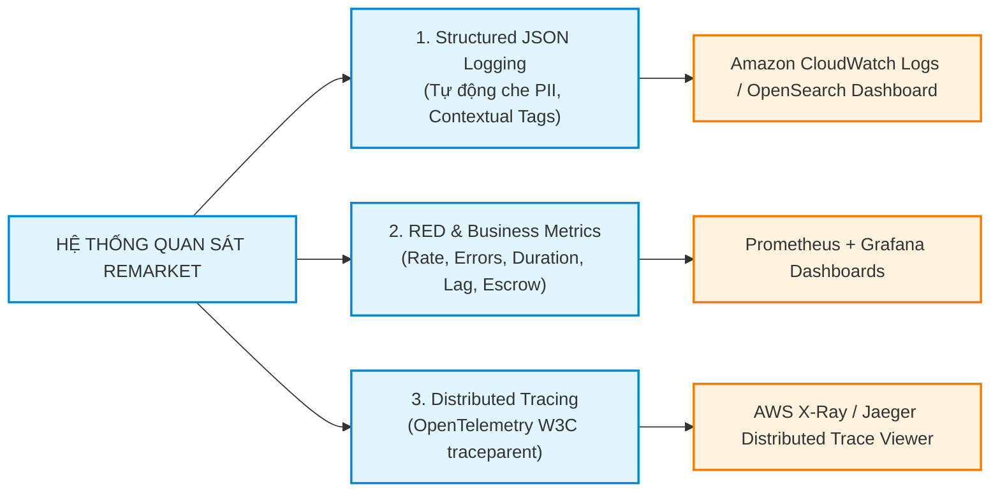

# Giám Sát, Truy Vết Phân Tán & Đối Soát Tự Động — Observability & Reconciliation

| Tài liệu | Thiết Kế Khả Năng Quan Sát & Động Cơ Đối Soát Tự Động (Observability & Reconciliation) |
| :--- | :--- |
| **Dự án** | Nền tảng Thương mại Điện tử Đồ cũ C2C ReMarket |
| **Mã tài liệu** | `DOC-BA-06-OBS` |
| **Phiên bản** | v1.0 |
| **Trạng thái** | Chấp thuận (Approved) |
| **Phân hệ cha** | [docs/BA/06_microservices-and-integrations/README.md](file:///d:/remarket-platform-system/docs/BA/06_microservices-and-integrations/README.md) |
| **Liên kết truy vết** | [screen-inventory.md](file:///d:/remarket-platform-system/docs/BA/04_product-and-ux/screen-inventory.md) (`SCR-ADM-08`), [open-questions-and-decisions.md](file:///d:/remarket-platform-system/docs/BA/02_business-analysis/open-questions-and-decisions.md) (`Q-OPS-06`, `Q-DR-05`), [non-functional-requirements.md](file:///d:/remarket-platform-system/docs/BA/03_requirements/non-functional-requirements.md) (`NFR-OBS-01..03`) |

---

## 1. Ba Trụ Cột Quan Sát Hệ Thống Phân Tán (3 Pillars of Observability)

Để đáp ứng yêu cầu giám sát toàn diện hệ thống phân tán theo chuẩn `NFR-OBS-01..03`, nền tảng ReMarket triển khai bộ giải pháp OpenTelemetry:

### 1.1. Chuẩn Hóa Nhật Ký Cấu Trúc (Structured JSON Logging)
- Mọi microservice bắt buộc ghi log dưới định dạng **JSON một dòng (Single-line JSON)**.
- **Các trường bắt buộc:** `timestamp`, `level` (INFO, WARN, ERROR), `service_name`, `trace_id`, `span_id`, `correlation_id`, `user_id`, `order_id`, `message`.
- **Bộ Lọc Che Giấu Dữ Liệu Nhạy Cảm (PII Masking Filter - `NFR-OBS-02`):**
  - Tầng Logging Middleware tự động nhận diện và che giấu các trường nhạy cảm trước khi đẩy ra stdout:
    - Số điện thoại: `0987654321` $\to$ `098***4321`.
    - Email: `buyer@gmail.com` $\to$ `b***r@gmail.com`.
    - Số thẻ ngân hàng / CCCD: Tự động che toàn bộ, chỉ để lại 4 số cuối.

### 1.2. Hệ Thống Chỉ Số Đo Lường (RED Metrics & Business KPIs)
- **Phương pháp RED Method trên từng Microservice:**
  - **R (Rate):** Số lượng request mỗi giây (RPS) trên từng Endpoint API.
  - **E (Errors):** Tỷ lệ lỗi HTTP 5xx và gRPC Error Codes.
  - **D (Duration):** Phân phối thời gian xử lý: $p50, p90, p95, p99$.
- **Các Chỉ Số Nghiệp Vụ Cốt Lõi (Business & Distributed Pipeline Metrics):**
  - `kafka_consumer_lag`: Độ trễ của các Consumer so với sự kiện mới nhất trong Kafka Topic.
  - `outbox_pending_messages`: Số lượng bản ghi chưa kịp gửi trong bảng `OutboxMessages` của `OrderDB`.
  - `active_reservations_count`: Số lượng đơn giữ chỗ 15 phút đang hoạt động ngoài sàn.
  - `payment_conversion_rate`: Tỷ lệ thanh toán thành công trong 15 phút giữ hàng (`BR-ORD-003`).

### 1.3. Truy Vết Phân Tán (OpenTelemetry W3C Distributed Tracing)
- Chuẩn hóa việc lan truyền ngữ cảnh (Context Propagation) theo chuẩn **W3C Trace Context**:
  $$\texttt{traceparent: 00-\{trace\_id\}-\{span\_id\}-\{flags\}}$$
- Mã `traceparent` được sinh ra ngay từ trình duyệt Client, truyền qua API Gateway, chuyển tiếp qua các cuộc gọi gRPC nội bộ, nhúng vào cột `OutboxMessages`, đưa vào Kafka Message Header, và truyền sang Consumer. Cho phép kỹ sư SRE theo dõi trọn vẹn hành trình của một đơn hàng qua 5 dịch vụ chỉ bằng 1 thao tác tìm kiếm `trace_id` duy nhất.

---

## 2. Ma Trận Cảnh Báo Vận Hành (Alerting & Severity Matrix)

Hệ thống phân cấp sự cố thành 3 mức độ ưu tiên, tích hợp trực tiếp với PagerDuty và kênh Slack Vận hành:

| Cấp Độ Sự Cố | Tiêu Chí Kích Hoạt Tự Động | Thời Gian Phản Hồi (SLA) | Kênh Thông Báo & Người Chịu Trách Nhiệm |
| :---: | :--- | :---: | :--- |
| **P1 - Critical** | - Tỷ lệ lỗi thanh toán thành công giảm $> 20\%$ trong 5 phút. - Cụm CSDL Primary bị sập (Failover diễn ra). - Có bản tin rơi vào Dead Letter Queue (DLQ). - Phát hiện đơn hàng bị lệch trạng thái tiền (`Captured`) nhưng không có đơn (`Out-of-Sync`). | **$\le 15$ phút** | PagerDuty gọi điện thoại trực tiếp cho **Incident Commander (`STK-18`)** và Lead Database Engineer. |
| **P2 - High** | - Tỷ lệ lỗi 5xx trên API Gateway $> 5\%$ trong 3 phút. - Kafka Consumer Lag $> 5.000$ messages. - Thời gian phản hồi $p99 > 2.000\text{ms}$. | **$\le 30$ phút** | Bắn cảnh báo âm thanh tới kênh `#alerts-high-severity` trên Slack. |
| **P3 - Warning** | - Dung lượng ổ đĩa RDS còn $< 20\%$. - Tỷ lệ sử dụng CPU Pod $> 80\%$ trong 10 phút liên tục. | **$\le 2$ giờ** | Ghi nhận ticket kiểm tra cho nhóm DevOps / Cloud Engineer. |

---

## 3. Kiến Trúc Động Cơ Đối Soát Tự Động 3 Chiều (3-Way Reconciliation Engine)

Giải quyết trọn vẹn câu hỏi mở `Q-OPS-06` và `Q-DR-05` về việc bảo đảm tính toàn vẹn số liệu tài chính giữa Hệ thống nội bộ, Cổng thanh toán và Đối tác 3PL:

```mermaid
flowchart TD
    subgraph REALTIME_RECON["1. ĐỐI SOÁT THỜI GIAN THỰC (Near Real-time Checker - 1 Phút/Lần)"]
        RT_CRON["Worker Quét Liên Tục (1 phút)"] --> RT_SCAN["Đối Chiếu OrderDB vs PaymentDB vs CatalogDB"]
        RT_SCAN --> RT_DETECT{"Phát Hiện Lệch Pha Trạng Thái?"}
        RT_DETECT -- "Có (Payment=Captured, Order=Created quá 60s)" --> RT_HEAL["Tự Lành (Self-Healing): Bắn lại OrderConfirmedEvent"]
        RT_DETECT -- "Không thể tự lành" --> RT_FLAG["Hiển Thị Cờ Cảnh Báo Lên Màn Hình SCR-ADM-08"]
    end

    subgraph DAILY_RECON["2. ĐỐI SOÁT TÀI CHÍNH CUỐI NGÀY (T+1 Settlement Reconciliation - 02:00 AM)"]
        DAILY_CRON["Cronjob Đối Soát 02:00 AM"] --> FETCH_BANK["Tải Báo Cáo Giao Dịch Đối Soát Từ Cổng VNPAY / MoMo"]
        DAILY_CRON --> FETCH_3PL["Tải Báo Cáo Giao Hàng & Thu Hộ Từ Đơn Vị 3PL"]
        DAILY_CRON --> FETCH_LEDGER["Trích Xuất Sổ Cái Giao Dịch PaymentDB.PaymentTransactions"]

        FETCH_BANK --> MATCH_ENGINE["Động Cơ So Khớp Tự Động (Matching Engine)"]
        FETCH_3PL --> MATCH_ENGINE
        FETCH_LEDGER --> MATCH_ENGINE

        MATCH_ENGINE --> RES_MATCH{"Kết Quả Đối Soát"}
        RES_MATCH -- "Khớp 100%" --> APPROVE_PAYOUT["Tự Động Kích Hoạt Lệnh Batch Payout Cho Người Bán"]
        RES_MATCH -- "Có Chênh Lệch (Giao Dịch Thừa/Thiếu)" --> HOLD_PAYOUT["Tạm Dừng Payout + Sinh Báo Cáo Lệch Cho Finance Lead (STK-15)"]
    end
```

### 3.1. Đối Soát Lệch Pha Thời Gian Thực (Near Real-Time Reconciliation)
- Chạy định kỳ **mỗi 1 phút**, quét toàn bộ các giao dịch phát sinh trong 10 phút gần nhất:
  - Nếu phát hiện bản ghi `PaymentIntents.PaymentStatus = 'Captured'` nhưng `Orders.OrderStatus = 'Created'` kéo dài quá 60 giây (do mạng nghẽn khiến sự kiện Kafka đến chậm).
  - Động cơ đối soát tự động kích hoạt **Cơ chế tự lành (Self-Healing)**: Tái tạo và bắn lại sự kiện `PaymentCapturedEvent` vào Kafka bus để ép `OrderService` hoàn tất đơn hàng.
  - Nếu thử lại 3 lần vẫn thất bại, hệ thống gắn cờ cảnh báo trực tiếp lên bảng điều khiển `SCR-ADM-08` để kỹ sư vận hành can thiệp thủ công.

### 3.2. Đối Soát Sổ Cái Tài Chính Cuối Ngày (T+1 Settlement Reconciliation)
- Chạy tự động vào lúc **02:00 sáng hàng ngày**:
  1. Tải toàn bộ file sao kê đối soát (Reconciliation CSV / API Report) từ các cổng thanh toán (VNPAY, MoMo) của ngày hôm trước ($T$).
  2. So khớp từng bản ghi theo mã chuẩn chi ngân hàng (`GatewayTransactionId`):
     - Kiểm tra khớp số tiền giao dịch (`Gross Amount`).
     - Kiểm tra khớp tỷ lệ phí cổng thanh toán khấu trừ.
  3. Chỉ khi toàn bộ giao dịch trong ngày đạt tỷ lệ so khớp **100% không chênh lệch**, hệ thống mới cấp phép mở khóa lệnh giải ngân tự động (**`Batch Payout`**) chuyển tiền bán đồ cũ vào tài khoản ngân hàng của Người bán.

