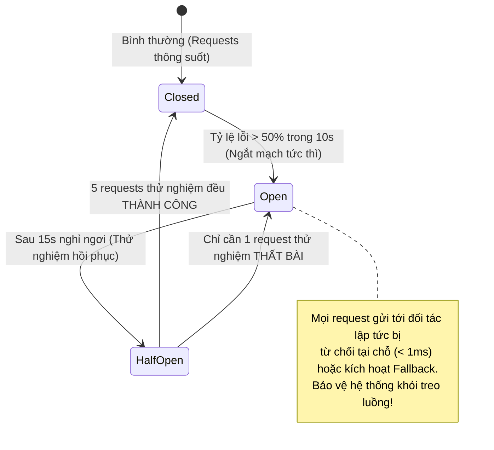

# Khả Năng Chịu Lỗi & Kiểm Soát Lưu Lượng — Resilience & Rate Limiting

| Tài liệu | Thiết Kế Chịu Lỗi Hệ Thống Phân Tán & Kiểm Soát Lưu Lượng (Resilience & Throttling) |
| :--- | :--- |
| **Dự án** | Nền tảng Thương mại Điện tử Đồ cũ C2C ReMarket |
| **Mã tài liệu** | `DOC-BA-06-RES` |
| **Phiên bản** | v1.0 |
| **Trạng thái** | Chấp thuận (Approved) |
| **Phân hệ cha** | [docs/BA/06_microservices-and-integrations/README.md](file:///d:/remarket-platform-system/docs/BA/06_microservices-and-integrations/README.md) |
| **Liên kết truy vết** | [service-boundaries.md](file:///d:/remarket-platform-system/docs/BA/06_microservices-and-integrations/service-boundaries.md), [non-functional-requirements.md](file:///d:/remarket-platform-system/docs/BA/03_requirements/non-functional-requirements.md) (`NFR-AVL-01`, `NFR-REL-01..02`, `NFR-SCAL-01`) |

---

## 1. Phân Bổ Ngân Sách Thời Gian Chờ (Timeout Budget & Deadline Propagation)

Để ngăn chặn hiện tượng treo luồng đồng loạt (Thread Starvation) khiến sự cố của một cổng thanh toán hoặc dịch vụ con kéo sập toàn bộ hệ thống, ReMarket phân bổ ngân sách thời gian chờ nghiêm ngặt theo thứ bậc:

```
+------------------------------------------------------------------------+
| 1. Client Browser / Mobile Timeout Budget        : 15.0 giây           |
+------------------------------------------------------------------------+
    |
    v
+--------------------------------------------------------------------+
| 2. AWS ALB / CloudFront Timeout                  : 12.0 giây       |
+--------------------------------------------------------------------+
    |
    v
+----------------------------------------------------------------+
| 3. API Gateway / BFF Timeout                     : 10.0 giây   |
+----------------------------------------------------------------+
    |
    v
+------------------------------------------------------------+
| 4. Microservice Business Logic Timeout           : 5.0 giây|
+------------------------------------------------------------+
    |
    v
+--------------------------------------------------------+
| 5. External API Call (VNPAY / GHN 3PL) Timeout : 3.0s  |
| 6. Database Query Execution Timeout            : 2.0s  |
| 7. Distributed Lock Acquisition Timeout        : 1.0s  |
+--------------------------------------------------------+
```

### Cơ Chế Lan Truyền Thời Hạn (Deadline Propagation):
- Khi một request đi qua API Gateway, hệ thống tự động tính toán thời điểm hết hạn `Deadline = Now + 10s` và gắn vào Header `X-Request-Deadline: 1731420010000` (hoặc gRPC Deadline Context).
- Toàn bộ các microservices con trong chuỗi gọi East-West liên tục kiểm tra Deadline này. Nếu thời gian còn lại $\le 100\text{ms}$, service tự động **hủy bỏ xử lý (Abort Execution)** và giải phóng tài nguyên CPU/Connection, không tiếp tục thực hiện các câu lệnh CSDL vô ích.

---

## 2. Mẫu Ngắt Mạch (Circuit Breaker) & Vách Ngăn Cách Ly (Bulkhead Pattern)

### 2.1. Cấu Hình Circuit Breaker Cho Từng Thành Phần
Áp dụng thư viện **Polly (.NET)** và **Resilience4j** tại tầng gọi API đối tác ngoài và giao tiếp liên dịch vụ:



- **Ngưỡng cấu hình Circuit Breaker cho Cổng thanh toán (VNPAY/MoMo):**
  - Cửa sổ trượt (Sliding Window): 20 requests liên tiếp.
  - Tỷ lệ lỗi kích hoạt ngắt mạch: $\ge 50\%$ hoặc $p99 \text{ latency} > 3\text{ giây}$.
  - Thời gian giữ trạng thái ngắt (`Open Duration`): 15 giây.
  - Số request thử nghiệm khi mở lại (`Half-Open Probe Count`): 5 requests.

### 2.2. Vách Ngăn Cách Ly Tài Nguyên (Bulkhead Isolation Pattern)
Nhằm đảm bảo nếu một tính năng gặp sự cố quá tải thì các tính năng sống còn khác vẫn hoạt động 100%:
- **Tách Biệt Nhóm Luồng Xử Lý (Thread Pool Isolation):**
  - *Luồng Trọng Yếu (Checkout & Thanh Toán):* Cấp phát riêng 40% số kết nối DB Connection Pool và 50 luồng CPU độc quyền.
  - *Luồng Tra Cứu & Đọc Tin:* Cấp phát pool riêng biệt.
  - *Luồng Báo Cáo / Xuất Dữ Liệu Nặng:* Giới hạn tối đa 5 luồng xử lý đồng thời.
- **Kết quả:** Ngay cả khi hàng nghìn người dùng đang tải báo cáo hoặc tìm kiếm làm nghẽn luồng đọc, một Người mua đang tại bước Checkout vẫn bấm "Xác nhận thanh toán" thành công mà không bị ảnh hưởng.

---

## 3. Chiến Lược Giới Hạn Tốc Độ Đa Tầng (Multi-Tier Rate Limiting)

Hệ thống triển khai cơ chế kiểm soát tốc độ tại tầng `SVC-00 API Gateway` thông qua thuật toán **Token Bucket** và **Sliding Window Counter** lưu trữ trên Redis Cluster:

| Nhóm Tuyến Đường API | Khóa Định Danh Giới Hạn | Hạn Mức Tối Đa (Rate Limit) | Mục Tiêu Bảo Vệ Kỹ Thuật |
| :--- | :--- | :---: | :--- |
| `POST /api/v1/auth/login`, `/otp/send` | Theo `Client IP` & `PhoneNumber` | **5 requests / phút** | Chống tấn công dò mật khẩu (Brute-force) và spam cước viễn thông OTP. |
| `POST /api/v1/orders/checkout` | Theo `User ID` đã xác thực | **10 requests / phút** | Chống phần mềm tự động (Bot) quét và gom hàng đồ cũ giá hời. |
| `POST /api/v1/media/presigned-url` | Theo `Seller ID` | **30 requests / phút** | Chống lạm dụng tài nguyên lưu trữ và băng thông Amazon S3. |
| `GET /api/v1/search`, `/feed/home` | Theo `Client IP` | **120 requests / phút** | Chống cào dữ liệu (Web Scraping) và bảo vệ cụm OpenSearch. |
| `POST /api/v1/webhooks/**` | Theo `Gateway IP Whitelist` | **1.000 requests / phút** | Đảm bảo thông suốt cho lưu lượng Webhook từ ngân hàng và 3PL. |

- Khi vượt quá hạn mức, hệ thống trả về ngay mã lỗi **`429 Too Many Requests`** kèm Header `Retry-After: 45` chỉ định số giây người dùng cần chờ trước khi thử lại.

---

## 4. Ma Trận Giảm Cấp Dịch Vụ Thanh Lịch (Graceful Degradation Matrix)

Trong môi trường phân tán quy mô lớn, một số thành phần phụ trợ gặp sự cố là điều không thể tránh khỏi. Hệ thống tự động chuyển sang chế độ dự phòng thanh lịch (Graceful Degradation) để bảo vệ trải nghiệm người dùng:

| Thành Phần Gặp Sự Cố | Mức Độ Ảnh Hưởng | Chế Độ Dự Phòng Tự Động (Fallback Mode) | Trải Nghiệm Phản Hồi Trên Giao Diện |
| :--- | :---: | :--- | :--- |
| **Cụm OpenSearch bị sập** | Cao | Tự động chuyển luồng tìm kiếm sang truy vấn trực tiếp vào danh mục tĩnh của `MongoDB CatalogDB`. | Tắt tính năng tự động gợi ý (Autocomplete); hiển thị thông báo nhẹ: *"Tìm kiếm nâng cao đang bảo trì, bạn có thể duyệt theo Danh mục"*. |
| **Cụm Redis Cache bị sập** | Trung bình | Tự động bỏ qua tầng Cache (Bypass Cache), đọc trực tiếp từ Read Replica Database kèm siết chặt Rate Limiting. | Trang tải chậm hơn bình thường (khoảng 1 - 2 giây), nhưng toàn bộ dữ liệu vẫn hiển thị chính xác. |
| **API của Đơn vị 3PL (GHN) Timeout** | Trung bình | Cho phép Người bán xác nhận đơn và đóng gói bình thường; đưa yêu cầu tạo vận đơn vào hàng đợi Kafka để tự động thử lại sau. | Nút in vận đơn tạm thời vô hiệu hóa; hiển thị thông báo: *"Mã vận đơn đang được hệ thống tạo tự động, vui lòng quay lại sau ít phút"*. |
| **Cổng Thanh toán Ngân hàng Timeout** | Cao | Chuyển đơn sang trạng thái `Payment Pending` trong 5 phút; kích hoạt Worker QueryDR đối soát chủ động (`EX-005`). | Hiển thị màn hình đồng hồ cát vàng (`SCR-MKT-07`), khóa nút bấm thanh toán lặp, hướng dẫn khách kiểm tra số dư tài khoản trước khi thử lại. |
| **Notification Service bị sập** | Thấp | Toàn bộ sự kiện gửi thông báo vẫn lưu an toàn trong Kafka Topic; tự động gửi bù khi service hoạt động trở lại. | Người dùng không nhận được Email/Push tức thì; luồng mua bán trên sàn hoàn toàn không bị gián đoạn. |

