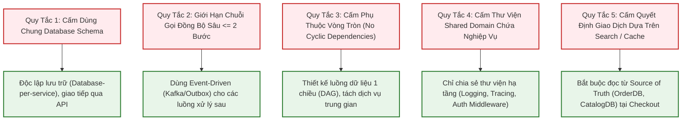

# Ranh Giới Dịch Vụ & Chống Phân Tán Giả Cầy — Service Boundaries

| Tài liệu | Phân Định Ranh Giới Trách Nhiệm & Quy Tắc Thiết Kế Microservices (Service Boundaries) |
| :--- | :--- |
| **Dự án** | Nền tảng Thương mại Điện tử Đồ cũ C2C ReMarket |
| **Mã tài liệu** | `DOC-BA-06-BND` |
| **Phiên bản** | v1.0 |
| **Trạng thái** | Chấp thuận (Approved) |
| **Phân hệ cha** | [docs/BA/06_microservices-and-integrations/README.md](file:///d:/remarket-platform-system/docs/BA/06_microservices-and-integrations/README.md) |
| **Liên kết truy vết** | [service-catalog.md](file:///d:/remarket-platform-system/docs/BA/06_microservices-and-integrations/service-catalog.md), [domain-model.md](file:///d:/remarket-platform-system/docs/BA/05_domain-and-data/domain-model.md), [non-functional-requirements.md](file:///d:/remarket-platform-system/docs/BA/03_requirements/non-functional-requirements.md) (`NFR-AVL-01`, `NFR-REL-01`) |

---

## 1. Ma Trận Phân Định Sở Hữu Tuyệt Đối (Owns vs Never Owns)

Trong kiến trúc Microservices phân tán, ranh giới sở hữu dữ liệu phải được xác lập bất biến. Một microservice chỉ được phép sửa đổi dữ liệu do chính nó sở hữu:

| Microservice | Những Gì Dịch Vụ Sở Hữu Tuyệt Đối (OWNS) | Những Gì Dịch Vụ TUYỆT ĐỐI KHÔNG Sở Hữu (NEVER OWNS) |
| :--- | :--- | :--- |
| `SVC-01: IdentityService` | Tài khoản, Mật khẩu băm, Quyền hạn RBAC, Hồ sơ KYC Người bán, Sổ địa chỉ người dùng. | **Không** sở hữu số dư tiền bán, **Không** tạo đơn hàng, **Không** lưu lịch sử khiếu nại. |
| `SVC-02: CatalogService` | Dữ liệu tin đăng gốc, Album ảnh S3 URLs, Thuộc tính động, Cây danh mục, Đánh giá sao. | **Không** quản lý giữ chỗ 15p tại checkout, **Không** lưu thông tin thanh toán, **Không** theo dõi tracking vận đơn. |
| `SVC-03: MediaService` | Quản lý cấp Presigned URLs, Kiểm duyệt mã băm ảnh (Hash), Quét nội dung bạo lực/nhạy cảm. | **Không** lưu nội dung tin đăng, **Không** quản lý tài khoản người dùng, **Không** xử lý thanh toán. |
| `SVC-04: SearchService` | Dữ liệu dẫn xuất (Read Model Index) phục vụ tìm kiếm toàn văn tiếng Việt, Faceted Aggregations. | **Không** sở hữu dữ liệu gốc, **Không bao giờ** được phép đưa ra quyết định giao dịch hoặc kiểm tra tồn kho (`INV-02`). |
| `SVC-05: OrderService` | Lệnh giữ hàng 15p (`InventoryReservations`), Đơn hàng (`Orders`), Snapshot bất biến (`OrderItemSnapshots`). | **Không** gọi trực tiếp cổng ngân hàng (ủy quyền cho `PaymentService`), **Không** can thiệp trực tiếp vào mã vận đơn 3PL. |
| `SVC-06: PaymentService` | Ý định thanh toán (`PaymentIntents`), Giao dịch thẻ/ngân hàng, Quỹ tạm giữ (`EscrowAccounts`), Lịch sử Payout. | **Không** quyết định hủy đơn do hết hàng (ủy quyền cho `OrderService`), **Không** lưu trữ thông tin địa chỉ giao nhận của khách. |
| `SVC-07: ShippingService` | Vận đơn (`Shipments`), Lịch sử Checkpoints 3PL, Bảng tính cước vận chuyển, Token kết nối đối tác GHN/GHTK. | **Không** tự ý tạo vận đơn khi đơn chưa thanh toán (`Confirmed`), **Không** can thiệp vào số tiền thanh toán của đơn hàng. |
| `SVC-08: TrustSupportService`| Hồ sơ kiểm duyệt (`ModerationTickets`), Hồ sơ tranh chấp (`DisputeCases`), Nhật ký mở PII (`SupportPIIAuditLogs`), CQRS `Order360View`. | **Không** thực hiện trừ/cộng tiền trực tiếp (chỉ phát lệnh hoàn tiền sang `PaymentService`), **Không** sửa nội dung snapshot của đơn. |
| `SVC-09: NotificationService`| Lịch sử thông báo đa kênh, Cấu hình tùy chọn nhận tin (`NotificationPreferences`), Phiên kết nối WebSocket. | **Không** sinh ra trạng thái đơn hàng, **Không** thay đổi trạng thái thanh toán. |

---

## 2. Năm Quy Tắc Thiết Kế Chống "Phân Tán Giả Cầy" (Anti-Distributed Monolith)

Hệ thống phân tán giả cầy (Distributed Monolith) là hiện tượng các microservices bị dính chặt với nhau (Tightly Coupled), khiến việc triển khai hoặc sự cố của một dịch vụ kéo sập toàn bộ hệ thống. ReMarket áp dụng nghiêm ngặt 5 quy tắc kiến trúc sau:



1. **Quy Tắc 1 — Cấm Dùng Chung Cơ Sở Dữ Liệu (No Shared Database):**
   - Tuyệt đối không cho phép 2 microservices cùng kết nối vào một Database Schema hoặc thực hiện câu lệnh SQL `JOIN` xuyên cơ sở dữ liệu.
2. **Quy Tắc 2 — Giới Hạn Độ Sâu Chuỗi Gọi Đồng Bộ (Sync Call Depth $\le$ 2):**
   - Chuỗi gọi đồng bộ tối đa cho phép: `Client → API Gateway → Microservice A → Microservice B`.
   - **Nghiêm cấm** chuỗi gọi đồng bộ sâu dạng `Gateway → Service A → Service B → Service C → Service D`. Nếu một dịch vụ trong chuỗi bị chậm, toàn bộ chuỗi sẽ bị Timeout và khóa cứng luồng xử lý.
3. **Quy Tắc 3 — Cấm Phụ Thuộc Vòng Tròn (No Cyclic Dependency):**
   - Nếu `OrderService` gọi `PaymentService`, thì `PaymentService` tuyệt đối không được gọi ngược lại `OrderService` qua HTTP/gRPC. Chiều phản hồi bắt buộc phải sử dụng **Domain Event bất đồng bộ qua Kafka**.
4. **Quy Tắc 4 — Cấm Chia Sẻ Thư Viện Nghiệp Vụ (No Shared Domain Libraries):**
   - Không tạo gói NuGet / NPM chứa chung Domain Entities hoặc Business Logic để dùng chung giữa các services. Việc này sẽ làm dính chặt chu kỳ release của các team. Mỗi microservice tự định nghĩa Contract DTO của riêng mình.
5. **Quy Tắc 5 — Cấm Quyết Định Giao Dịch Dựa Trên Dữ Liệu Dẫn Xuất (`INV-02`):**
   - Dữ liệu trên `OpenSearch` và `Redis Cache` chỉ dùng cho mục đích khám phá và tăng tốc hiển thị. Khi Người mua bấm "Mua ngay" tại `SCR-MKT-03` hoặc "Xác nhận thanh toán" tại `SCR-MKT-06`, hệ thống bắt buộc phải kiểm tra và khóa tồn kho trên CSDL gốc (`OrderDB.InventoryReservations`).

---

## 3. Ma Trận Giao Tiếp Đồng Bộ (Synchronous) vs Bất Đồng Bộ (Asynchronous)

| Luồng Tương Tác Giữa Các Dịch Vụ | Giao Thức Lựa Chọn | Cơ Sở Kỹ Thuật (Design Rationale) | Xử Lý Khi Dịch Vụ Đích Gặp Sự Cố |
| :--- | :---: | :--- | :--- |
| `API Gateway` $\to$ `IdentityService` | **gRPC Đồng Bộ** | Cần giải mã Token, kiểm tra quyền hạn tức thì (< 10ms) cho mọi request. | Gateway từ chối request với mã lỗi 401/403. |
| `OrderService` $\to$ `CatalogService` (Lúc Checkout) | **gRPC Đồng Bộ** | Cần lấy dữ liệu gốc để tạo `OrderItemSnapshots` bất biến trong vài mili-giây. | Báo lỗi không tạo được đơn, mở lại giỏ hàng cho khách. |
| `OrderService` $\to$ `PaymentService` (Khởi tạo thanh toán)| **HTTP REST Đồng bộ** | Cần lấy ngay Payment URL chuyển hướng người dùng sang giao diện ngân hàng. | Báo lỗi cổng thanh toán bận, giữ chỗ 15p vẫn bảo lưu cho khách thử lại. |
| `PaymentService` $\to$ `OrderService` (Thanh toán thành công)| **Kafka Bất Đồng Bộ** | Đảm bảo tính bền vững: Dù `OrderService` khởi động lại, bản tin vẫn nằm trong Kafka chờ xử lý. | Bản tin nằm trong Topic; tự động tiêu thụ khi service online trở lại. |
| `OrderService` $\to$ `ShippingService` (Tạo vận đơn) | **Kafka Bất Đồng Bộ** | Quy trình tạo vận đơn 3PL mất từ 1 đến 3 giây, không bắt người mua phải chờ trên màn hình kết quả thanh toán. | Retry tự động qua Retry Topics; nếu lỗi 3PL thì đẩy vào hàng đợi chờ xử lý lại. |
| `Tất cả Services` $\to$ `SearchService` (Đồng bộ Search) | **Kafka Bất Đồng Bộ** | Cập nhật Read Model là phi giao dịch, cho phép độ trễ nhất định (Eventual Consistency). | Consumer tiêu thụ tuần tự theo `listing_id` partition key. |
| `Tất cả Services` $\to$ `NotificationService` | **Kafka Bất Đồng Bộ** | Việc gửi Email/Push notification không được phép làm nghẽn hoặc rollback giao dịch chính. | Xử lý ngầm, không ảnh hưởng đến giao dịch của người dùng. |

---

## 4. Sơ Đồ Phối Hợp Xuyên Ranh Giới (Cross-Boundary Sequence)

Sơ đồ thể hiện sự kết hợp hoàn hảo giữa **Giao tiếp Đồng bộ (Fast-path)** tại bước tạo đơn và **Giao tiếp Bất đồng bộ (Event-driven)** tại bước hoàn tất đơn:

```mermaid
sequenceDiagram
    autonumber
    actor Buyer as Người Mua (ROLE-01)
    participant GW as API Gateway (SVC-00)
    participant OrderSvc as OrderService (SVC-05)
    participant CatSvc as CatalogService (SVC-02)
    participant PaySvc as PaymentService (SVC-06)
    participant Kafka as Kafka Event Bus
    participant ShipSvc as ShippingService (SVC-07)
    participant NotifSvc as NotificationService (SVC-09)

    Note over Buyer,PaySvc: GIAI ĐOẠN 1: ĐỒNG BỘ (Synchronous Fast-Path)
    Buyer->>GW: POST /api/v1/checkout (Bấm Mua ngay)
    GW->>OrderSvc: Gửi yêu cầu Đặt hàng & Giữ chỗ 15p
    OrderSvc->>CatSvc: gRPC GetListingSnapshot(ListingId)
    CatSvc-->>OrderSvc: Trả về Title, Price, Condition, Photos
    OrderSvc->>OrderSvc: Transaction: Khóa Reservation (15p) + Tạo Order (Created)
    OrderSvc->>PaySvc: POST /internal/payments/intent
    PaySvc-->>OrderSvc: Trả về PaymentUrl (VNPAY/MoMo)
    OrderSvc-->>GW-->>Buyer: Trả về URL thanh toán & Bật đồng hồ 15:00

    Note over Buyer,NotifSvc: GIAI ĐOẠN 2: BẤT ĐỒNG BỘ (Event-Driven Reliability)
    Buyer->>PaySvc: Thanh toán thành công tại Cổng ngân hàng (Webhook IPN)
    PaySvc->>PaySvc: Transaction: Payment = Captured + Tạo Escrow Holding
    PaySvc->>Kafka: Publish event: PaymentCapturedEvent (PartitionKey = OrderId)

    par Tiêu Thụ Sự Kiện Độc Lập
        Kafka->>OrderSvc: Consume PaymentCapturedEvent
        OrderSvc->>OrderSvc: Chuyển Order = Confirmed + Reservation = Consumed
        OrderSvc->>Kafka: Publish event: OrderConfirmedEvent
    and Tiêu Thụ Gửi Thông Báo
        Kafka->>NotifSvc: Consume PaymentCapturedEvent
        NotifSvc-->>Buyer: Bắn thông báo: "Thanh toán thành công đơn hàng!"
    end

    Kafka->>ShipSvc: Consume OrderConfirmedEvent
    ShipSvc->>ShipSvc: Tự động khởi tạo hồ sơ vận chuyển nội bộ
```

