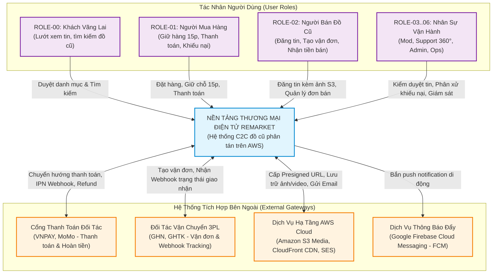
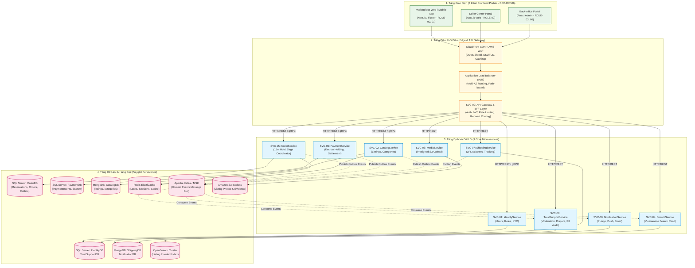

# Bối Cảnh Hệ Thống & Sơ Đồ C4 — System Context & Container Architecture

| Tài liệu | Đặc tả Bối Cảnh Hệ Thống & Sơ đồ C4 Level 1 - Level 2 (System Context & Containers) |
| :--- | :--- |
| **Dự án** | Nền tảng Thương mại Điện tử Đồ cũ C2C ReMarket |
| **Mã tài liệu** | `DOC-BA-06-CTX` |
| **Phiên bản** | v1.0 |
| **Trạng thái** | Chấp thuận (Approved) |
| **Phân hệ cha** | [docs/BA/06_microservices-and-integrations/README.md](file:///d:/remarket-platform-system/docs/BA/06_microservices-and-integrations/README.md) |
| **Liên kết truy vết** | [scope-and-boundaries.md](file:///d:/remarket-platform-system/docs/BA/00_project-context/scope-and-boundaries.md), [user-roles-and-permissions.md](file:///d:/remarket-platform-system/docs/BA/01_stakeholders-and-users/user-roles-and-permissions.md), [domain-model.md](file:///d:/remarket-platform-system/docs/BA/05_domain-and-data/domain-model.md), [open-questions-and-decisions.md](file:///d:/remarket-platform-system/docs/BA/02_business-analysis/open-questions-and-decisions.md) (`DEC-DIR-01..06`) |

---

## 1. Mô Hình C4 Level 1 — Sơ Đồ Bối Cảnh Hệ Thống (System Context Diagram)

Sơ đồ C4 Level 1 trực quan hóa ranh giới tương tác ngoài của nền tảng **ReMarket Platform** với 7 nhóm tác nhân người dùng và 4 nhóm hệ thống tích hợp đối tác bên ngoài:

---

## 2. Mô Hình C4 Level 2 — Sơ Đồ Khối Ứng Dụng (Container Architecture Diagram)

Sơ đồ C4 Level 2 phân rã hệ thống thành các khối ứng dụng (Containers), phân tách rạch ròi giữa Tầng Giao diện người dùng, Tầng Điều phối biên (Ingress/BFF), Tầng 9 Microservices nghiệp vụ và Tầng Cơ sở dữ liệu phân tán:

---

## 3. Phân Luồng Giao Tiếp Mạng (Traffic Topology)

Hệ thống phân tách lưu lượng mạng thành 2 hướng giao tiếp độc lập nhằm tối đa hóa bảo mật và hiệu năng:

### 3.1. Luồng Giao Tiếp Bắc - Nam (North-South Traffic)
- **Định nghĩa:** Luồng lưu lượng từ Internet (Client trình duyệt, Mobile App, Webhook của ngân hàng/3PL) đi vào hệ thống qua biên bảo vệ.
- **Tiêu chuẩn kiểm soát tại biên:**
  1. **HTTPS / TLS 1.3:** Mã hóa 100% đường truyền tại CloudFront CDN và kết thúc TLS tại Application Load Balancer (ALB).
  2. **AWS WAF (Web Application Firewall):** Chặn các cuộc tấn công phổ biến (SQL Injection, Cross-Site Scripting XSS, HTTP Flood, Bad Bot).
  3. **Xác thực & Ủy quyền (Authentication & Authorization):** `SVC-00 API Gateway` giải mã Token JWT, kiểm tra chữ ký số, trích xuất Claims vai trò (`roles`) và định tuyến vào các Microservices tương ứng.
  4. **Kiểm soát Tần suất (Rate Limiting):** Áp dụng thuật toán Token Bucket trên Redis để ngăn chặn tấn công từ chối dịch vụ (DDoS) và bot gom hàng.

### 3.2. Luồng Giao Tiếp Đông - Tây (East-West Traffic)
- **Định nghĩa:** Luồng lưu lượng nội bộ giữa các microservices bên trong mạng riêng (Private Subnet).
- **Tiêu chuẩn giao tiếp nội bộ:**
  1. **Truy vấn Đồng bộ Tốc độ Cao (Internal Synchronous Queries):** Sử dụng **gRPC trên nền tảng HTTP/2 với Protobuf Binary Serialization**.
     - Giảm 60% kích thước gói tin so với JSON REST.
     - Áp dụng cho các truy vấn kiểm tra nhanh có ràng buộc thời gian (ví dụ: `OrderService` gọi `CatalogService` để lấy thông tin tạo snapshot, hoặc gọi `IdentityService` để xác thực hồ sơ).
  2. **Giao Tiếp Hướng Sự Kiện Bất Đồng Bộ (Asynchronous Event-Driven Communication):** Sử dụng **Apache Kafka / AWS MSK**.
     - Áp dụng mẫu **Transactional Outbox Pattern** để đảm bảo tính nhất quán (Atomicity) giữa việc ghi CSDL và bắn sự kiện (`At-least-once Delivery`).
     - Tách rời hoàn toàn sự phụ thuộc (Decoupling) giữa dịch vụ phát sinh sự kiện và các dịch vụ lắng nghe (ví dụ: `PaymentCapturedEvent` được phát ra, `OrderService`, `CatalogService` và `NotificationService` đồng thời tiêu thụ độc lập mà không làm chậm luồng thanh toán).

