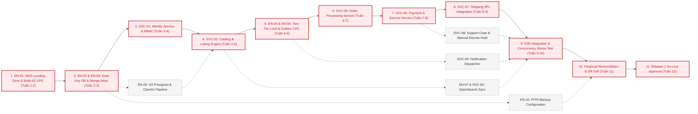

# Dependencies, Critical Path & Release Risk Management – ReMarket

## Thông tin tài liệu

| Thuộc tính | Giá trị |
|---|---|
| Dự án | ReMarket – Nền tảng Thương mại Điện tử Đồ cũ C2C/B2C Phân tán |
| Tài liệu | Quản lý Phụ thuộc Đa chiều, Sơ đồ Đường găng (Critical Path) & Sổ Đăng ký Rủi ro Phát hành |
| Mã tài liệu | `DOC-BA-07-DEP` |
| Phiên bản | 1.0 |
| Trạng thái | Hoàn thiện (Baseline cho Quản trị Tiến độ & Phòng ngừa Rủi ro) |
| Ngày cập nhật | 12/11/2026 |
| Tài liệu liên quan | `07_backlog-and-release/epics-and-features.md`, `release-scope.md`, `02_business-analysis/open-questions-and-decisions.md`, `06_microservices-and-integrations/external-integrations.md` |

---

## 1. Ma trận Phụ thuộc Kỹ thuật & Kiến trúc Nội bộ (DAG)

Trong một hệ thống gồm 10 thành phần dịch vụ (`SVC-00..09`) và 10 hạng mục kỹ thuật nền tảng (`EN-01..10`), các thành phần không thể được xây dựng một cách tùy tiện mà phải tuân theo đồ thị có hướng không chu trình (Directed Acyclic Graph - DAG):

| Hạng mục Mục tiêu | Hạng mục Tiên quyết Bắt buộc (Prerequisites) | Loại Phụ thuộc | Lý do Kỹ thuật / Ràng buộc Bất biến |
|---|---|---|---|
| **`EN-02`** (Dual-Key SQL Schema) | `EN-01` (AWS Landing Zone & VPC) | Cứng (Hard) | Cần có mạng VPC bảo mật trước khi khởi tạo cụm RDS SQL Server Multi-AZ. |
| **`EN-03`** (MongoDB Atlas Schemas) | `EN-01` (VPC Peering / PrivateLink) | Cứng (Hard) | Cần kết nối an toàn VPC Peering giữa AWS và MongoDB Atlas. |
| **`SVC-01`** (Identity & Access) | `EN-02` (`IdentityDB`), `EN-01` (Gateway) | Cứng (Hard) | Toàn bộ các dịch vụ khác đều cần JWT token và thông tin xác thực từ `SVC-01`. |
| **`SVC-02`** (Catalog & Listing) | `SVC-01` (Auth), `EN-03` (`CatalogDB`), `EN-06` (S3) | Cứng (Hard) | Đăng tin cần xác thực người bán và presigned URL tải ảnh trực tiếp S3. |
| **`SVC-04`** (Search Engine) | `SVC-02` (Catalog Events), `EN-07` (OpenSearch) | Mềm (Soft) | Công cụ tìm kiếm cần dữ liệu tin đăng và pipeline đồng bộ sự kiện NRT. |
| **`EN-04`** (Two-Tier Lock Engine) | `EN-01` (ElastiCache Redis), `EN-02` (`OrderDB`) | Cứng (Hard) | Cần cả Redis Cluster và bảng SQL RowVersion để bảo vệ **`INV-01` Zero Overselling**. |
| **`EN-05`** (Outbox & Debezium CDC) | `EN-02` (SQL), `EN-03` (Mongo), AWS EventBridge | Cứng (Hard) | Cần bảng Outbox trên cơ sở dữ liệu giao dịch để bảo vệ **`INV-03` Zero Lost Events**. |
| **`SVC-05`** (Order Processing) | `SVC-02` (Listing Check), `EN-04` (Lock), `EN-05` (Outbox) | Cứng (Hard) | Khởi tạo đơn và khóa giữ chỗ 15 phút là trái tim điều phối giao dịch. |
| **`SVC-06`** (Payment & Escrow) | `SVC-05` (Order Events), `EN-02` (`PaymentDB`), `EN-05` | Cứng (Hard) | Cần thông tin đơn hàng và mã thanh toán để giao tiếp với PSP đối tác (**`INV-02`**). |
| **`SVC-07`** (Shipping & Logistics) | `SVC-05` (Order Paid Event), `EN-03` (`ShippingDB`) | Cứng (Hard) | Chỉ kích hoạt tạo vận đơn 3PL khi đơn hàng chuyển sang trạng thái đã thanh toán. |
| **`SVC-08`** (Trust & Support) | `SVC-05`, `SVC-06`, `SVC-07`, `EN-03` (`SupportDB`) | Mềm (Soft) | Tiếp nhận khiếu nại tranh chấp và đóng băng ký quỹ (**`INV-04`**), hiển thị `Order 360°`. |
| **`SVC-09`** (Notification) | `EN-05` (Event Consumer), AWS SES / SMS Gateway | Mềm (Soft) | Nhận sự kiện từ EventBridge để đẩy thông báo đa kênh không đồng bộ. |
| **`EN-10`** (PITR Backup & DR) | `EN-02`, `EN-03`, S3 Glacier Vault | Cứng (Hard) | Thiết lập sao lưu định kỳ và diễn tập khôi phục thảm họa (**`INV-05`**). |

---

## 2. Sơ đồ Đường găng Dự án (Critical Path Method - CPM)

Đường găng (Critical Path) là chuỗi các nhiệm vụ dài nhất quyết định ngày bàn giao và Go-Live của hệ thống ReMarket. Bất kỳ sự chậm trễ nào trên các mắt xích màu đỏ của đường găng sẽ trực tiếp làm trễ tiến độ toàn bộ dự án:

---

## 3. Ma trận Phụ thuộc Quyết định Nghiệp vụ & Kỹ thuật Đang mở (Open Questions Gate Mapping)

Toàn bộ **38 câu hỏi mở** từ tài liệu `02_business-analysis/open-questions-and-decisions.md` được phân bổ vào các mốc kiểm soát tiến độ (Milestone Gates). Nếu một câu hỏi không được các bên phê duyệt trước hạn định, hạng mục kỹ thuật tương ứng bắt buộc phải dừng lại hoặc áp dụng phương án mặc định đã được quy định:

| Mã Quyết định | Nội dung Câu hỏi Cần chốt | Mốc Phải Chốt Xong (Gate) | Tác động Kỹ thuật nếu Chậm Phê duyệt | Phương án Mặc định (Fallback Assumption) |
|---|---|---|---|---|
| **`Q-BIZ-01`** | Phục vụ C2C hay cả B2C / Enterprise? | **Trước Sprint 1** | Ảnh hưởng thiết kế bảng `Users`, `Roles` và luồng Onboarding. | Chỉ phục vụ cá nhân C2C ở R1; B2C chuyển sang R2. |
| **`Q-BIZ-02`** | Phạm vi địa lý, tiền tệ và vùng giao hàng? | **Trước Sprint 1** | Cấu hình bảng địa chỉ hành chính, tiền tệ và bảng giá 3PL. | Nội địa Việt Nam, Đồng Việt Nam (VND). |
| **`Q-BIZ-03`** | Mô hình hàng hóa có mặc định `Inventory = 1`? | **Trước Sprint 1** | Quyết định logic khóa giữ hàng và mô hình bảng `OrderItems`. | 100% đồ cũ đơn chiếc (`Inventory = 1`) cho R1/R2. |
| **`Q-BIZ-10`** | Một đơn hàng chứa hàng từ nhiều người bán? | **Trước Sprint 1** | Ảnh hưởng toàn bộ kiến trúc Aggregate Root của `OrderDB`. | Mỗi đơn chỉ duy nhất 1 món hàng từ 1 người bán. |
| **`Q-BIZ-15`** | Kênh giao diện nào triển khai trong đợt đầu? | **Trước Sprint 1** | Phạm vi phát triển BFF và giao diện người dùng Web/Mobile. | Web Responsive cho cả Buyer, Seller và Admin. |
| **`Q-DATA-01`** | Workload và Edition của SQL Server trên AWS? | **Trước Sprint 1** | Ảnh hưởng chi phí bản quyền và hạ tầng RDS Multi-AZ. | RDS for SQL Server Standard Edition Multi-AZ. |
| **`Q-DATA-02`** | MongoDB dùng phương án hosting nào? | **Trước Sprint 1** | Ảnh hưởng kết nối mạng bảo mật và cơ chế sao lưu. | MongoDB Atlas Dedicated Cluster M10+ trên AWS. |
| **`Q-DATA-03`** | Service sở hữu từng Entity và Transaction boundary? | **Trước Sprint 1** | Phân định ranh giới Bounded Contexts và bất biến phân tán. | Tuân thủ tuyệt đối CatalogDB, OrderDB, PaymentDB riêng. |
| **`Q-DR-01`** | Cam kết RPO và RTO cho từng phân loại dữ liệu? | **Trước Sprint 1** | Ảnh hưởng kiến trúc RDS Multi-AZ và chiến lược sao lưu. | RPO ≤ 5 phút, RTO ≤ 30 phút cho dữ liệu giao dịch tài chính. |
| **`Q-DR-06`** | Vùng đám mây AWS chính và phụ là gì? | **Trước Sprint 1** | Ảnh hưởng cấu hình mạng VPC, độ trễ và chi phí. | Vùng chính: Singapore (`ap-southeast-1`); Dự phòng: Tokyo. |
| **`Q-BIZ-04`** | Danh mục ngành hàng và danh sách hàng cấm? | **Trước Sprint 2** | Ảnh hưởng bảng `Categories` và từ điển từ khóa cấm. | Nhóm Đồ điện tử, Đồ gia dụng, Thời trang; cấm vũ khí, chất cấm. |
| **`Q-BIZ-05`** | Người bán có bắt buộc xác minh KYC ban đầu? | **Trước Sprint 2** | Luồng đăng tin của người bán và giao diện Back-office. | Xác minh cơ bản qua SĐT/Email; KYC CCCD khuyến khích ở R1. |
| **`Q-BIZ-06`** | Kiểm duyệt trước (Pre) hay hậu kiểm (Post)? | **Trước Sprint 2** | Quy trình duyệt tin và thiết kế trạng thái `PENDING_REVIEW`. | Hybrid: Lọc từ khóa tự động duyệt ngay; nghi vấn đưa vào hàng đợi. |
| **`Q-DATA-07`** | Cấu hình lưu trữ và quét mã độc tệp tải lên S3? | **Trước Sprint 2** | Pipeline tải ảnh trực tiếp qua Presigned URL. | S3 Presigned URL + ClamAV Container quét trong 3 giây. |
| **`Q-DATA-08`** | Công cụ tìm kiếm và giải pháp rebuild dữ liệu? | **Trước Sprint 3** | Kiến trúc đồng bộ NRT sang OpenSearch. | AWS OpenSearch Service với ICU Vietnamese Analyzer. |
| **`Q-OPS-03`** | ReMarket có đội xe riêng hay tích hợp 3PL? | **Trước Sprint 4** | Phạm vi của `SVC-07 Shipping` và màn hình in vận đơn. | 100% tích hợp đối tác 3PL (GHN, GHTK); không làm portal xe riêng. |
| **`Q-OPS-04`** | Cổng Sandbox và đối tác vận chuyển nào tích hợp? | **Trước Sprint 4** | Triển khai Adapter Pattern và kiểm thử tích hợp. | GHN và GHTK API v2; dùng Mock Adapter nếu sandbox chậm. |
| **`Q-OPS-05`** | Cổng thanh toán nào được tích hợp? Có COD không? | **Trước Sprint 5** | Triển khai `SVC-06 Payment` và xử lý chữ ký số. | VNPAY, MoMo, VietQR Chuyển khoản tức thời. Không hỗ trợ COD. |
| **`Q-BIZ-11`** | Quy tắc hủy đơn, hoàn tiền và khiếu nại? | **Trước Sprint 5** | Máy trạng thái đơn hàng và các kịch bản Auto-Refund. | Hủy trước khi người bán gói hàng hoàn 100%; khiếu nại 72h. |
| **`Q-BIZ-12`** | Khi nào đơn hàng được coi là hoàn tất giải ngân? | **Trước Sprint 5** | Bộ đếm thời gian tự động giải ngân ký quỹ Escrow. | Sau 72h kể từ lúc 3PL báo DELIVERED mà không có khiếu nại. |
| **`Q-OPS-06`** | Quy trình đối soát tài chính và giải quyết lệch tiền? | **Trước Sprint 6** | Thuật toán đối soát 3 bên và phân quyền Kế toán. | Chạy tự động lúc 02:00 sáng; lệch > 1.000 đ cảnh báo ngay. |
| **`Q-DR-04`** | Tần suất diễn tập khôi phục thảm họa DR Drill? | **Trước Sprint 6** | Kịch bản kiểm thử nghiệm thu Go-Live. | Tối thiểu 1 lần trước Go-Live và định kỳ mỗi 6 tháng. |
| **`Q-DR-05`** | Tính nhất quán giữa DB, S3 và PSP sau khôi phục? | **Trước Sprint 6** | Kịch bản đối soát Runbook sau sự cố khôi phục thảm họa. | Báo cáo đối soát đối chiếu lại giao dịch với PSP ngay khi khôi phục. |
| **`Q-BIZ-07..09, 13, 14, 16`** | Phí sàn, Chat trước mua, Review, Kênh thông báo | **Giai đoạn R2/R3** | Bổ sung các tính năng nâng cao trong các đợt phát hành sau. | Áp dụng theo lộ trình tại tài liệu `release-scope.md`. |
| **`Q-OPS-01, 02, 07`** | RACI vận hành, Quy trình xử phạt, Thời hạn lưu trữ | **Giai đoạn R2** | Hoàn thiện quy chế vận hành và hợp đồng dịch vụ SLA. | Áp dụng quy chuẩn vận hành chuẩn ngành thương mại điện tử. |
| **`Q-DATA-04..06, 09`** | Tách DB cluster, Cache TTL, Load Balancer, Retention | **Giai đoạn R2** | Tinh chỉnh tối ưu hóa chi phí và hiệu năng hạ tầng. | Áp dụng theo các tiêu chuẩn kỹ thuật tại mục 05 và 06. |
| **`Q-DR-02, 03`** | S3 WORM Compliance và Phân quyền Break-glass | **Giai đoạn R2** | Thiết lập bảo vệ dữ liệu chống tấn công mã hóa tống tiền. | Bật S3 Object Lock Compliance Mode cho tệp log kiểm toán. |

---

## 4. Phụ thuộc Đối tác Bên ngoài & Hạ tầng Đám mây (External Vendor Dependencies)

Để không bị đình trệ tiến độ phát triển khi phụ thuộc vào các tổ chức bên ngoài, ReMarket thiết lập kế hoạch điều phối và phương án dự phòng chi tiết:

| Đối tác / Đơn vị | Dịch vụ Phụ thuộc | Rủi ro Tiềm ẩn | Biện pháp Phòng ngừa & Giải tỏa Điểm nghẽn |
|---|---|---|---|
| **Cổng Thanh toán (VNPAY / MoMo)** | API khởi tạo giao dịch, chữ ký HMAC, Webhook IPN, Hợp đồng Merchant. | Chậm ký hợp đồng thương mại; tài khoản Sandbox bị lỗi hoặc giới hạn hạn mức; chậm phê duyệt IP whitelisting. | Xây dựng **Mock Payment Gateway Simulator (`US-OPS-11`)** cho phép đội phát triển kiểm thử đầy đủ luồng thanh toán, lỗi mạng, webhook trùng lặp mà không cần chờ môi trường thật của đối tác. |
| **Đơn vị Vận chuyển (GHN / GHTK)** | API tạo vận đơn, tính phí ship, webhook cập nhật hành trình bưu tá. | API đối tác thay đổi cấu trúc không báo trước; môi trường Sandbox chập chờn; tài xế không đến thu gom đúng giờ. | Áp dụng **Adapter Pattern** đa đối tác: nếu GHN gặp lỗi hệ thống, tự động điều chuyển đơn sang GHTK qua Circuit Breaker; phát triển Webhook Simulator để giả lập đầy đủ trạng thái hành trình. |
| **Dịch vụ Đám mây (AWS Cloud)** | Hạn mức gửi tin AWS SES (Email), AWS SNS/Pinpoint (SMS OTP), Quota RDS. | AWS ban đầu áp dụng chế độ SES Sandbox (chỉ gửi được cho email đã verify); chạm trần hạn mức số lượng SMS mỗi ngày. | Gửi đơn yêu cầu nâng hạn mức AWS Production Access trước ngày triển khai 3 tuần; tích hợp thêm nhà cung cấp SMS/ZNS dự phòng trong nước (như Viettel / FPT / eSMS). |
| **Cơ quan Quản lý & Pháp lý** | Đăng ký Sàn Giao dịch Thương mại Điện tử với Bộ Công Thương; tuân thủ Nghị định 13/2023/NĐ-CP về bảo vệ dữ liệu cá nhân. | Bị đình chỉ hoạt động hoặc xử phạt nếu thiếu quy chế sàn hoặc để rò rỉ dữ liệu thông tin cá nhân của người dùng. | Ban hành Quy chế hoạt động sàn và Chính sách quyền riêng tư minh bạch; mã hóa 100% dữ liệu CCCD, SĐT lưu trữ trên database bằng khóa AWS KMS; che giấu dữ liệu PII trên toàn bộ log hệ thống. |

---

## 5. Sổ Đăng ký Rủi ro Kế hoạch & Phát hành (`RSK-REL-01..15`)

Bảng lượng hóa 15 rủi ro trọng yếu ảnh hưởng đến tiến độ, tính an toàn và chất lượng phát hành của hệ thống ReMarket. Ma trận đánh giá dựa trên thang điểm:
$$\text{Mức độ Rủi ro (Risk Exposure)} = \text{Xác suất (1..5)} \times \text{Mức độ Ảnh hưởng (1..5)}$$

| Mã Rủi ro | Tên Rủi ro & Mô tả Ngắn | Nhóm | Xác suất | Ảnh hưởng | Điểm Rủi ro | Dấu hiệu Cảnh báo Sớm (Early Warning) | Kế hoạch Giảm thiểu & Phòng ngừa (Mitigation) | Phương án Dự phòng khi Xảy ra (Contingency / Fallback) | Chủ sở hữu |
|---|---|---|:---:|:---:|:---:|---|---|---|:---:|
| **`RSK-REL-01`** | **Race Condition gây Bán trùng Hàng hóa Độc bản** Nhiều người mua cùng thanh toán 1 món đồ cũ dẫn đến vi phạm `INV-01`. | Kiến trúc | 3 | 5 | **15 (High)** | Lượng truy cập trang checkout tăng đột biến; phát sinh nhiều lệnh giữ chỗ cùng 1 giây. | Áp dụng Two-Tier Lock Engine: Redis `SET NX EX 900` tại Gateway kết hợp SQL Server `UPDLOCK + RowVersion`. | Lệnh thanh toán sau bị hủy tự động, kích hoạt hoàn tiền 100% trong 30s và gửi voucher xin lỗi khách hàng. | Tech Lead / Order Owner |
| **`RSK-REL-02`** | **Độ trễ hoặc Mất Sự kiện trong Transactional Outbox / CDC** Debezium trễ làm các dịch vụ hạ nguồn không nhận được trạng thái. | Dữ liệu | 3 | 4 | **12 (High)** | Số lượng bản ghi `PROCESSED = 0` trong bảng Outbox tăng dồn dập; độ trễ CDC > 5s. | Giám sát độ trễ CDC lag qua Prometheus; cấp phát tài nguyên Kafka/EventBridge đủ lớn; Consumer Idempotent. | Kích hoạt tác vụ quét vét (Fallback Scheduled Poller) quét các bản ghi Outbox quá 1 phút chưa bắn để gửi bù. | Database Admin / SRE |
| **`RSK-REL-03`** | **Sai lệch Dữ liệu giữa CSDL Giao dịch và Báo cáo CQRS Order 360°** Nhân viên CSKH nhìn thấy dữ liệu cũ, xử lý sai cho khách hàng. | Dữ liệu | 2 | 4 | **8 (Medium)** | Khách hàng phàn nàn đã chuyển khoản nhưng màn hình CSKH báo chưa nhận; lag Change Stream. | Đánh dấu nhãn trạng thái NRT (Hiển thị thời gian đồng bộ gần nhất); cơ chế so khớp phiên bản Versioning. | Cung cấp nút "Cưỡng bức Làm mới" (Force Refresh) trên giao diện CSKH để gọi trực tiếp Read-API của Core. | Support Lead / Architect |
| **`RSK-REL-04`** | **Webhook Thanh toán Đến trễ Sau khi Đơn hàng Đã Hết hạn 15 Phút** Khách hàng trả tiền thành công nhưng đơn đã hủy do quá hạn giữ hàng. | Tích hợp | 4 | 4 | **16 (Critical)** | Tỷ lệ giao dịch phát sinh lỗi `EXPIRED_PAYMENT_CAPTURED` trên Payment Service vượt ngưỡng. | Tối ưu hóa luồng điều hướng; hiển thị đồng hồ đếm ngược cảnh báo rõ ràng người mua không thanh toán sát giờ. | Triển khai động cơ Tự động Hoàn tiền (Auto-Refund) tức thời về tài khoản cổng PSP và thông báo lý do cho khách. | Payment Lead |
| **`RSK-REL-05`** | **Đối tác Vận chuyển 3PL Mất kết nối hoặc Trả sai Trạng thái Đơn** Hệ thống không nhận được trạng thái giao hàng, treo tiền ký quỹ. | Tích hợp | 3 | 4 | **12 (High)** | Webhook từ hãng giao hàng trả lỗi HTTP 5xx liên tiếp; hàng giao xong nhưng hệ thống vẫn báo đang giao. | Thiết kế Circuit Breaker và Retry với Exponential Backoff; chuẩn hóa trạng thái qua Adapter Pattern. | Tự động chuyển đổi sang đối tác dự phòng; cho phép điều tra trạng thái thủ công qua cổng portal của hãng. | Logistics Lead |
| **`RSK-REL-06`** | **Chậm cấp Môi trường Sandbox hoặc Hợp đồng từ Phía Đối tác** Tiến độ kiểm thử tích hợp bị chặn do đối tác bên thứ ba chậm trễ. | Kế hoạch | 4 | 3 | **12 (High)** | Đối tác không phản hồi email quá 5 ngày làm việc; thủ tục thẩm định hồ sơ doanh nghiệp kéo dài. | Khởi động quy trình đăng ký hồ sơ pháp lý sớm 6 tuần trước mốc tích hợp; theo dõi tiến độ hàng ngày. | Sử dụng bộ giả lập Mock / Simulator Services (`US-OPS-11`) để phát triển và kiểm thử nội bộ song song. | PM / Partner Lead |
| **`RSK-REL-07`** | **Phình to Phạm vi Dự án (Scope Creep) Đòi bổ sung Ví nội bộ hoặc Đấu giá** Làm vỡ kế hoạch tiến độ phát hành và gây lỗi kiến trúc nghiêm trọng. | Phạm vi | 4 | 4 | **16 (Critical)** | Xuất hiện các đề xuất tính năng mới trong các buổi họp Sprint mà không qua chấm điểm WSJF. | Tuyên bố ranh giới loại trừ rõ ràng trong tài liệu `release-scope.md`; áp dụng nguyên tắc bù trừ dung lượng. | Ban Giám đốc và CCB kiên quyết từ chối mọi yêu cầu nằm trong danh mục Won't Have trước ngày Go-Live. | Product Owner |
| **`RSK-REL-08`** | **Chậm chốt các Quyết định Nghiệp vụ & Chính sách Mở (`Q-BIZ-*`)** Đội ngũ kỹ thuật phải giả định logic, dẫn đến việc phải đập đi làm lại. | Quản trị | 3 | 4 | **12 (High)** | Các câu hỏi P0 trong danh mục Open Questions quá hạn 2 tuần vẫn ở trạng thái "Mở". | Thiết lập ma trận ánh xạ quyết định theo từng Sprint Gate; tổ chức cuộc họp giải quyết điểm nghẽn hàng tuần. | Áp dụng phương án mặc định (Fallback Assumption) đã quy định trong tài liệu này nếu quá hạn chốt. | Business Analyst Lead |
| **`RSK-REL-09`** | **Lỗ hổng Quy trình Tranh chấp Bị Trục lợi Chiếm đoạt Tiền Ký quỹ** Người mua gian lận báo hàng vỡ hỏng để đòi hoàn tiền nhưng giữ hàng. | Nghiệp vụ | 3 | 4 | **12 (High)** | Số lượng đơn khiếu nại vọt tăng bất thường ở các mặt hàng điện tử có giá trị cao. | Bắt buộc cung cấp video khui hộp liền mạch không cắt ghép; quy định giữ tiền ký quỹ và đối chất 3 bên. | Trọng tài viên ReMarket Back-office có quyền từ chối bồi hoàn nếu bằng chứng không thỏa mãn điều kiện. | Trust & Safety Lead |
| **`RSK-REL-10`** | **Chi phí Hạ tầng Đám mây AWS Vượt Ngân sách Cho phép (FinOps Breach)** NAT Gateway, OpenSearch hoặc dung lượng log OpenTelemetry tăng phi mã. | Vận hành | 3 | 3 | **9 (Medium)** | Báo cáo chi phí AWS Cost Explorer hàng tuần chạm mốc 85% hạn mức ngân sách tháng. | Cấu hình VPC Endpoints thay vì đẩy traffic qua NAT Gateway; thiết lập chính sách xóa log cũ sau 14 ngày. | Bật AWS Budget Alert cảnh báo tự động; cắt giảm dung lượng cụm OpenSearch không thiết yếu trên Staging. | Cloud / DevOps Lead |
| **`RSK-REL-11`** | **Người dùng Tải lên Hình ảnh Chứa Mã độc hoặc Tệp Độc hại qua S3** Gây nguy cơ lây nhiễm mã độc sang máy tính của nhân viên hoặc khách hàng. | An ninh | 2 | 5 | **10 (High)** | Hệ thống phát hiện tệp tin lạ có phần mở rộng ngụy trang (`.exe.jpg`, macro script) được tải lên S3. | Presigned URL giới hạn Content-Type ảnh (`image/jpeg`, `image/png`, `image/webp`); giới hạn dung lượng ≤ 10MB. | ClamAV quét tự động trong vòng 3 giây; nếu nhiễm virus lập tức xóa tệp trên S3 và khóa cảnh cáo tài khoản. | Security Lead |
| **`RSK-REL-12`** | **Diễn tập Khôi phục Thảm họa (DR Drill) Thất bại hoặc Bị Lệch Dữ liệu** Không đạt cam kết RPO ≤ 5m hoặc RTO ≤ 30m khi có sự cố thực tế. | Vận hành | 2 | 5 | **10 (High)** | Thời gian restore bản ghi SQL Server vượt quá 30 phút trong các lần chạy thử nghiệm nội bộ. | Thiết lập sao lưu tự động Transaction Log mỗi 5 phút; kịch bản tự động hóa bằng AWS Backup & Terraform. | Tối ưu hóa IOPS của ổ cứng EBS; phân công nhân sự diễn tập định kỳ hàng quý có checklist rõ ràng. | SRE Lead / DBA |
| **`RSK-REL-13`** | **Rò rỉ Dữ liệu Nhạy cảm Thông tin Cá nhân (PII) trên Log Hệ thống** Số CCCD, số thẻ ngân hàng hoặc mật khẩu bị ghi lộ ra Elastic/Grafana. | Tuân thủ | 2 | 5 | **10 (High)** | Công cụ kiểm toán phát hiện chuỗi ký tự số thẻ hoặc số điện thoại chưa được che dấu trên log. | Sử dụng bộ lọc PII Masking Filter (Logstash / FluentBit) tự động thay thế dữ liệu nhạy cảm bằng dấu `***`. | Thu hồi quyền truy cập log thô; cô lập cụm log bị lộ và tiến hành thanh lọc dữ liệu an toàn. | Security / QA Lead |
| **`RSK-REL-14`** | **Tấn công Từ chối Dịch vụ Phân tán (DDoS) vào Cổng Gateway** Làm nghẽn lưu lượng truy cập và gián đoạn phiên thanh toán của người dùng. | An ninh | 3 | 4 | **12 (High)** | Lưu lượng truy cập vào ALB tăng vọt gấp 20 lần mức bình thường từ dải địa chỉ IP bất thường. | Bật AWS Shield Standard và AWS WAF v2 với bộ quy tắc Rate Limiting (giới hạn 300 req/phút/IP). | Tự động chặn IP vi phạm; kích hoạt chế độ chống nghẽn bảo vệ riêng luồng thanh toán và xác nhận đơn. | Cloud Security Lead |
| **`RSK-REL-15`** | **Thiếu hụt Nhân lực Trực ca Vận hành Khẩn cấp Sau Ngày Go-Live** Sự cố xảy ra ngoài giờ hành chính không có người giải quyết kịp thời. | Nhân sự | 3 | 3 | **9 (Medium)** | Thời gian phản hồi sự cố cấp P1 vượt quá 1 giờ vào ban đêm hoặc ngày cuối tuần. | Thiết lập lịch trực On-Call xoay vòng cho các kỹ sư chủ chốt; tích hợp PagerDuty gọi điện thoại khẩn cấp. | Có chính sách phụ cấp trực ca thỏa đáng; quy định rõ ràng ma trận leo thang sự cố (Escalation Matrix). | Engineering Manager |

---

## 6. Lịch sử cập nhật

| Phiên bản | Ngày | Tác giả | Nội dung thay đổi |
|---|---|---|---|
| 1.0 | 12/11/2026 | Nhóm Phân tích Nghiệp vụ & Kiến trúc | Khởi tạo tài liệu quản lý phụ thuộc đa chiều, sơ đồ đường găng CPM, ánh xạ 38 câu hỏi mở và sổ đăng ký 15 rủi ro phát hành. |

