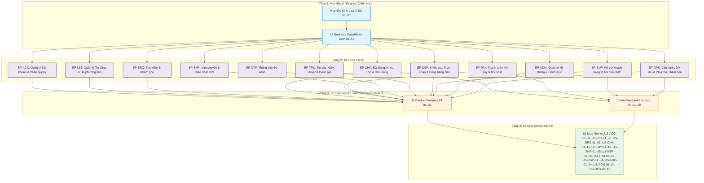

# Epics, Features & Architectural Enablers – ReMarket

## Thông tin tài liệu

| Thuộc tính | Giá trị |
|---|---|
| Dự án | ReMarket – Nền tảng Thương mại Điện tử Đồ cũ C2C/B2C Phân tán |
| Tài liệu | Danh mục Epic, Feature Sản phẩm, Architectural Enablers và Ánh xạ Backlog |
| Mã tài liệu | `DOC-BA-07-EAP` |
| Phiên bản | 1.0 |
| Trạng thái | Hoàn thiện (Baseline cho Release Planning & Sprint Execution) |
| Ngày cập nhật | 12/11/2026 |
| Tài liệu liên quan | `03_requirements/user-stories.md`, `functional-requirements.md`, `04_product-and-ux/screen-inventory.md`, `05_domain-and-data/domain-model.md`, `06_microservices-and-integrations/service-catalog.md` |

---

## 1. Kiến trúc phân cấp Product Backlog (Backlog Hierarchy)

Hệ thống Backlog của ReMarket được tổ chức theo chuẩn Enterprise Agile / Scaled Agile Framework (SAFe) với 4 tầng phân rã chặt chẽ nhằm đảm bảo tính truy vết 2 chiều (Bidirectional Traceability) từ mục tiêu kinh doanh chiến lược đến từng dòng mã và tiêu chí nghiệm thu:

1. **Tầng 1 - Business Capability (`CAP-01..12`) & Strategic Goal (`BO-01..07`):** Năng lực nghiệp vụ cốt lõi cần kích hoạt trên sàn ReMarket (đã định nghĩa tại `02_business-analysis/capabilities.md`).
2. **Tầng 2 - Epic (`EP-ACC` đến `EP-OPS`):** 12 khối công việc giải pháp lớn bao quát toàn bộ hành trình người dùng và vận hành nền tảng (đã định nghĩa tại `03_requirements/user-stories.md`).
3. **Tầng 3 - Feature (`FT-01..32`) & Architectural Enabler (`EN-01..10`):**
   - **Product Feature (`FT-*`):** Các tính năng chức năng mang lại giá trị trực tiếp cho Buyer, Seller và Đội ngũ Vận hành.
   - **Architectural Enabler (`EN-*`):** Các giải pháp kỹ thuật nền tảng (Cloud Landing Zone, Dual-Key Database, Hai tầng khóa giữ hàng Two-Tier Reservation, Transactional Outbox, CDC, CQRS, PITR Disaster Recovery) bắt buộc phải có để các Feature vận hành an toàn và thỏa mãn 5 bất biến kiến trúc (`INV-01..05`).
4. **Tầng 4 - User Story (`US-*`):** 81 User Stories chi tiết, có tiêu chí nghiệm thu Acceptance Criteria (Gherkin format) tại `03_requirements/acceptance-criteria.md`.

---

## 2. Danh mục 12 Epics Cốt lõi

Bảng dưới đây tổng hợp đầy đủ 12 Epics của hệ thống ReMarket, ánh xạ trực tiếp sang các Capability nghiệp vụ, Mục tiêu kinh doanh và Domain Owner chịu trách nhiệm:

| Mã Epic | Tên Epic Nghiệp vụ | Capability | Mục tiêu Kinh doanh | Chỉ số Đo lường | Domain Owner | Số FT | Số US |
|---|---|---|---|---|---|:---:|:---:|
| **`EP-ACC`** | Quản lý Tài khoản, Hồ sơ & Phân quyền | `CAP-01` | `BO-01`, `BO-04` | `MET-BUY-01`, `MET-SEL-01` | Product Lead / Sec | 3 | 8 |
| **`EP-LST`** | Quản lý Tin đăng & Đa phương tiện | `CAP-02` | `BO-01`, `BO-05` | `MET-SEL-02`, `MET-PLAT-01` | Catalog Domain Owner | 3 | 8 |
| **`EP-SRC`** | Tìm kiếm & Khám phá Hàng hóa | `CAP-03` | `BO-02`, `BO-06` | `MET-BUY-02`, `MET-PLAT-02` | Search Domain Owner | 2 | 6 |
| **`EP-CHK`** | Đặt hàng, Khóa giữ 15p & Vòng đời Đơn | `CAP-04`, `CAP-05` | `BO-02`, `BO-03` | `MET-BUY-03`, `MET-PLAT-03` | Order Domain Owner | 3 | 11 |
| **`EP-PAY`** | Thanh toán, Tạm giữ Ký quỹ & Quyết toán | `CAP-06` | `BO-03`, `BO-07` | `MET-BUY-04`, `MET-SEL-03` | Finance / Payment Owner | 4 | 10 |
| **`EP-SHP`** | Vận chuyển Tích hợp Đa đối tác 3PL | `CAP-07` | `BO-03` | `MET-OPS-01`, `MET-OPS-02` | Logistics Domain Owner | 3 | 8 |
| **`EP-NTF`** | Trung tâm Thông báo Sự kiện Đa kênh | `CAP-08` | `BO-04` | `MET-BUY-01`, `MET-SEL-01` | Engagement Owner | 2 | 5 |
| **`EP-TRU`** | Kiểm duyệt Tin, Báo cáo & Đánh giá | `CAP-09` | `BO-05` | `MET-TRUST-01`, `MET-TRUST-02` | Trust & Safety Owner | 3 | 7 |
| **`EP-DSP`** | Khiếu nại, Tranh chấp & Đóng băng Ký quỹ | `CAP-10` | `BO-05`, `BO-07` | `MET-TRUST-03`, `MET-OPS-03` | Customer Experience Lead | 2 | 4 |
| **`EP-SUP`** | Hỗ trợ Vận hành & Chăm sóc Khách hàng 360° | `CAP-11` | `BO-04`, `BO-05` | `MET-OPS-03`, `MET-OPS-04` | Operations Support Lead | 2 | 4 |
| **`EP-ADM`** | Quản trị Hệ thống, Danh mục & Tham số | `CAP-12` | `BO-06` | `MET-PLAT-04` | Back-office System Admin | 3 | 4 |
| **`EP-OPS`** | Vận hành Kỹ thuật, Đối soát & Khôi phục Thảm họa | `CAP-12` | `BO-07` | `MET-PLAT-05`, `MET-PLAT-06` | Platform / SRE Lead | 2 | 12 |
| **TỔNG CỘNG** | **12 Epics Nghiệp vụ & Vận hành** | **12 CAP** | **7 BO** | **18 KPIs** | **Toàn ban dự án** | **32** | **81** |

---

## 3. Phân rã Chi tiết 32 Product Features (`FT-01..32`)

Dưới đây là đặc tả chi tiết của toàn bộ 32 Features sản phẩm, bảo đảm 100% không bỏ sót bất kỳ User Story nào (`US-ACC-01..08` đến `US-OPS-01..12`):

### Nhóm 1: `EP-ACC` – Quản lý Tài khoản, Hồ sơ & Phân quyền

#### `FT-01`: Đăng ký, Đăng nhập & Xác thực Ủy quyền Đa kênh (Auth & RBAC)
- **Mô tả nghiệp vụ:** Cung cấp cơ chế đăng ký bằng Số điện thoại/Email, đăng nhập nhận mã OTP/Mật khẩu an toàn, cấp phát Access Token/Refresh Token và phân quyền RBAC/ABAC phân biệt rõ các vai trò: Buyer, Seller cá nhân, Chuyên viên Kiểm duyệt, Kế toán, Chăm sóc Khách hàng và Quản trị viên hệ thống.
- **User Stories trực thuộc:** `US-ACC-01` (Đăng ký tài khoản), `US-ACC-02` (Đăng nhập & xác thực OTP), `US-ACC-03` (Quản lý hồ sơ & sổ địa chỉ), `US-ACC-04` (Đăng ký trở thành Người bán).
- **Yêu cầu chức năng (`FR-*`):** `FR-ACC-01`, `FR-ACC-02`, `FR-ACC-03`, `FR-ACC-04`, `FR-ACC-05`.
- **Ca sử dụng (`UC-*`):** `UC-01` (Đăng ký & Kích hoạt tài khoản), `UC-02` (Đăng nhập & Cấp quyền).
- **Giao diện liên quan:** `SCR-MKT-01` (Trang chủ/Header), `SCR-MKT-08` (Hồ sơ người dùng), `SCR-SEL-01` (Seller Onboarding).
- **Dịch vụ phụ trách:** `SVC-01 Identity & Access Service`.
- **Cơ sở dữ liệu:** `IdentityDB` (SQL Server - `Users`, `Roles`, `UserRoles`, `Addresses`).
- **Tiêu chí nghiệm thu cấp Feature (FAC):**
  - Đăng ký mới thành công gửi OTP trong vòng 5 giây; lưu mật khẩu mã hóa BCrypt (cost factor 12).
  - Cấp cặp JWT Access Token (hạn 15 phút) và Refresh Token (hạn 7 ngày) lưu HttpOnly Cookie; phân quyền chính xác đến từng endpoint qua Gateway `SVC-00`.

#### `FT-02`: Xác minh Danh tính Người bán (Seller KYC) & Bảo mật Hai lớp (2FA)
- **Mô tả nghiệp vụ:** Cho phép người bán xác minh danh tính điện tử qua CCCD/Hộ chiếu để nâng hạn mức bán hàng và kích hoạt huy hiệu người bán uy tín; cấu hình bảo mật 2 lớp qua SMS OTP hoặc Authenticator App (TOTP) cho các thao tác nhạy cảm (rút tiền, đổi mật khẩu).
- **User Stories trực thuộc:** `US-ACC-05` (Xác minh danh tính Seller KYC), `US-ACC-08` (Bật bảo mật xác thực hai yếu tố 2FA).
- **Yêu cầu chức năng (`FR-*`):** `FR-ACC-06`, `FR-ACC-07`, `FR-ACC-09`.
- **Ca sử dụng (`UC-*`):** `UC-03` (Xác minh danh tính người bán).
- **Giao diện liên quan:** `SCR-SEL-01` (Seller Profile & KYC), `SCR-ADM-01` (Duyệt hồ sơ KYC).
- **Dịch vụ phụ trách:** `SVC-01 Identity & Access Service`, `SVC-03 Media Storage Service`.
- **Cơ sở dữ liệu:** `IdentityDB` (`SellerProfiles`, `VerificationDocuments`).
- **Tiêu chí nghiệm thu cấp Feature (FAC):**
  - Tải lên ảnh CCCD 2 mặt qua Presigned URL S3 được mã hóa KMS; Back-office duyệt/từ chối KYC với lý do cụ thể trong vòng 24 giờ.
  - Khi bật 2FA, mọi phiên đăng nhập từ thiết bị lạ hoặc lệnh rút tiền ký quỹ đều bắt buộc nhập mã TOTP/OTP hợp lệ.

#### `FT-03`: Kiểm soát Khóa Tài khoản, Thu hồi Quyền & Nhật ký Tuân thủ (Account Enforcement)
- **Mô tả nghiệp vụ:** Cho phép Quản trị viên và Đội ngũ Tin cậy khóa tài khoản tạm thời hoặc vĩnh viễn khi phát hiện gian lận/vi phạm chính sách; tự động hủy phiên đăng nhập, thu hồi quyền hạn và lưu vết toàn bộ hành động kiểm soát để phục vụ thanh tra.
- **User Stories trực thuộc:** `US-ACC-06` (Khóa/Tạm dừng tài khoản vi phạm), `US-ACC-07` (Tra cứu lịch sử hoạt động & nhật ký bảo mật).
- **Yêu cầu chức năng (`FR-*`):** `FR-ACC-08`, `FR-ACC-10`.
- **Ca sử dụng (`UC-*`):** `UC-04` (Khóa tài khoản & Xử lý vi phạm).
- **Giao diện liên quan:** `SCR-ADM-02` (Quản lý Người dùng & Phân quyền).
- **Dịch vụ phụ trách:** `SVC-01 Identity & Access Service`.
- **Cơ sở dữ liệu:** `IdentityDB` (`UserAuditLogs`, `AccountSuspensions`).
- **Tiêu chí nghiệm thu cấp Feature (FAC):**
  - Khi tài khoản bị khóa (`STATUS = SUSPENDED`), toàn bộ JWT Refresh Token lập tức bị thu hồi trên Redis Cache; mọi yêu cầu API tiếp theo bị Gateway từ chối HTTP 403 Forbidden.

---

### Nhóm 2: `EP-LST` – Quản lý Tin đăng & Đa phương tiện

#### `FT-04`: Đăng tin, Quản lý Vòng đời Hàng hóa & Cấu hình Đơn chiếc
- **Mô tả nghiệp vụ:** Cung cấp biểu mẫu trực quan cho Người bán đăng bán đồ cũ với nguyên tắc bất biến món hàng duy nhất (`Inventory = 1`); quản lý đầy đủ các trạng thái tin: Nháp (`DRAFT`), Chờ duyệt (`PENDING`), Đang hiển thị (`ACTIVE`), Đã giữ chỗ (`RESERVED`), Đã bán (`SOLD`), Hết hạn (`EXPIRED`) hoặc Bị ẩn/Gỡ bỏ (`REMOVED`).
- **User Stories trực thuộc:** `US-LST-01` (Tạo tin đăng mới với thuộc tính động), `US-LST-02` (Chỉnh sửa nội dung & giá bán tin đăng), `US-LST-03` (Quản lý trạng thái & danh sách tin của người bán), `US-LST-08` (Cấu hình thuộc tính bắt buộc & số IMEI/Serial chống hàng giả).
- **Yêu cầu chức năng (`FR-*`):** `FR-LST-01`, `FR-LST-02`, `FR-LST-03`, `FR-LST-04`, `FR-LST-05`, `FR-LST-10`, `FR-LST-14`.
- **Ca sử dụng (`UC-*`):** `UC-05` (Tạo & Xuất bản tin đăng), `UC-06` (Cập nhật & Quản lý tin bán).
- **Giao diện liên quan:** `SCR-SEL-02` (Đăng tin mới), `SCR-SEL-03` (Quản lý tin đăng Seller Center).
- **Dịch vụ phụ trách:** `SVC-02 Catalog & Listing Service`.
- **Cơ sở dữ liệu:** `CatalogDB` (MongoDB - collection `listings`).
- **Tiêu chí nghiệm thu cấp Feature (FAC):**
  - Kiểm tra ràng buộc bắt buộc theo từng danh mục (ví dụ: Điện thoại bắt buộc có dung lượng pin, tình trạng iCloud, số IMEI che 4 số cuối).
  - Không cho phép sửa đổi giá bán hoặc nội dung cốt lõi khi tin đăng đang ở trạng thái `RESERVED` hoặc `SOLD`.

#### `FT-05`: Xử lý Ảnh Trực tiếp S3, Tối ưu Kích thước & Quét Mã độc (Media Pipeline)
- **Mô tả nghiệp vụ:** Hỗ trợ tải lên tối đa 10 hình ảnh và 1 video ngắn mô tả sản phẩm bằng phương thức Direct-to-S3 Presigned URL; tự động kích hoạt tiến trình nén WebP đa độ phân giải, đóng dấu bản quyền watermark và quét mã độc (malware scan) trước khi cho phép xuất bản.
- **User Stories trực thuộc:** `US-LST-04` (Tải ảnh trực tiếp lên S3 qua Presigned URL), `US-LST-05` (Tối ưu hóa ảnh & tạo hình thu nhỏ đa kích thước).
- **Yêu cầu chức năng (`FR-*`):** `FR-MED-01`, `FR-MED-02`, `FR-MED-03`, `FR-MED-04`, `FR-MED-05`, `FR-MED-06`.
- **Ca sử dụng (`UC-*`):** `UC-07` (Tải lên & Xử lý đa phương tiện).
- **Giao diện liên quan:** `SCR-SEL-02` (Component Upload Media).
- **Dịch vụ phụ trách:** `SVC-03 Media Storage Service`.
- **Cơ sở dữ liệu:** `CatalogDB` (`media_assets`), S3 Bucket `remarket-media-prod`.
- **Tiêu chí nghiệm thu cấp Feature (FAC):**
  - Client nhận Presigned URL trong 500ms; tệp tải lên được ClamAV quét trong 3 giây. Nếu phát hiện virus/mã độc, tự động xóa tệp trên S3 và trả mã lỗi HTTP 422 Unprocessable Entity.

#### `FT-06`: Cổng Kiểm duyệt Tự động & Hậu kiểm Rủi ro (Listing Moderation Gate)
- **Mô tả nghiệp vụ:** Áp dụng bộ quy tắc lọc tự động đối chiếu tiêu đề và mô tả với Từ điển từ khóa cấm (`ProhibitedKeywords`); phân luồng tin đăng: tin hợp lệ được đăng ngay (`ACTIVE`), tin nghi vấn vi phạm chuyển vào hàng đợi duyệt thủ công của Back-office (`PENDING_REVIEW`).
- **User Stories trực thuộc:** `US-LST-06` (Kiểm tra từ khóa cấm tự động), `US-LST-07` (Phê duyệt/Từ chối tin đăng vi phạm).
- **Yêu cầu chức năng (`FR-*`):** `FR-LST-06`, `FR-LST-07`, `FR-LST-08`, `FR-LST-11`.
- **Ca sử dụng (`UC-*`):** `UC-08` (Kiểm duyệt tin đăng).
- **Giao diện liên quan:** `SCR-ADM-03` (Hàng đợi Kiểm duyệt Tin đăng).
- **Dịch vụ phụ trách:** `SVC-02 Catalog & Listing Service`, `SVC-08 Trust & Support Service`.
- **Cơ sở dữ liệu:** `CatalogDB` (`listings`), `SupportDB` (`moderation_tasks`).
- **Tiêu chí nghiệm thu cấp Feature (FAC):**
  - Chặn ngay lập tức 100% các tin đăng chứa từ khóa cấm nghiêm trọng (vũ khí, chất cấm, hàng giả hàng nhái nhãn hiệu được bảo hộ).
  - Khi bị từ chối, gửi thông báo chi tiết lý do và hướng dẫn sửa đổi cho người bán trong vòng 10 giây.

---

### Nhóm 3: `EP-SRC` – Tìm kiếm & Khám phá Hàng hóa

#### `FT-07`: Công cụ Tìm kiếm Toàn văn, Bộ lọc Đa diện & Sắp xếp (OpenSearch Engine)
- **Mô tả nghiệp vụ:** Cung cấp trải nghiệm tìm kiếm hàng hóa siêu tốc độ trễ dưới 200ms trên cụm AWS OpenSearch; hỗ trợ tìm kiếm toàn văn tiếng Việt có dấu/không dấu, sửa lỗi chính tả gợi ý từ khóa (autocomplete/fuzzy match), và bộ lọc đa diện sâu (theo danh mục, khoảng giá, tình trạng sử dụng, khu vực địa lý, phương thức giao hàng).
- **User Stories trực thuộc:** `US-SRC-01` (Tìm kiếm theo từ khóa có gợi ý tiếng Việt), `US-SRC-02` (Lọc nâng cao theo thuộc tính danh mục & tình trạng hàng), `US-SRC-03` (Sắp xếp theo giá, độ mới và khoảng cách địa lý), `US-SRC-06` (Đồng bộ dữ liệu NRT từ Catalog sang OpenSearch).
- **Yêu cầu chức năng (`FR-*`):** `FR-SRC-01`, `FR-SRC-02`, `FR-SRC-03`, `FR-SRC-04`, `FR-SRC-07`, `FR-SRC-08`.
- **Ca sử dụng (`UC-*`):** `UC-09` (Tìm kiếm & Lọc danh mục sản phẩm).
- **Giao diện liên quan:** `SCR-MKT-01` (Thanh tìm kiếm Trang chủ), `SCR-MKT-02` (Trang Kết quả Tìm kiếm & Bộ lọc).
- **Dịch vụ phụ trách:** `SVC-04 Search & Discovery Service`.
- **Cơ sở dữ liệu:** AWS OpenSearch Cluster (`listings_index_v1`).
- **Tiêu chí nghiệm thu cấp Feature (FAC):**
  - Độ trễ phản hồi tìm kiếm trung vị p95 < 200ms với kho dữ liệu 1.000.000 tin đăng.
  - Sự kiện tin đăng mới (`EVT-03 ListingPublishedEvent`) hoặc cập nhật giá/trạng thái được đồng bộ sang OpenSearch trong vòng tối đa 2 giây (Near-Real-Time).

#### `FT-08`: Hiển thị Chi tiết Sản phẩm, Tình trạng Thực tế & Khuyến nghị Tin liên quan
- **Mô tả nghiệp vụ:** Trình bày trang chi tiết sản phẩm đầy đủ thông tin: bộ sưu tập ảnh độ nét cao có thể phóng to, huy hiệu tình trạng hàng hóa (Mới 99%, Cũ trầy xước nhẹ...), thông tin người bán kèm điểm uy tín, chính sách bảo vệ người mua ReMarket Escrow, huy hiệu trạng thái sẵn sàng (Còn hàng / Đang có người giữ chỗ / Đã bán), cùng danh sách tin đăng tương tự.
- **User Stories trực thuộc:** `US-SRC-04` (Xem chi tiết tin đăng & hồ sơ uy tín người bán), `US-SRC-05` (Gợi ý tin đăng tương tự cùng khu vực/tầm giá).
- **Yêu cầu chức năng (`FR-*`):** `FR-SRC-05`, `FR-SRC-06`, `FR-SRC-09`.
- **Ca sử dụng (`UC-*`):** `UC-10` (Xem chi tiết món hàng & Đánh giá rủi ro).
- **Giao diện liên quan:** `SCR-MKT-03` (Trang Chi tiết Sản phẩm - PDP).
- **Dịch vụ phụ trách:** `SVC-04 Search & Discovery Service`, `SVC-02 Catalog & Listing Service`.
- **Cơ sở dữ liệu:** `CatalogDB` (`listings`), `Redis Cache` (TTL 300s).
- **Tiêu chí nghiệm thu cấp Feature (FAC):**
  - Hiển thị chính xác huy hiệu `ĐANG CÓ NGƯỜI GIỮ CHỖ (15:00)` theo thời gian thực nếu món hàng đang được đặt lệnh checkout bởi người mua khác.

---

### Nhóm 4: `EP-CHK` – Đặt hàng, Khóa giữ 15 Phút & Quản lý Đơn hàng

#### `FT-09`: Đặt hàng Món đơn chiếc, Tính toán Báo giá & Địa chỉ Giao nhận (Checkout Quote)
- **Mô tả nghiệp vụ:** Luồng mua ngay (Buy Now) dành riêng cho món hàng độc bản đơn chiếc (`Inventory = 1`); kiểm tra hợp lệ của tin đăng, tự động tính tổng tiền thanh toán minh bạch (Giá hàng + Phí vận chuyển tạm tính từ đơn vị 3PL + Phí bảo hiểm hàng giá trị cao - Khuyến mãi nếu có), lựa chọn địa chỉ giao nhận và phương thức thanh toán hợp lệ.
- **User Stories trực thuộc:** `US-CHK-01` (Khởi tạo phiên đặt mua món hàng đơn chiếc), `US-CHK-02` (Chọn địa chỉ nhận hàng & tính phí ship 3PL tức thời), `US-CHK-03` (Xem tóm tắt báo giá chi tiết trước khi xác nhận).
- **Yêu cầu chức năng (`FR-*`):** `FR-CHK-01`, `FR-CHK-02`, `FR-CHK-03`, `FR-CHK-04`.
- **Ca sử dụng (`UC-*`):** `UC-11` (Tiến hành Đặt hàng & Nhận Báo giá).
- **Giao diện liên quan:** `SCR-MKT-04` (Trang Checkout - Đặt hàng).
- **Dịch vụ phụ trách:** `SVC-05 Order Processing Service`.
- **Cơ sở dữ liệu:** `OrderDB` (SQL Server - `Orders`, `OrderItems`).
- **Tiêu chí nghiệm thu cấp Feature (FAC):**
  - Báo giá tính toán chính xác 100% đến từng đồng VNĐ; ngăn chặn người mua tự đặt mua hàng của chính mình (chặn self-trading); trả mã lỗi HTTP 400 Bad Request kèm thông báo rõ ràng nếu vi phạm.

#### `FT-10`: Động cơ Hai Tầng Khóa Giữ Hàng 15 Phút (Two-Tier Reservation Lock Engine)
- **Mô tả nghiệp vụ:** Đảm bảo triệt để **Bất biến `INV-01` (Tuyệt đối không bán trùng - Zero Overselling)** cho hàng độc bản; cơ chế phối hợp hai tầng: Tầng 1 sử dụng Redis Cluster phân tán (`SET lock:listing:{id} order_id NX EX 900`) chặn đứng hàng ngàn lượt bấm đồng thời tại Gateway; Tầng 2 sử dụng SQL Server Concurrency Control (`WITH (UPDLOCK, ROWLOCK)` kết hợp kiểm tra `RowVersion/ConcurrencyStamp`) để lưu trữ bản ghi giữ chỗ bền vững.
- **User Stories trực thuộc:** `US-CHK-04` (Khóa giữ chỗ độc quyền trong 15 phút), `US-CHK-05` (Giải phóng khóa giữ hàng tự động khi hết hạn 15 phút), `US-CHK-06` (Hủy giữ hàng chủ động khi người mua từ bỏ phiên checkout).
- **Yêu cầu chức năng (`FR-*`):** `FR-CHK-05`, `FR-CHK-06`, `FR-CHK-07`, `FR-CHK-08`.
- **Ca sử dụng (`UC-*`):** `UC-12` (Khóa giữ chỗ & Phòng chống Bán trùng).
- **Giao diện liên quan:** `SCR-MKT-04` (Thanh đếm ngược Countdown 15:00 trên Checkout), `MOD-01` (Cảnh báo hết hạn giữ hàng).
- **Dịch vụ phụ trách:** `SVC-05 Order Processing Service`, `SVC-02 Catalog & Listing Service`.
- **Cơ sở dữ liệu:** `OrderDB` (`OrderReservations`), `Redis Cluster`.
- **Tiêu chí nghiệm thu cấp Feature (FAC):**
  - Trong thử nghiệm tải cực đại (Stress Test 100 concurrent requests cùng checkout 1 món hàng độc bản), duy nhất đúng 1 lệnh mua giành được quyền khóa giữ chỗ thành công; 99 lệnh còn lại nhận HTTP 409 Conflict với thông báo món hàng đang được xử lý.
  - Đồng hồ đếm ngược 15 phút chạy chuẩn xác; nếu sau 900 giây không phát sinh thanh toán, tiến trình nền tự động mở khóa, chuyển trạng thái tin đăng về lại `ACTIVE` trong vòng 1 giây.

#### `FT-11`: Máy trạng thái Vòng đời Đơn hàng & Tự động Hủy đơn (Order State Machine)
- **Mô tả nghiệp vụ:** Vận hành máy trạng thái hữu hạn (Finite State Machine) nghiêm ngặt quản lý toàn bộ vòng đời đơn hàng: Khởi tạo (`CREATED`) → Chờ thanh toán (`AWAITING_PAYMENT`) → Đã thanh toán / Tạm giữ ký quỹ (`PAYMENT_ESCROWED`) → Chờ người bán bàn giao (`AWAITING_FULFILLMENT`) → Đang giao hàng (`SHIPPING`) → Đã giao hàng (`DELIVERED`) → Hoàn tất (`COMPLETED`) hoặc Hủy bỏ (`CANCELLED`) / Tranh chấp (`DISPUTED`).
- **User Stories trực thuộc:** `US-CHK-07` (Tạo đơn hàng chính thức với mã UUIDv7 duy nhất), `US-CHK-08` (Theo dõi tiến trình trạng thái đơn hàng thời gian thực), `US-CHK-09` (Người bán xác nhận đơn & chuẩn bị đóng gói hàng), `US-CHK-10` (Hủy đơn hàng tự động khi quá hạn người bán không bàn giao), `US-CHK-11` (Người mua xác nhận đã nhận hàng đúng mô tả để hoàn tất đơn).
- **Yêu cầu chức năng (`FR-*`):** `FR-ORD-01`, `FR-ORD-02`, `FR-ORD-03`, `FR-ORD-04`, `FR-ORD-05`, `FR-ORD-06`, `FR-ORD-07`, `FR-ORD-08`, `FR-ORD-09`, `FR-ORD-10`.
- **Ca sử dụng (`UC-*`):** `UC-13` (Quản lý Vòng đời & Trạng thái Đơn hàng).
- **Giao diện liên quan:** `SCR-MKT-05` (Trang Xác nhận Đơn hàng), `SCR-MKT-06` (Chi tiết Đơn mua của Buyer), `SCR-SEL-04` (Quản lý Đơn bán của Seller).
- **Dịch vụ phụ trách:** `SVC-05 Order Processing Service`.
- **Cơ sở dữ liệu:** `OrderDB` (`Orders`, `OrderHistory`, `OrderStatusAudit`).
- **Tiêu chí nghiệm thu cấp Feature (FAC):**
  - Máy trạng thái từ chối 100% các chuyển dịch trạng thái không hợp lệ (ví dụ: cấm chuyển thẳng từ `CREATED` sang `SHIPPING` nếu chưa qua `PAYMENT_ESCROWED`). Mọi biến động trạng thái đều phát sinh sự kiện CloudEvent chuẩn lưu vào Outbox table.

---

### Nhóm 5: `EP-PAY` – Thanh toán, Tạm giữ Ký quỹ & Quyết toán

#### `FT-12`: Khởi tạo Giao dịch Thanh toán & Điều hướng Cổng PSP (Payment Intent & PSP Integration)
- **Mô tả nghiệp vụ:** Tích hợp các cổng thanh toán hàng đầu Việt Nam (VNPAY, MoMo, VietQR Chuyển khoản ngân hàng tức thời); sinh mã thanh toán bảo mật `PaymentIntent` kèm chữ ký số SHA-256 (HMAC-SHA512) và điều hướng an toàn người mua sang giao diện thanh toán của cổng đối tác.
- **User Stories trực thuộc:** `US-PAY-01` (Tạo phiên thanh toán & chọn phương thức VNPAY/MoMo/VietQR), `US-PAY-02` (Điều hướng an toàn sang cổng thanh toán đối tác với chữ ký số), `US-PAY-07` (Bảo vệ giao dịch bằng Token hóa thẻ & tuân thủ chuẩn PCI-DSS).
- **Yêu cầu chức năng (`FR-*`):** `FR-PAY-01`, `FR-PAY-02`, `FR-PAY-03`, `FR-PAY-08`.
- **Ca sử dụng (`UC-*`):** `UC-14` (Thanh toán Đơn hàng qua Cổng Điện tử).
- **Giao diện liên quan:** `SCR-MKT-04` (Lựa chọn Cổng Thanh toán), Cổng thanh toán bên thứ ba.
- **Dịch vụ phụ trách:** `SVC-06 Payment & Escrow Service`.
- **Cơ sở dữ liệu:** `PaymentDB` (SQL Server - `PaymentTransactions`, `PaymentIntents`).
- **Tiêu chí nghiệm thu cấp Feature (FAC):**
  - Chữ ký số mã hóa kiểm tra toàn vẹn dữ liệu đơn hàng; ngăn chặn tuyệt đối can thiệp sửa đổi số tiền thanh toán (Parameter Tampering); hệ thống từ chối giao dịch nếu checksum không khớp.

#### `FT-13`: Xử lý Webhook Bất đồng bộ Idempotent & Tự động Hoàn tiền Thanh toán Trễ
- **Mô tả nghiệp vụ:** Đảm bảo **Bất biến `INV-02` (Tuyệt đối không trừ tiền trùng - Zero Double Charge)**; tiếp nhận Webhook kết quả từ cổng PSP với cơ chế xử lý Idempotent (kiểm tra `IdempotencyKey` và `TransactionReference`); tự động kích hoạt hoàn tiền (Auto-Refund) nếu tiền về sau khi lệnh giữ hàng 15 phút đã bị hủy quá hạn.
- **User Stories trực thuộc:** `US-PAY-03` (Xử lý Webhook thanh toán an toàn & Idempotent), `US-PAY-05` (Tự động hoàn tiền khi thanh toán thành công nhưng đơn hàng đã bị hủy quá hạn).
- **Yêu cầu chức năng (`FR-*`):** `FR-PAY-04`, `FR-PAY-05`, `FR-PAY-09`, `FR-PAY-11`.
- **Ca sử dụng (`UC-*`):** `UC-15` (Tiếp nhận Webhook & Khớp nối Thanh toán).
- **Giao diện liên quan:** Backend API Endpoint Webhook, `SCR-MKT-06` (Thông báo hoàn tiền trễ).
- **Dịch vụ phụ trách:** `SVC-06 Payment & Escrow Service`.
- **Cơ sở dữ liệu:** `PaymentDB` (`PaymentWebhooks`, `ProcessedTransactions`).
- **Tiêu chí nghiệm thu cấp Feature (FAC):**
  - Nếu đối tác gửi lại Webhook 10 lần liên tiếp cho cùng một giao dịch thành công, hệ thống chỉ ghi nhận tiền vào sổ cái đúng 1 lần duy nhất; 9 lần sau trả HTTP 200 OK ngay lập tức mà không tác động dữ liệu.
  - Trường hợp người mua trả tiền ở phút thứ 16 (sau khi khóa giữ hàng đã nhả và đơn đã hủy): Hệ thống tự động ghi nhận trạng thái `EXPIRED_PAYMENT_CAPTURED` và bắn lệnh hoàn tiền 100% về cổng PSP trong vòng 30 giây.

#### `FT-14`: Sổ cái Ký quỹ Bảo vệ Người mua & Tự động Giải ngân T+3 (Escrow Ledger & Auto-Payout)
- **Mô tả nghiệp vụ:** Toàn bộ tiền người mua thanh toán được tạm giữ an toàn trong tài khoản ký quỹ trung gian (Escrow Account); chỉ giải ngân chuyển tiền vào tài khoản ngân hàng của người bán sau khi đơn hàng hoàn tất hoặc sau thời hạn bảo vệ 72 giờ (T+3 ngày) tính từ lúc đơn vị vận chuyển báo giao hàng thành công mà người mua không có khiếu nại.
- **User Stories trực thuộc:** `US-PAY-04` (Tạm giữ tiền trong tài khoản ký quỹ Escrow bảo vệ người mua), `US-PAY-08` (Giải ngân tiền bán hàng tự động cho người bán sau 72h hoàn tất đơn).
- **Yêu cầu chức năng (`FR-*`):** `FR-PAY-06`, `FR-PAY-07`, `FR-PAY-12`.
- **Ca sử dụng (`UC-*`):** `UC-16` (Tạm giữ Ký quỹ & Tự động Giải ngân Escrow).
- **Giao diện liên quan:** `SCR-SEL-05` (Quản lý Doanh thu & Ví Ký quỹ Seller), `SCR-ADM-06` (Quản trị Dòng tiền Ký quỹ).
- **Dịch vụ phụ trách:** `SVC-06 Payment & Escrow Service`.
- **Cơ sở dữ liệu:** `PaymentDB` (`EscrowHoldings`, `PayoutLedgers`, `SellerBankAccounts`).
- **Tiêu chí nghiệm thu cấp Feature (FAC):**
  - Tuân thủ nguyên tắc kế toán kép (Double-entry bookkeeping) trong sổ cái ký quỹ; tổng nợ bằng tổng có; không có bất kỳ trạng thái thất thoát tiền nào.
  - Tự động đóng băng lệnh giải ngân lập tức khi phát sinh sự kiện tranh chấp (`EVT-22 DisputeOpenedEvent`).

#### `FT-15`: Động cơ Đối soát Tài chính 3 Bên Tự động (3-Way Financial Reconciliation Engine)
- **Mô tả nghiệp vụ:** Tự động đối chiếu chéo số liệu tài chính mỗi ngày vào lúc 02:00 sáng giữa 3 nguồn độc lập: Sổ cái giao dịch ReMarket (`PaymentDB`), Báo cáo đối soát từ Cổng thanh toán (PSP Settlement Report), và Sao kê biến động số dư tài khoản Ngân hàng doanh nghiệp; tự động phân loại giao dịch khớp và lập danh sách các khoản chênh lệch cần can thiệp xử lý.
- **User Stories trực thuộc:** `US-PAY-06` (Đối soát giao dịch định kỳ với cổng thanh toán), `US-PAY-09` (Cảnh báo sai lệch số liệu tài chính & xử lý tranh chấp thanh toán), `US-PAY-10` (Kết xuất báo cáo tài chính & doanh thu minh bạch).
- **Yêu cầu chức năng (`FR-*`):** `FR-PAY-10`, `FR-PAY-13`.
- **Ca sử dụng (`UC-*`):** `UC-17` (Đối soát Tài chính & Xử lý Chênh lệch).
- **Giao diện liên quan:** `SCR-ADM-06` (Bảng điều khiển Đối soát Tài chính Back-office).
- **Dịch vụ phụ trách:** `SVC-06 Payment & Escrow Service`.
- **Cơ sở dữ liệu:** `PaymentDB` (`ReconciliationBatches`, `ReconciliationDiscrepancies`).
- **Tiêu chí nghiệm thu cấp Feature (FAC):**
  - Tỷ lệ tự động khớp lệnh đối soát đạt > 99.8%; mọi sai lệch vượt 1.000 VNĐ đều tự động kích hoạt cảnh báo mức High đến kênh Slack Kế toán và tạo bản ghi cần điều tra.

---

### Nhóm 6: `EP-SHP` – Vận chuyển Tích hợp Đa đối tác 3PL

#### `FT-16`: Bộ Chuyển đổi Vận chuyển Đa đối tác, Tạo Vận đơn & Lịch Lấy hàng (3PL Adapter & Waybill)
- **Mô tả nghiệp vụ:** Tích hợp đa đối tác giao hàng hàng đầu (Giao Hàng Nhanh - GHN, Giao Hàng Tiết Kiệm - GHTK) thông qua kiến trúc Adapter Pattern thống nhất; tự động truyền dữ liệu đơn hàng, tạo vận đơn chính thức, lấy mã vận đơn (Tracking Code), sinh tem vận chuyển có mã vạch/QR code và điều phối tài xế đến địa chỉ người bán lấy hàng.
- **User Stories trực thuộc:** `US-SHP-01` (Tự động tạo mã vận đơn với đối tác 3PL ngay sau khi đơn được người bán xác nhận), `US-SHP-02` (In nhãn vận chuyển có mã vạch chuẩn cho đơn hàng), `US-SHP-06` (Chuyển đổi linh hoạt giữa các đối tác vận chuyển theo khu vực & chi phí).
- **Yêu cầu chức năng (`FR-*`):** `FR-SHP-01`, `FR-SHP-02`, `FR-SHP-03`, `FR-SHP-08`, `FR-SHP-10`.
- **Ca sử dụng (`UC-*`):** `UC-18` (Tạo Vận đơn & Điều phối Thu gom Hàng).
- **Giao diện liên quan:** `SCR-SEL-04` (In Nhãn Giao Hàng Seller), `SCR-ADM-05` (Quản trị Vận chuyển & Đối tác 3PL).
- **Dịch vụ phụ trách:** `SVC-07 Shipping & Logistics Service`.
- **Cơ sở dữ liệu:** `ShippingDB` (MongoDB - collection `shipments`, `waybills`).
- **Tiêu chí nghiệm thu cấp Feature (FAC):**
  - Thời gian tạo vận đơn và nhận mã tracking từ 3PL qua API không quá 2.5 giây. Nếu đối tác chính (ví dụ GHN) gặp sự cố mạng (HTTP 5xx), Circuit Breaker tự động chuyển sang đơn vị dự phòng (GHTK) mượt mà.

#### `FT-17`: Cập nhật Hành trình Vận chuyển Thời gian thực & Bằng chứng Giao hàng (Tracking & POD)
- **Mô tả nghiệp vụ:** Tiếp nhận Webhook thông báo hành trình từ hãng vận chuyển 24/7; chuẩn hóa trạng thái về mô hình thống nhất (`PICKING` → `IN_TRANSIT` → `OUT_FOR_DELIVERY` → `DELIVERED`); hiển thị bản đồ hành trình chi tiết cho cả Người mua và Người bán; lưu trữ chữ ký số hoặc hình ảnh bằng chứng giao hàng thành công (Proof of Delivery - POD).
- **User Stories trực thuộc:** `US-SHP-03` (Theo dõi vị trí đơn hàng & lịch sử bưu tá di chuyển thời gian thực), `US-SHP-04` (Ghi nhận bằng chứng giao hàng có chữ ký/hình ảnh POD), `US-SHP-07` (Thông báo ước tính ngày giờ giao hàng chính xác cho người mua).
- **Yêu cầu chức năng (`FR-*`):** `FR-SHP-04`, `FR-SHP-05`, `FR-SHP-06`, `FR-SHP-09`.
- **Ca sử dụng (`UC-*`):** `UC-19` (Theo dõi Hành trình Vận chuyển & Xác nhận Giao).
- **Giao diện liên quan:** `SCR-MKT-07` (Trang Tra cứu Hành trình Vận chuyển Đơn hàng).
- **Dịch vụ phụ trách:** `SVC-07 Shipping & Logistics Service`.
- **Cơ sở dữ liệu:** `ShippingDB` (`shipment_tracking_events`, `delivery_evidences`).
- **Tiêu chí nghiệm thu cấp Feature (FAC):**
  - Khi hãng vận chuyển cập nhật trạng thái `DELIVERED`, hệ thống cập nhật màn hình người dùng trong vòng 3 giây và tự động kích hoạt bộ đếm thời gian khiếu nại 72 giờ (`Timer 72h Escrow Auto-Release`).

#### `FT-18`: Xử lý Ngoại lệ Giao hàng Thất bại & Hoàn trả Hàng về Người bán (RTS Handling)
- **Mô tả nghiệp vụ:** Xử lý chuyên sâu các tình huống bất thường trong giao nhận (không liên lạc được người mua, địa chỉ sai, hàng nghi vấn vỡ hỏng dọc đường); cho phép lưu kho thử giao lại tối đa 3 lần; nếu giao thất bại hoàn toàn, tự động kích hoạt luồng trả hàng về cho người bán (Return to Sender - RTS) và thông báo lý do minh bạch cho cả hai bên.
- **User Stories trực thuộc:** `US-SHP-05` (Xử lý giao hàng thất bại & hẹn lịch giao lại), `US-SHP-08` (Đối soát phí vận chuyển và khiếu nại cước với đối tác 3PL).
- **Yêu cầu chức năng (`FR-*`):** `FR-SHP-07`, `FR-SHP-11`, `FR-SHP-12`.
- **Ca sử dụng (`UC-*`):** `UC-20` (Xử lý Ngoại lệ Giao hàng & Chuyển hoàn).
- **Giao diện liên quan:** `SCR-SEL-04` (Cảnh báo Giao hàng Ngoại lệ), `SCR-ADM-05` (Bảng theo dõi Đơn chuyển hoàn).
- **Dịch vụ phụ trách:** `SVC-07 Shipping & Logistics Service`.
- **Cơ sở dữ liệu:** `ShippingDB` (`delivery_exceptions`, `carrier_reconciliations`).
- **Tiêu chí nghiệm thu cấp Feature (FAC):**
  - Tự động thông báo cảnh báo sau lần giao thất bại thứ 2; khi xác nhận chuyển hoàn hoàn tất, giải phóng tiền hàng ký quỹ để hoàn trả người mua sau khi đã trừ phí vận chuyển theo đúng điều khoản chính sách.

---

### Nhóm 7: `EP-NTF` – Trung tâm Thông báo Sự kiện Đa kênh

#### `FT-19`: Động cơ Điều phối Thông báo Bất đồng bộ Hướng sự kiện (Event-Driven Notification Dispatcher)
- **Mô tả nghiệp vụ:** Tiếp nhận toàn bộ các sự kiện nghiệp vụ quan trọng trong hệ thống (`EVT-01` đến `EVT-28`) từ EventBridge/SQS; tự động định tuyến và gửi thông báo theo thời gian thực qua các kênh: In-app WebSocket, Email (Amazon SES), và SMS/ZNS OTP phục vụ các mốc quan trọng (đặt hàng thành công, đã giao hàng, tiền đã về ví...).
- **User Stories trực thuộc:** `US-NTF-01` (Gửi thông báo tức thời khi có biến động đơn hàng qua In-app & Email), `US-NTF-04` (Gửi mã OTP xác thực và cảnh báo bảo mật qua SMS/ZNS).
- **Yêu cầu chức năng (`FR-*`):** `FR-NTF-01`, `FR-NTF-02`, `FR-NTF-03`, `FR-NTF-06`.
- **Ca sử dụng (`UC-*`):** `UC-21` (Phát hành & Phân phối Thông báo Đa kênh).
- **Giao diện liên quan:** Header Notification Bell (`SCR-MKT-01..12`, `SCR-SEL-01..07`).
- **Dịch vụ phụ trách:** `SVC-09 Notification Service`.
- **Cơ sở dữ liệu:** `NotificationDB` (MongoDB - collection `notifications`, `templates`).
- **Tiêu chí nghiệm thu cấp Feature (FAC):**
  - Thông báo In-app WebSocket đẩy đến trình duyệt/ứng dụng trong vòng < 1 giây kể từ khi sự kiện nghiệp vụ được phát hành.
  - Sử dụng cơ chế Rate Limiting chống spam tin nhắn; đảm bảo tỷ lệ gửi email SES thành công > 99%.

#### `FT-20`: Trung tâm Quản lý Thông báo, Cấu hình Nhận tin & Khung giờ Yên lặng (Notification Preferences)
- **Mô tả nghiệp vụ:** Cung cấp trang trung tâm thông báo tập trung cho phép người dùng đánh dấu đã đọc/chưa đọc, lọc theo chủ đề (Đơn hàng, Khuyến mãi, Hệ thống); đồng thời cho phép tùy chỉnh bật/tắt từng loại kênh thông báo và kích hoạt chế độ Khung giờ yên tĩnh (Quiet Hours từ 22:00 đến 07:00 sáng hôm sau) ngăn làm phiền giấc ngủ người dùng trừ các cảnh báo bảo mật khẩn cấp.
- **User Stories trực thuộc:** `US-NTF-02` (Tùy chỉnh bật/tắt nhận thông báo theo từng chủ đề), `US-NTF-03` (Bật khung giờ yên tĩnh không nhận tin quảng cáo ban đêm), `US-NTF-05` (Lịch sử thông báo tập trung & đánh dấu đã đọc).
- **Yêu cầu chức năng (`FR-*`):** `FR-NTF-04`, `FR-NTF-05`, `FR-NTF-07`.
- **Ca sử dụng (`UC-*`):** `UC-22` (Quản lý Hộp thư Thông báo & Tùy chọn Nhận tin).
- **Giao diện liên quan:** `SCR-MKT-09` (Trung tâm Thông báo & Tùy chọn).
- **Dịch vụ phụ trách:** `SVC-09 Notification Service`.
- **Cơ sở dữ liệu:** `NotificationDB` (`user_preferences`).
- **Tiêu chí nghiệm thu cấp Feature (FAC):**
  - Tuân thủ tuyệt đối cấu hình Quiet Hours: toàn bộ thông báo tiếp thị, khuyến mãi phát sinh trong khung giờ 22:00 - 07:00 được hoãn (defer) và tự động xả hàng đợi gửi đi vào lúc 07:05 sáng.

---

### Nhóm 8: `EP-TRU` – Kiểm duyệt Tin, Báo cáo Vi phạm & Đánh giá

#### `FT-21`: Tiếp nhận Báo cáo Vi phạm, Hàng rào Kiểm duyệt & Xử phạt (Abuse Reporting & Moderation)
- **Mô tả nghiệp vụ:** Cho phép người dùng gắn cờ báo cáo tin đăng có dấu hiệu lừa đảo, hàng giả, hình ảnh phản cảm hoặc người bán có hành vi gian lận; tự động tổng hợp vào hàng đợi của Đội ngũ Tin cậy (Trust & Safety Queue); hỗ trợ công cụ kiểm duyệt nhanh, áp dụng biện pháp ẩn tin, cảnh cáo hoặc khóa quyền đăng bán của người vi phạm.
- **User Stories trực thuộc:** `US-TRU-01` (Báo cáo tin đăng có dấu hiệu gian lận hoặc hàng cấm), `US-TRU-02` (Hàng đợi kiểm duyệt báo cáo tập trung cho Back-office), `US-TRU-05` (Áp dụng chế tài cảnh cáo hoặc khóa tính năng đăng bán).
- **Yêu cầu chức năng (`FR-*`):** `FR-TRU-01`, `FR-TRU-02`, `FR-TRU-03`, `FR-TRU-05`.
- **Ca sử dụng (`UC-*`):** `UC-23` (Báo cáo Vi phạm & Xử lý Khiếu nại Tin đăng).
- **Giao diện liên quan:** `MOD-03` (Modal Báo cáo Tin đăng), `SCR-ADM-03` (Hàng đợi Kiểm duyệt Vi phạm).
- **Dịch vụ phụ trách:** `SVC-08 Trust & Support Service`.
- **Cơ sở dữ liệu:** `SupportDB` (MongoDB - collection `abuse_reports`, `moderation_actions`).
- **Tiêu chí nghiệm thu cấp Feature (FAC):**
  - Một tin đăng nhận từ 5 báo cáo vi phạm độc lập từ các tài khoản uy tín sẽ tự động bị tạm ẩn khỏi trang tìm kiếm trong vòng 60 giây để chờ chuyên viên kiểm duyệt xác minh.

#### `FT-22`: Khiếu nại Quyết định Kiểm duyệt & Khôi phục Tin đăng (Seller Moderation Appeal)
- **Mô tả nghiệp vụ:** Cung cấp quy trình minh bạch cho phép người bán gửi đơn khiếu nại (Appeal) kèm hình ảnh hóa đơn, chứng từ chứng minh nguồn gốc xuất xứ hàng hóa khi tin đăng của họ bị hệ thống tự động hoặc nhân viên từ chối nhầm; chuyên viên độc lập rà soát và khôi phục trạng thái tin nếu bằng chứng hợp lệ.
- **User Stories trực thuộc:** `US-TRU-06` (Người bán gửi khiếu nại quyết định kiểm duyệt kèm bằng chứng chứng từ).
- **Yêu cầu chức năng (`FR-*`):** `FR-TRU-06`.
- **Ca sử dụng (`UC-*`):** `UC-23` (Nhánh Khiếu nại Quyết định).
- **Giao diện liên quan:** `SCR-SEL-03` (Chi tiết lý do từ chối & Nút Gửi khiếu nại), `SCR-ADM-03` (Hàng đợi Xem xét Khiếu nại).
- **Dịch vụ phụ trách:** `SVC-08 Trust & Support Service`.
- **Cơ sở dữ liệu:** `SupportDB` (`moderation_appeals`).
- **Tiêu chí nghiệm thu cấp Feature (FAC):**
  - Thời gian xử lý khiếu nại kiểm duyệt được cam kết SLA trong vòng 12 giờ làm việc; kết quả phê duyệt khôi phục tin về trạng thái `ACTIVE` mà không làm thay đổi ngày tạo ban đầu.

#### `FT-23`: Đánh giá Uy tín Sau Mua & Xếp hạng Người bán Có xác thực (Verified Post-Order Review)
- **Mô tả nghiệp vụ:** Chỉ cho phép người mua thực tế đã hoàn tất đơn hàng và nhận hàng thành công được quyền gửi đánh giá từ 1 đến 5 sao kèm nhận xét chi tiết và hình ảnh thực tế; người bán có quyền gửi 1 phản hồi công khai; hệ thống tính toán điểm uy tín trung bình của người bán theo thuật toán Bayes chống gian lận bơm điểm ảo.
- **User Stories trực thuộc:** `US-TRU-03` (Đánh giá và nhận xét người bán sau khi đơn hàng hoàn tất thành công), `US-TRU-04` (Người bán phản hồi nhận xét đánh giá của người mua), `US-TRU-07` (Tính toán điểm uy tín người bán dựa trên lịch sử giao dịch và đánh giá).
- **Yêu cầu chức năng (`FR-*`):** `FR-REV-01`, `FR-REV-02`, `FR-REV-03`, `FR-TRU-04`, `FR-TRU-07`.
- **Ca sử dụng (`UC-*`):** `UC-24` (Đánh giá Sau Mua & Xếp hạng Uy tín).
- **Giao diện liên quan:** `SCR-MKT-10` (Trang Đánh giá Đơn hàng), `SCR-MKT-08` (Tab Đánh giá trên Hồ sơ Người bán).
- **Dịch vụ phụ trách:** `SVC-08 Trust & Support Service`.
- **Cơ sở dữ liệu:** `SupportDB` (`order_reviews`, `seller_reputation_scores`).
- **Tiêu chí nghiệm thu cấp Feature (FAC):**
  - Chặn đứng 100% đánh giá giả mạo (Fake Review): chỉ tài khoản Buyer gắn với `OrderId` ở trạng thái `COMPLETED` trong vòng 15 ngày mới mở quyền gửi đánh giá.

---

### Nhóm 9: `EP-DSP` – Khiếu nại, Tranh chấp & Đóng băng Ký quỹ

#### `FT-24`: Khởi tạo Khiếu nại, Kho Bằng chứng S3 & Tức thời Đóng băng Ký quỹ (Dispute & Escrow Freeze)
- **Mô tả nghiệp vụ:** Thực thi nghiêm ngặt **Bất biến `INV-04` (Khi có tranh chấp, dòng tiền ký quỹ lập tức bị đóng băng - Escrow Freeze)**; cho phép người mua mở khiếu nại trong vòng 72 giờ kể từ khi nhận hàng (lý do: hàng vỡ hỏng do vận chuyển, hàng sai mô tả, hàng giả/nhái, thiếu phụ kiện); tải lên tối đa 5 video mở hộp/ảnh chụp cận cảnh làm bằng chứng; hệ thống tự động đình chỉ bộ đếm tự động giải ngân của `Payment Service`.
- **User Stories trực thuộc:** `US-DSP-01` (Người mua mở khiếu nại trong vòng 72h kèm hình ảnh/video mở hộp), `US-DSP-02` (Hệ thống tự động đóng băng tiền ký quỹ ngay khi khiếu nại được tiếp nhận).
- **Yêu cầu chức năng (`FR-*`):** `FR-DSP-01`, `FR-DSP-02`, `FR-DSP-04`.
- **Ca sử dụng (`UC-*`):** `UC-25` (Khởi tạo Tranh chấp & Đóng băng Tiền Ký quỹ).
- **Giao diện liên quan:** `SCR-MKT-11` (Màn hình Mở Khiếu nại Đơn hàng), `MOD-04` (Xác nhận Đóng băng Tiền & Khiếu nại).
- **Dịch vụ phụ trách:** `SVC-08 Trust & Support Service`, `SVC-06 Payment & Escrow Service`, `SVC-05 Order Processing Service`.
- **Cơ sở dữ liệu:** `SupportDB` (`dispute_cases`), `OrderDB` (`Orders.STATUS = DISPUTED`), `PaymentDB` (`EscrowHoldings.STATUS = FROZEN`).
- **Tiêu chí nghiệm thu cấp Feature (FAC):**
  - Trong vòng < 500ms kể từ khi người mua nhấn "Gửi Khiếu nại", sự kiện `EVT-22 DisputeOpenedEvent` được kích hoạt qua Outbox; `PaymentDB` lập tức khóa trạng thái lệnh giải ngân sang `FROZEN`, đảm bảo người bán không thể rút tiền trong thời gian điều tra.

#### `FT-25`: Trọng tài Phán quyết Tranh chấp & Thực thi Bồi hoàn Tự động (Dispute Adjudication & Resolution)
- **Mô tả nghiệp vụ:** Cung cấp bàn làm việc cho Trọng tài viên ReMarket Back-office so sánh hình ảnh tin đăng gốc, video đóng gói của người bán và video khui hàng của người mua; trao đổi bằng chứng 3 bên; đưa ra phán quyết cuối cùng: Bác bỏ khiếu nại giải ngân cho người bán, Hoàn tiền 100% kèm thu hồi hàng, hoặc Hoàn tiền một phần có thỏa thuận; tự động phát lệnh xử lý tiền sang `Payment Service`.
- **User Stories trực thuộc:** `US-DSP-03` (Chuyên viên thẩm định bằng chứng và đưa ra phán quyết giải quyết tranh chấp), `US-DSP-04` (Tự động thực thi hoàn tiền hoặc giải ngân theo kết quả phán quyết tranh chấp).
- **Yêu cầu chức năng (`FR-*`):** `FR-DSP-03`, `FR-DSP-05`.
- **Ca sử dụng (`UC-*`):** `UC-25` (Nhánh Phán quyết & Xử lý Tiền Ký quỹ).
- **Giao diện liên quan:** `SCR-ADM-04` (Bàn Trọng tài Phán quyết Tranh chấp Back-office).
- **Dịch vụ phụ trách:** `SVC-08 Trust & Support Service`, `SVC-06 Payment & Escrow Service`.
- **Cơ sở dữ liệu:** `SupportDB` (`dispute_resolutions`), `PaymentDB` (`Refunds`, `EscrowReleases`).
- **Tiêu chí nghiệm thu cấp Feature (FAC):**
  - Phán quyết hoàn tiền thực thi tự động qua API cổng PSP trong vòng 60 giây; lưu vết toàn bộ bằng chứng và lý do phán quyết vào sổ kiểm toán bất biến không thể sửa xóa.

---

### Nhóm 10: `EP-SUP` – Hỗ trợ Vận hành & Chăm sóc Khách hàng 360°

#### `FT-26`: Quản lý Yêu cầu Hỗ trợ Khách hàng & Đồng hồ Cam kết SLA (Support Case Management)
- **Mô tả nghiệp vụ:** Cung cấp hệ thống tạo vé hỗ trợ (Ticket/Case) cho khách hàng gặp vướng mắc về tài khoản, vận chuyển hoặc thanh toán; tự động phân luồng theo mức độ nghiêm trọng (P1 khẩn cấp đến P4 thông thường); kích hoạt đồng hồ đếm ngược SLA phản hồi và xử lý; tự động leo thang (escalate) lên cấp quản lý nếu vi phạm thời hạn.
- **User Stories trực thuộc:** `US-SUP-01` (Gửi yêu cầu trợ giúp đến bộ phận CSKH), `US-SUP-02` (Quản lý hàng đợi ticket & giám sát cam kết SLA phản hồi).
- **Yêu cầu chức năng (`FR-*`):** `FR-SUP-01`, `FR-SUP-02`, `FR-SUP-04`.
- **Ca sử dụng (`UC-*`):** `UC-26` (Chăm sóc Khách hàng & Tra cứu Hồ sơ 360°).
- **Giao diện liên quan:** `SCR-MKT-12` (Trung tâm Trợ giúp & Gửi Yêu cầu Hỗ trợ), `SCR-ADM-07` (Hàng đợi Xử lý Yêu cầu CSKH).
- **Dịch vụ phụ trách:** `SVC-08 Trust & Support Service`.
- **Cơ sở dữ liệu:** `SupportDB` (`support_tickets`, `ticket_sla_tracking`).
- **Tiêu chí nghiệm thu cấp Feature (FAC):**
  - Yêu cầu loại P1 (liên quan đến mất tiền hoặc khóa tài khoản oan) phải được phản hồi lần đầu trong vòng < 15 phút 24/7; hệ thống gửi thông báo nhắc việc đến nhân viên trực ca khi còn 5 phút hết hạn SLA.

#### `FT-27`: Tra cứu Dòng thời gian Đơn hàng Hợp nhất CQRS Order 360° (CQRS Order 360° View)
- **Mô tả nghiệp vụ:** Cung cấp màn hình tra cứu toàn diện 360 độ cho nhân viên hỗ trợ và quản trị viên; tổng hợp toàn bộ dữ liệu phân tán từ 5 dịch vụ khác nhau thành một dòng thời gian duy nhất (Unified Timeline): Lịch sử đặt hàng (`OrderDB`), Dòng tiền thanh toán & hoàn tiền (`PaymentDB`), Lộ trình bưu tá di chuyển (`ShippingDB`), Lịch sử tin đăng gốc (`CatalogDB`), và Nhật ký khiếu nại (`SupportDB`).
- **User Stories trực thuộc:** `US-SUP-03` (Tra cứu bức tranh tổng thể 360 độ của đơn hàng đa dịch vụ), `US-SUP-04` (Ghi chú nội bộ và nhật ký tương tác khách hàng).
- **Yêu cầu chức năng (`FR-*`):** `FR-SUP-03`, `FR-SUP-05`.
- **Ca sử dụng (`UC-*`):** `UC-26` (Nhánh Tra cứu 360°).
- **Giao diện liên quan:** `SCR-ADM-07` (Giao diện Xem Đơn Hàng Hợp Nhất Order 360°).
- **Dịch vụ phụ trách:** `SVC-08 Trust & Support Service`.
- **Cơ sở dữ liệu:** `SupportDB` (MongoDB - collection `order_360_view`, tổng hợp bất đồng bộ từ các sự kiện qua CDC/Outbox).
- **Tiêu chí nghiệm thu cấp Feature (FAC):**
  - Nhân viên CSKH mở màn hình tra cứu `Order 360°` tải đầy đủ toàn bộ lịch sử 5 dịch vụ trong vòng < 400ms mà không gây tải trực tiếp (Zero Read-Contention) lên cơ sở dữ liệu giao dịch `OrderDB` và `PaymentDB`.

---

### Nhóm 11: `EP-ADM` – Quản trị Hệ thống, Danh mục & Tham số

#### `FT-28`: Quản trị Cây Danh mục Động & Bộ Thuộc tính Ngành hàng (Dynamic Taxonomy Builder)
- **Mô tả nghiệp vụ:** Cho phép Quản trị viên xây dựng cây danh mục đa cấp độ (tối đa 4 tầng: Danh mục chính → Danh mục phụ → Loại sản phẩm → Phân khúc); cấu hình động các trường thuộc tính bắt buộc/tùy chọn (Attribute Schema) theo định dạng JSON Schema linh hoạt cho từng ngành hàng (ví dụ: Điện thoại, Laptop, Xe cộ, Đồ gia dụng).
- **User Stories trực thuộc:** `US-ADM-01` (Tạo và cấu hình cây danh mục hàng hóa đa cấp độ), `US-ADM-02` (Định nghĩa thuộc tính đặc thù và quy tắc bắt buộc theo từng ngành hàng).
- **Yêu cầu chức năng (`FR-*`):** `FR-ADM-01`, `FR-ADM-02`.
- **Ca sử dụng:** Nghiệp vụ Quản trị Cấu hình Danh mục Hệ thống.
- **Giao diện liên quan:** `SCR-ADM-07` (Quản trị Cấu hình Danh mục & Thuộc tính).
- **Dịch vụ phụ trách:** `SVC-02 Catalog & Listing Service`.
- **Cơ sở dữ liệu:** `CatalogDB` (`categories`, `category_schemas`).
- **Tiêu chí nghiệm thu cấp Feature (FAC):**
  - Mọi thay đổi thuộc tính bắt buộc của danh mục có hiệu lực tức thì trên biểu mẫu đăng tin mới của người bán mà không cần khởi động lại dịch vụ hoặc triển khai mã nguồn mới.

#### `FT-29`: Quản trị Từ điển Từ khóa Cấm & Hiệu chỉnh Tham số Hệ thống (Prohibited Keywords & System Tuning)
- **Mô tả nghiệp vụ:** Cung cấp giao diện trực quan cho phép Quản trị viên cập nhật danh sách đen từ khóa cấm theo thời gian thực (hỗ trợ cả từ ghép tiếng Việt, các biến thể viết tắt kiểu teencode, thay ký tự bằng số); điều chỉnh các tham số cấu hình toàn sàn: Thời gian khóa giữ chỗ (mặc định 15 phút), Thời gian đệm tự động giải ngân ký quỹ (mặc định 72 giờ), Ngưỡng cảnh báo tự động ẩn tin vi phạm.
- **User Stories trực thuộc:** `US-ADM-03` (Quản lý danh sách từ khóa cấm & cập nhật quy tắc kiểm duyệt tự động).
- **Yêu cầu chức năng (`FR-*`):** `FR-ADM-03`, `FR-ADM-04`.
- **Ca sử dụng:** Nghiệp vụ Hiệu chỉnh Tham số & Quy tắc Vận hành.
- **Giao diện liên quan:** `SCR-ADM-07` (Tab Quản lý Từ khóa Cấm & Tham số).
- **Dịch vụ phụ trách:** `SVC-08 Trust & Support Service`, `SVC-02 Catalog & Listing Service`.
- **Cơ sở dữ liệu:** `CatalogDB` (`prohibited_keywords`), `Redis Cache` (`sys_params`).
- **Tiêu chí nghiệm thu cấp Feature (FAC):**
  - Từ khóa cấm mới thêm được đồng bộ vào bộ nhớ Redis Cache trong vòng < 1 giây; các tin đăng mới tạo sau thời điểm đó lập tức bị chặn nếu chứa từ khóa vừa cấu hình.

#### `FT-30`: Bảng Điều khiển Phân tích Kinh doanh & Báo cáo Hiệu năng Sàn (Marketplace Analytics Dashboard)
- **Mô tả nghiệp vụ:** Hiển thị bức tranh trực quan về sức khỏe kinh doanh toàn sàn cho Ban Giám đốc và Nhà tài trợ: Khối lượng giao dịch gộp (GMV), Tỷ lệ đơn hàng thành công, Tỷ lệ phát sinh tranh chấp/khiếu nại, Thời gian trung bình bán thành công một món hàng, Số lượng tin đăng mới mỗi ngày, Doanh thu phí nền tảng và phân bố người dùng theo khu vực.
- **User Stories trực thuộc:** `US-ADM-04` (Xem bảng điều khiển chỉ số kinh doanh GMV và sức khỏe sàn giao dịch).
- **Yêu cầu chức năng (`FR-*`):** `FR-ADM-05`.
- **Ca sử dụng:** Nghiệp vụ Báo cáo Chiến lược Kinh doanh.
- **Giao diện liên quan:** `SCR-ADM-08` (Bảng điều khiển Báo cáo Quản trị Toàn sàn).
- **Dịch vụ phụ trách:** `SVC-08 Trust & Support Service`, Data Warehouse / Read-Replica.
- **Cơ sở dữ liệu:** Read Replicas SQL Server, MongoDB Analytical Views.
- **Tiêu chí nghiệm thu cấp Feature (FAC):**
  - Dữ liệu báo cáo tổng hợp cập nhật tự động mỗi 15 phút; giao diện đồ thị phản hồi nhanh < 1.5 giây mà không làm ảnh hưởng đến cơ sở dữ liệu giao dịch OLTP chính.

---

### Nhóm 12: `EP-OPS` – Vận hành Kỹ thuật, Đối soát & Khôi phục Thảm họa

#### `FT-31`: Khung Quan sát Phân tán, Lưu vết Outbox/DLQ & Giả lập Đối tác (Observability & Sandbox)
- **Mô tả nghiệp vụ:** Thiết lập hạ tầng quan sát chuẩn Enterprise: Phân bổ mã truy vết duy nhất `TraceId` và `CorrelationId` xuyên suốt 9 microservices; xuất chỉ số hiệu năng theo chuẩn RED (Rate, Errors, Duration) và USE (Utilization, Saturation, Errors); theo dõi hàng đợi sự kiện Outbox, phát hiện tin nhắn lỗi trong Dead Letter Queue (DLQ) và công cụ kích hoạt phát lại (Replay Tool); cung cấp bộ giả lập Sandbox cho các đối tác cổng thanh toán và vận chuyển để hỗ trợ kiểm thử tự động.
- **User Stories trực thuộc:** `US-OPS-01` (Ghi log tập trung có che chắn dữ liệu nhạy cảm PII), `US-OPS-02` (Truy vết phân tán phân luồng giao dịch với Correlation ID), `US-OPS-03` (Bảng giám sát chỉ số kỹ thuật RED/USE thời gian thực), `US-OPS-04` (Cảnh báo sự cố kỹ thuật tự động qua PagerDuty/Slack), `US-OPS-07` (Quản lý sự kiện lỗi Dead Letter Queue & cơ chế phát lại), `US-OPS-11` (Môi trường giả lập Sandbox kiểm thử tích hợp đối tác 3PL và PSP).
- **Yêu cầu chức năng (`FR-*`):** `FR-OPS-01`, `FR-OPS-02`, `FR-OPS-03`, `FR-OPS-04`, `FR-OPS-07`, `NFR-MNT-01..05`.
- **Ca sử dụng:** Quy trình Vận hành SRE & Quản trị Hạ tầng Kỹ thuật.
- **Giao diện liên quan:** Grafana Dashboards, Prometheus, AWS CloudWatch, Jaeger Tracing UI.
- **Dịch vụ phụ trách:** Nền tảng dùng chung toàn bộ các Microservices `SVC-00..09`.
- **Cơ sở dữ liệu:** Centralized OpenSearch Log Cluster, Prometheus Time-Series DB.
- **Tiêu chí nghiệm thu cấp Feature (FAC):**
  - 100% dữ liệu nhạy cảm PII (Mật khẩu, Số thẻ ngân hàng, Số CCCD, Khóa bí mật API) được tự động che chắn (Masking `***`) trước khi ghi log hoặc đẩy sang OpenSearch.
  - Chuyên viên SRE có thể dùng 1 click trên UI nội bộ để phát lại (Replay) an toàn các tin nhắn trong DLQ sau khi đã khắc phục sự cố dịch vụ tiếp nhận.

#### `FT-32`: Sao lưu Dữ liệu Tự động PITR, Diễn tập Khôi phục Thảm họa & Kiểm soát Chi phí FinOps (Disaster Recovery & FinOps)
- **Mô tả nghiệp vụ:** Đảm bảo **Bất biến `INV-05` (Bảo toàn dữ liệu kiểm toán & Khôi phục thảm họa toàn vẹn - Data Recovery & Audit Preservation)**; tự động sao lưu Point-in-Time Recovery (PITR) cho SQL Server (sao lưu Transaction Log mỗi 5 phút, giữ RPO ≤ 5 phút); sao lưu liên vùng (Cross-Region Backup) sang Singapore và Tokyo; chính sách lưu trữ bảo vệ chống xóa mã độc (S3 Object Lock WORM); kịch bản diễn tập khôi phục thảm họa định kỳ; kiểm soát hạn mức ngân sách đám mây AWS FinOps tự động cảnh báo khi vượt 80% ngân sách tháng.
- **User Stories trực thuộc:** `US-OPS-05` (Sao lưu dữ liệu tự động định kỳ với khả năng khôi phục tại điểm thời gian PITR), `US-OPS-06` (Khôi phục thảm họa liên vùng với cam kết RPO ≤ 5m và RTO ≤ 30m), `US-OPS-08` (Diễn tập khôi phục thảm họa định kỳ và ghi nhận bằng chứng kiểm toán), `US-OPS-09` (Lưu trữ dữ liệu lịch sử lâu dài tuân thủ quy định pháp luật và chính sách WORM), `US-OPS-10` (Đối soát tính toàn vẹn dữ liệu tự động giữa cơ sở dữ liệu và lưu trữ đối tượng S3), `US-OPS-12` (Kiểm soát chi phí hạ tầng AWS FinOps & cảnh báo tự động vượt ngân sách).
- **Yêu cầu chức năng (`FR-*`):** `FR-OPS-05`, `FR-OPS-06`, `FR-OPS-08`, `FR-OPS-09`, `NFR-REL-01..05`.
- **Ca sử dụng:** Quy trình Phục hồi Thảm họa & Tuân thủ Tài chính Đám mây.
- **Giao diện liên quan:** AWS Backup Console, AWS Cost Explorer, Kịch bản Khôi phục Thảm họa Runbook.
- **Dịch vụ phụ trách:** Nền tảng Cơ sở Dữ liệu & Cloud Infrastructure.
- **Cơ sở dữ liệu:** RDS SQL Server Multi-AZ, MongoDB Atlas Continuous Backup, S3 Glacier Vault.
- **Tiêu chí nghiệm thu cấp Feature (FAC):**
  - Diễn tập khôi phục thảm họa giả lập sập toàn bộ Primary AWS Availability Zone chứng minh khôi phục thành công dịch vụ với RTO < 25 phút và mất mát dữ liệu RPO = 0 giây đối với các giao dịch tài chính đã cam kết.
  - Cảnh báo FinOps bắn email và tin nhắn Slack tức thời khi chi phí AWS lũy kế trong tháng chạm ngưỡng 80% ngân sách kế hoạch đã duyệt.

---

## 4. Danh mục 10 Architectural & Data Enablers (`EN-01..10`)

Các Architectural Enabler đại diện cho những năng lực kỹ thuật nền tảng, cơ sở dữ liệu và hạ tầng phân tán bắt buộc phải được hoàn thành trước hoặc song song với các Sprint nghiệp vụ để đảm bảo hệ thống vận hành đúng đắn, không xảy ra lỗi kiến trúc:

| Mã Enabler | Tên Hạng mục Kỹ thuật Nền tảng | Công nghệ Áp dụng | Bất biến Bảo vệ | Dịch vụ Trực tiếp Hưởng lợi |
|---|---|---|---|---|
| **`EN-01`** | **AWS Landing Zone, Network Firewall & WAF v2 WebACL** | AWS CDK, VPC 4-Tier, Network Firewall (DPI Suricata), WAF v2 (10 Rules), ALB, API Gateway | N/A (Hạ tầng mạng & Tường lửa) | Toàn bộ 10 thành phần `SVC-00..09` |
| **`EN-02`** | **Dual-Key Relational Schema Architecture** | RDS SQL Server Multi-AZ (`BIGINT IDENTITY` nội bộ + `UUIDv7` công khai) | `INV-01`, `INV-02`, `INV-05` | `SVC-01 Identity`, `SVC-05 Order`, `SVC-06 Payment` |
| **`EN-03`** | **MongoDB Atlas Document Schemas & Hybrid Patterns** | MongoDB Atlas Replica Set, JSON Schema Validation, TTL Indexes | Tính linh hoạt phi cấu trúc | `SVC-02 Catalog`, `SVC-07 Shipping`, `SVC-08 Trust`, `SVC-09 Notif` |
| **`EN-04`** | **Two-Tier Reservation Engine (Redis NX + SQL UPDLOCK)** | Redis Cluster (ElastiCache), Distributed Lock, SQL `RowVersion` | `INV-01` (Chống bán trùng) | `SVC-05 Order`, `SVC-02 Catalog` |
| **`EN-05`** | **Transactional Outbox, Debezium CDC & Inbox Pattern** | Transactional Outbox Table, Kafka/EventBridge, SQS, `InboxMessages` | `INV-03` (Chống mất sự kiện) | Toàn bộ 9 core services |
| **`EN-06`** | **Direct-to-S3 Presigned Pipeline & Malware Scan** | AWS S3, CloudFront CDN, Presigned URL v4, ClamAV Container | An toàn tệp tải lên | `SVC-03 Media`, `SVC-02 Catalog`, `SVC-08 Trust` |
| **`EN-07`** | **OpenSearch Vietnamese Analyzer & NRT Index Sync** | AWS OpenSearch Service, `vi_analyzer`, ICU Analysis Plugin | Trải nghiệm tìm kiếm tức thời | `SVC-04 Search & Discovery` |
| **`EN-08`** | **CQRS Order 360° View Read-Model Aggregator** | Change Streams, Read-Model MongoDB Collection `order_360_view` | `INV-05` (Toàn vẹn kiểm toán) | `SVC-08 Trust & Support` (Back-office) |
| **`EN-09`** | **OpenTelemetry Distributed Tracing & RED/USE Stack** | OTel Collector, Jaeger/X-Ray, Prometheus, Grafana, FluentBit | Độ trong suốt phân tán | Toàn bộ 10 thành phần `SVC-00..09` |
| **`EN-10`** | **Cross-Region Automated PITR Backup & WORM Vault** | AWS Backup, S3 Object Lock (Compliance Mode), Cross-Region Rep | `INV-05` (Bảo toàn dữ liệu) | `OrderDB`, `PaymentDB`, `IdentityDB`, S3 Buckets |

---

## 5. Ma trận Ánh xạ Đa chiều: 12 Epics, 32 Features, 10 Enablers sang 81 User Stories

Bảng dưới đây thiết lập sự liên kết chặt chẽ 100% giữa các thực thể Backlog, đảm bảo không có câu chuyện người dùng nào bị cô lập:

| Mã Epic | Mã Feature / Enabler | Mã User Stories Trực thuộc | Mã Màn hình Giao diện | Mã Microservices Phụ trách |
|---|---|---|---|---|
| **`EP-ACC`** | `FT-01` (Auth & RBAC) | `US-ACC-01`, `US-ACC-02`, `US-ACC-03`, `US-ACC-04` | `SCR-MKT-01`, `SCR-MKT-08`, `SCR-SEL-01` | `SVC-00`, `SVC-01` |
| | `FT-02` (Seller KYC & 2FA) | `US-ACC-05`, `US-ACC-08` | `SCR-SEL-01`, `SCR-ADM-01` | `SVC-01`, `SVC-03` |
| | `FT-03` (Account Enforcement) | `US-ACC-06`, `US-ACC-07` | `SCR-ADM-02` | `SVC-01` |
| **`EP-LST`** | `FT-04` (Listing Lifecycle) | `US-LST-01`, `US-LST-02`, `US-LST-03`, `US-LST-08` | `SCR-SEL-02`, `SCR-SEL-03` | `SVC-02` |
| | `FT-05` (Media Pipeline) | `US-LST-04`, `US-LST-05` | `SCR-SEL-02` | `SVC-03` |
| | `FT-06` (Moderation Gate) | `US-LST-06`, `US-LST-07` | `SCR-ADM-03` | `SVC-02`, `SVC-08` |
| **`EP-SRC`** | `FT-07` (OpenSearch Engine) | `US-SRC-01`, `US-SRC-02`, `US-SRC-03`, `US-SRC-06` | `SCR-MKT-01`, `SCR-MKT-02` | `SVC-04` |
| | `FT-08` (PDP & Availability) | `US-SRC-04`, `US-SRC-05` | `SCR-MKT-03` | `SVC-04`, `SVC-02` |
| **`EP-CHK`** | `FT-09` (Checkout Quote) | `US-CHK-01`, `US-CHK-02`, `US-CHK-03` | `SCR-MKT-04` | `SVC-05` |
| | `FT-10` (Two-Tier Reservation) | `US-CHK-04`, `US-CHK-05`, `US-CHK-06` | `SCR-MKT-04`, `MOD-01` | `SVC-05`, `SVC-02` |
| | `FT-11` (Order State Machine) | `US-CHK-07`, `US-CHK-08`, `US-CHK-09`, `US-CHK-10`, `US-CHK-11` | `SCR-MKT-05`, `SCR-MKT-06`, `SCR-SEL-04` | `SVC-05` |
| **`EP-PAY`** | `FT-12` (Payment Intent) | `US-PAY-01`, `US-PAY-02`, `US-PAY-07` | `SCR-MKT-04` | `SVC-06` |
| | `FT-13` (Webhook & Auto-Refund)| `US-PAY-03`, `US-PAY-05` | `SCR-MKT-06` | `SVC-06` |
| | `FT-14` (Escrow Ledger) | `US-PAY-04`, `US-PAY-08` | `SCR-SEL-05`, `SCR-ADM-06` | `SVC-06` |
| | `FT-15` (3-Way Reconciliation) | `US-PAY-06`, `US-PAY-09`, `US-PAY-10` | `SCR-ADM-06` | `SVC-06` |
| **`EP-SHP`** | `FT-16` (3PL Adapter Waybill) | `US-SHP-01`, `US-SHP-02`, `US-SHP-06` | `SCR-SEL-04`, `SCR-ADM-05` | `SVC-07` |
| | `FT-17` (Tracking & POD) | `US-SHP-03`, `US-SHP-04`, `US-SHP-07` | `SCR-MKT-07` | `SVC-07` |
| | `FT-18` (RTS & Exceptions) | `US-SHP-05`, `US-SHP-08` | `SCR-SEL-04`, `SCR-ADM-05` | `SVC-07` |
| **`EP-NTF`** | `FT-19` (Event Dispatcher) | `US-NTF-01`, `US-NTF-04` | Toàn bộ các trang | `SVC-09` |
| | `FT-20` (Notification Center) | `US-NTF-02`, `US-NTF-03`, `US-NTF-05` | `SCR-MKT-09` | `SVC-09` |
| **`EP-TRU`** | `FT-21` (Abuse Moderation) | `US-TRU-01`, `US-TRU-02`, `US-TRU-05` | `MOD-03`, `SCR-ADM-03` | `SVC-08` |
| | `FT-22` (Moderation Appeal) | `US-TRU-06` | `SCR-SEL-03`, `SCR-ADM-03` | `SVC-08` |
| | `FT-23` (Verified Reviews) | `US-TRU-03`, `US-TRU-04`, `US-TRU-07` | `SCR-MKT-10`, `SCR-MKT-08` | `SVC-08` |
| **`EP-DSP`** | `FT-24` (Dispute Escrow Freeze)| `US-DSP-01`, `US-DSP-02` | `SCR-MKT-11`, `MOD-04` | `SVC-08`, `SVC-06`, `SVC-05` |
| | `FT-25` (Adjudication & Payout)| `US-DSP-03`, `US-DSP-04` | `SCR-ADM-04` | `SVC-08`, `SVC-06` |
| **`EP-SUP`** | `FT-26` (Case Management) | `US-SUP-01`, `US-SUP-02` | `SCR-MKT-12`, `SCR-ADM-07` | `SVC-08` |
| | `FT-27` (CQRS Order 360°) | `US-SUP-03`, `US-SUP-04` | `SCR-ADM-07` | `SVC-08` |
| **`EP-ADM`** | `FT-28` (Dynamic Taxonomy) | `US-ADM-01`, `US-ADM-02` | `SCR-ADM-07` | `SVC-02` |
| | `FT-29` (Keywords & Tuning) | `US-ADM-03` | `SCR-ADM-07` | `SVC-08`, `SVC-02` |
| | `FT-30` (Analytics Dashboard) | `US-ADM-04` | `SCR-ADM-08` | `SVC-08` |
| **`EP-OPS`** | `FT-31` (Observability & Sandbox)| `US-OPS-01`, `US-OPS-02`, `US-OPS-03`, `US-OPS-04`, `US-OPS-07`, `US-OPS-11` | Monitoring UIs | Toàn bộ `SVC-00..09` |
| | `FT-32` (Backup PITR & FinOps) | `US-OPS-05`, `US-OPS-06`, `US-OPS-08`, `US-OPS-09`, `US-OPS-10`, `US-OPS-12` | Backup & Cloud Console | Toàn bộ DB & AWS |
| **NỀN TẢNG** | `EN-01..10` (10 Enablers) | Hỗ trợ nền tảng kỹ thuật cho toàn bộ 81 User Stories trên | Infrastructure & Middleware | Toàn bộ Kiến trúc |

---

## 6. Lịch sử cập nhật

| Phiên bản | Ngày | Tác giả | Nội dung thay đổi |
|---|---|---|---|
| 1.0 | 12/11/2026 | Nhóm Phân tích Nghiệp vụ & Kiến trúc | Khởi tạo đầy đủ danh mục 12 Epics, 32 Features, 10 Architectural Enablers và ánh xạ 100% không sót 81 User Stories. |

