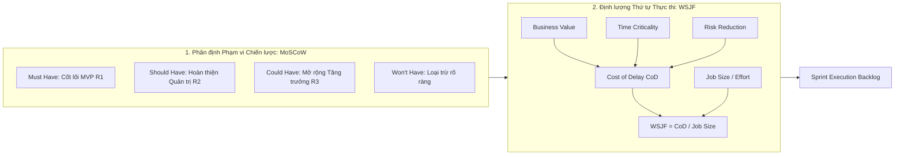
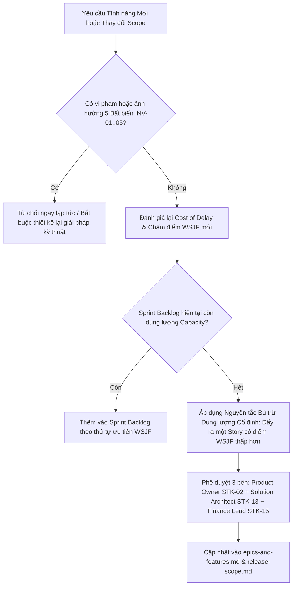

# Prioritization Framework & Backlog Ranking – ReMarket

## Thông tin tài liệu

| Thuộc tính | Giá trị |
|---|---|
| Dự án | ReMarket – Nền tảng Thương mại Điện tử Đồ cũ C2C/B2C Phân tán |
| Tài liệu | Khung Ưu tiên hóa Sản phẩm (MoSCoW & WSJF) và Bảng Xếp hạng Backlog Chi tiết |
| Mã tài liệu | `DOC-BA-07-PRI` |
| Phiên bản | 1.0 |
| Trạng thái | Hoàn thiện (Baseline cho Quản lý Phạm vi & Lập Kế hoạch Sprint) |
| Ngày cập nhật | 12/11/2026 |
| Tài liệu liên quan | `07_backlog-and-release/epics-and-features.md`, `03_requirements/user-stories.md`, `05_domain-and-data/domain-model.md` |

---

## 1. Phương pháp luận Ưu tiên hóa Kép (Dual Prioritization Framework)

Để tránh cảm tính trong việc lựa chọn tính năng và dung hòa giữa yêu cầu thị trường gấp rút với độ phức tạp của một hệ thống thương mại điện tử phân tán có tính nhất quán cao, ReMarket áp dụng **Khung Ưu tiên hóa Kép kết hợp giữa MoSCoW và WSJF**:

1. **Khung MoSCoW (Macro Level - Ranh giới Phạm vi Phát hành):**
   - **Must Have (`M`):** Các tính năng cốt lõi bắt buộc phải có để hệ thống thực hiện được một giao dịch an toàn trọn vẹn (End-to-End Escrow Trade) và bảo toàn tính toàn vẹn hệ thống. Thiếu bất kỳ tính năng nào trong nhóm này, hệ thống không thể Go-Live. (Đóng gói vào **Release 1 - MVP**).
   - **Should Have (`S`):** Các tính năng nghiệp vụ quan trọng nhằm tự động hóa quy trình tranh chấp, đối soát 3 bên, nâng cao bảo mật và trải nghiệm, nhưng nếu chưa kịp có thì đội ngũ vận hành vẫn có thể tạm thời xử lý bằng quy trình thủ công (Workaround) trong giai đoạn đầu. (Đóng gói vào **Release 2**).
   - **Could Have (`C`):** Các tính năng gia tăng giá trị, tối ưu hóa trải nghiệm khách hàng và mở rộng tăng trưởng quy mô khi sàn đã hoạt động ổn định. (Đóng gói vào **Release 3**).
   - **Won't Have (`W`):** Các tính năng nằm ngoài phạm vi định hướng chiến lược ban đầu, tuyệt đối không đưa vào thiết kế và triển khai nhằm tránh phình to phạm vi (Scope Creep).

2. **Mô hình WSJF - Weighted Shortest Job First (Micro Level - Thứ tự Triển khai Chi tiết):**
   - Áp dụng nguyên lý của Scaled Agile Framework (SAFe) nhằm tối đa hóa tỷ suất hoàn vốn và giảm thiểu tổn thất do chậm trễ:
     $$\text{WSJF} = \frac{\text{Cost of Delay (CoD)}}{\text{Job Size (Duration / Effort)}}$$
   - Trong đó, **Cost of Delay (CoD)** được lượng hóa từ 3 thành phần:
     $$\text{Cost of Delay} = \text{User-Business Value} + \text{Time Criticality} + \text{Risk Reduction / Opportunity Enablement}$$
   - **Thang điểm Fibonacci chuẩn:** Sử dụng dãy số `1, 2, 3, 5, 8, 13, 20` để chấm điểm tương đối cho cả 4 tiêu chí.

---

## 2. Nguyên tắc Ưu tiên Bất khả Xâm phạm theo 5 Bất biến Hệ thống (`INV-01..05`)

Trong một kiến trúc microservices phân tán chịu tải cao, rủi ro sai lệch dữ liệu tài chính hoặc bán trùng hàng hóa có thể phá hủy hoàn toàn uy tín của sàn. Do đó, ReMarket quy định nguyên tắc bất khả xâm phạm:

> [!IMPORTANT]
> Mọi Feature, Enabler hoặc User Story có nhiệm vụ trực tiếp thiết lập, bảo vệ hoặc kiểm chứng **5 Bất biến Kiến trúc (`INV-01` đến `INV-05`)** sẽ tự động nhận điểm **Risk Reduction = 20** và mặc định được xếp vào nhóm ưu tiên cao nhất:
>
> 1. **`INV-01` (Zero Overselling):** Khóa giữ hàng độc bản 15 phút Two-Tier (`FT-10`, `EN-04`). Bắt buộc trong R1 MVP.
> 2. **`INV-02` (Zero Double Charge):** Idempotent Payment Webhook & Late Payment Auto-Refund (`FT-13`). Bắt buộc trong R1 MVP.
> 3. **`INV-03` (Zero Lost Distributed Events):** Transactional Outbox + Debezium CDC + Inbox Pattern (`EN-05`). Bắt buộc trong R1 MVP.
> 4. **`INV-04` (Escrow Freeze on Dispute):** Tức thời đóng băng giải ngân khi có tranh chấp (`FT-24`). Bắt buộc có cơ chế khóa tiền tự động hoặc thủ công ngay từ R1.
> 5. **`INV-05` (Audit Preservation & Disaster Recovery):** Sao lưu tự động PITR RPO ≤ 5m, RTO ≤ 30m & S3 WORM (`FT-32`, `EN-10`). Bắt buộc trong R1 MVP.

---

## 3. Bảng Chấm điểm Định lượng WSJF & Phân loại Toàn bộ 32 Features & 10 Enablers

Dưới đây là bảng xếp hạng chi tiết toàn bộ 42 hạng mục (32 Product Features + 10 Architectural Enablers) được sắp xếp theo thứ tự điểm số WSJF từ cao xuống thấp, làm căn cứ điều phối việc thực thi:

| Hạng | Mã ID | Tên Feature / Enabler | Epic | Business Value | Time Crit. | Risk Red. | Tổng CoD | Job Size | Điểm WSJF | MoSCoW | Release |
|:---:|---|---|---|:---:|:---:|:---:|:---:|:---:|:---:|:---:|:---:|
| **1** | `EN-01` | AWS Landing Zone, VPC & API Gateway | Nền tảng | 8 | 20 | 13 | 41 | 3 | **13.67** | **Must** | **R1** |
| **2** | `EN-02` | Dual-Key Schema (SQL Server Multi-AZ) | Nền tảng | 13 | 20 | 20 | 53 | 5 | **10.60** | **Must** | **R1** |
| **3** | `FT-10` | Động cơ Hai Tầng Khóa Giữ Hàng 15 Phút | `EP-CHK` | 20 | 20 | 20 | 60 | 8 | **7.50** | **Must** | **R1** |
| **4** | `EN-04` | Two-Tier Lock Engine (Redis NX + UPDLOCK) | Nền tảng | 13 | 20 | 20 | 53 | 8 | **6.63** | **Must** | **R1** |
| **5** | `FT-01` | Xác thực Đa kênh & Phân quyền RBAC | `EP-ACC` | 20 | 13 | 8 | 41 | 5 | **8.20** | **Must** | **R1** |
| **6** | `EN-05` | Transactional Outbox + Debezium CDC | Nền tảng | 13 | 13 | 20 | 46 | 8 | **5.75** | **Must** | **R1** |
| **7** | `FT-13` | Webhook Idempotent & Auto-Refund Trễ | `EP-PAY` | 20 | 13 | 20 | 53 | 8 | **6.63** | **Must** | **R1** |
| **8** | `FT-09` | Đặt hàng Đơn chiếc & Tính phí Vận chuyển | `EP-CHK` | 20 | 13 | 5 | 38 | 5 | **7.60** | **Must** | **R1** |
| **9** | `FT-12` | Payment Intent & Điều hướng Cổng PSP | `EP-PAY` | 20 | 20 | 13 | 53 | 8 | **6.63** | **Must** | **R1** |
| **10** | `FT-04` | Đăng tin & Quản lý Hàng hóa Đơn chiếc | `EP-LST` | 20 | 13 | 8 | 41 | 8 | **5.13** | **Must** | **R1** |
| **11** | `EN-06` | Presigned URL S3 & Quét Mã độc ClamAV | Nền tảng | 8 | 13 | 13 | 34 | 5 | **6.80** | **Must** | **R1** |
| **12** | `FT-11` | Máy trạng thái Vòng đời Đơn hàng | `EP-CHK` | 13 | 13 | 13 | 39 | 5 | **7.80** | **Must** | **R1** |
| **13** | `FT-05` | Xử lý Đa phương tiện Ảnh/Video S3 | `EP-LST` | 13 | 8 | 5 | 26 | 5 | **5.20** | **Must** | **R1** |
| **14** | `EN-03` | MongoDB Atlas Schemas & TTL Indexes | Nền tảng | 8 | 13 | 8 | 29 | 5 | **5.80** | **Must** | **R1** |
| **15** | `FT-16` | Adapter Vận chuyển 3PL & Tạo Vận đơn | `EP-SHP` | 20 | 13 | 8 | 41 | 8 | **5.13** | **Must** | **R1** |
| **16** | `FT-17` | Cập nhật Hành trình Vận chuyển & POD | `EP-SHP` | 13 | 8 | 8 | 29 | 5 | **5.80** | **Must** | **R1** |
| **17** | `FT-14` | Sổ cái Ký quỹ Escrow & Tự động Giải ngân | `EP-PAY` | 20 | 13 | 13 | 46 | 8 | **5.75** | **Must** | **R1** |
| **18** | `EN-10` | PITR Backup Tự động & S3 WORM Vault | Nền tảng | 8 | 13 | 20 | 41 | 5 | **8.20** | **Must** | **R1** |
| **19** | `FT-32` | Backup PITR, Diễn tập DR & FinOps | `EP-OPS` | 8 | 13 | 20 | 41 | 8 | **5.13** | **Must** | **R1** |
| **20** | `FT-07` | Tìm kiếm Toàn văn OpenSearch Tiếng Việt | `EP-SRC` | 13 | 8 | 5 | 26 | 8 | **3.25** | **Must** | **R1** |
| **21** | `EN-07` | OpenSearch Vietnamese Analyzer Engine | Nền tảng | 8 | 8 | 5 | 21 | 5 | **4.20** | **Must** | **R1** |
| **22** | `FT-08` | Chi tiết Sản phẩm & Huy hiệu Còn hàng | `EP-SRC` | 13 | 8 | 3 | 24 | 5 | **4.80** | **Must** | **R1** |
| **23** | `FT-06` | Kiểm duyệt Tự động Từ khóa Cấm Ban đầu | `EP-LST` | 8 | 8 | 13 | 29 | 5 | **5.80** | **Must** | **R1** |
| **24** | `FT-19` | Điều phối Thông báo Bất đồng bộ Đa kênh | `EP-NTF` | 8 | 8 | 5 | 21 | 5 | **4.20** | **Must** | **R1** |
| **25** | `FT-21` | Báo cáo Vi phạm & Hàng đợi Kiểm duyệt | `EP-TRU` | 8 | 8 | 13 | 29 | 5 | **5.80** | **Must** | **R1** |
| **26** | `FT-26` | Quản lý Yêu cầu CSKH & Đồng hồ SLA | `EP-SUP` | 8 | 8 | 5 | 21 | 5 | **4.20** | **Must** | **R1** |
| **27** | `FT-27` | Tra cứu Hợp nhất CQRS Order 360° | `EP-SUP` | 8 | 8 | 8 | 24 | 5 | **4.80** | **Must** | **R1** |
| **28** | `EN-09` | OpenTelemetry Tracing & RED/USE Stack | Nền tảng | 5 | 8 | 13 | 26 | 5 | **5.20** | **Must** | **R1** |
| **29** | `FT-31` | Khung Quan sát Phân tán, DLQ & Sandbox | `EP-OPS` | 8 | 8 | 13 | 29 | 8 | **3.63** | **Must** | **R1** |
| **30** | `FT-24` | Mở Khiếu nại Tranh chấp & Đóng băng Tiền | `EP-DSP` | 13 | 13 | 20 | 46 | 8 | **5.75** | **Should** | **R2** |
| **31** | `FT-25` | Trọng tài Phán quyết & Bồi hoàn Tự động | `EP-DSP` | 13 | 8 | 13 | 34 | 8 | **4.25** | **Should** | **R2** |
| **32** | `FT-15` | Động cơ Đối soát Tài chính 3 Bên Tự động | `EP-PAY` | 13 | 8 | 13 | 34 | 8 | **4.25** | **Should** | **R2** |
| **33** | `FT-18` | Xử lý Giao thất bại & Hoàn trả Hàng RTS | `EP-SHP` | 8 | 8 | 8 | 24 | 5 | **4.80** | **Should** | **R2** |
| **34** | `FT-02` | Xác minh Danh tính Người bán & 2FA | `EP-ACC` | 8 | 5 | 13 | 26 | 5 | **5.20** | **Should** | **R2** |
| **35** | `FT-28` | Xây dựng Cây Danh mục Động Đa cấp độ | `EP-ADM` | 8 | 5 | 5 | 18 | 5 | **3.60** | **Should** | **R2** |
| **36** | `FT-29` | Quản trị Từ điển Từ khóa Cấm & Tham số | `EP-ADM` | 8 | 5 | 8 | 21 | 5 | **4.20** | **Should** | **R2** |
| **37** | `FT-20` | Trung tâm Thông báo & Khung giờ Yên lặng | `EP-NTF` | 5 | 3 | 3 | 11 | 5 | **2.20** | **Should** | **R2** |
| **38** | `FT-22` | Khiếu nại Quyết định Kiểm duyệt (Appeal) | `EP-TRU` | 5 | 3 | 5 | 13 | 5 | **2.60** | **Should** | **R2** |
| **39** | `EN-08` | CQRS Order 360° Real-time Materializer | Nền tảng | 5 | 5 | 5 | 15 | 5 | **3.00** | **Should** | **R2** |
| **40** | `FT-03` | Quản lý Khóa Tài khoản & Nhật ký Bảo mật | `EP-ACC` | 8 | 5 | 8 | 21 | 5 | **4.20** | **Must** | **R1** |
| **41** | `FT-23` | Đánh giá Uy tín Sau Mua & Xếp hạng | `EP-TRU` | 8 | 3 | 3 | 14 | 8 | **1.75** | **Could** | **R3** |
| **42** | `FT-30` | Bảng Điều khiển Phân tích GMV & Toàn sàn | `EP-ADM` | 5 | 3 | 3 | 11 | 8 | **1.38** | **Could** | **R3** |

---

## 4. Ma trận Phân loại Chi tiết Toàn bộ 81 User Stories (`US-*`) theo MoSCoW

Dưới đây là việc phân bổ chính xác 100% của toàn bộ **81 User Stories** vào 4 nhóm MoSCoW, làm kim chỉ nam tuyệt đối cho các nhóm phát triển:

### 4.1. Nhóm `Must Have` (56 Stories – Cốt lõi Bắt buộc cho Release 1 MVP)

Nhóm này tạo thành luồng **Walking Skeleton & Safe Transaction MVP**, cho phép một cá nhân đăng bán một món đồ cũ độc bản và một người mua khác tìm kiếm, đặt mua, thanh toán giữ tiền qua cổng điện tử, giao nhận qua 3PL, nhận hàng và tự động giải ngân cho người bán an toàn:

- **`EP-ACC` (7 Stories):**
  - `US-ACC-01`: Đăng ký tài khoản bằng SĐT/Email.
  - `US-ACC-02`: Đăng nhập an toàn nhận mã xác thực OTP.
  - `US-ACC-03`: Quản lý hồ sơ cá nhân và danh sách địa chỉ nhận hàng.
  - `US-ACC-04`: Đăng ký trở thành Người bán hàng trên sàn.
  - `US-ACC-05`: Gửi hồ sơ định danh cơ bản KYC (CCCD).
  - `US-ACC-06`: Khóa tài khoản vi phạm chính sách giao dịch.
  - `US-ACC-07`: Nhật ký đăng nhập và lịch sử bảo mật người dùng.
- **`EP-LST` (7 Stories):**
  - `US-LST-01`: Đăng tin bán đồ cũ với biểu mẫu thuộc tính danh mục chuẩn.
  - `US-LST-02`: Chỉnh sửa thông tin và hình ảnh tin bán trước khi có người mua.
  - `US-LST-03`: Xem danh sách và quản lý trạng thái tin của tôi.
  - `US-LST-04`: Tải ảnh sản phẩm trực tiếp lên S3 qua Presigned URL an toàn.
  - `US-LST-05`: Tự động nén ảnh WebP tối ưu dung lượng hiển thị.
  - `US-LST-06`: Hệ thống tự động chặn tin chứa từ khóa cấm cơ bản.
  - `US-LST-07`: Kiểm duyệt thủ công tin đăng nghi vấn vi phạm.
- **`EP-SRC` (6 Stories):**
  - `US-SRC-01`: Tìm kiếm sản phẩm theo từ khóa tiếng Việt không dấu/có dấu.
  - `US-SRC-02`: Lọc hàng hóa theo danh mục, mức giá và tình trạng đồ cũ.
  - `US-SRC-03`: Sắp xếp kết quả theo giá bán và độ mới của tin đăng.
  - `US-SRC-04`: Xem thông tin chi tiết món hàng và trạng thái sẵn sàng.
  - `US-SRC-05`: Hiển thị gợi ý các tin đăng tương tự cùng ngành hàng.
  - `US-SRC-06`: Đồng bộ tin đăng mới sang công cụ tìm kiếm trong vòng 2 giây.
- **`EP-CHK` (11 Stories – Đầy đủ luồng Check-out & Giữ hàng):**
  - `US-CHK-01`: Nhấn "Mua Ngay" món đồ độc bản chuyển sang trang thanh toán.
  - `US-CHK-02`: Chọn địa chỉ giao hàng và nhận báo giá vận chuyển 3PL tạm tính.
  - `US-CHK-03`: Xem bảng tóm tắt chi phí minh bạch trước khi bấm đặt hàng.
  - `US-CHK-04`: Khóa giữ chỗ món hàng độc bản trong 15 phút chống bán trùng.
  - `US-CHK-05`: Tự động nhả khóa giữ chỗ khi hết 15 phút không trả tiền.
  - `US-CHK-06`: Chủ động hủy phiên giữ chỗ khi người mua không muốn mua nữa.
  - `US-CHK-07`: Khởi tạo đơn hàng chính thức với mã định danh UUIDv7.
  - `US-CHK-08`: Xem tiến trình và lịch sử chuyển đổi trạng thái đơn hàng.
  - `US-CHK-09`: Người bán nhận thông báo và xác nhận chuẩn bị gói hàng.
  - `US-CHK-10`: Tự động hủy đơn hàng nếu quá hạn người bán không xác nhận giao.
  - `US-CHK-11`: Người mua bấm xác nhận đã nhận hàng đúng mô tả để hoàn tất.
- **`EP-PAY` (6 Stories):**
  - `US-PAY-01`: Chọn phương thức thanh toán điện tử (VNPAY / MoMo / Chuyển khoản QR).
  - `US-PAY-02`: Điều hướng bảo mật sang cổng thanh toán với chữ ký số toàn vẹn.
  - `US-PAY-03`: Xử lý Webhook thanh toán an toàn, chống ghi nhận trùng lặp.
  - `US-PAY-07`: Bảo vệ thông tin giao dịch tuân thủ chuẩn PCI-DSS.
  - `US-PAY-09`: Cảnh báo quản trị viên khi phát hiện sai lệch giao dịch thanh toán.
  - `US-PAY-10`: Xem lịch sử giao dịch và hóa đơn điện tử minh bạch.
- **`EP-SHP` (6 Stories):**
  - `US-SHP-01`: Tự động tạo mã vận đơn với đối tác giao hàng khi người bán xác nhận.
  - `US-SHP-02`: In phiếu gửi hàng có mã vạch dán lên kiện đồ cũ.
  - `US-SHP-03`: Theo dõi hành trình bưu tá di chuyển và cập nhật trạng thái gói hàng.
  - `US-SHP-04`: Ghi nhận bằng chứng giao hàng thành công từ đối tác vận chuyển.
  - `US-SHP-05`: Xử lý tình huống giao hàng thất bại và hẹn giao lại.
  - `US-SHP-07`: Cập nhật ngày giờ giao hàng dự kiến chính xác cho người mua.
- **`EP-NTF` (2 Stories):**
  - `US-NTF-01`: Nhận thông báo In-app và Email khi trạng thái đơn hàng biến động.
  - `US-NTF-04`: Nhận tin nhắn SMS/ZNS chứa mã OTP bảo mật.
- **`EP-TRU` (5 Stories):**
  - `US-TRU-01`: Người dùng gắn cờ báo cáo tin đăng vi phạm hoặc lừa đảo.
  - `US-TRU-02`: Chuyên viên xem danh sách báo cáo vi phạm tập trung trên Back-office.
  - `US-TRU-03`: Xem đánh giá mẫu và nguyên tắc tin cậy trên sàn.
  - `US-TRU-04`: Người bán phản hồi khiếu nại chất lượng cơ bản.
  - `US-TRU-05`: Áp dụng chế tài cảnh cáo hoặc khóa quyền đăng tin vi phạm.
- **`EP-SUP` (4 Stories):**
  - `US-SUP-01`: Người dùng tạo yêu cầu hỗ trợ khi gặp sự cố đơn hàng.
  - `US-SUP-02`: Chuyên viên CSKH quản lý danh sách yêu cầu cần giải quyết.
  - `US-SUP-03`: Tra cứu dòng thời gian đơn hàng hợp nhất phục vụ hỗ trợ.
  - `US-SUP-04`: Ghi chú nội bộ giữa các nhân viên hỗ trợ khi xử lý sự cố.
- **`EP-ADM` (1 Story):**
  - `US-ADM-03`: Cập nhật danh sách từ khóa cấm trên giao diện quản trị.
- **`EP-OPS` (10 Stories):**
  - `US-OPS-01`: Ghi log tập trung có che chắn dữ liệu nhạy cảm PII.
  - `US-OPS-02`: Truy vết phân tán giao dịch xuyên microservices với Correlation ID.
  - `US-OPS-03`: Bảng giám sát chỉ số kỹ thuật RED/USE thời gian thực.
  - `US-OPS-04`: Cảnh báo tự động khi tỷ lệ lỗi HTTP 5xx vượt ngưỡng cho phép.
  - `US-OPS-05`: Sao lưu dữ liệu tự động Point-in-Time Recovery (PITR) với RPO ≤ 5m.
  - `US-OPS-06`: Khôi phục hệ thống khi có sự cố hạ tầng với RTO ≤ 30m.
  - `US-OPS-07`: Quản lý và xử lý sự kiện trong hàng đợi lỗi Dead Letter Queue.
  - `US-OPS-08`: Diễn tập khôi phục thảm họa trước ngày chính thức Go-Live.
  - `US-OPS-09`: Thiết lập chính sách lưu trữ bất biến WORM cho dữ liệu kiểm toán.
  - `US-OPS-10`: Kiểm tra đối soát tự động tính toàn vẹn giữa SQL Server và Amazon S3.

---

### 4.2. Nhóm `Should Have` (23 Stories – Hoàn thiện Quản trị & Đối soát cho Release 2)

Nhóm này bổ sung quy trình tự động hóa tranh chấp, đối soát 3 bên, nâng cấp bảo mật và các tiện ích vận hành chuyên sâu:

- **`EP-ACC` (1 Story):**
  - `US-ACC-08`: Bật bảo mật xác thực hai yếu tố 2FA (TOTP/SMS) khi rút tiền hoặc đổi mật khẩu.
- **`EP-LST` (1 Story):**
  - `US-LST-08`: Bắt buộc nhập số IMEI/Serial và tình trạng bảo hành cho đồ điện tử.
- **`EP-PAY` (4 Stories):**
  - `US-PAY-04`: Quản lý số dư ký quỹ Escrow minh bạch trên màn hình Người bán.
  - `US-PAY-05`: Tự động hoàn tiền 100% về cổng thanh toán khi tiền vào sau khi đơn đã hủy quá hạn.
  - `US-PAY-06`: Hệ thống tự động đối soát tài chính 3 bên mỗi ngày lúc 02:00 sáng.
  - `US-PAY-08`: Tự động giải ngân chuyển tiền vào tài khoản ngân hàng người bán sau 72h đơn hoàn tất.
- **`EP-SHP` (2 Stories):**
  - `US-SHP-06`: Cấu hình định tuyến đối tác giao hàng tự động theo vùng địa lý và cước phí tối ưu.
  - `US-SHP-08`: Báo cáo đối soát cước vận chuyển hàng tuần với hãng vận chuyển 3PL.
- **`EP-NTF` (3 Stories):**
  - `US-NTF-02`: Người dùng tùy chỉnh bật/tắt nhận thông báo theo từng chủ đề riêng lẻ.
  - `US-NTF-03`: Cấu hình khung giờ yên tĩnh (Quiet Hours 22:00 - 07:00) không nhận tin tiếp thị.
  - `US-NTF-05`: Trung tâm thông báo tập trung xem lại lịch sử và đánh dấu đã đọc tất cả.
- **`EP-TRU` (1 Story):**
  - `US-TRU-06`: Người bán gửi đơn khiếu nại (Appeal) quyết định kiểm duyệt kèm hóa đơn chứng từ.
- **`EP-DSP` (4 Stories – Trọn vẹn Luồng Tranh chấp Tự động):**
  - `US-DSP-01`: Người mua mở khiếu nại chính thức trong vòng 72h kèm video khui hộp.
  - `US-DSP-02`: Hệ thống tự động đóng băng lệnh giải ngân ký quỹ ngay khi tiếp nhận khiếu nại.
  - `US-DSP-03`: Chuyên viên trọng tài thẩm định bằng chứng và ra phán quyết giải quyết tranh chấp.
  - `US-DSP-04`: Tự động thực thi hoàn tiền hoặc giải ngân theo kết quả phán quyết của trọng tài.
- **`EP-ADM` (2 Stories):**
  - `US-ADM-01`: Quản trị viên tự do tạo mới và sắp xếp cây danh mục đa cấp độ trên giao diện.
  - `US-ADM-02`: Định nghĩa các trường thuộc tính động (JSON Schema) theo từng ngành hàng đặc thù.
- **`EP-OPS` (2 Stories):**
  - `US-OPS-11`: Môi trường giả lập Sandbox kiểm thử tự động toàn diện API thanh toán và vận chuyển.
  - `US-OPS-12`: Kiểm soát chi phí đám mây AWS FinOps tự động gửi cảnh báo vượt ngân sách.

---

### 4.3. Nhóm `Could Have` (2 Stories & Mở rộng Tối ưu Tăng trưởng cho Release 3)

Nhóm này bao gồm các tính năng tối ưu trải nghiệm và chuẩn bị năng lực chịu tải quy mô lớn khi sàn giao dịch bùng nổ:

- **`EP-TRU` (1 Story):**
  - `US-TRU-07`: Hệ thống tự động tính toán điểm uy tín Người bán bằng thuật toán Bayes nâng cao và gắn huy hiệu tin cậy dựa trên lịch sử giao dịch.
- **`EP-ADM` (1 Story):**
  - `US-ADM-04`: Bảng điều khiển phân tích số liệu kinh doanh thông minh (GMV, tăng trưởng người dùng, tỷ lệ chuyển đổi) cho Ban Giám đốc.
- **Nâng cấp Kiến trúc Phân tán:**
  - Kích hoạt cơ chế **Horizontal Database Sharding trên SQL Server** và **Sharded Cluster trên MongoDB** khi dung lượng lưu trữ vượt ngưỡng 2TB hoặc lượng giao dịch vượt 5.000 TPS (theo đặc tả `05_domain-and-data/sharding-and-partitioning-strategy.md`).
  - Danh sách sản phẩm yêu thích / Theo dõi giá (`FR-SRC-09 Watchlist`).
  - Tự động hết hạn và gia hạn tin đăng định kỳ (`FR-LST-10 Auto-expiration`).

---

### 4.4. Nhóm `Won't Have` (Danh mục Phạm vi Loại trừ Chính thức - Out of Scope)

Các tính năng dưới đây **tuyệt đối không được phát triển trong giai đoạn này** nhằm giữ vững trọng tâm kiến trúc và tuân thủ quy định pháp luật:

1. **Ví điện tử nội bộ lưu trữ số dư (In-app Stored-Value Wallet):** Không phát triển tính năng cho phép người dùng nạp tiền vào ví ảo để lưu trữ số dư trên nền tảng do đòi hỏi giấy phép Trung gian thanh toán của Ngân hàng Nhà nước. Tiền bán hàng sau khi giải ngân được chuyển thẳng về tài khoản ngân hàng thật của Người bán (`Direct Bank Payout`).
2. **Cổng Cổng dịch vụ Vận chuyển Nội bộ (Internal Fleet Carrier Portal - `FR-SHP-13`):** ReMarket không xây dựng đội ngũ giao hàng riêng và không làm cổng điều phối tài xế nội bộ; toàn bộ hoạt động giao nhận ủy quyền 100% cho các đối tác 3PL chuyên nghiệp qua API.
3. **Đấu giá trực tiếp thời gian thực (Real-time Live Auction / Bidding Engine):** Mọi tin đăng chỉ bán theo giá cố định hoặc thương lượng trả giá ngoài luồng, không hỗ trợ động cơ đấu giá đẩy giá tự động để tránh tranh chấp và nghẽn tài nguyên cơ sở dữ liệu.
4. **Giỏ hàng gom nhiều người bán (Multi-seller Cart with Unified Checkout):** Mỗi giao dịch đặt hàng chỉ áp dụng cho duy nhất một món hàng từ một người bán (`Single-Item Checkout`), tránh việc chia tách thanh toán (Payment Splitting) và vận chuyển phức tạp vượt tầm kiểm soát ở giai đoạn đầu.
5. **Giao dịch Thương mại Xuyên biên giới (Cross-border Trade):** Chỉ hỗ trợ giao dịch trong lãnh thổ Việt Nam, thanh toán bằng Đồng Việt Nam (VND).

---

## 5. Quy trình Quản trị Tái đánh giá Ưu tiên & Thay đổi Phạm vi (Change Governance)

Trong quá trình thực thi các Sprint, nếu phát sinh yêu cầu thay đổi từ các bên liên quan, Nhóm dự án phải tuân thủ nghiêm ngặt quy trình quản trị thay đổi:

- **Nguyên tắc Dung lượng Cố định (Fixed Capacity Principle):** Không bao giờ nhồi nhét thêm User Story vào một Sprint đã được cam kết. Nếu muốn đưa một User Story mới vào Sprint, bắt buộc phải loại bỏ một hoặc nhiều User Story khác có tổng Job Size tương đương và điểm WSJF thấp hơn ra khỏi Sprint đó.
- **Hội đồng Phê duyệt Thay đổi (Change Control Board - CCB):** Mọi điều chỉnh trạng thái MoSCoW (chuyển từ Should sang Must hoặc ngược lại) phải có chữ ký đồng thuận của 3 vai trò:
  - **Product Owner (`STK-02`):** Xác nhận giá trị kinh doanh và sự đồng thuận của khách hàng.
  - **Solution Architect / Tech Lead (`STK-13`):** Xác nhận tính khả thi kỹ thuật và không làm suy yếu 5 bất biến.
  - **Finance / Legal Lead (`STK-15`, `STK-16`):** Xác nhận an toàn dòng tiền ký quỹ và tuân thủ pháp lý.

---

## 6. Lịch sử cập nhật

| Phiên bản | Ngày | Tác giả | Nội dung thay đổi |
|---|---|---|---|
| 1.0 | 12/11/2026 | Nhóm Phân tích Nghiệp vụ & Kiến trúc | Khởi tạo khung ưu tiên MoSCoW & WSJF; lượng hóa đầy đủ 32 Features, 10 Enablers và phân bổ trọn vẹn 81 User Stories. |

