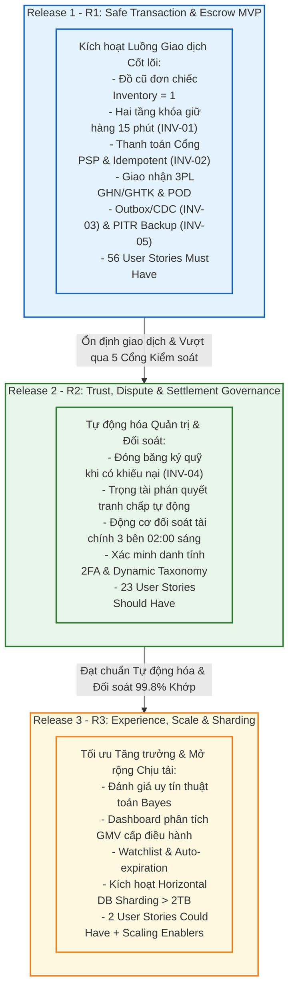
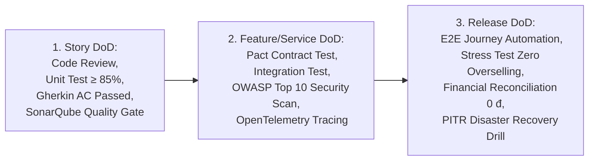
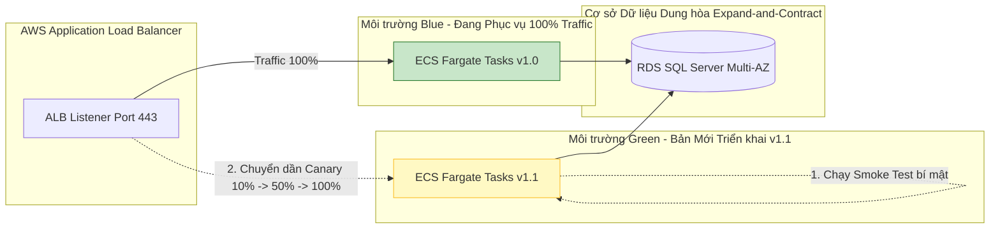

# Release Scope, Definition of Done & Deployment Strategy – ReMarket

## Thông tin tài liệu

| Thuộc tính | Giá trị |
|---|---|
| Dự án | ReMarket – Nền tảng Thương mại Điện tử Đồ cũ C2C/B2C Phân tán |
| Tài liệu | Đặc tả Phạm vi Phát hành (R1/R2/R3), Bộ tiêu chuẩn DoR/DoD & Chiến lược Triển khai |
| Mã tài liệu | `DOC-BA-07-REL` |
| Phiên bản | 1.0 |
| Trạng thái | Hoàn thiện (Quy chuẩn Bàn giao Phát hành & Kiểm thử Nghiệm thu) |
| Ngày cập nhật | 12/11/2026 |
| Tài liệu liên quan | `07_backlog-and-release/epics-and-features.md`, `prioritization.md`, `03_requirements/acceptance-criteria.md`, `06_microservices-and-integrations/aws-cloud-and-network-architecture.md` |

---

## 1. Chiến lược Phát hành Đa Giai đoạn (Multi-Wave Release Strategy Overview)

Để giảm thiểu rủi ro vận hành cho một hệ thống phân tán phức tạp có liên quan trực tiếp đến tiền ký quỹ và giao nhận hàng hóa thực tế, ReMarket áp dụng chiến lược phát hành chia làm **3 Đợt Phát hành Lũy tiến (Progressive Release Waves)**:

---

## 2. Đặc tả Phạm vi Release 1 (R1 – Core Transaction, Escrow & Distributed Foundation MVP)

### 2.1. Mục tiêu Kinh doanh & Năng lực Kích hoạt
Release 1 là phiên bản **Tối thiểu Khả thi (Minimum Viable Product - MVP)** nhưng đạt tiêu chuẩn thương mại cao cấp. Mục tiêu tối thượng của R1 là hiện thực hóa một vòng tròn giao dịch mua bán đồ cũ an toàn trọn vẹn giữa hai cá nhân xa lạ mà không lo bị lừa đảo hoặc mất hàng:
- Người bán cá nhân đăng bán một món đồ cũ duy nhất (`Inventory = 1`).
- Người mua tìm kiếm, xem hàng, đặt lệnh mua ngay và được bảo đảm độc quyền giữ hàng trong 15 phút chống bán trùng (`INV-01`).
- Người mua thanh toán qua cổng điện tử bảo mật; tiền được giữ trong tài khoản ký quỹ trung gian Escrow (`INV-02`).
- Người bán gói hàng, hệ thống tự động tạo mã vận đơn với hãng vận chuyển 3PL (GHN/GHTK) để tài xế đến lấy hàng tận nhà.
- Người mua nhận kiện hàng, kiểm tra và xác nhận; tiền tự động được giải ngân an toàn cho người bán.
- Toàn bộ dữ liệu giao dịch được bảo vệ bằng cơ chế Transactional Outbox (`INV-03`) và sao lưu phục hồi thảm họa PITR liên vùng (`INV-05`).

### 2.2. Danh sách Phạm vi Kỹ thuật Release 1
- **User Stories (56 Stories Must Have):**
  - `EP-ACC` (7 Stories): `US-ACC-01`, `02`, `03`, `04`, `05`, `06`, `07`.
  - `EP-LST` (7 Stories): `US-LST-01`, `02`, `03`, `04`, `05`, `06`, `07`.
  - `EP-SRC` (6 Stories): `US-SRC-01`, `02`, `03`, `04`, `05`, `06`.
  - `EP-CHK` (11 Stories): `US-CHK-01`, `02`, `03`, `04`, `05`, `06`, `07`, `08`, `09`, `10`, `11`.
  - `EP-PAY` (6 Stories): `US-PAY-01`, `02`, `03`, `07`, `09`, `10`.
  - `EP-SHP` (6 Stories): `US-SHP-01`, `02`, `03`, `04`, `05`, `07`.
  - `EP-NTF` (2 Stories): `US-NTF-01`, `04`.
  - `EP-TRU` (5 Stories): `US-TRU-01`, `02`, `03`, `04`, `05`.
  - `EP-SUP` (4 Stories): `US-SUP-01`, `02`, `03`, `04`.
  - `EP-ADM` (1 Story): `US-ADM-03`.
  - `EP-OPS` (10 Stories): `US-OPS-01`, `02`, `03`, `04`, `05`, `06`, `07`, `08`, `09`, `10`.
- **Product Features:** 20 Features trực tiếp (`FT-01`, `03`, `04`, `05`, `06`, `07`, `08`, `09`, `10`, `11`, `12`, `13`, `14`, `16`, `17`, `19`, `21`, `26`, `27`, `31`, `32`).
- **Architectural Enablers:** 9 Enablers nền tảng (`EN-01`, `EN-02`, `EN-03`, `EN-04`, `EN-05`, `EN-06`, `EN-07`, `EN-09`, `EN-10`).
- **Màn hình Giao diện:** 21 Màn hình chính (`SCR-MKT-01..10`, `SCR-MKT-12`, `SCR-SEL-01..05`, `SCR-ADM-01..03`, `SCR-ADM-05`, `SCR-ADM-07`) cùng 5 Modals (`MOD-01`, `MOD-02`, `MOD-03`, `MOD-05`, `MOD-06`).
- **Dịch vụ & Dữ liệu:** 10 Microservices `SVC-00..09` triển khai trên AWS ECS Fargate; Dual-Key RDS SQL Server Multi-AZ (`IdentityDB`, `OrderDB`, `PaymentDB`); MongoDB Atlas Replica Set (`CatalogDB`, `ShippingDB`, `SupportDB`, `NotificationDB`); AWS OpenSearch Cluster.

### 2.3. Quy trình Vận hành Tạm thời trong Release 1 (Operational Workarounds / Fallback)
Do các tính năng tự động hóa chuyên sâu của Release 2 chưa có mặt ở R1, Đội ngũ Vận hành ReMarket sẽ áp dụng quy trình xử lý bán tự động có kiểm soát:
1. **Xử lý Khiếu nại Hàng hóa:** Chưa có màn hình Dispute tự động (`FT-24`); Người mua khiếu nại qua vé hỗ trợ CSKH (`US-SUP-01`). Chuyên viên hỗ trợ mở màn hình Back-office tra cứu `Order 360°` (`US-SUP-03`) và nhấn nút "Tạm dừng giải ngân thủ công" (`Manual Escrow Hold`) trên bảng quản trị `PaymentDB` để bảo vệ tiền người mua trong thời gian làm việc với người bán.
2. **Đối soát Tài chính:** Chưa có động cơ chạy tự động lúc 02:00 sáng (`FT-15`); Chuyên viên Kế toán kết xuất báo cáo giao dịch cuối ngày (`US-PAY-10`), nạp file Excel sao kê cổng VNPAY/MoMo vào công cụ script đối chiếu nội bộ để phát hiện sai lệch.
3. **Danh mục Ngành hàng:** Chưa có UI tạo danh mục động (`FT-28`); cấu hình danh mục và bộ thuộc tính được nạp ban đầu qua tệp Database Migration script đã được phê duyệt.

---

## 3. Đặc tả Phạm vi Release 2 (R2 – Trust, Dispute Resolution, Automated Settlement & Governance)

### 3.1. Mục tiêu Kinh doanh & Năng lực Kích hoạt
Release 2 nâng cấp toàn diện năng lực tự động hóa vận hành, cắt giảm 80% khối lượng can thiệp thủ công, bảo vệ dòng tiền ký quỹ tuyệt đối và mở rộng các công cụ quản trị tinh vi:
- Kích hoạt quy trình Tranh chấp & Khiếu nại tự động 100% gắn chặt với **Bất biến `INV-04` (Escrow Freeze on Dispute)**.
- Triển khai động cơ Đối soát Tài chính 3 Bên tự động chạy hàng ngày, loại bỏ hoàn toàn sai lệch số liệu kế toán.
- Bổ sung xác thực 2 lớp (2FA) bảo vệ tài khoản người bán khi thực hiện các giao dịch rút tiền nhạy cảm.
- Trao quyền cho Quản trị viên tự do mở rộng cây danh mục hàng hóa động và tùy biến thuộc tính ngành hàng mà không cần động đến code.

### 3.2. Danh sách Phạm vi Kỹ thuật Release 2
- **User Stories (23 Stories Should Have):**
  - `EP-ACC` (1 Story): `US-ACC-08` (Bật bảo mật xác thực hai yếu tố 2FA).
  - `EP-LST` (1 Story): `US-LST-08` (Cấu hình thuộc tính bắt buộc & số IMEI/Serial chống hàng giả).
  - `EP-PAY` (4 Stories): `US-PAY-04` (Quản lý số dư ký quỹ Escrow), `US-PAY-05` (Tự động hoàn tiền đơn hủy quá hạn), `US-PAY-06` (Đối soát tài chính 3 bên tự động), `US-PAY-08` (Tự động giải ngân sau 72h).
  - `EP-SHP` (2 Stories): `US-SHP-06` (Định tuyến đối tác vận chuyển thông minh), `US-SHP-08` (Đối soát cước vận chuyển 3PL).
  - `EP-NTF` (3 Stories): `US-NTF-02` (Tùy chọn chủ đề thông báo), `US-NTF-03` (Khung giờ yên tĩnh ban đêm), `US-NTF-05` (Lịch sử thông báo tập trung).
  - `EP-TRU` (1 Story): `US-TRU-06` (Quy trình khiếu nại kiểm duyệt Appeal).
  - `EP-DSP` (4 Stories – Trọn vẹn Luồng Tranh chấp): `US-DSP-01`, `02`, `03`, `04`.
  - `EP-ADM` (2 Stories): `US-ADM-01` (Cây danh mục động), `US-ADM-02` (Định nghĩa thuộc tính Schema động).
  - `EP-OPS` (2 Stories): `US-OPS-11` (Môi trường giả lập Sandbox 3PL & PSP), `US-OPS-12` (Cảnh báo chi phí đám mây FinOps).
- **Product Features:** 10 Features hoàn thiện (`FT-02`, `FT-14` nâng cao, `FT-15`, `FT-18`, `FT-20`, `FT-22`, `FT-24`, `FT-25`, `FT-28`, `FT-29` nâng cao).
- **Architectural Enablers:** `EN-08` (CQRS Order 360° Real-time Materializer qua MongoDB Change Streams).
- **Màn hình Giao diện:** Bổ sung các màn hình chuyên sâu còn lại: `SCR-MKT-11` (Mở Khiếu nại Tranh chấp), `SCR-SEL-06` (Quản lý Khiếu nại Seller), `SCR-ADM-04` (Bàn Trọng tài Phán quyết Tranh chấp), `SCR-ADM-06` (Dashboard Đối soát Ký quỹ), `SCR-ADM-07` (Quản trị Danh mục Động), cùng Modal `MOD-04` (Xác nhận Đóng băng Tiền).

---

## 4. Đặc tả Phạm vi Release 3 (R3 – Experience Optimization, Reputation & Horizontal Sharding Scale)

### 4.1. Mục tiêu Kinh doanh & Năng lực Kích hoạt
Release 3 tập trung vào tối ưu hóa trải nghiệm giữ chân khách hàng (Retention), xây dựng hệ sinh thái danh tiếng minh bạch và mở rộng kiến trúc chịu tải siêu cao chuẩn bị cho các đợt Siêu Sale bùng nổ:
- Triển khai hệ thống Đánh giá Sau Mua có xác thực, tính điểm uy tín người bán theo thuật toán Bayes chống gian lận.
- Cung cấp Bảng điều khiển phân tích số liệu kinh doanh GMV và sức khỏe sàn giao dịch phục vụ Ban Giám đốc.
- Kích hoạt cơ chế **Horizontal Database Sharding trên SQL Server** và **Sharded Cluster trên MongoDB** khi dung lượng lưu trữ toàn sàn vượt mốc 2TB hoặc thông lượng đạt 5.000 TPS.

### 4.2. Danh sách Phạm vi Kỹ thuật Release 3
- **User Stories (2 Stories Could Have & Mở rộng Tăng trưởng):**
  - `US-TRU-07`: Hệ thống tự động tính toán điểm uy tín người bán dựa trên lịch sử giao dịch và đánh giá xác thực.
  - `US-ADM-04`: Bảng điều khiển trực quan chỉ số kinh doanh GMV, tỷ lệ chuyển đổi và sức khỏe tài chính toàn sàn.
  - `FR-SRC-09`: Danh sách sản phẩm theo dõi và yêu thích (Watchlist / Wishlist).
  - `FR-LST-10`: Cơ chế tự động hết hạn tin đăng sau 30 ngày và nhắc nhở người bán gia hạn.
- **Product Features:** `FT-23` (Verified Reviews & Reputation Scoring), `FT-30` (Marketplace Analytics Dashboard).
- **Màn hình Giao diện:** `SCR-ADM-08` (Bảng điều khiển Báo cáo Quản trị Cấp cao), `SCR-MKT-10` (Đánh giá Đơn hàng).
- **Nâng cấp Hạ tầng:** Kích hoạt kiến trúc Sharding phân tán đa Node theo kế hoạch chi tiết tại tài liệu `05_domain-and-data/sharding-and-partitioning-strategy.md`.

---

## 5. Danh mục Phạm vi Loại trừ Chính thức (Explicit Out-of-Scope / Won't Have Boundaries)

Để bảo đảm tính tập trung nguồn lực và an toàn pháp lý, các tính năng sau đây được tuyên bố **Loại trừ Hoàn toàn (Won't Have)**:

| Hạng mục Loại trừ | Lý do Kiến trúc & Nghiệp vụ Loại trừ | Phương án Thay thế Hợp lệ |
|---|---|---|
| **Ví điện tử nội bộ lưu trữ số dư** *(In-app Stored-Value Wallet)* | Đòi hỏi giấy phép Trung gian thanh toán của Ngân hàng Nhà nước, rủi ro rửa tiền và chi phí tuân thủ bảo mật tài chính cực lớn. | Tiền bán hàng sau khi giải ngân ký quỹ được chuyển khoản thẳng về số tài khoản Ngân hàng thật của người bán (`Direct Bank Transfer`). |
| **Cổng Điều phối Giao hàng Nội bộ** *(`FR-SHP-13` Internal Fleet Portal)* | ReMarket là sàn công nghệ, không đầu tư đội xe tải xế riêng; việc xây dựng cổng portal điều phối tài xế sẽ làm phân tán nguồn lực cốt lõi. | Tích hợp 100% qua API với các đối tác vận chuyển chuyên nghiệp (GHN, GHTK); theo dõi toàn bộ qua mã vận đơn bưu cục. |
| **Đấu giá trực tiếp thời gian thực** *(Real-time Live Bidding Engine)* | Mô hình đấu giá đòi hỏi cơ chế WebSocket cực nặng, độ trễ pico-giây và tiềm ẩn rủi ro thao túng giá, tranh chấp pháp lý phức tạp. | Bán theo giá niêm yết cố định (`Fixed-Price Single Listing`); người mua có thể trao đổi riêng với người bán nếu muốn thỏa thuận giá. |
| **Giỏ hàng gom nhiều người bán** *(Multi-seller Cart Unified Checkout)* | Gây ra bài toán phân bổ thanh toán cực kỳ phức tạp (Split Payment), tính toán phí ship đa bưu cục và vướng mắc lớn khi 1 trong các món bị hủy. | Áp dụng mô hình **Single-Item Buy Now**: mỗi phiên checkout chỉ áp dụng duy nhất cho một món hàng từ một người bán. |
| **Thương mại xuyên biên giới** *(Cross-border Trade)* | Phức tạp về thuế nhập khẩu, hải quan, tỷ giá hối đoái và chính sách trả hàng quốc tế. | Chỉ phục vụ giao dịch trong lãnh thổ Việt Nam, sử dụng Đồng Việt Nam (VND) và giao nhận nội địa. |

---

## 6. Tiêu chuẩn Sẵn sàng (DoR) & Tiêu chuẩn Hoàn thành (DoD)

### 6.1. Tiêu chuẩn Sẵn sàng (Definition of Ready - DoR)
Một User Story chỉ được phép đưa vào Sprint Backlog để đội ngũ kỹ sư bắt đầu lập trình khi thỏa mãn đầy đủ **8 tiêu chí DoR**:
1. [ ] **Mục đích Nghiệp vụ Rõ ràng:** Có đầy đủ cấu trúc câu chuyện chuẩn: *"Là một [Vai trò], tôi muốn [Hành động] để [Lợi ích]"*.
2. [ ] **Tiêu chí Nghiệm thu Chuẩn hóa (AC):** Có ít nhất từ 2 đến 5 kịch bản kiểm thử viết theo cú pháp **Gherkin (`Given - When - Then`)**, bao quát cả luồng chính (Happy Path) và các luồng ngoại lệ/biên (Edge Cases).
3. [ ] **Thiết kế Giao diện Hoàn tất:** Có liên kết trực tiếp đến Wireframe / Prototype hoặc mã màn hình chuẩn (`SCR-*`, `MOD-*`) kèm đặc tả các trạng thái giao diện: *Empty State, Loading, Active, Error*.
4. [ ] **Hợp đồng Giao tiếp Xác định:** Có định nghĩa API Request/Response schema (OpenAPI/Swagger) hoặc CloudEvent schema (`EVT-*`) liên quan.
5. [ ] **Ràng buộc Dữ liệu Minh bạch:** Xác định rõ bảng/collection cần thao tác và các trường thông tin bắt buộc, kiểu dữ liệu, ràng buộc khóa chính/khóa ngoại.
6. [ ] **Không bị Chặn Phụ thuộc (Unblocked):** Các câu hỏi mở nghiệp vụ (`Q-BIZ-*`, `Q-OPS-*`, `Q-DATA-*`) liên quan đã có quyết định chính thức; các API/Enabler nền tảng phụ thuộc đã sẵn sàng trên môi trường Staging.
7. [ ] **Bảo vệ Bất biến Kiến trúc:** Story được đánh giá rõ ràng có chạm đến 5 bất biến `INV-01..05` hay không; nếu có, phải có giải pháp kiểm soát xung đột đồng thời.
8. [ ] **Ước lượng Dung lượng (Story Points):** Đã được toàn đội kỹ thuật thống nhất chấm điểm Story Points (tối đa không quá 13 points; nếu lớn hơn phải tách nhỏ).

### 6.2. Tiêu chuẩn Hoàn thành (Definition of Done - DoD)
Một hạng mục chỉ được xem là hoàn thành và được phép đóng lại khi đáp ứng nghiêm ngặt theo 3 cấp độ DoD:

#### Cấp độ 1: Story DoD (Áp dụng cho từng User Story)
- [ ] Mã nguồn được viết tuân thủ Coding Conventions, Clean Architecture; 100% Pull Request được review và phê duyệt bởi ít nhất 2 lập trình viên.
- [ ] Unit Test đạt độ bao phủ mã nguồn (Code Coverage) tối thiểu **≥ 85%**; bao phủ 100% các nhánh rẽ nghiệp vụ tính toán tiền và kiểm tra trạng thái đơn.
- [ ] Toàn bộ các kịch bản kiểm thử chấp nhận Gherkin đã được tự động hóa và chạy PASS 100%.
- [ ] Vượt qua kiểm tra chất lượng mã tĩnh (SonarQube Quality Gate): 0 lỗi nghiêm trọng (Blocker/Critical Bugs), 0 lỗ hổng bảo mật (Vulnerabilities), Technical Debt < 5%.
- [ ] Dữ liệu nhạy cảm PII được kiểm tra che chắn mã hóa trước khi ghi log.

#### Cấp độ 2: Feature / Service DoD (Áp dụng cho từng Dịch vụ & Tính năng)
- [ ] Hợp đồng API giữa các microservices vượt qua kiểm thử hợp đồng tự động (Contract Testing với Pact) không gây lỗi phá vỡ tương thích (Zero Breaking Changes).
- [ ] Kiểm thử tích hợp (Integration Tests) với cơ sở dữ liệu thật (SQL Server / MongoDB chạy trên Docker Testcontainers) chạy thành công 100%.
- [ ] Tích hợp đầy đủ OpenTelemetry Tracing (`TraceId`, `CorrelationId`) xuất log chuẩn JSON sang hệ thống giám sát.
- [ ] Quét lỗ hổng bảo mật tự động mã nguồn mở (SAST/DAST, OWASP Top 10) đạt chứng chỉ sạch lỗ hổng.
- [ ] Tài liệu hướng dẫn sử dụng và tài liệu OpenAPI (Swagger) được cập nhật đồng bộ.

#### Cấp độ 3: Release DoD (Áp dụng cho toàn bộ Đợt Phát hành trước khi Go-Live)
- [ ] Vượt qua kiểm thử đầu-cuối tự động (E2E Regression Automation Testing) cho toàn bộ các luồng giao dịch mua bán, thanh toán, vận chuyển.
- [ ] Vượt qua thử nghiệm tải nặng (Performance & Stress Testing): Chịu tải đồng thời 100 checkout trên cùng một món hàng độc bản chứng minh **100% không bán trùng (`INV-01 Zero Overselling`)**.
- [ ] Thử nghiệm Idempotent Webhook: Bơm 1.000 webhook thanh toán trùng lặp xác nhận **không ghi nhận sai số dư ký quỹ (`INV-02 Zero Double Charge`)**.
- [ ] Đối soát tài chính chạy thử nghiệm đạt sai lệch **0 VNĐ**.
- [ ] Kịch bản diễn tập phục hồi thảm họa thực tế (DR Drill) đạt cam kết: **RPO ≤ 5 phút** và **RTO ≤ 30 phút** có biên bản xác nhận của SRE Lead (`STK-18`).

---

## 7. Cổng Kiểm soát Phát hành (Release Readiness & Exit Gates) & Chiến lược Triển khai Zero-Downtime

### 7.1. 5 Cổng Kiểm soát Phát hành Bắt buộc (Release Exit Gates)
Hệ thống chỉ được phép chuyển từ môi trường Staging lên Production khi vượt qua 5 cổng kiểm soát độc lập:

| Cổng Kiểm soát | Tiêu chí Vượt qua (Pass Criteria) | Bằng chứng Kiểm chứng (Artifact) | Người Phê duyệt |
|---|---|---|---|
| **Cổng 1: Nghiệp vụ & Chức năng** | Tỷ lệ Test Case Passed = 100% cho Must Have; 0 lỗi mở cấp P1/P2. | Báo cáo Allure / TestRail Report | QA Lead (`STK-14`) |
| **Cổng 2: Hiệu năng & Chống Bán trùng** | 100 concurrent checkout trên 1 item → Đúng 1 thành công; p95 latency < 500ms; không rò rỉ bộ nhớ. | Báo cáo k6 / JMeter Stress Test | Performance Engineer |
| **Cổng 3: An toàn Tài chính & Ký quỹ** | 100% giao dịch thanh toán khớp đúng số dư; hoàn tiền đơn trễ tự động; sai lệch đối soát = 0 đ. | Báo cáo Kiểm toán Ký quỹ | Finance Lead (`STK-15`) |
| **Cổng 4: An ninh Thông tin & Tuân thủ** | WAF v2 kích hoạt; TLS 1.3; mã hóa KMS; không phát hiện lỗ hổng mức Critical/High; che chắn PII 100%. | Báo cáo Pentest & Security Scan | Security Lead (`STK-19`) |
| **Cổng 5: Khôi phục Thảm họa DR Drill** | Diễn tập sập AZ thành công; RPO đo được ≤ 3 phút; RTO đo được ≤ 22 phút; dữ liệu toàn vẹn. | Biên bản Diễn tập DR Drill | SRE Lead (`STK-18`) |

---

### 7.2. Chiến lược Triển khai Zero-Downtime (Blue/Green & Expand-Contract DB Migration)
Nhằm bảo đảm sàn thương mại hoạt động liên tục 24/7, không bao giờ phải ngắt kết nối phục vụ bảo trì, ReMarket áp dụng quy trình triển khai hiện đại:

1. **Triển khai Blue/Green trên AWS ECS Fargate:**
   - Phiên bản hiện tại đang phục vụ khách hàng trên cụm **Blue**.
   - Phiên bản mã nguồn mới được dựng song song trên cụm **Green**. Hệ thống chạy bộ kiểm thử tự động Smoke Test ngầm mà người dùng không hề hay biết.
   - Sử dụng AWS CodeDeploy điều tiết lưu lượng truy cập: Chuyển thử nghiệm 10% lưu lượng (Canary Deployment) sang Green trong 15 phút. Nếu tỷ lệ lỗi HTTP 5xx = 0, tự động chuyển toàn bộ 100% lưu lượng sang Green và giữ lại Blue trong 2 giờ để sẵn sàng Instant Rollback nếu cần.
2. **Chiến lược Nâng cấp Cơ sở Dữ liệu Expand-and-Contract (Mở rộng trước - Thu hẹp sau):**
   - **Giai đoạn Expand (Mở rộng):** Bổ sung cột mới hoặc bảng mới nhưng giữ nguyên các cột cũ; mã nguồn mới có thể đọc/ghi dữ liệu ở cấu trúc mới trong khi mã nguồn cũ vẫn đọc/ghi bình thường trên cấu trúc cũ.
   - **Giai đoạn Transition (Chuyển tiếp):** Triển khai mã nguồn v2 đọc cấu trúc mới.
   - **Giai đoạn Contract (Thu hẹp):** Sau khi bản nâng cấp chạy ổn định 1 tuần trên Production, chạy script dọn dẹp các cột cũ không còn sử dụng. Tuyệt đối không bao giờ chạy các lệnh đổi tên cột hoặc xóa cột trực tiếp gây khóa bảng (Lock table) trong giờ giao dịch.
3. **Cơ chế Feature Flags:**
   - Mọi tính năng mới phát hành trong Release 2 và Release 3 đều được bao bọc bởi Feature Flag (sử dụng AWS AppConfig). Cho phép bật/tắt tính năng theo thời gian thực (ví dụ: tạm tắt cổng thanh toán MoMo nếu đối tác bảo trì) mà không cần phải triển khai lại mã nguồn.

---

## 8. Lịch sử cập nhật

| Phiên bản | Ngày | Tác giả | Nội dung thay đổi |
|---|---|---|---|
| 1.0 | 12/11/2026 | Nhóm Phân tích Nghiệp vụ & Kiến trúc | Khởi tạo tài liệu đặc tả phạm vi phát hành R1/R2/R3, DoR/DoD 3 cấp, 5 Release Gates và chiến lược triển khai Blue/Green Zero-Downtime. |

