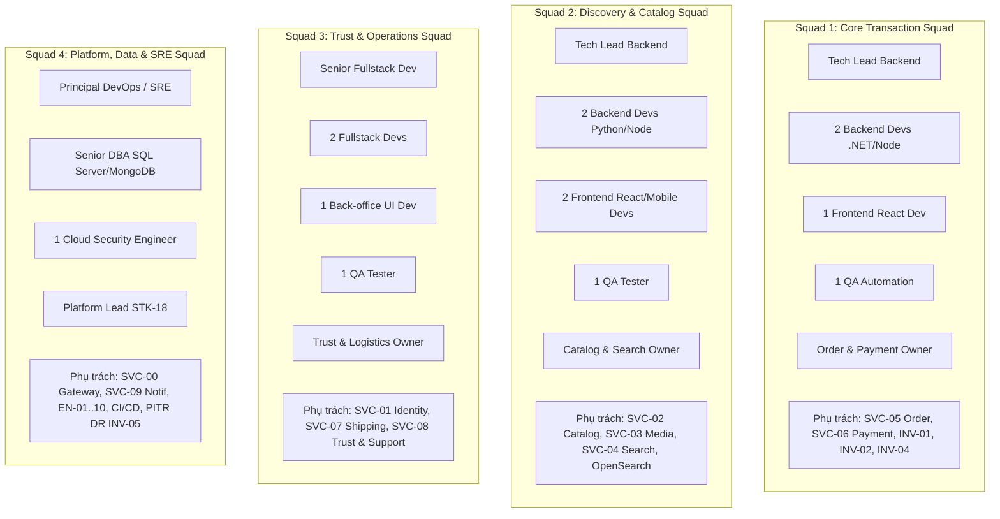

# User Story Mapping & Delivery Roadmap – ReMarket

## Thông tin tài liệu

| Thuộc tính | Giá trị |
|---|---|
| Dự án | ReMarket – Nền tảng Thương mại Điện tử Đồ cũ C2C/B2C Phân tán |
| Tài liệu | Bản đồ Câu chuyện Người dùng (Story Map), Lộ trình Thực thi 12 Sprints & Cấu trúc Đội ngũ |
| Mã tài liệu | `DOC-BA-07-MAP` |
| Phiên bản | 1.0 |
| Trạng thái | Hoàn thiện (Kế hoạch Điều phối Sản xuất & Thực thi Sprint) |
| Ngày cập nhật | 12/11/2026 |
| Tài liệu liên quan | `07_backlog-and-release/epics-and-features.md`, `prioritization.md`, `release-scope.md`, `dependencies-and-risks.md` |

---

## 1. Bản đồ User Story Mapping 2 Chiều (End-to-End User Story Map)

Bản đồ User Story Mapping cung cấp góc nhìn trực quan toàn cảnh, gắn kết hành vi người dùng dọc theo dòng giá trị nghiệp vụ với các lát cắt phát hành lũy tiến. Toàn bộ **81 User Stories** được bố trí khoa học theo 2 trục:

- **Trục ngang (The Backbone - 6 Chặng Dòng Giá trị Hành trình Khách hàng):**
  1. `VS-01` (Onboarding & Đăng bán): Đăng ký, đăng nhập, hồ sơ người bán, tải ảnh và xuất bản tin đồ cũ.
  2. `VS-02` (Khám phá & Đánh giá): Tìm kiếm toàn văn, bộ lọc đa diện, xem chi tiết và kiểm tra độ uy tín.
  3. `VS-03` (Đặt hàng & Thanh toán): Checkout món đồ độc bản, khóa giữ hàng 15 phút, thanh toán tạm giữ Escrow.
  4. `VS-04` (Đóng gói & Giao vận 3PL): Người bán in vận đơn, bưu tá lấy hàng, theo dõi hành trình và giao hàng có POD.
  5. `VS-05` (Hoàn tất & Quyết toán): Người mua xác nhận, tự động giải ngân ký quỹ, đánh giá phản hồi sau mua.
  6. `VS-06` (Ngoại lệ, Tranh chấp & Hỗ trợ): Xử lý giao thất bại, khiếu nại đóng băng tiền, đối soát và khôi phục thảm họa.

- **Trục dọc (Release Slices - Các Lát cắt Phát hành):**
  - **Lát cắt 1: Walking Skeleton (Khung xương tối thiểu để chạy thông luồng end-to-end)**.
  - **Lát cắt 2: Release 1 MVP (56 Must Have Stories - Sàn giao dịch ký quỹ an toàn hoàn chỉnh)**.
  - **Lát cắt 3: Release 2 (23 Should Have Stories - Quản trị tranh chấp, đối soát tự động & bảo mật)**.
  - **Lát cắt 4: Release 3 (2 Could Have Stories & Nâng cấp Mở rộng Sharding)**.

```mermaid
flowchart TB
    subgraph Backbone [TRỤC NGANG: 6 CHẶNG DÒNG GIÁ TRỊ KHÁCH HÀNG (VALUE STREAMS)]
        direction LR
        VS1["VS-01: Onboarding & Đăng bán"]
        VS2["VS-02: Khám phá & Đánh giá"]
        VS3["VS-03: Đặt hàng & Thanh toán"]
        VS4["VS-04: Đóng gói & Giao vận 3PL"]
        VS5["VS-05: Hoàn tất & Quyết toán"]
        VS6["VS-06: Ngoại lệ, Tranh chấp & Hỗ trợ"]
        VS1 --> VS2 --> VS3 --> VS4 --> VS5 --> VS6
    end

    subgraph SliceR1 [LÁT CẮT RELEASE 1 (MVP - 56 MUST HAVE STORIES)]
        direction TB
        R1_1["VS-01: US-ACC-01..05, US-LST-01..07"]
        R1_2["VS-02: US-SRC-01..06"]
        R1_3["VS-03: US-CHK-01..10, US-PAY-01..03, 07"]
        R1_4["VS-04: US-SHP-01..05, 07, US-NTF-01, 04"]
        R1_5["VS-05: US-CHK-11, US-PAY-10, US-TRU-03, 04"]
        R1_6["VS-06: US-SUP-01..04, US-TRU-01, 02, 05, US-ADM-03, US-OPS-01..10"]
    end

    subgraph SliceR2 [LÁT CẮT RELEASE 2 (23 SHOULD HAVE STORIES)]
        direction TB
        R2_1["VS-01: US-ACC-08, US-LST-08, US-ADM-01, 02"]
        R2_3["VS-03: US-PAY-04, 05"]
        R2_4["VS-04: US-SHP-06, 08, US-NTF-02, 03, 05"]
        R2_5["VS-05: US-PAY-06, 08"]
        R2_6["VS-06: US-DSP-01..04, US-TRU-06, US-OPS-11, 12"]
    end

    subgraph SliceR3 [LÁT CẮT RELEASE 3 (2 COULD HAVE STORIES & SCALE)]
        direction TB
        R3_2["VS-02: FR-SRC-09 Watchlist, FR-LST-10 Expiration"]
        R3_5["VS-05: US-TRU-07 Xếp hạng Uy tín Bayes"]
        R3_6["VS-06: US-ADM-04 Báo cáo GMV, Kích hoạt Sharding > 2TB"]
    end

    Backbone --> SliceR1
    SliceR1 --> SliceR2
    SliceR2 --> SliceR3

    classDef bb fill:#e8eaf6,stroke:#3f51b5,stroke-width:2px;
    classDef r1 fill:#e3f2fd,stroke:#1e88e5,stroke-width:1.5px;
    classDef r2 fill:#e8f5e9,stroke:#43a047,stroke-width:1.5px;
    classDef r3 fill:#fffde7,stroke:#fbc02d,stroke-width:1.5px;
    class VS1,VS2,VS3,VS4,VS5,VS6 bb;
    class R1_1,R1_2,R1_3,R1_4,R1_5,R1_6 r1;
    class R2_1,R2_3,R2_4,R2_5,R2_6 r2;
    class R3_2,R3_5,R3_6 r3;
```

---

## 2. Bảng Phân bổ Toàn bộ 81 User Stories vào User Story Map

Bảng dưới đây liệt kê chi tiết vị trí tọa độ của toàn bộ 81 câu chuyện người dùng trên bản đồ:

| Chặng Dòng Giá trị | Lát cắt R1 (Must Have) | Lát cắt R2 (Should Have) | Lát cắt R3 (Could Have / Scaling) |
|---|---|---|---|
| **`VS-01` (Onboarding & Đăng bán)** | `US-ACC-01` (Đăng ký SĐT)<br>`US-ACC-02` (Đăng nhập OTP)<br>`US-ACC-03` (Hồ sơ & Địa chỉ)<br>`US-ACC-04` (Đăng ký Người bán)<br>`US-ACC-05` (KYC cơ bản)<br>`US-LST-01` (Đăng tin đồ cũ)<br>`US-LST-02` (Sửa tin)<br>`US-LST-03` (Quản lý tin đăng)<br>`US-LST-04` (S3 Presigned URL)<br>`US-LST-05` (Nén ảnh WebP)<br>`US-LST-06` (Chặn từ cấm)<br>`US-LST-07` (Kiểm duyệt tin) | `US-ACC-08` (Bật bảo mật 2FA)<br>`US-LST-08` (IMEI/Serial bắt buộc)<br>`US-ADM-01` (Cây danh mục động)<br>`US-ADM-02` (Thuộc tính Schema động) | `FR-LST-10` (Tự động hết hạn tin sau 30 ngày) |
| **`VS-02` (Khám phá & Đánh giá)** | `US-SRC-01` (Tìm kiếm có dấu/không dấu)<br>`US-SRC-02` (Lọc giá/tình trạng)<br>`US-SRC-03` (Sắp xếp theo độ mới/giá)<br>`US-SRC-04` (Xem chi tiết PDP)<br>`US-SRC-05` (Gợi ý tin tương tự)<br>`US-SRC-06` (Sync OpenSearch 2s) | *Không có (Đã hoàn thiện ở R1)* | `FR-SRC-09` (Danh sách sản phẩm theo dõi Watchlist) |
| **`VS-03` (Đặt hàng & Thanh toán)** | `US-CHK-01` (Mua ngay đơn chiếc)<br>`US-CHK-02` (Địa chỉ & phí ship 3PL)<br>`US-CHK-03` (Tóm tắt chi phí)<br>`US-CHK-04` (Khóa giữ chỗ 15p)<br>`US-CHK-05` (Mở khóa hết 15p)<br>`US-CHK-06` (Hủy giữ chỗ)<br>`US-CHK-07` (Tạo đơn UUIDv7)<br>`US-CHK-08` (Theo dõi đơn)<br>`US-CHK-09` (Seller xác nhận)<br>`US-CHK-10` (Tự hủy đơn quá hạn)<br>`US-PAY-01` (Chọn cổng PSP)<br>`US-PAY-02` (Điều hướng chữ ký số)<br>`US-PAY-03` (Webhook Idempotent)<br>`US-PAY-07` (Bảo mật PCI-DSS) | `US-PAY-04` (Quản lý số dư ký quỹ)<br>`US-PAY-05` (Auto-refund đơn hủy trễ) | *Không có* |
| **`VS-04` (Đóng gói & Giao vận 3PL)** | `US-SHP-01` (Tự động tạo mã vận đơn)<br>`US-SHP-02` (In nhãn gửi hàng)<br>`US-SHP-03` (Hành trình bưu tá)<br>`US-SHP-04` (Bằng chứng giao hàng POD)<br>`US-SHP-05` (Giao thất bại & hẹn lại)<br>`US-SHP-07` (Ước tính ngày giao)<br>`US-NTF-01` (Thông báo In-app/Email)<br>`US-NTF-04` (Gửi SMS OTP) | `US-SHP-06` (Định tuyến 3PL thông minh)<br>`US-SHP-08` (Đối soát cước 3PL)<br>`US-NTF-02` (Tùy chọn chủ đề thông báo)<br>`US-NTF-03` (Khung giờ yên tĩnh đêm)<br>`US-NTF-05` (Lịch sử thông báo tập trung) | *Không có* |
| **`VS-05` (Hoàn tất & Quyết toán)** | `US-CHK-11` (Xác nhận nhận hàng đúng mô tả)<br>`US-PAY-10` (Hóa đơn điện tử)<br>`US-TRU-03` (Xem đánh giá mẫu)<br>`US-TRU-04` (Phản hồi đánh giá cơ bản) | `US-PAY-06` (Đối soát tự động 02:00)<br>`US-PAY-08` (Tự động giải ngân sau 72h) | `US-TRU-07` (Tính điểm uy tín thuật toán Bayes nâng cao) |
| **`VS-06` (Ngoại lệ, Tranh chấp & Hỗ trợ)**| `US-SUP-01` (Tạo ticket CSKH)<br>`US-SUP-02` (Quản lý ticket CSKH)<br>`US-SUP-03` (Tra cứu Order 360° cơ bản)<br>`US-SUP-04` (Ghi chú nội bộ)<br>`US-TRU-01` (Báo cáo vi phạm)<br>`US-TRU-02` (Hàng đợi kiểm duyệt)<br>`US-TRU-05` (Cảnh cáo/Khóa tin)<br>`US-ADM-03` (Cấu hình từ khóa cấm)<br>`US-OPS-01` (Log che chắn PII)<br>`US-OPS-02` (Trace Correlation ID)<br>`US-OPS-03` (Monitor RED/USE)<br>`US-OPS-04` (Cảnh báo lỗi 5xx)<br>`US-OPS-05` (PITR Backup RPO 5m)<br>`US-OPS-06` (Restore DR RTO 30m)<br>`US-OPS-07` (Dead Letter Queue Replay)<br>`US-OPS-08` (Diễn tập DR Drill)<br>`US-OPS-09` (Lưu trữ S3 WORM)<br>`US-OPS-10` (Đối soát DB vs S3) | `US-DSP-01` (Mở khiếu nại trong 72h)<br>`US-DSP-02` (Tự động đóng băng tiền ký quỹ)<br>`US-DSP-03` (Trọng tài thẩm định)<br>`US-DSP-04` (Thực thi hoàn tiền phán quyết)<br>`US-TRU-06` (Người bán khiếu nại Appeal)<br>`US-OPS-11` (Sandbox giả lập 3PL & PSP)<br>`US-OPS-12` (Cảnh báo chi phí FinOps) | `US-ADM-04` (Báo cáo GMV cấp Giám đốc)<br>Kích hoạt Database Sharding khi DB > 2TB |

---

## 3. Lộ trình Triển khai Chi tiết theo 12 Sprints (24 Tuần)

Quy trình phát triển được đóng gói thành **12 Sprints đều đặn**, mỗi Sprint kéo dài đúng 2 tuần (10 ngày làm việc). Lộ trình bảo đảm tuân thủ triệt để đồ thị phụ thuộc DAG và đường găng Critical Path:

```mermaid
gantt
    title LỘ TRÌNH THỰC THI 12 SPRINTS (24 TUẦN) - REMARKET PLATFORM
    dateFormat  YYYY-MM-DD
    section Giai đoạn 1: Release 1 MVP (Tuần 1 - 12)
    Sprint 1: Nền tảng Cloud & Identity Service          :active, sp1, 2026-11-16, 14d
    Sprint 2: Catalog, Media S3 & Kiểm duyệt Ban đầu      :sp2, after sp1, 14d
    Sprint 3: OpenSearch Sync & Giao diện Khám phá       :sp3, after sp2, 14d
    Sprint 4: Order Core & Khóa Giữ hàng 15 Phút (INV-01) :sp4, after sp3, 14d
    Sprint 5: Cổng Thanh toán PSP, Escrow & Giao vận 3PL :sp5, after sp4, 14d
    Sprint 6: Support 360°, Stress Test & Diễn tập DR     :sp6, after sp5, 14d
    section Mốc Cột mốc 1: Go-Live Release 1 MVP
    Phê duyệt 5 Cổng Kiểm soát & Go-Live R1              :milestone, m1, after sp6, 0d
    section Giai đoạn 2: Release 2 Governance (Tuần 13 - 20)
    Sprint 7: Luồng Tranh chấp & Đóng băng Tiền (INV-04) :sp7, after sp6, 14d
    Sprint 8: Tự động Giải ngân T+3 & Đối soát 3 Bên 02h :sp8, after sp7, 14d
    Sprint 9: Cây Danh mục Động, IMEI & Bảo mật 2FA       :sp9, after sp8, 14d
    Sprint 10: Notification Center, Sandbox & Tối ưu R2   :sp10, after sp9, 14d
    section Mốc Cột mốc 2: Go-Live Release 2
    Nghiệm thu Tự động hóa & Go-Live R2                  :milestone, m2, after sp10, 0d
    section Giai đoạn 3: Release 3 Growth & Scale (Tuần 21 - 24)
    Sprint 11: Đánh giá Uy tín Bayes & Dashboard GMV      :sp11, after sp10, 14d
    Sprint 12: Diễn tập Sharding Phân tán & High-Scale   :sp12, after sp11, 14d
    section Mốc Cột mốc 3: Hoàn thành Toàn diện R3
    Bàn giao Vận hành Quy mô Siêu lớn                    :milestone, m3, after sp12, 0d
```

### Chi tiết Kế hoạch Từng Sprint:

#### Sprint 1 (Tuần 1 - 2): Nền tảng Cloud, Cơ sở Dữ liệu & Identity Service
- **Mục tiêu:** Thiết lập xong hạ tầng mạng AWS bảo mật, cụm RDS SQL Server Multi-AZ, MongoDB Atlas và hoàn thành dịch vụ định danh.
- **Enablers & Dịch vụ:** `EN-01` (Landing Zone, VPC, Gateway), `EN-02` (Dual-Key SQL), `EN-03` (MongoDB Atlas), `SVC-00`, `SVC-01`.
- **User Stories thực thi:** `US-ACC-01`, `US-ACC-02`, `US-ACC-03`, `US-ACC-04`, `US-ACC-05`, `US-ACC-06`, `US-ACC-07`, `US-OPS-01`, `US-OPS-02`.
- **Giao diện nghiệm thu:** `SCR-MKT-01` (Header Auth), `SCR-MKT-08` (Hồ sơ), `SCR-SEL-01` (Onboarding), `SCR-ADM-01` (Duyệt KYC), `SCR-ADM-02` (Quản lý User).
- **Tiêu chí kết thúc Sprint (Sprint Exit):** Người dùng đăng ký/đăng nhập nhận OTP thành công; cấp JWT token phân quyền chính xác qua Gateway.

#### Sprint 2 (Tuần 3 - 4): Quản lý Tin đăng, Pipeline Ảnh S3 & Hàng rào Kiểm duyệt Ban đầu
- **Mục tiêu:** Xây dựng tính năng đăng bán đồ cũ với nguyên tắc `Inventory = 1`, tải ảnh trực tiếp S3 và lọc từ cấm tự động.
- **Enablers & Dịch vụ:** `EN-06` (S3 Presigned & ClamAV Scan), `SVC-02 Catalog`, `SVC-03 Media Storage`.
- **User Stories thực thi:** `US-LST-01`, `US-LST-02`, `US-LST-03`, `US-LST-04`, `US-LST-05`, `US-LST-06`, `US-LST-07`, `US-ADM-03`, `US-TRU-03`, `US-TRU-04`.
- **Giao diện nghiệm thu:** `SCR-SEL-02` (Đăng tin mới), `SCR-SEL-03` (Quản lý tin đăng), `SCR-ADM-03` (Kiểm duyệt tin).
- **Tiêu chí kết thúc Sprint:** Đăng tin tải lên tối đa 10 ảnh WebP trong 5 giây; tự động chặn tin chứa từ khóa cấm.

#### Sprint 3 (Tuần 5 - 6): Đồng bộ OpenSearch NRT & Giao diện Tìm kiếm Khám phá Hàng hóa
- **Mục tiêu:** Triển khai công cụ tìm kiếm tiếng Việt toàn văn và trang chi tiết sản phẩm hiển thị trạng thái sẵn sàng.
- **Enablers & Dịch vụ:** `EN-07` (OpenSearch Vietnamese Analyzer), `SVC-04 Search & Discovery`.
- **User Stories thực thi:** `US-SRC-01`, `US-SRC-02`, `US-SRC-03`, `US-SRC-04`, `US-SRC-05`, `US-SRC-06`.
- **Giao diện nghiệm thu:** `SCR-MKT-01` (Trang chủ), `SCR-MKT-02` (Kết quả tìm kiếm & Bộ lọc), `SCR-MKT-03` (Chi tiết món hàng PDP).
- **Tiêu chí kết thúc Sprint:** Tìm kiếm phản hồi < 200ms; tin đăng mới đồng bộ sang OpenSearch dưới 2 giây.

#### Sprint 4 (Tuần 7 - 8): Động cơ Đặt hàng, Khóa Giữ chỗ Hai Tầng 15 Phút (Bảo vệ `INV-01`)
- **Mục tiêu:** Xây dựng lõi xử lý đơn hàng, tính báo giá vận chuyển tạm tính và động cơ khóa giữ hàng 15 phút Two-Tier.
- **Enablers & Dịch vụ:** `EN-04` (Two-Tier Lock Engine), `EN-05` (Transactional Outbox), `SVC-05 Order Processing`.
- **User Stories thực thi:** `US-CHK-01`, `US-CHK-02`, `US-CHK-03`, `US-CHK-04`, `US-CHK-05`, `US-CHK-06`, `US-CHK-07`, `US-CHK-08`, `US-CHK-09`, `US-CHK-10`.
- **Giao diện nghiệm thu:** `SCR-MKT-04` (Checkout & Countdown 15:00), `MOD-01` (Cảnh báo hết hạn), `SCR-MKT-05` (Xác nhận đặt hàng), `SCR-SEL-04` (Đơn bán Seller).
- **Tiêu chí kết thúc Sprint:** Kiểm thử đồng thời 100 request mua cùng 1 món chỉ 1 request thành công; tự động nhả khóa sau 900 giây.

#### Sprint 5 (Tuần 9 - 10): Tích hợp Cổng PSP (Bảo vệ `INV-02`), Ký quỹ Escrow & Vận chuyển 3PL
- **Mục tiêu:** Hoàn thiện tích hợp thanh toán VNPAY/MoMo với chữ ký số; xử lý Webhook idempotent; tạo mã vận đơn với GHN/GHTK.
- **Enablers & Dịch vụ:** `SVC-06 Payment & Escrow`, `SVC-07 Shipping & Logistics`, `SVC-09 Notification`.
- **User Stories thực thi:** `US-PAY-01`, `US-PAY-02`, `US-PAY-03`, `US-PAY-07`, `US-PAY-09`, `US-PAY-10`, `US-SHP-01`, `US-SHP-02`, `US-SHP-03`, `US-SHP-04`, `US-SHP-05`, `US-SHP-07`, `US-NTF-01`, `US-NTF-04`.
- **Giao diện nghiệm thu:** `SCR-MKT-06` (Chi tiết đơn mua), `SCR-MKT-07` (Tra cứu hành trình vận chuyển), `SCR-SEL-05` (Ví ký quỹ người bán), `SCR-ADM-05` (Vận chuyển).
- **Tiêu chí kết thúc Sprint:** Bắn 1.000 webhook trùng lặp không bị sai lệch số dư; tạo vận đơn thành công với 3PL trong 2.5 giây.

#### Sprint 6 (Tuần 11 - 12): Trust, Support 360°, Thử nghiệm Tải Nặng & Diễn tập Khôi phục Thảm họa DR
- **Mục tiêu:** Hoàn thiện màn hình CSKH 360°, kiểm thử tải toàn diện và diễn tập khôi phục thảm họa trước khi Go-Live R1.
- **Enablers & Dịch vụ:** `SVC-08 Trust & Support`, `EN-09` (OpenTelemetry Tracing), `EN-10` (Cross-Region Backup).
- **User Stories thực thi:** `US-CHK-11`, `US-TRU-01`, `US-TRU-02`, `US-TRU-05`, `US-SUP-01`, `US-SUP-02`, `US-SUP-03`, `US-SUP-04`, `US-OPS-03`, `US-OPS-04`, `US-OPS-05`, `US-OPS-06`, `US-OPS-07`, `US-OPS-08`, `US-OPS-09`, `US-OPS-10`.
- **Giao diện nghiệm thu:** `SCR-MKT-12` (Trung tâm trợ giúp), `SCR-ADM-07` (Hàng đợi CSKH & Order 360°), Grafana Monitoring Dashboards.
- **Cột mốc Cột mốc (Milestone 1):** Vượt qua 5 Cổng Kiểm soát Phát hành (Release Exit Gates); chính thức phát hành **Release 1 MVP**.

#### Sprint 7 (Tuần 13 - 14): Quy trình Tranh chấp Khiếu nại Tự động & Đóng băng Ký quỹ (Bảo vệ `INV-04`)
- **Mục tiêu:** Tự động hóa hoàn toàn quy trình khiếu nại trong 72h; tức thời đóng băng giải ngân khi có tranh chấp; bàn làm việc trọng tài viên.
- **User Stories thực thi:** `US-DSP-01`, `US-DSP-02`, `US-DSP-03`, `US-DSP-04`, `US-TRU-06`.
- **Giao diện nghiệm thu:** `SCR-MKT-11` (Mở khiếu nại), `MOD-04` (Xác nhận đóng băng tiền), `SCR-SEL-06` (Khiếu nại người bán), `SCR-ADM-04` (Bàn trọng tài phán quyết).
- **Tiêu chí kết thúc Sprint:** Bấm gửi khiếu nại đóng băng tiền ký quỹ trong vòng < 500ms; thực thi hoàn tiền tự động qua API khi có phán quyết.

#### Sprint 8 (Tuần 15 - 16): Tự động Hóa Giải ngân T+3, Hoàn tiền Đơn trễ & Động cơ Đối soát Tài chính 3 Bên
- **Mục tiêu:** Tự động hóa lệnh giải ngân sau 72h hoàn tất; tự động hoàn tiền khi thanh toán trễ quá 15 phút; đối soát 3 bên lúc 02:00 sáng.
- **User Stories thực thi:** `US-PAY-04`, `US-PAY-05`, `US-PAY-06`, `US-PAY-08`, `US-SHP-06`, `US-SHP-08`.
- **Giao diện nghiệm thu:** `SCR-ADM-06` (Dashboard Đối soát Ký quỹ & Xử lý Chênh lệch).
- **Tiêu chí kết thúc Sprint:** Động cơ đối soát chạy tự động khớp > 99.8% giao dịch; tự động hoàn tiền giao dịch quá hạn trong 30 giây.

#### Sprint 9 (Tuần 17 - 18): Cây Danh mục Động Đa cấp độ, Thuộc tính Schema & Xác thực Bảo mật 2FA
- **Mục tiêu:** Cung cấp công cụ UI tạo danh mục động và JSON Schema thuộc tính; bổ sung bảo mật 2 lớp cho người bán.
- **User Stories thực thi:** `US-ADM-01`, `US-ADM-02`, `US-ACC-08`, `US-LST-08`.
- **Giao diện nghiệm thu:** `SCR-ADM-07` (Quản trị Danh mục & Thuộc tính động), `SCR-SEL-01` (Bật 2FA TOTP/SMS).
- **Tiêu chí kết thúc Sprint:** Thêm danh mục mới có hiệu lực tức thì trên form đăng tin; mọi lệnh rút tiền bắt buộc xác thực mã 2FA.

#### Sprint 10 (Tuần 19 - 20): Trung tâm Thông báo Tùy biến, Sandbox Giả lập & Tối ưu Hóa Release 2
- **Mục tiêu:** Hoàn thiện tùy chọn thông báo, cấu hình giờ yên lặng, bộ giả lập Sandbox 3PL/PSP và kiểm soát chi phí FinOps.
- **Enablers hoàn thiện:** `EN-08` (CQRS Order 360° Real-time Materializer).
- **User Stories thực thi:** `US-NTF-02`, `US-NTF-03`, `US-NTF-05`, `US-OPS-11`, `US-OPS-12`.
- **Giao diện nghiệm thu:** `SCR-MKT-09` (Trung tâm thông báo & Tùy chọn), AWS Cost Alerts.
- **Cột mốc Cột mốc (Milestone 2):** Nghiệm thu tự động hóa toàn sàn; chính thức phát hành **Release 2**.

#### Sprint 11 (Tuần 21 - 22): Đánh giá Uy tín Sau Mua Thuật toán Bayes & Dashboard GMV Điều hành
- **Mục tiêu:** Hệ thống đánh giá uy tín người bán chống gian lận và bảng điều khiển số liệu kinh doanh GMV toàn sàn.
- **User Stories thực thi:** `US-TRU-07`, `US-ADM-04`, `FR-SRC-09` (Watchlist), `FR-LST-10` (Hết hạn tin).
- **Giao diện nghiệm thu:** `SCR-MKT-10` (Đánh giá sau mua), `SCR-ADM-08` (Dashboard Báo cáo Doanh thu Toàn sàn).
- **Tiêu chí kết thúc Sprint:** Chỉ cho phép người mua thực tế đã nhận hàng đánh giá; bảng dashboard phản hồi đồ thị GMV < 1.5 giây.

#### Sprint 12 (Tuần 23 - 24): Diễn tập Nâng cấp Database Sharding Phân tán & Đóng gói Bàn giao Toàn diện
- **Mục tiêu:** Thử nghiệm kịch bản tách Shard dữ liệu trên SQL Server và MongoDB Cluster; kiểm tra khả năng chịu tải 5.000 TPS; bàn giao vận hành.
- **Nâng cấp Kỹ thuật:** Thực thi quy trình Sharding theo tài liệu `05_domain-and-data/sharding-and-partitioning-strategy.md`.
- **Cột mốc Cột mốc (Milestone 3):** Hoàn thành toàn diện **Release 3**; hệ thống sẵn sàng cho quy mô hàng triệu giao dịch.

---

## 4. Phân bổ Năng lực Đội ngũ & Nghi thức Quản trị Agile (Team Topology)

Để vận hành hiệu quả 12 Sprints, ReMarket tổ chức nhân sự thành **4 Đội Đa Chức Năng (Cross-functional Squads)** bám sát theo các Bounded Contexts:



### Các Nghi thức Quản trị Agile (Agile Ceremonies):
1. **Sprint Planning (Đầu mỗi Sprint - 4 giờ):** Rà soát DoR, phân bổ User Stories cho các Squads và cam kết Sprint Goal.
2. **Daily Standup (Mỗi buổi sáng 09:15 - 15 phút):** Báo cáo 3 câu hỏi (Hôm qua làm gì? Hôm nay làm gì? Có gặp điểm nghẽn/Blocker nào không?).
3. **Backlog Refinement (Giữa mỗi Sprint - 2 giờ):** Chấm điểm WSJF, làm rõ tiêu chí AC Gherkin cho các Stories của Sprint kế tiếp.
4. **Sprint Review & Demo (Cuối mỗi Sprint - 2 giờ):** Trình diễn tính năng chạy thật trên môi trường Staging cho Product Owner và các bên liên quan.
5. **Sprint Retrospective (Sau Sprint Review - 1.5 giờ):** Rút kinh nghiệm cải tiến quy trình (What went well? What didn't go well? Action items).

---

## 5. Lịch sử cập nhật

| Phiên bản | Ngày | Tác giả | Nội dung thay đổi |
|---|---|---|---|
| 1.0 | 12/11/2026 | Nhóm Phân tích Nghiệp vụ & Kiến trúc | Khởi tạo tài liệu User Story Mapping 2 chiều (6 chặng hành trình), lộ trình chi tiết 12 Sprints và cơ cấu 4 Squads đa chức năng. |

