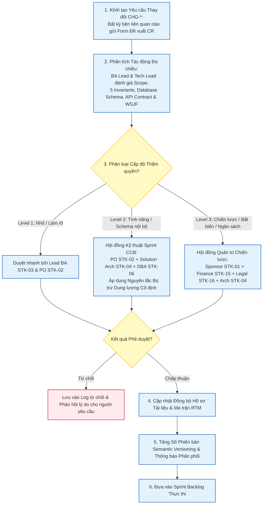

# Change Log & Configuration Management – ReMarket

## Thông tin tài liệu

| Thuộc tính | Giá trị |
|---|---|
| Dự án | ReMarket – Nền tảng Thương mại Điện tử Đồ cũ C2C/B2C Phân tán |
| Tài liệu | Quy trình Kiểm soát Thay đổi (Change Control) & Sổ Đăng ký Lịch sử Phiên bản Toàn sàn |
| Mã tài liệu | `DOC-BA-08-CHG` |
| Phiên bản | 1.0 |
| Trạng thái | Hoàn thiện (Baseline cho Quản lý Thay đổi & Cấu hình Hồ sơ) |
| Ngày cập nhật | 12/11/2026 |
| Tài liệu liên quan | Toàn bộ 10 phân hệ tài liệu từ `00` đến `09` trong `docs/BA/` |

---

## 1. Quy trình Kiểm soát Thay đổi Chính thức (Enterprise Change Control Lifecycle)

Sau khi bộ hồ sơ Phân tích Nghiệp vụ và Kiến trúc ReMarket được phê duyệt đóng băng Baseline, mọi đề xuất sửa đổi, bổ sung tính năng hoặc điều chỉnh kiến trúc đều bắt buộc phải tuân theo **Quy trình Kiểm soát Thay đổi 6 Bước (Change Control Workflow)** nhằm ngăn chặn phình to phạm vi (Scope Creep) và bảo vệ 5 Bất biến Hệ thống:



---

## 2. Phân cấp Thẩm quyền Phê duyệt Thay đổi (Change Authority Matrix)

Hệ thống phân định 3 cấp độ thẩm quyền thay đổi rõ ràng:

| Cấp độ Thay đổi | Định nghĩa & Tiêu chí Nhận diện | Phạm vi Tác động | Thẩm quyền Phê duyệt (Approval Authority) | Thời gian Xử lý SLA |
|---|---|---|---|:---:|
| **Level 1 (Minor / Cosmetic)** | Đính chính lỗi chính tả, làm rõ câu từ mô tả, cập nhật ví dụ minh họa mà không làm thay đổi logic nghiệp vụ hay mã nguồn. | Cục bộ 1 tài liệu | Lead BA (`STK-03`) & Product Owner (`STK-02`) | < 24 giờ |
| **Level 2 (Tactical Feature / Technical Adjustment)** | Thêm trường dữ liệu không bắt buộc, điều chỉnh màn hình UI, tinh chỉnh tham số API hoặc bổ sung chỉ mục tối ưu truy vấn mà không làm vỡ Sprint Capacity. | Ảnh hưởng 1-2 Microservices | **Hội đồng Kỹ thuật (Technical CCB):**<br>PO (`STK-02`) + Solution Arch (`STK-04`) + DBA (`STK-06`). Bắt buộc áp dụng nguyên tắc bù trừ dung lượng cố định. | < 3 ngày làm việc |
| **Level 3 (Strategic / Architectural / Budget Breach)** | Bổ sung tính năng mới ngoài MVP (ví dụ: đòi làm Ví nội bộ hay Đấu giá), thay đổi chính sách tài chính ký quỹ, điều chỉnh 5 Bất biến (`INV-01..05`), thay đổi mục tiêu RPO/RTO hoặc chi phí đám mây vượt ngân sách. | Ảnh hưởng toàn hệ thống & Pháp lý | **Hội đồng Quản trị Dự án (Executive CCB):**<br>Sponsor (`STK-01`) + Finance Lead (`STK-15`) + Legal (`STK-16`) + Solution Arch (`STK-04`). | < 5 ngày làm việc |

---

## 3. Quy tắc Đánh số Phiên bản & Quản lý Cấu hình Tài liệu (Semantic Versioning)

Mọi tài liệu trong bộ hồ sơ BA ReMarket tuân thủ quy tắc đánh số phiên bản ngữ nghĩa:
$$\text{Phiên bản} = \mathbf{Major}.\mathbf{Minor}.\mathbf{Patch}$$

1. **`Major` (Thay đổi Kiến trúc / Ranh giới Phạm vi):** Tăng khi có sự thay đổi lớn về chiến lược sản phẩm, tái cấu trúc ranh giới Microservices hoặc chuyển đổi giai đoạn phát hành (ví dụ: chuyển từ R1 sang R2).
2. **`Minor` (Thay đổi Tính năng / Quy tắc Nghiệp vụ):** Tăng khi bổ sung User Story mới, cập nhật sơ đồ máy trạng thái, thay đổi API contract hoặc thêm bảng dữ liệu.
3. **`Patch` (Làm rõ / Sửa đổi Cục bộ):** Tăng khi hiệu chỉnh lỗi chính tả, chuẩn hóa mã định danh, bổ sung ghi chú kỹ thuật hoặc cập nhật kết quả kiểm thử.

---

## 4. Nhật ký Lịch sử Thay đổi Toàn diện Bộ Hồ sơ BA ReMarket (Master Change Log Register)

Bảng dưới đây ghi nhận toàn bộ quá trình phát triển, chuẩn hóa và đóng băng của **cả 10 thư mục tài liệu** trong dự án ReMarket:

| Mã CR | Ngày | Phân hệ Tài liệu | Phiên bản | Tóm tắt Nội dung Thay đổi & Lý do Kỹ thuật / Nghiệp vụ | Người Đề xuất | Người Phê duyệt |
|---|---|---|:---:|---|---|---|
| **`CHG-001`** | 10/11/2026 | `00_project-context` | 1.0 → 1.1 | Khởi tạo tài liệu Project Brief, Business Case, xác định phạm vi giao dịch đồ cũ C2C, tuyên bố các giả định kỹ thuật ban đầu. | BA Lead (`STK-03`) | Sponsor (`STK-01`) |
| **`CHG-002`** | 10/11/2026 | `01_stakeholders` | 1.0 → 1.1 | Bổ sung danh bạ 18 Bên liên quan (`STK-01..18`), lập Ma trận RACI, đặc tả Personas cho Buyer, Seller cá nhân, Chuyên viên kiểm duyệt, CSKH và Đối soát. | BA Lead (`STK-03`) | PO (`STK-02`) |
| **`CHG-003`** | 11/11/2026 | `02_business-analysis` | 1.0 → 1.1 | Chuẩn hóa 38 Câu hỏi Mở (`Q-BIZ-*`, `Q-OPS-*`, `Q-DATA-*`, `Q-DR-*`), lập bản đồ Capability Map, phân tích quy trình As-Is & To-Be và bộ quy tắc nghiệp vụ `BR-*`. | BA Lead (`STK-03`) | PO (`STK-02`) |
| **`CHG-004`** | 11/11/2026 | `03_requirements` | 0.0 → 1.0 | Biên soạn trọn vẹn 30 BRQ, 190 Yêu cầu Chức năng (`FR-*`), 110 Phi chức năng (`NFR-*`), 26 Use Cases (`UC-01..26`), 81 User Stories (`US-*`) và Acceptance Criteria cú pháp Gherkin. | BA Lead (`STK-03`) | PO (`STK-02`), Tech Lead |
| **`CHG-005`** | 11/11/2026 | `04_product-and-ux` | 0.0 → 1.0 | Thiết kế Kiến trúc Thông tin (IA), Sitemap đa kênh, Screen Inventory (27 màn hình chính `SCR-*` + 7 Modals `MOD-*`), Wireframes chi tiết và 3 luồng màn hình trọng yếu. | UI/UX Lead | PO (`STK-02`) |
| **`CHG-006`** | 12/11/2026 | `05_domain-and-data` | 0.0 → 1.0 | Đặc tả Domain Model DDD (9 Bounded Contexts), Dual-Key SQL Server ERD, MongoDB Schemas, Hai tầng khóa giữ hàng Two-Tier (`INV-01`), Outbox CDC (`INV-03`), Sharding ngưỡng 2TB và PITR DR (`INV-05`). | Solution Arch (`STK-04`) | DBA Lead (`STK-06`) |
| **`CHG-007`** | 12/11/2026 | `06_microservices` | 0.0 → 1.0 | Xây dựng Service Catalog (10 Microservices `SVC-00..09`), Hợp đồng API OpenAPI, 28 Sự kiện miền (`EVT-01..28`), Adapter VNPAY/MoMo và GHN/GHTK, Hạ tầng AWS VPC và Khung quan sát phân tán. | Solution Arch (`STK-04`) | Cloud/SRE (`STK-07, 18`) |
| **`CHG-008`** | 12/11/2026 | `09_diagrams` | 0.0 → 1.0 | Thiết lập Trung tâm Sơ đồ Trực quan (8 tài liệu Mermaid): Sơ đồ bối cảnh toàn hệ thống, Luồng nghiệp vụ Value Streams, 5 Máy trạng thái, Polyglot Data, Sagas, AWS Cloud Topology và Disaster Recovery. | BA Lead (`STK-03`) | Solution Arch (`STK-04`) |
| **`CHG-009`** | 12/11/2026 | `07_backlog-release` | 0.0 → 1.0 | Phân rã 12 Epics, 32 Features, 10 Enablers, 81 User Stories; chấm điểm định lượng WSJF & MoSCoW; kế hoạch phát hành R1/R2/R3, DoR/DoD 3 cấp, đường găng CPM và User Story Mapping 12 Sprints. | Agile Lead | PO (`STK-02`), QA Lead |
| **`CHG-010`** | 12/11/2026 | `00_project-context` | 1.1 → 1.2 | Cập nhật Glossary thuật ngữ chuẩn hóa, đồng bộ các giả định kỹ thuật về Dual-Key, Redis Cluster, Debezium CDC và S3 WORM Vault với các phân hệ kiến trúc. | BA Lead (`STK-03`) | PO (`STK-02`) |
| **`CHG-011`** | 12/11/2026 | `08_validation-gov` | 0.0 → 1.0 | Xây dựng Ma trận Truy vết Hai chiều (RTM) đạt độ bao phủ 100%, Bộ kịch bản kiểm thử nghiệm thu (`TS-INV-01..08`, `TS-E2E-*`), Kế hoạch NFR/Chaos/DR Drill, Khung thẩm định Sign-off và Nhật ký Change Log. | QA Lead (`STK-14`) | Sponsor (`STK-01`), PO |
| **`CHG-012`** | 12/11/2026 | **Toàn sàn ReMarket** | **v1.0 Baseline** | **CHÍNH THỨC CÔNG BỐ ĐÓNG BĂNG BASELINE TOÀN BỘ 10 PHÂN HỆ HỒ SƠ PHÂN TÍCH NGHIỆP VỤ & KIẾN TRÚC REMARKET (MASTER BASELINE RELEASE)**. | **Ban Chỉ Đạo Dự Án** | **Sponsor (`STK-01`)** |

---

## 5. Biểu mẫu Đề xuất Yêu cầu Thay đổi Chuẩn (Change Request Form Template)

Khi có nhu cầu thay đổi, người yêu cầu phải điền đầy đủ thông tin vào biểu mẫu sau và gửi cho Ban Thư ký CCB:

```markdown
### PHIẾU ĐỀ XUẤT YÊU CẦU THAY ĐỔI (CHANGE REQUEST FORM)
- **Mã Yêu cầu Thay đổi:** `CR-YYYYMMDD-[STT]`
- **Người Đề xuất:** [Họ tên / Vai trò / Đơn vị]
- **Ngày Đề xuất:** [DD/MM/YYYY]
- **Tên Yêu cầu Thay đổi:** [Tóm tắt ngắn gọn thay đổi]
- **Phân loại Cấp độ:** [ ] Level 1 (Nhỏ)   [ ] Level 2 (Tính năng/API)   [ ] Level 3 (Chiến lược/Bất biến)

#### 1. Mô tả Vấn đề & Lý do Thay đổi:
[Nêu rõ bối cảnh, khó khăn hiện tại hoặc cơ hội kinh doanh mới dẫn đến đề xuất này]

#### 2. Đề xuất Giải pháp Chi tiết:
[Mô tả chi tiết giải pháp cần sửa đổi trên tài liệu hoặc mã nguồn]

#### 3. Báo cáo Đánh giá Tác động Đa chiều (Impact Analysis):
- **Tác động Phạm vi (Scope & Epics):** [Có ảnh hưởng đến danh mục 12 Epics và 81 User Stories không?]
- **Tác động 5 Bất biến Kiến trúc (INV-01..05):** [Có vi phạm hoặc làm suy yếu bất biến nào không?]
- **Tác động Cơ sở Dữ liệu & API:** [Có cần thay đổi Schema SQL/MongoDB hoặc Breaking API Contract không?]
- **Tác động Tiến độ & Dung lượng (Sprint Capacity):** [Tốn bao nhiêu Story Points? Story nào sẽ bị đẩy ra?]
- **Tác động Chi phí Hạ tầng Đám mây (AWS FinOps):** [Tăng/giảm bao nhiêu USD/tháng?]

#### 4. Ý kiến Thẩm định Chuyên môn:
- **Product Owner (STK-02):** [Đồng ý / Từ chối / Ý kiến]
- **Solution Architect (STK-04):** [Đồng ý / Từ chối / Ý kiến kỹ thuật]
- **Finance / Legal (Nếu là Level 3):** [Đồng ý / Từ chối / Rủi ro pháp lý & dòng tiền]

#### 5. Quyết định của Hội đồng CCB:
[ ] PHÊ DUYỆT (APPROVED)      [ ] TỪ CHỐI (REJECTED)      [ ] YÊU CẦU BỔ SUNG THÔNG TIN
- **Chữ ký Chủ tịch Hội đồng CCB:** ____________________   **Ngày:** ______________
```

---

## 6. Lịch sử cập nhật

| Phiên bản | Ngày | Tác giả | Nội dung thay đổi |
|---|---|---|---|
| 1.0 | 12/11/2026 | Nhóm Phân tích Nghiệp vụ & Kiến trúc | Khởi tạo tài liệu quy trình kiểm soát thay đổi 6 bước, phân cấp thẩm quyền CCB 3 cấp, quy tắc Semantic Versioning và Sổ đăng ký lịch sử thay đổi Master Change Log cho toàn bộ 10 phân hệ BA. |

