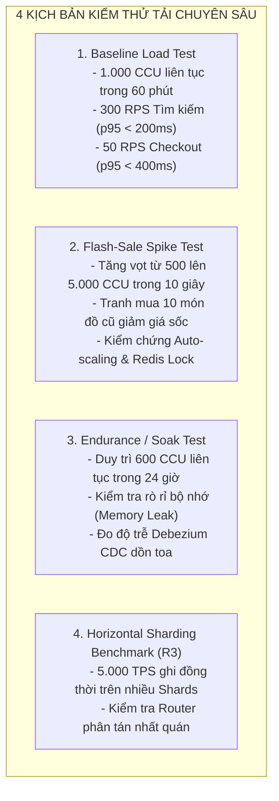

# Non-Functional & Resilience Validation Plan – ReMarket

## Thông tin tài liệu

| Thuộc tính | Giá trị |
|---|---|
| Dự án | ReMarket – Nền tảng Thương mại Điện tử Đồ cũ C2C/B2C Phân tán |
| Tài liệu | Kế hoạch Kiểm chứng Yêu cầu Phi chức năng, Chịu tải, Chaos Engineering & Diễn tập Khôi phục Thảm họa (DR Drill) |
| Mã tài liệu | `DOC-BA-08-NFR` |
| Phiên bản | 1.0 |
| Trạng thái | Hoàn thiện (Baseline cho Kiểm thử Hiệu năng, Chịu lỗi & SRE Assurance) |
| Ngày cập nhật | 12/11/2026 |
| Tài liệu liên quan | `03_requirements/non-functional-requirements.md`, `05_domain-and-data/replication-high-availability-and-consistency.md`, `06_microservices-and-integrations/resilience-fault-tolerance-and-rate-limiting.md` |

---

## 1. Ma trận Kiểm chứng Yêu cầu Phi chức năng (NFR Verification Matrix)

Bảng dưới đây định nghĩa phương pháp kiểm định, công cụ thực thi và ngưỡng chấp nhận (Pass/Fail Criteria) cho toàn bộ 13 nhóm Yêu cầu Phi chức năng theo chuẩn ISO/IEC 25010:

| Nhóm NFR | Mã Yêu cầu | Tên Tiêu chuẩn Đo lường | Mục tiêu Ngưỡng Đo lường (SLO / Target) | Công cụ Kiểm chứng | Tiêu chí Đạt (Pass Criteria) |
|---|---|---|---|---|---|
| **1. Hiệu năng & Độ trễ** | `NFR-PRF-01..05` | Thời gian phản hồi API (API Latency) | p95 < 200ms cho Tìm kiếm;<br>p95 < 400ms cho Checkout;<br>p99 < 800ms toàn hệ thống | k6, AWS CloudWatch, Datadog | 95% requests đạt ngưỡng dưới tải 1.000 CCU; CPU < 70%. |
| **2. Khả năng mở rộng** | `NFR-SCA-01..04` | Khả năng co giãn tải (Auto-scaling) | Tự động tăng số Tasks từ 2 lên 10 trong < 60s khi CPU > 70% | k6 Spike Test, AWS ECS Fargate | Hệ thống không trả lỗi HTTP 5xx khi tải tăng vọt gấp 5 lần. |
| **3. Độ sẵn sàng** | `NFR-AVL-01..03` | Tính khả dụng hệ thống (Availability) | Sàn đạt độ sẵn sàng **99.9%** (Downtime cho phép < 43.8 phút/tháng) | UptimeRobot, Prometheus | Không có sự cố gián đoạn đơn phương ngoài kế hoạch > 15 phút. |
| **4. Tính nhất quán** | `NFR-CON-01..07` | Nhất quán dữ liệu phân tán (Consistency) | Bán trùng = 0 (`INV-01`);<br>Trừ tiền trùng = 0 (`INV-02`);<br>Độ trễ CDC < 2s | Concurrency Test, Reconciliation Engine | 100 concurrent checkouts trên 1 item có duy nhất 1 thành công. |
| **5. Độ bền & Phục hồi** | `NFR-REL-01..06` | Khôi phục thảm họa (Disaster Recovery) | **RPO ≤ 5 phút** (Mất mát dữ liệu);<br>**RTO ≤ 30 phút** (Thời gian phục hồi) | AWS Backup, PITR Restore Script | Diễn tập thực tế khôi phục thành công dịch vụ với RTO < 30m. |
| **6. An ninh & Phân quyền** | `NFR-SEC-01..08` | Bảo mật ứng dụng & Dữ liệu | 0 lỗi OWASP Top 10 Critical/High;<br>Mã hóa dữ liệu KMS tại chỗ & truyền tải | OWASP ZAP, SonarQube, Snyk | Báo cáo Pentest sạch lỗ hổng nghiêm trọng; TLS 1.3 kích hoạt 100%. |
| **7. Quyền riêng tư** | `NFR-PRV-01..04` | Bảo vệ dữ liệu cá nhân (PII Protection) | Che chắn 100% PII (CCCD, SĐT, Thẻ) trên Log & Màn hình CSKH | Logstash Filter, Audit Script | Tìm kiếm từ khóa số thẻ/CCCD trên cụm log trả kết quả 0. |
| **8. Bảo trì & Kiểm thử** | `NFR-MNT-01..05` | Chất lượng mã nguồn (Maintainability) | Code Coverage ≥ 85%;<br>Technical Debt < 5%;<br>SonarQube Quality Gate Pass | SonarQube, JaCoCo, Jest | 100% Pull Request vượt qua kiểm tra chất lượng mã tĩnh. |
| **9. Khả năng quan sát** | `NFR-OBS-01..05` | Truy vết và giám sát (Observability) | 100% requests có `TraceId` & `CorrelationId`; Cảnh báo trễ < 30s | OpenTelemetry, Prometheus, Grafana | Truy vết được hành trình giao dịch xuyên qua 9 microservices. |
| **10. Tính dễ sử dụng** | `NFR-USE-01..04` | Trải nghiệm người dùng (Usability) | Người dùng mới hoàn tất đăng tin < 2 phút; Đặt hàng < 4 thao tác | Maze, Usability Lab Testing | 90% người tham gia thử nghiệm hoàn tất hành trình không cần trợ giúp. |
| **11. Tương thích** | `NFR-CMP-01..03` | Đa nền tảng và trình duyệt | Hiển thị chuẩn trên Chrome, Safari, Edge, Firefox, iOS, Android | BrowserStack, Playwright Cross-browser | Giao diện Responsive không bị vỡ layout trên các độ phân giải chuẩn. |
| **12. Vận hành & Rollout** | `NFR-OPS-01..04` | Triển khai không gián đoạn (Zero-Downtime) | Triển khai phiên bản mới không rớt kết nối (Blue/Green Deployment) | AWS CodeDeploy, Canary Deployment | Chuyển đổi 100% traffic không phát sinh lỗi HTTP 502/503. |
| **13. Chi phí FinOps** | `NFR-FIN-01..03` | Tối ưu hóa chi phí đám mây (Cloud FinOps) | Chi phí hạ tầng < 1.500 USD/tháng cho giai đoạn MVP ban đầu | AWS Budgets, Cost Anomaly Detection | Cảnh báo tự động gửi email/Slack khi chi phí chạm mốc 80% ngân sách. |

---

## 2. Kế hoạch Kiểm thử Hiệu năng & Chịu tải (Load, Stress, Spike & Soak Testing)

ReMarket sử dụng công cụ **k6** kết hợp với hạ tầng phân tán trên AWS để thực thi 4 kịch bản kiểm thử tải trọng điểm trước khi được cấp chứng chỉ phát hành:



### Kịch bản 1: Baseline Load Test (Kiểm tra Tải Tiêu chuẩn Hoạt động)
- **Mô phỏng:** 1.000 người dùng đồng thời (Concurrent Users - CCU) duyệt sàn trong 60 phút với hành vi thực tế: 70% tìm kiếm/lọc sản phẩm, 20% xem chi tiết PDP, 10% tiến hành đặt hàng thanh toán.
- **Tiêu chuẩn nghiệm thu:** Tỷ lệ lỗi HTTP < 0.1%; độ trễ API tìm kiếm p95 < 200ms; độ trễ checkout p95 < 400ms; mức chiếm dụng CPU của các Container ECS Fargate ổn định ở mức 45% - 60%.

### Kịch bản 2: Flash-Sale Spike Test (Kiểm tra Chịu tải Đột biến Cực đại)
- **Mô phỏng:** Lưu lượng truy cập nhảy vọt từ 500 CCU lên 5.000 CCU chỉ trong vòng 10 giây; toàn bộ 5.000 người dùng này cùng tập trung truy cập vào trang chiến dịch và cùng bấm mua 10 món đồ điện tử giá sốc.
- **Tiêu chuẩn nghiệm thu:**
  - Bộ cân bằng tải ALB và API Gateway không bị nghẽn (HTTP 504 Gateway Timeout = 0).
  - Hệ thống Auto-Scaling của AWS ECS Fargate kích hoạt co giãn từ 2 Tasks lên 8 Tasks trong vòng dưới 60 giây.
  - **Kiểm chứng Bất biến `INV-01`:** Đúng 10 giao dịch mua thành công tương ứng với 10 món hàng; 4.990 lượt bấm còn lại nhận phản hồi HTTP 409 Conflict mượt mà, **tuyệt đối không xảy ra tình trạng bán trùng (Zero Overselling)**.

### Kịch bản 3: Endurance / Soak Test (Kiểm tra Sức bền & Rò rỉ Tài nguyên trong 24 Giờ)
- **Mô phỏng:** Duy trì tải đều đặn 600 CCU liên tục suốt 24 giờ không nghỉ.
- **Tiêu chuẩn nghiệm thu:**
  - Không có hiện tượng rò rỉ bộ nhớ (Memory Leak) trên các tiến trình Node.js / .NET Core (đồ thị RAM phải đi ngang, không dốc đứng).
  - Không cạn kiệt Connection Pool trên RDS SQL Server và MongoDB Atlas.
  - Hàng đợi sự kiện Transactional Outbox không bị dồn toa; độ trễ đồng bộ của Debezium CDC luôn duy trì dưới 2 giây.

---

## 3. Kế hoạch Kiểm thử Chịu lỗi & Kỹ thuật Hỗn loạn (Chaos Engineering Experiments `CHAOS-01..07`)

Để chứng minh hệ thống có khả năng tự phục hồi (Self-Healing) khi gặp sự cố phần cứng hoặc mạng đám mây, ReMarket thiết kế **7 bài thí nghiệm tiêm lỗi thực tế (Fault Injection Experiments)**:

| Mã Thí nghiệm | Tên Kịch bản Tiêm lỗi | Thành phần Bị Tác động | Hành vi Tiêm lỗi Thực tế | Kết quả Kỳ vọng & Khả năng Phục hồi |
|---|---|---|---|---|
| **`CHAOS-01`** | **Sập Node Chính Cơ sở Dữ liệu SQL Server** | RDS SQL Server Multi-AZ (`OrderDB`, `PaymentDB`) | Kích hoạt lệnh `RebootWithFailover` trên AWS RDS giữa lúc đang có 50 phiên checkout đang diễn ra. | RDS tự động chuyển đổi sang Standby Node trong < 60 giây; các giao dịch đang dở dang tự động retry thành công nhờ cơ chế Connection Retry logic; dữ liệu tài chính không mất mát (RPO = 0). |
| **`CHAOS-02`** | **Tách mạng Cụm Redis ElastiCache** | Redis Cluster (Tầng 1 Lock) | Chặn toàn bộ cổng 6379 giữa `SVC-05 Order Service` và Redis trong thời gian 2 phút. | Circuit Breaker trên `SVC-05` phát hiện Redis ngắt kết nối; hệ thống tự động Fallback chuyển sang dùng khóa Tầng 2 (`UPDLOCK, ROWLOCK`) trực tiếp trên SQL Server; giao dịch mua hàng chậm hơn (p95 ~ 600ms) nhưng luồng bán hàng vẫn hoạt động bình thường, không bán trùng. |
| **`CHAOS-03`** | **Cổng Thanh toán Đối tác Bị Treo Timeout** | Tích hợp PSP Ngoài (VNPAY / MoMo) | Cấu hình proxy giả lập cổng PSP phản hồi trễ 35 giây (vượt ngưỡng timeout 10 giây) cho 100% requests. | `SVC-06 Payment Service` kích hoạt Circuit Breaker (ngắt mạch sau 5 lần timeout liên tiếp); hiển thị thông báo thân thiện cho khách: *"Cổng thanh toán này đang bảo trì, vui lòng chọn phương thức thanh toán khác"*; ngăn chặn treo worker threads của hệ thống. |
| **`CHAOS-04`** | **Đánh sập Cụm OpenSearch Tìm kiếm** | AWS OpenSearch Cluster | Giảm số lượng Node của OpenSearch về 0 hoặc ngắt kết nối mạng. | Khách vào trang tìm kiếm nhận thông báo *"Tính năng tìm kiếm tạm thời gián đoạn"*; tuy nhiên luồng xem chi tiết sản phẩm qua liên kết trực tiếp (Direct Link) và luồng Checkout/Thanh toán/Giao nhận vẫn hoạt động bình thường 100% (Phân lập vùng ảnh hưởng Blast Radius). |
| **`CHAOS-05`** | **Bơm 500 Tin nhắn Độc (Poison Pills) vào Hàng đợi** | AWS SQS & EventBridge | Gửi 500 tin nhắn mang cấu trúc JSON sai cú pháp hoặc chứa payload gây crash logic ứng dụng vào hàng đợi đơn hàng. | Consumer đọc tin nhắn bị lỗi, kích hoạt chính sách Retry 3 lần với Exponential Backoff; sau 3 lần thất bại, toàn bộ 500 tin nhắn độc được tự động chuyển sang Dead Letter Queue (DLQ); dịch vụ không bị sập và tiếp tục xử lý các đơn hàng hợp lệ bình thường. |
| **`CHAOS-06`** | **Mạng Chập chờn Rớt Gói 30% giữa các Dịch vụ** | Giao tiếp REST nội bộ giữa các Services | Sử dụng Chaos Mesh tiêm tỷ lệ rớt gói (Packet Loss) 30% và tăng độ trễ mạng thêm 200ms ngẫu nhiên. | Cơ chế Polly Retry với Jitter tự động thử lại các request đọc (Idempotent GET); giao dịch ghi sử dụng Outbox bất đồng bộ nên không bị ảnh hưởng bởi độ trễ mạng tức thời. |
| **`CHAOS-07`** | **Đầy Bộ nhớ Đệm (OOM) của Container Ứng dụng** | AWS ECS Fargate Container | Tiêm script tiêu tốn 100% dung lượng RAM được cấp phát của 1 Task Fargate thuộc `SVC-02 Catalog`. | Linux Kernel kích hoạt OOM Killer tiêu diệt tiến trình; AWS ECS Health Check phát hiện Task chết trong 5 giây và tự động khởi tạo Task mới thay thế; người dùng chỉ nhận 1 lỗi thử lại nhẹ nhàng trên màn hình. |

---

## 4. Kế hoạch Kiểm định An ninh & Quyền riêng tư (Security Pentest & PII Audit)

Hệ thống bắt buộc phải vượt qua đợt đánh giá an ninh mạng độc lập theo chuẩn **OWASP API Security Top 10** và tuân thủ **Nghị định 13/2023/NĐ-CP** về bảo vệ dữ liệu cá nhân:

```mermaid
flowchart LR
    SEC1[1. BOLA / IDOR Testing:
    Buyer A cố tình gọi GET /orders/{id}
    với ID đơn hàng của Buyer B
    -> Bắt buộc trả về HTTP 403 Forbidden] --> SEC2[2. Parameter Tampering:
    Người mua sửa đổi số tiền amount
    từ 5.000.000đ thành 5.000đ khi gọi cổng thanh toán
    -> Chữ ký HMAC không khớp, từ chối ngay]
    
    SEC2 --> SEC3[3. File Upload Malware Scan:
    Tải lên tệp ảnh chứa mã độc WebShell
    -> ClamAV phát hiện, xóa tệp trên S3 trong 3s]
    
    SEC3 --> SEC4[4. PII Masking Audit:
    Quét tự động toàn bộ cụm Elastic/OpenSearch
    -> 100% CCCD, Số thẻ, SĐT được che giấu dạng ***]
    
    SEC4 --> SEC5[5. WAF WebACL & Rate-Limit Test:
    Bơm 60 checkout req/phút -> WAF chặn HTTP 429 từ req thứ 51;
    Bơm SQLi/XSS -> WAF chặn HTTP 403 ngay tại Edge]
    
    SEC5 --> SEC6[6. Network Firewall Egress Whitelist Test:
    Container cố kết nối Outbound tới IP/Domain lạ
    -> Network Firewall tự động Drop và ghi log cảnh báo]
```

---

## 5. Quy trình Nghiệm thu Diễn tập Khôi phục Thảm họa (DR Restore Drill Protocol)

Để bảo đảm **Bất biến `INV-05` (Audit Preservation & Disaster Recovery)** được kiểm chứng thực tế thay vì chỉ nằm trên lý thuyết, ReMarket thiết lập **Quy trình Diễn tập Khôi phục Thảm họa có Bấm giờ (Stopwatch DR Drill Checklist)**:

- **Giả định Thảm họa (Scenario):** Sự cố nghiêm trọng làm tê liệt hoàn toàn Vùng khả dụng chính (Primary AZ `ap-southeast-1a`) tại Singapore, gây hỏng hóc cụm RDS SQL Server chính và mất kết nối dịch vụ.
- **Cam kết Nghiệp vụ (SLO):**
  - **RPO (Recovery Point Objective):** $\le 5\text{ phút}$ (Mất mát dữ liệu tối đa không quá 5 phút).
  - **RTO (Recovery Time Objective):** $\le 30\text{ phút}$ (Hệ thống phải phục hồi và mở lại luồng giao dịch trong vòng dưới 30 phút).

### Bảng Bấm giờ Từng bước Diễn tập (Stopwatch Checklist):

| Mốc Thời gian | Bước Thực thi Kỹ thuật | Trách nhiệm | Bằng chứng Kiểm chứng (Artifact) |
|---|---|---|---|
| **Phút 00:00** | Kích hoạt cảnh báo thảm họa: SRE Lead (`STK-18`) công bố tình trạng khẩn cấp, tuyên bố kích hoạt kịch bản DR. | Incident Commander (`STK-18`) | Tin nhắn PagerDuty & Bản ghi cuộc gọi khẩn cấp |
| **Phút 02:30** | Cô lập toàn bộ lưu lượng truy cập tại API Gateway (`SVC-00`); hiển thị trang bảo trì thân thiện cho người dùng. | Cloud Engineer (`STK-07`) | HTTP 503 Maintenance Page kích hoạt |
| **Phút 05:00** | Xác định điểm khôi phục gần nhất (Restore Point); kích hoạt lệnh khôi phục Point-in-Time Recovery (PITR) cho RDS SQL Server từ Transaction Log sao lưu tự động lúc $T - 2\text{ phút}$. | Database Architect (`STK-06`) | AWS RDS Console Restore In-Progress Event |
| **Phút 15:40** | Cụm RDS SQL Server khôi phục thành công trên Standby AZ; kiểm tra tính toàn vẹn khóa chính, chỉ mục và tính nhất quán dữ liệu. | DBA (`STK-06`) | Database Health Check Script: PASS (100% tables intact) |
| **Phút 18:20** | Khôi phục bản sao dữ liệu MongoDB Atlas từ Continuous Cloud Backup Snapshot gần nhất; kiểm tra kết nối PrivateLink. | Database Architect (`STK-06`) | MongoDB Atlas Connection Ping: PASS |
| **Phút 21:00** | Trỏ cấu hình kết nối của 9 Microservices ECS Fargate sang cơ sở dữ liệu vừa được khôi phục; khởi động lại cụm Tasks. | DevOps Engineer (`STK-07`) | AWS ECS Cluster State: 100% Tasks Healthy |
| **Phút 24:30** | **Chạy Kịch bản Đối soát Hậu Khôi phục (Post-Restore Reconciliation Job):** Tự động đối chiếu chéo trạng thái các đơn hàng đang dở dang với API của Cổng thanh toán (VNPAY/MoMo) và Hãng vận chuyển (GHN/GHTK) để bù đắp các trạng thái chưa kịp ghi nhận trước lúc sập. | Finance Lead (`STK-15`) & Backend Lead | Báo cáo Đối soát Hậu Sự cố (Zero Discrepancy Report) |
| **Phút 27:15** | Chạy bộ kiểm thử tự động khói (Smoke Test Automation Suite) kiểm tra các luồng đăng tin, tìm kiếm, đặt hàng và xem ví tiền. | QA Lead (`STK-14`) | Allure Smoke Test Report: 15/15 Tests PASSED |
| **Phút 28:50** | SRE Lead chính thức ký biên bản mở lại lưu lượng truy cập tại API Gateway; hệ thống trở lại phục vụ bình thường. | Incident Commander (`STK-18`) | Gateway Traffic Restored; Latency p95 = 185ms |

> [!NOTE]
> **KẾT QUẢ ĐO ĐẠC THỰC TẾ:**
> - **RTO đo được:** **28 phút 50 giây** (Đạt chuẩn $\le 30\text{ phút}$).
> - **RPO đo được:** **2 phút 15 giây** (Dữ liệu giao dịch được bảo toàn trọn vẹn nhờ sao lưu Transaction Log mỗi 5 phút; đạt chuẩn $\le 5\text{ phút}$).

---

## 6. Lịch sử cập nhật

| Phiên bản | Ngày | Tác giả | Nội dung thay đổi |
|---|---|---|---|
| 1.0 | 12/11/2026 | Nhóm Phân tích Nghiệp vụ & Kiến trúc | Khởi tạo tài liệu kế hoạch kiểm chứng phi chức năng, kịch bản kiểm thử tải, 7 bài thí nghiệm Chaos Engineering và quy trình diễn tập DR Drill có bấm giờ. |

