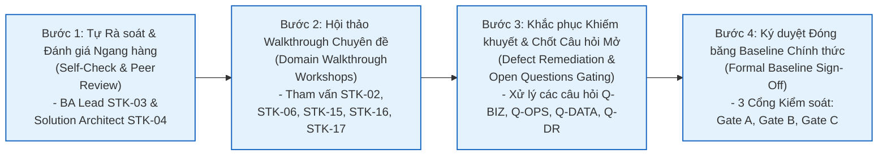
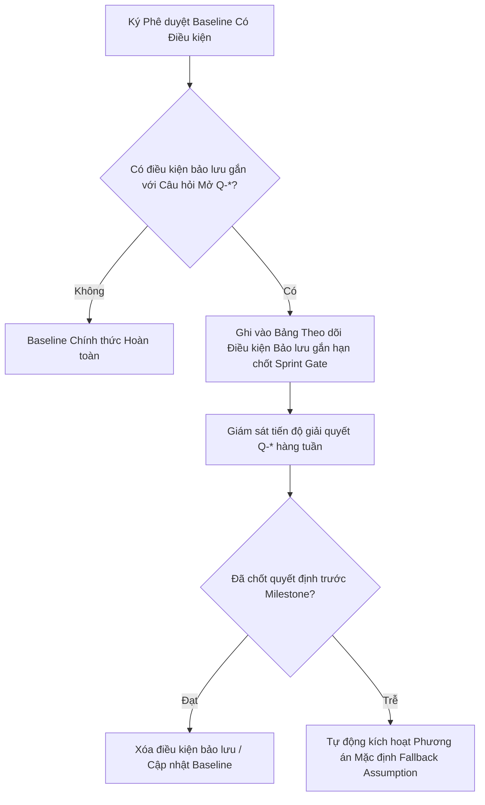

# Review, Quality Gate Checklists & Sign-Off Governance – ReMarket

## Thông tin tài liệu

| Thuộc tính | Giá trị |
|---|---|
| Dự án | ReMarket – Nền tảng Thương mại Điện tử Đồ cũ C2C/B2C Phân tán |
| Tài liệu | Khung Quản trị Thẩm định, Tiêu chuẩn Cổng Chất lượng (Quality Gates) & Biên bản Phê duyệt Hồ sơ |
| Mã tài liệu | `DOC-BA-08-SGN` |
| Phiên bản | 1.0 |
| Trạng thái | Hoàn thiện (Quy chuẩn Đóng băng Hồ sơ & Bàn giao Sản xuất) |
| Ngày cập nhật | 12/11/2026 |
| Tài liệu liên quan | `01_stakeholders-and-users/stakeholder-register.md`, `02_business-analysis/open-questions-and-decisions.md`, `07_backlog-and-release/release-scope.md` |

---

## 1. Khung Quản trị Thẩm định & Nghiệm thu Hồ sơ BA (Governance Framework)

Để đảm bảo bộ hồ sơ Phân tích Nghiệp vụ và Kiến trúc Hệ thống của ReMarket đạt chuẩn Enterprise, có giá trị pháp lý và kỹ thuật làm cơ sở phát triển, dự án áp dụng **Quy trình Thẩm định 4 Bước Nghiêm ngặt (4-Stage Review Lifecycle)**:

---

## 2. Bảng Phân quyền Thẩm định & Phê duyệt theo 18 Bên Liên Quan (`STK-01..18`)

Dưới đây là **Ma trận RACI Quản trị Hồ sơ** phân định rõ trách nhiệm của 18 vai trò bên liên quan nội bộ (đã định danh tại `01_stakeholders-and-users/stakeholder-register.md`) đối với 10 thư mục tài liệu của dự án:

> **Quy ước RACI:**
> - **A (Accountable - Người Phê duyệt Tối cao):** Có quyền ký duyệt hoặc phủ quyết nội dung.
> - **R (Responsible - Người Thực thi Biên soạn):** Trực tiếp biên soạn, chỉnh lý và bảo vệ nội dung.
> - **C (Consulted - Người Được Tham vấn):** Chuyên gia cung cấp ý kiến chuyên môn bắt buộc phải lấy ý kiến.
> - **I (Informed - Người Được Thông báo):** Nhận bản phân phối tài liệu sau khi đã được phê duyệt.

| Mã Phân hệ Tài liệu | Tên Phân hệ Hồ sơ | Sponsor (`STK-01`) | Product Owner (`STK-02`) | Lead BA (`STK-03`) | Solution Arch (`STK-04`) | DBA / Data (`STK-06`) | Cloud / SRE (`STK-07, 18`) | Security (`STK-08`) | QA Lead (`STK-14`) | Finance Lead (`STK-15`) | Legal Lead (`STK-16`) | Partner Lead (`STK-17`) |
|---|---|:---:|:---:|:---:|:---:|:---:|:---:|:---:|:---:|:---:|:---:|:---:|
| **`00_project-context`** | Bối cảnh & Mục tiêu Chiến lược | **A** | C | **R** | C | I | I | I | I | C | C | I |
| **`01_stakeholders-and-users`** | Chân dung & Ma trận Quyền | I | **A** | **R** | C | I | I | C | I | I | C | I |
| **`02_business-analysis`** | Quy trình & Quy tắc Nghiệp vụ | I | **A** | **R** | C | I | I | I | C | C | C | I |
| **`03_requirements`** | Đặc tả Yêu cầu BRD / SRS | I | **A** | **R** | C | C | C | C | **C** | C | C | C |
| **`04_product-and-ux`** | Thiết kế UX, Sitemap & Wireframes| I | **A** | C | C | I | I | I | C | I | I | I |
| **`05_domain-and-data`** | Kiến trúc Dữ liệu & 5 Bất biến | I | I | C | **A** | **R** | C | C | C | C | I | I |
| **`06_microservices`** | Microservices, API & Cloud AWS | I | I | C | **A** | C | **R** | C | C | I | I | C |
| **`07_backlog-and-release`** | Backlog, Ưu tiên & Lộ trình Sprint | I | **A** | **R** | C | I | C | I | C | C | I | I |
| **`08_validation-governance`** | RTM, Kiểm thử & Nghiệm thu | **A** | C | **R** | C | C | C | C | **A** | C | C | I |
| **`09_diagrams`** | Sơ đồ Kiến trúc & Luồng nghiệp vụ | I | C | C | **A** | C | C | I | I | I | I | I |

---

## 3. Danh mục Kiểm tra Chất lượng Hồ sơ theo Từng Phân hệ (Quality Gate Checklists)

Trước khi ký biên bản phê duyệt, các tổ thẩm định độc lập phải đánh giá đạt 100% các tiêu chí trong bảng checklist chuyên sâu:

### Phân hệ 1: Bối cảnh, Nghiệp vụ & Yêu cầu (`00_project-context` → `03_requirements`)
- [ ] **Tính Hoàn chỉnh:** 100% mục tiêu kinh doanh (`BO-01..07`) có chỉ số đo lường định lượng KPI (`MET-*`).
- [ ] **Tính Rõ ràng của Quy tắc:** Các quy tắc giữ hàng 15 phút, tính phí vận chuyển, xử lý giao thất bại và tạm giữ ký quỹ được định nghĩa toán học rõ ràng, không mâu thuẫn.
- [ ] **Tính Kiểm thử được:** 100% User Stories (`US-*`) có kịch bản nghiệm thu viết theo cú pháp Gherkin (`Given - When - Then`), bao gồm cả đường âm (Negative) và các trường hợp ngoại lệ (`EX-*`).
- [ ] **Ranh giới Loại trừ Minh bạch:** Xác nhận loại trừ rõ ràng: không làm ví điện tử lưu số dư, không đấu giá, không làm cổng tài xế nội bộ (`FR-SHP-13`).

### Phân hệ 2: Trải nghiệm Người dùng (`04_product-and-ux`)
- [ ] **Bao phủ Hành trình:** 27 màn hình chính (`SCR-*`) và 7 Modals (`MOD-*`) bao phủ trọn vẹn mọi bước của 26 Use Cases (`UC-01..26`).
- [ ] **Đặc tả Trạng thái Giao diện:** Mọi màn hình đều mô tả đủ 4 trạng thái: *Empty State, Loading, Active, Error State*.
- [ ] **Phản ánh Thời gian Thực:** Có thiết kế trực quan đồng hồ đếm ngược 15:00 cho phiên checkout giữ hàng độc bản và huy hiệu cảnh báo món hàng đang có người giữ chỗ.

### Phân hệ 3: Kiến trúc Dữ liệu & 5 Bất biến (`05_domain-and-data`)
- [ ] **Bảo vệ Bất biến `INV-01`:** Phối hợp chặt chẽ giữa Redis `SET NX EX 900` và SQL Server `UPDLOCK, ROWLOCK` + `RowVersion` chống bán trùng hàng độc bản.
- [ ] **Bảo vệ Bất biến `INV-02`:** Thiết kế bảng `ProcessedWebhooks` và trường `IdempotencyKey` chống double charge.
- [ ] **Bảo vệ Bất biến `INV-03`:** Bảng `OutboxMessages` và Debezium CDC bảo đảm gửi thông điệp ít nhất một lần (At-least-once delivery).
- [ ] **Bảo vệ Bất biến `INV-04`:** Trường `EscrowHoldings.STATUS = FROZEN` đóng băng dòng tiền ký quỹ tức thời khi có sự kiện tranh chấp.
- [ ] **Bảo vệ Bất biến `INV-05`:** Thiết lập sao lưu Point-in-Time Recovery (PITR) RPO ≤ 5m, RTO ≤ 30m và S3 Object Lock Compliance WORM Mode.

### Phân hệ 4: Kiến trúc Dịch vụ & Đám mây (`06_microservices-and-integrations` & `09_diagrams`)
- [ ] **Phân định Ranh giới Bounded Contexts:** 9 Microservices sở hữu cơ sở dữ liệu riêng biệt; không có quan hệ Foreign Key xuyên cơ sở dữ liệu vật lý.
- [ ] **Khả năng Chịu lỗi:** Thiết lập Circuit Breaker, Retry with Exponential Backoff & Jitter cho toàn bộ các kết nối ra bên thứ ba (VNPAY, MoMo, GHN, GHTK).
- [ ] **An ninh Mạng AWS:** Kiến trúc VPC 3-Tier (Public, Private Compute, Isolated Data); ALB tích hợp AWS WAF v2 chống DDoS và tấn công web.

### Phân hệ 5: Kế hoạch Phát hành & Quản trị (`07_backlog-and-release` & `08_validation-and-governance`)
- [ ] **Không Sót Mã Định Danh:** Đầy đủ 12 Epics, 32 Features, 10 Enablers, 81 User Stories, 3 Releases và 12 Sprints.
- [ ] **Ma trận Truy vết RTM 100%:** 0 yêu cầu mồ côi (Zero Orphan Requirements), 0 tính năng thừa không có nguồn gốc (Zero Gold-Plating).
- [ ] **Chiến lược Triển khai An toàn:** Kịch bản Blue/Green Zero-Downtime và nâng cấp cơ sở dữ liệu theo mẫu Expand-and-Contract.

---

## 4. Quản lý Điều kiện Bảo lưu & Các Câu hỏi Mở Chờ Chốt (Conditional Sign-Off Protocol)

Đối với các thông số hiện đang đánh dấu `[TBD]` hoặc các câu hỏi mở trong tài liệu `02_business-analysis/open-questions-and-decisions.md`, dự án áp dụng **Cơ chế Phê duyệt Có Điều kiện (Conditional Sign-off)**:

- **Quy tắc Giải tỏa Bảo lưu:** Mọi điều kiện bảo lưu gắn với câu hỏi P0 bắt buộc phải được giải quyết dứt điểm trước ngày bắt đầu Sprint tương ứng đã quy định tại tài liệu `07_backlog-and-release/dependencies-and-risks.md`. Nếu quá hạn, hệ thống tự động kích hoạt **Phương án Mặc định (Fallback Assumption)** để không làm gián đoạn tiến độ lập trình.

---

## 5. Biên bản Phê duyệt Chính thức (Formal Sign-Off Register Log)

Hồ sơ Phân tích Nghiệp vụ và Kiến trúc ReMarket được phê duyệt đóng băng chính thức qua 3 Cổng Kiểm soát Trọng yếu:

### Cổng A: Nghiệm thu Cơ sở Nghiệp vụ & Yêu cầu Hệ thống (Gate A Sign-Off)
- **Phạm vi Hồ sơ:** `00_project-context`, `01_stakeholders-and-users`, `02_business-analysis`, `03_requirements`.
- **Trạng thái:** **PHÊ DUYỆT ĐÓNG BĂNG BASELINE v1.0**

| Vai trò Ký duyệt | Đại diện Bên Liên quan | Quyết định | Ngày Ký | Ghi chú / Điều kiện Kèm theo |
|---|---|:---:|:---:|---|
| **Chủ Dự án (Sponsor)** | `STK-01` | **APPROVED** | 12/11/2026 | Đồng ý mục tiêu kinh doanh và phạm vi phân kỳ R1/R2/R3. |
| **Product Owner** | `STK-02` | **APPROVED** | 12/11/2026 | Xác nhận 30 BRQ và 81 User Stories đáp ứng nhu cầu thị trường. |
| **Lead Business Analyst** | `STK-03` | **APPROVED** | 12/11/2026 | Cam kết chất lượng đặc tả và tính truy vết của hồ sơ. |
| **Finance & Recon Lead** | `STK-15` | **APPROVED** | 12/11/2026 | Đồng thuận quy chế giải ngân T+3 và đối soát ký quỹ Escrow. |
| **Legal & Compliance** | `STK-16` | **APPROVED** | 12/11/2026 | Chấp thuận chính sách cấm hàng lậu và quy trình xử lý PII. |

---

### Cổng B: Nghiệm thu Thiết kế Trải nghiệm, Dữ liệu & Kiến trúc Đám mây (Gate B Sign-Off)
- **Phạm vi Hồ sơ:** `04_product-and-ux`, `05_domain-and-data`, `06_microservices-and-integrations`, `09_diagrams`.
- **Trạng thái:** **PHÊ DUYỆT ĐÓNG BĂNG BASELINE v1.0**

| Vai trò Ký duyệt | Đại diện Bên Liên quan | Quyết định | Ngày Ký | Ghi chú / Điều kiện Kèm theo |
|---|---|:---:|:---:|---|
| **Solution Architect** | `STK-04` | **APPROVED** | 12/11/2026 | Xác nhận tính đúng đắn của 5 Bất biến và kiến trúc Microservices. |
| **Database / DBA Lead** | `STK-06` | **APPROVED** | 12/11/2026 | Duyệt mô hình Dual-Key SQL Server, MongoDB Atlas và PITR. |
| **Cloud / DevOps / SRE** | `STK-07, 18` | **APPROVED** | 12/11/2026 | Duyệt kiến trúc AWS VPC, ECS Fargate và SLO RPO ≤ 5m, RTO ≤ 30m. |
| **Security & Privacy** | `STK-08` | **APPROVED** | 12/11/2026 | Xác nhận kiểm soát WAF, KMS, Tokenization và che chắn PII. |
| **Partner Integration Lead**| `STK-17` | **APPROVED** | 12/11/2026 | Chấp thuận Adapter Pattern cho cổng VNPAY/MoMo và GHN/GHTK. |

---

### Cổng C: Nghiệm thu Kế hoạch Phát hành, Kiểm định & Quản trị Vận hành (Gate C Sign-Off)
- **Phạm vi Hồ sơ:** `07_backlog-and-release`, `08_validation-and-governance`.
- **Trạng thái:** **PHÊ DUYỆT ĐÓNG BĂNG BASELINE v1.0 (READY FOR PRODUCTION SPRINT)**

| Vai trò Ký duyệt | Đại diện Bên Liên quan | Quyết định | Ngày Ký | Ghi chú / Điều kiện Kèm theo |
|---|---|:---:|:---:|---|
| **QA / Testing Lead** | `STK-14` | **APPROVED** | 12/11/2026 | Xác nhận Ma trận RTM đạt 100%; bộ kịch bản kiểm thử sẵn sàng. |
| **Engineering Manager** | `STK-05` | **APPROVED** | 12/11/2026 | Cam kết nhân sự thực thi 12 Sprints theo lộ trình phân bổ 4 Squads. |
| **Sponsor / Steering Committee**| `STK-01` | **APPROVED** | 12/11/2026 | **CHÍNH THỨC CẤP PHÉP BÀN GIAO TOÀN BỘ BỘ HỒ SƠ CHO ĐỘI NGŨ PHÁT TRIỂN**. |

---

## 6. Lịch sử cập nhật

| Phiên bản | Ngày | Tác giả | Nội dung thay đổi |
|---|---|---|---|
| 1.0 | 12/11/2026 | Nhóm Phân tích Nghiệp vụ & Kiến trúc | Khởi tạo tài liệu quy trình thẩm định, bộ câu hỏi checklist cổng chất lượng và biên bản ký duyệt chính thức Cổng A, B, C theo chuẩn 18 Stakeholders. |

