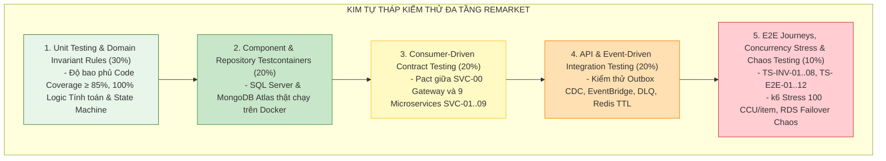

# Test Scenarios & Invariant Verification – ReMarket

## Thông tin tài liệu

| Thuộc tính | Giá trị |
|---|---|
| Dự án | ReMarket – Nền tảng Thương mại Điện tử Đồ cũ C2C/B2C Phân tán |
| Tài liệu | Danh mục Kịch bản Kiểm thử Nghiệm thu Đầu-Cuối (E2E) & Kiểm chứng Bất biến Kiến trúc |
| Mã tài liệu | `DOC-BA-08-TST` |
| Phiên bản | 1.0 |
| Trạng thái | Hoàn thiện (Baseline cho Kiểm thử Nghiệm thu & QA Automation) |
| Ngày cập nhật | 12/11/2026 |
| Tài liệu liên quan | `03_requirements/acceptance-criteria.md`, `functional-requirements.md`, `05_domain-and-data/domain-model.md`, `08_validation-and-governance/requirements-traceability-matrix.md` |

---

## 1. Chiến lược Kim tự tháp Kiểm thử & Shift-Left Testing (Testing Strategy)

Hệ thống ReMarket áp dụng chiến lược kiểm thử đa tầng theo chuẩn Agile Testing Pyramid, đẩy việc kiểm thử chất lượng sang giai đoạn sớm nhất (Shift-Left Testing) để phát hiện và triệt tiêu lỗi phân tán trước khi đến môi trường Staging/Production:

---

## 2. Nhóm 1: Kịch bản Kiểm chứng 5 Bất biến Kiến trúc Cốt lõi (`TS-INV-01..08`)

Đây là các kịch bản kiểm thử ở mức độ **Blocker / P0**. Nếu bất kỳ kịch bản nào trong nhóm này thất bại, hệ thống bị cấm Go-Live tuyệt đối:

### `TS-INV-01`: Race Condition 100 Buyer Đồng thời Bấm Checkout 1 Món Hàng Đơn chiếc
- **Bất biến Bảo vệ:** **`INV-01` (Zero Overselling)** – Hàng độc bản đơn chiếc tuyệt đối không bán trùng.
- **Mã Yêu cầu & Trace:** `BRQ-TXN-01`, `FR-CHK-05`, `US-CHK-04`, `EN-04`.
- **Mục tiêu Kiểm thử:** Chứng minh Two-Tier Reservation Engine (Redis `SET NX EX 900` + SQL Server `UPDLOCK, ROWLOCK` + `RowVersion`) ngăn chặn 100% tình trạng bán trùng hàng hóa khi có đột biến tải cao.
- **Điều kiện Tiên quyết (Pre-conditions):**
  - Món hàng `ListingId = LST-TEST-001` đang ở trạng thái `ACTIVE` trên `CatalogDB`.
  - Khóa `lock:listing:LST-TEST-001` chưa tồn tại trên Redis Cluster.
  - Chuẩn bị 100 tài khoản Buyer ảo (`Buyer_001` đến `Buyer_100`) đã xác thực có JWT hợp lệ.
- **Dữ liệu Kiểm thử (Test Data):**
  - Script kiểm thử k6 cấu hình 100 Virtual Users (VUs) gửi đồng thời 100 request `POST /api/v1/checkout/reserve` trỏ vào cùng `LST-TEST-001` tại cùng 1 mili-giây.
- **Các bước Thực thi (Execution Steps):**
  1. Kích hoạt k6 script bắn 100 requests đồng thời qua AWS API Gateway `SVC-00`.
  2. Gateway định tuyến đồng thời vào cụm `SVC-05 Order Processing Service`.
  3. Lệnh đầu tiên chạm Redis thực thi `SET lock:listing:LST-TEST-001 {order_id} NX EX 900`.
  4. Lệnh đầu tiên tiếp tục mở transaction trên `OrderDB` với câu lệnh `SELECT ... WITH (UPDLOCK, ROWLOCK)` và chèn bản ghi vào bảng `OrderReservations`.
  5. 99 requests còn lại bị chặn tại Redis (nhận kết quả 0) hoặc bị chặn tại SQL Server do kiểm tra phiên bản `RowVersion`.
- **Trạng thái Hệ thống Kỳ vọng (Expected System State):**
  - **Mã HTTP phản hồi:** Duy nhất đúng 1 request nhận mã `HTTP 201 Created` kèm `ReservationId` và thời hạn 15 phút. Đúng 99 requests còn lại nhận mã `HTTP 409 Conflict` kèm thông báo *"Món hàng này hiện đang có người giữ chỗ giao dịch"*.
  - **Trạng thái Redis:** Key `lock:listing:LST-TEST-001` có giá trị là `OrderId` thành công, TTL dao động từ 898 đến 900 giây.
  - **Trạng thái SQL Server:** Bảng `OrderReservations` chỉ có duy nhất **1 bản ghi mới** ở trạng thái `ACTIVE`.
  - **Trạng thái CatalogDB:** Tin đăng `LST-TEST-001` được cập nhật `STATUS = RESERVED`.
- **Điều kiện Kết thúc (Post-conditions):** Hệ thống không phát sinh bất kỳ bản ghi đơn hàng trùng lặp nào; không xảy ra lỗi deadlock không thể phục hồi trên SQL Server.

---

### `TS-INV-02`: Tự động Giải phóng Khóa Giữ hàng Đúng Giây Thứ 900 khi Buyer Không Thanh toán
- **Bất biến Bảo vệ:** **`INV-01` (Zero Overselling)** & Tính sẵn sàng của hàng hóa.
- **Mã Yêu cầu & Trace:** `BRQ-TXN-03`, `FR-CHK-06`, `US-CHK-05`, `EN-04`.
- **Mục tiêu Kiểm thử:** Kiểm tra cơ chế tự động mở khóa (TTL Auto-Release) đưa món hàng trở lại sàn ngay sau khi hết hạn 15 phút mà người mua không hoàn tất thanh toán.
- **Điều kiện Tiên quyết:**
  - Đơn hàng `ORD-TEST-900` đang giữ chỗ món hàng `LST-TEST-002` ở trạng thái `RESERVED`.
  - Key `lock:listing:LST-TEST-002` trên Redis có TTL còn lại 5 giây.
- **Các bước Thực thi:**
  1. Đợi 6 giây cho Redis TTL hết hạn (`Key Expired`).
  2. Redis phát sự kiện hết hạn key (Keyspace Notification) hoặc Worker định kỳ (`ReservationReaperWorker`) của `SVC-05` quét các bản ghi `OrderReservations` có `EXPIRES_AT < CURRENT_TIMESTAMP` và `STATUS = ACTIVE`.
  3. Worker thực thi cập nhật `OrderReservations.STATUS = EXPIRED` và bắn sự kiện `EVT-10 ReservationExpiredEvent` vào Outbox.
  4. `SVC-02 Catalog Service` tiêu thụ sự kiện và chuyển `listings.STATUS` từ `RESERVED` về `ACTIVE`.
- **Trạng thái Hệ thống Kỳ vọng:**
  - Trạng thái tin đăng trên giao diện PDP lập tức chuyển từ huy hiệu *"Đang có người giữ chỗ"* sang nút *"Mua Ngay"*.
  - Người mua khác bấm mua thành công và tạo được phiên giữ chỗ mới.

---

### `TS-INV-03`: Cổng Thanh toán Bắn Lặp 10 Lần Webhook Thành công do Lag Mạng
- **Bất biến Bảo vệ:** **`INV-02` (Zero Double Charge)** – Tuyệt đối không trừ tiền và không ghi nhận số dư trùng lặp.
- **Mã Yêu cầu & Trace:** `BRQ-TXN-08`, `FR-PAY-04, 05`, `US-PAY-03`, `EN-05`.
- **Mục tiêu Kiểm thử:** Chứng minh cơ chế xử lý Webhook Idempotent (kiểm tra `IdempotencyKey` và bảng `ProcessedWebhooks`) bảo vệ sổ cái ký quỹ trước các cuộc tấn công bắn lặp hoặc sự cố mạng chập chờn từ phía đối tác PSP.
- **Điều kiện Tiên quyết:** Đơn hàng `ORD-TEST-003` đang ở trạng thái `AWAITING_PAYMENT` với tổng số tiền cần thanh toán là 5.000.000 VNĐ.
- **Các bước Thực thi:**
  1. Sử dụng Postman gửi 10 requests `POST /api/v1/webhook/psp` liên tiếp trong 2 giây, cùng mang một payload chứa mã giao dịch cổng thanh toán `PSP_TXN_999888` và chữ ký số HMAC hợp lệ.
  2. Request 1 đến: `SVC-06` mở transaction, kiểm tra bảng `ProcessedWebhooks` chưa có mã này; thực hiện chèn bản ghi, cập nhật trạng thái đơn sang `PAYMENT_ESCROWED`, ghi nhận 5.000.000 VNĐ vào bảng `EscrowHoldings` và trả về `HTTP 200 OK`.
  3. Các requests 2 đến 10 đến: `SVC-06` kiểm tra thấy mã `PSP_TXN_999888` đã tồn tại trong `ProcessedWebhooks`.
- **Trạng thái Hệ thống Kỳ vọng:**
  - Toàn bộ 10 requests đều nhận mã `HTTP 200 OK` (để cổng thanh toán không tiếp tục retry).
  - Bảng `EscrowHoldings` của đơn hàng chỉ có **duy nhất 1 bản ghi** với số tiền đúng 5.000.000 VNĐ.
  - Sổ cái kế toán không bị ghi nhận dư tiền; tài khoản người bán không bị nhân đôi số dư.

---

### `TS-INV-04`: Webhook Thanh toán Thành công Đến Trễ ở Phút Thứ 16 Sau Khi Đơn Đã Hủy Quá Hạn
- **Bất biến Bảo vệ:** **`INV-01` (Zero Overselling)** kết hợp **`INV-02` (Zero Double Charge)**.
- **Mã Yêu cầu & Trace:** `BRQ-TXN-06, 08`, `FR-PAY-11`, `US-PAY-05`.
- **Mục tiêu Kiểm thử:** Kiểm tra tình huống biên nguy hiểm: Người mua thao tác thanh toán chậm, tiền bị trừ tại tài khoản ngân hàng nhưng Webhook về đến hệ thống ReMarket ở phút thứ 16 (khi lệnh giữ hàng 15 phút đã bị hủy tự động và món hàng đã được người khác mua).
- **Các bước Thực thi:**
  1. Tạo đơn hàng `ORD-TEST-004`, để quá 15 phút cho hệ thống chuyển sang `CANCELLED_DUE_TO_TIMEOUT`.
  2. Bắn Webhook từ cổng PSP báo giao dịch thành công cho đơn hàng `ORD-TEST-004`.
  3. `SVC-06 Payment Service` tiếp nhận Webhook, kiểm tra trạng thái đơn trên `OrderDB` thấy đơn đã bị hủy.
- **Trạng thái Hệ thống Kỳ vọng:**
  - Hệ thống **tuyệt đối không** chuyển đơn hàng sang `PAID` và **không** giữ hàng cho người mua này (vì hàng có thể đã bán cho người khác).
  - `SVC-06` tự động ghi nhận trạng thái giao dịch là `EXPIRED_PAYMENT_CAPTURED`.
  - Tự động gọi ngay lập tức API hoàn tiền (`Auto-Refund`) sang cổng PSP để trả lại 100% tiền cho người mua trong vòng < 30 giây.
  - Bắn thông báo In-app và Email xin lỗi người mua: *"Đơn hàng của bạn đã quá thời gian giữ chỗ 15 phút trước khi tiền được ghi nhận. Số tiền đã thanh toán đang được hoàn trả tự động về tài khoản của bạn."*

---

### `TS-INV-05`: Broker Sự kiện (EventBridge/Kafka) Mất Kết Nối Ngay Khi Commit Đơn Hàng
- **Bất biến Bảo vệ:** **`INV-03` (Zero Lost Distributed Events)** – Không bao giờ mất mát sự kiện nghiệp vụ giữa các microservices.
- **Mã Yêu cầu & Trace:** `BRQ-PLT-01`, `FR-OPS-07`, `US-OPS-07`, `EN-05`.
- **Mục tiêu Kiểm thử:** Chứng minh mẫu thiết kế Transactional Outbox Pattern bảo vệ tính nhất quán cuối cùng (Eventual Consistency) ngay cả khi hạ tầng mạng truyền thông điệp gặp thảm họa gián đoạn.
- **Các bước Thực thi:**
  1. Dùng firewall chặn toàn bộ kết nối từ `SVC-05 Order Service` sang AWS EventBridge / Kafka Broker.
  2. Người dùng tạo đơn hàng mới `ORD-TEST-005`.
  3. `SVC-05` commit transaction cục bộ trên `OrderDB`: chèn bản ghi vào bảng `Orders` và đồng thời chèn bản ghi sự kiện `EVT-08 OrderCreatedEvent` vào bảng `OutboxMessages` với `PROCESSED = 0`. Transaction commit thành công.
  4. Tiến trình gửi sự kiện (Debezium CDC hoặc Poller) cố gắng gửi sang EventBridge nhưng bị lỗi kết nối; sự kiện vẫn nằm nguyên trong bảng `OutboxMessages`.
  5. Sau 5 phút, mở lại kết nối mạng sang EventBridge.
- **Trạng thái Hệ thống Kỳ vọng:**
  - Tiến trình CDC/Poller tự động phát hiện kết nối đã thông, đọc các bản ghi Outbox tồn đọng và đẩy toàn bộ sang EventBridge.
  - `SVC-09 Notification Service` và `SVC-02 Catalog Service` nhận được sự kiện và xử lý đầy đủ; cập nhật `OutboxMessages.PROCESSED = 1`. Không một sự kiện nào bị thất thoát.

---

### `TS-INV-06`: Buyer Mở Khiếu Nại Tranh Chấp ở Giờ Thứ 71:59 Trước Khi Hết Hạn T+3
- **Bất biến Bảo vệ:** **`INV-04` (Escrow Freeze on Dispute)** – Tức thời đóng băng giải ngân khi phát sinh tranh chấp.
- **Mã Yêu cầu & Trace:** `BRQ-TRU-02`, `FR-DSP-04`, `US-DSP-02`, `FT-24`.
- **Mục tiêu Kiểm thử:** Kiểm tra tính tức thời của cơ chế đóng băng tiền ký quỹ, bảo vệ tiền người mua trước khi bộ đếm tự động giải ngân cho người bán kích hoạt.
- **Điều kiện Tiên quyết:** Đơn hàng `ORD-TEST-006` đã giao hàng thành công (`DELIVERED`) được 71 giờ 59 phút. Timer tự động giải ngân còn đúng 60 giây là chạy.
- **Các bước Thực thi:**
  1. Người mua nhấn nút "Khiếu nại / Trả hàng" trên màn hình `SCR-MKT-11`, chọn lý do "Hàng vỡ hỏng do vận chuyển", đính kèm video mở hộp và bấm "Gửi Khiếu nại".
  2. `SVC-08 Trust Service` nhận yêu cầu, tạo bản ghi `dispute_cases` và phát ngay sự kiện `EVT-22 DisputeOpenedEvent`.
  3. `SVC-06 Payment Service` tiếp nhận sự kiện trong vòng < 300ms, mở transaction trên `PaymentDB` cập nhật `EscrowHoldings.STATUS = FROZEN`.
  4. Đúng 60 giây sau, Timer giải ngân T+3 kích hoạt quét các đơn đủ điều kiện thanh toán.
- **Trạng thái Hệ thống Kỳ vọng:**
  - Timer giải ngân bỏ qua đơn hàng `ORD-TEST-006` do trạng thái ký quỹ đang là `FROZEN`.
  - Tiền người mua vẫn nằm an toàn 100% trong tài khoản ký quỹ trung gian của sàn; Người bán không thể thực hiện lệnh rút số tiền này.

---

### `TS-INV-07`: Phán quyết Tranh chấp Hoàn Tiền Một Phần (Split Payout) Cân Bằng Sổ Cái Kép
- **Bất biến Bảo vệ:** **`INV-04` (Escrow Freeze on Dispute)** & Tính toàn vẹn kế toán kép.
- **Mã Yêu cầu & Trace:** `BRQ-TXN-06`, `FR-DSP-05`, `US-DSP-04`, `FT-25`.
- **Mục tiêu Kiểm thử:** Kiểm tra tính chính xác của sổ cái kế toán khi Trọng tài viên ReMarket Back-office đưa ra phán quyết thỏa thuận hoàn tiền 30% cho người mua và giải ngân 70% còn lại cho người bán.
- **Dữ liệu Kiểm thử:** Đơn hàng giá trị 10.000.000 VNĐ. Phán quyết: Hoàn trả Buyer 3.000.000 VNĐ; Giải ngân Seller 7.000.000 VNĐ.
- **Các bước Thực thi:**
  1. Trọng tài viên đăng nhập màn hình `SCR-ADM-04`, nhập phán quyết Split: Buyer Refund = 3.000.000 VNĐ; Seller Payout = 7.000.000 VNĐ; bấm "Phê duyệt Thi hành".
  2. `SVC-06 Payment Service` thực thi một Transaction phân tán gồm 2 lệnh đồng thời:
     - Gọi cổng PSP hoàn trả 3.000.000 VNĐ về thẻ/tài khoản người mua.
     - Tạo bản ghi `PayoutLedgers` chuyển 7.000.000 VNĐ sang ví khả dụng của người bán.
     - Đóng trạng thái `EscrowHoldings` thành `SETTLED`.
- **Trạng thái Hệ thống Kỳ vọng:**
  - Tổng số tiền ra: 3.000.000 + 7.000.000 = 10.000.000 VNĐ (khớp đúng 100% số tiền ký quỹ ban đầu, sai lệch = 0 VNĐ).
  - Báo cáo đối soát tài chính ngày hôm đó hiển thị trạng thái cân bằng hoàn hảo (Zero Imbalance).

---

### `TS-INV-08`: Cố Tình Gọi API Sửa Xóa Log Kiểm Toán hoặc Tệp Lưu Trữ S3 WORM
- **Bất biến Bảo vệ:** **`INV-05` (Audit Preservation & Disaster Recovery)** – Bảo toàn bất biến dữ liệu kiểm toán.
- **Mã Yêu cầu & Trace:** `BRQ-PLT-05`, `FR-OPS-09`, `US-OPS-09`, `FT-32`.
- **Mục tiêu Kiểm thử:** Chứng minh dữ liệu kiểm toán pháp lý không thể bị thay đổi hoặc tiêu hủy ngay cả bởi tài khoản có quyền quản trị cao nhất (Chống Insider Threat và Ransomware).
- **Các bước Thực thi:**
  1. Dùng tài khoản Database Administrator (DBA) kết nối trực tiếp vào `PaymentDB`, chạy lệnh SQL: `DELETE FROM PaymentTransactions WHERE TransactionId = 123`.
  2. Dùng tài khoản AWS Root / Admin kết nối vào S3 Bucket lưu trữ chứng từ thanh toán, gọi lệnh `aws s3 rm s3://remarket-audit-vault/receipt_123.pdf`.
- **Trạng thái Hệ thống Kỳ vọng:**
  - Lệnh SQL DELETE bị chặn đứng bởi SQL Server Trigger / Deny Permission, trả về lỗi: *"Cannot delete or modify records in immutable audit ledger"*.
  - Lệnh AWS S3 CLI bị từ chối trả về lỗi `AccessDenied: Object is protected by S3 Object Lock in COMPLIANCE mode until retention date`.
  - Hệ thống ghi nhận cảnh báo an ninh mức Critical gửi tức thời về kênh Slack của Security Lead.

---

## 3. Nhóm 2: Kịch bản Kiểm thử Hành trình Đầu-Cuối (End-to-End Scenarios `TS-E2E-01..12`)

Bao quát toàn bộ 6 chặng dòng giá trị (Value Streams) từ lúc người dùng bước vào sàn đến khi hoàn tất giao dịch:

| Mã Kịch bản | Tên Kịch bản E2E | Luồng Nghiệp vụ Bao phủ | Dữ liệu & Kết quả Kỳ vọng |
|---|---|---|---|
| **`TS-E2E-01`** | Đăng ký tài khoản mới & Xác thực OTP | `US-ACC-01`, `02`, `04` | Nhập SĐT → Nhận OTP trong 3s → Xác thực thành công → Cấp token JWT → Chuyển sang màn hình hoàn thiện hồ sơ. |
| **`TS-E2E-02`** | Đăng tin đồ cũ kèm 5 ảnh WebP & Lọc từ cấm | `US-LST-01`, `04`, `05`, `06` | Điền form bán iPhone 13 cũ → Upload 5 ảnh qua S3 Presigned URL → ClamAV quét sạch → Không từ cấm → Tin đăng hiển thị `ACTIVE`. |
| **`TS-E2E-03`** | Đăng tin chứa từ cấm bị chặn tự động | `US-LST-06`, `07` | Điền form bán hàng có chứa từ "vũ khí nóng" → Bị chặn tại client & server → Tin chuyển sang `REJECTED` kèm thông báo lý do rõ ràng. |
| **`TS-E2E-04`** | Tìm kiếm toàn văn tiếng Việt & Lọc đa diện | `US-SRC-01`, `02`, `03` | Gõ "dien thoai cu gia re" → OpenSearch trả về kết quả trong 120ms → Chọn lọc "Hà Nội" + "Dưới 5 triệu" → Kết quả cập nhật chính xác. |
| **`TS-E2E-05`** | Hành trình Đặt hàng & Khóa giữ chỗ 15 phút | `US-CHK-01..05` | Bấm "Mua Ngay" món đồ độc bản → Màn hình Checkout hiển thị đồng hồ đếm ngược `15:00` → Listing chuyển `RESERVED` trên toàn sàn. |
| **`TS-E2E-06`** | Thanh toán thành công qua VNPAY / MoMo | `US-PAY-01..03`, `US-CHK-07` | Chọn VNPAY → Điều hướng an toàn với chữ ký HMAC → Thanh toán thẻ test → Webhook về cập nhật đơn `PAYMENT_ESCROWED`. |
| **`TS-E2E-07`** | Người bán chuẩn bị hàng & Tạo vận đơn 3PL | `US-CHK-09`, `US-SHP-01, 02` | Người bán bấm "Xác nhận gửi hàng" → Hệ thống gọi API GHN tạo vận đơn trong 2s → Sinh nhãn PDF có mã vạch in dán lên thùng hàng. |
| **`TS-E2E-08`** | Cập nhật lộ trình bưu tá & Giao hàng có POD | `US-SHP-03, 04`, `US-CHK-08` | Webhook GHN báo `IN_TRANSIT` → `DELIVERED` kèm ảnh chụp chữ ký POD → Trạng thái đơn cập nhật `DELIVERED`, bắt đầu đếm 72h. |
| **`TS-E2E-09`** | Người mua bấm "Đã nhận hàng" & Giải ngân ngay | `US-CHK-11`, `US-PAY-08` | Người mua bấm xác nhận hàng chuẩn mô tả → Đơn chuyển `COMPLETED` → Tiền ký quỹ giải ngân chuyển thẳng vào ví người bán tức thì. |
| **`TS-E2E-10`** | Hết 72h không khiếu nại tự động giải ngân T+3 | `US-PAY-08`, `US-CHK-11` | Sau 72h kể từ lúc DELIVERED mà người mua không có khiếu nại → Job tự động hoàn tất đơn và chuyển tiền cho người bán an toàn. |
| **`TS-E2E-11`** | Khiếu nại hàng sai mô tả & Trọng tài phán quyết | `US-DSP-01..04`, `US-TRU-06` | Người mua gửi video khui hàng chứng minh vỡ màn hình → Đóng băng tiền → Trọng tài yêu cầu trả hàng → Trả xong hoàn tiền 100%. |
| **`TS-E2E-12`** | CSKH tra cứu dòng thời gian Order 360° | `US-SUP-01..04` | Khách hàng gọi hotline báo sự cố → Nhân viên CSKH mở màn hình `Order 360°` tải hợp nhất lịch sử 5 dịch vụ trong 350ms, dữ liệu PII được che. |

---

## 4. Nhóm 3: Kịch bản Kiểm thử Chức năng & Ngoại lệ Chi tiết theo 12 Epics

Bảng dưới đây tổng hợp các kịch bản kiểm thử bao phủ toàn bộ 81 User Stories và 22 mã ngoại lệ (`EX-001..022`):

| Mã Kịch bản | Phân hệ Epic | User Story | Mã Ngoại lệ | Trọng tâm Kiểm thử (Chức năng & Biên / Ngoại lệ) |
|---|---|---|---|---|
| **`TS-ACC-01`** | `EP-ACC` | `US-ACC-01` | `EX-001` | Đăng ký bằng số điện thoại đã tồn tại trong hệ thống → Báo lỗi HTTP 409 trùng lặp. |
| **`TS-ACC-02`** | `EP-ACC` | `US-ACC-02` | `EX-002` | Nhập sai OTP quá 5 lần liên tiếp → Tạm khóa tính năng gửi OTP trong 15 phút chống brute-force. |
| **`TS-ACC-05`** | `EP-ACC` | `US-ACC-05` | `EX-003` | Tải ảnh KYC CCCD bị mờ không nhận dạng được → Back-office từ chối kèm lý do yêu cầu chụp lại. |
| **`TS-ACC-08`** | `EP-ACC` | `US-ACC-08` | `EX-004` | Đăng nhập từ thiết bị lạ khi đã bật 2FA → Bắt buộc nhập mã TOTP từ Authenticator App mới cấp token. |
| **`TS-LST-01`** | `EP-LST` | `US-LST-01` | `EX-005` | Người bán cá nhân đăng tin vượt quá hạn mức 5 tin chưa duyệt → Yêu cầu xác minh KYC để nâng hạn mức. |
| **`TS-LST-04`** | `EP-LST` | `US-LST-04` | `EX-006` | Cố tình tải lên tệp thực thi `.exe` giả dạng đuôi `.jpg` qua S3 → Bị ClamAV phát hiện và xóa ngay trong 3s. |
| **`TS-LST-08`** | `EP-LST` | `US-LST-08` | `EX-007` | Đăng bán điện thoại nhưng cố tình để trống trường IMEI → Form báo lỗi bắt buộc nhập. |
| **`TS-SRC-01`** | `EP-SRC` | `US-SRC-01` | `EX-008` | Tìm kiếm từ khóa sai chính tả (ví dụ: "iphoen 13") → OpenSearch tự động gợi ý "Ý bạn là: iPhone 13?". |
| **`TS-CHK-01`** | `EP-CHK` | `US-CHK-01` | `EX-009` | Người bán cố tình tự bấm mua món hàng của chính mình → Hệ thống chặn với thông báo HTTP 400 Bad Request. |
| **`TS-CHK-10`** | `EP-CHK` | `US-CHK-10` | `EX-010` | Quá 48h người bán không bấm xác nhận đóng gói hàng → Đơn tự động hủy và hoàn tiền 100% cho người mua. |
| **`TS-PAY-01`** | `EP-PAY` | `US-PAY-01` | `EX-011` | Cổng VNPAY trả về mã lỗi người dùng không đủ số dư thẻ → Đơn hàng giữ nguyên trạng thái chờ thanh toán lại. |
| **`TS-SHP-05`** | `EP-SHP` | `US-SHP-05` | `EX-012` | Bưu tá phát hàng không gặp khách lần 1 và lần 2 → Tự động hẹn giao lại lần 3 và gửi SMS thông báo cho khách. |
| **`TS-SHP-08`** | `EP-SHP` | `US-SHP-08` | `EX-013` | Cước phí vận chuyển thực tế từ hãng vượt quá 20% cước tạm tính → Đưa vào hàng đợi đối soát cước ngoại lệ. |
| **`TS-NTF-03`** | `EP-NTF` | `US-NTF-03` | `EX-014` | Có khuyến mãi gửi vào lúc 23:30 đêm → Hệ thống hoãn lại đến 07:05 sáng hôm sau mới bắn thông báo. |
| **`TS-TRU-01`** | `EP-TRU` | `US-TRU-01` | `EX-015` | Tin đăng nhận 5 lượt báo cáo lừa đảo từ các tài khoản uy tín → Tự động tạm ẩn khỏi thanh tìm kiếm trong 60s. |
| **`TS-DSP-01`** | `EP-DSP` | `US-DSP-01` | `EX-016` | Người mua cố mở khiếu nại ở ngày thứ 4 (sau 72h) → Hệ thống khóa nút khiếu nại, thông báo đã quá hạn quy định. |
| **`TS-SUP-01`** | `EP-SUP` | `US-SUP-01` | `EX-017` | Khách tạo vé hỗ trợ khẩn cấp P1 → Bật chuông cảnh báo và đồng hồ đếm ngược 15 phút trên màn hình CSKH. |
| **`TS-ADM-01`** | `EP-ADM` | `US-ADM-01` | `EX-018` | Quản trị viên thêm ngành hàng mới "Xe đạp trợ lực" → Người bán mở form đăng tin thấy ngay ngành hàng mới. |
| **`TS-OPS-04`** | `EP-OPS` | `US-OPS-04` | `EX-019` | Tỷ lệ lỗi HTTP 5xx của dịch vụ Payment vượt 1% trong 2 phút → Tự động gọi điện PagerDuty đánh thức kỹ sư trực ca. |
| **`TS-OPS-07`** | `EP-OPS` | `US-OPS-07` | `EX-020` | Tin nhắn độc (Poison Pill) lỗi cú pháp lọt vào hàng đợi SQS → Thử lại 3 lần thất bại tự động cách ly vào DLQ. |
| **`TS-OPS-10`** | `EP-OPS` | `US-OPS-10` | `EX-021` | Bảng ghi đơn hàng trên SQL Server trỏ vào ảnh S3 nhưng tệp trên S3 bị mất → Script đối soát phát hiện và cảnh báo. |
| **`TS-OPS-12`** | `EP-OPS` | `US-OPS-12` | `EX-022` | Chi phí AWS lũy kế ngày 15 trong tháng vượt quá 55% ngân sách tháng → Bắn cảnh báo FinOps về kênh quản trị. |

---

## 5. Quản lý Dữ liệu Kiểm thử & Môi trường Giả lập (Test Data & Sandbox Strategy)

Để đảm bảo các kịch bản kiểm thử có thể chạy tự động lặp lại (Reproducible) mà không làm rác môi trường hay ảnh hưởng tài khoản thật:

1. **Bộ Tài khoản Persona Test Chuẩn:**
   - `Buyer_Normal`: Người mua cá nhân uy tín, đã xác thực số điện thoại.
   - `Buyer_New`: Người mua mới chưa có lịch sử mua hàng.
   - `Seller_Verified`: Người bán cá nhân đã xác thực KYC CCCD, bật 2FA.
   - `Seller_Unverified`: Người bán mới đăng tin lần đầu.
   - `Moderator_Level1`: Chuyên viên kiểm duyệt nội dung tin đăng.
   - `Finance_Auditor`: Chuyên viên kế toán có quyền đối soát ký quỹ.
   - `Admin_Super`: Quản trị viên hệ thống có toàn quyền.
2. **Bộ Thẻ Ngân Hàng & Ví Điện Tử Test (PSP Sandbox):**
   - Sử dụng dải số thẻ test do VNPAY / MoMo cung cấp: Thẻ test thành công ngay (`OTP 123456`), thẻ test từ chối do không đủ tiền, thẻ test lỗi timeout để kiểm chứng kịch bản Auto-Refund.
3. **Môi trường Giả Lập Đối Tác Vận Chuyển (`US-OPS-11 Mock 3PL Server`):**
   - Triển khai mock service nội bộ mô phỏng 100% các API tạo vận đơn và phát webhook hành trình của GHN và GHTK, cho phép QA chủ động kích hoạt các tình huống: giao hàng thành công ngay, giao hàng thất bại 3 lần, hủy vận đơn hoặc bưu tá làm mất hàng.

---

## 6. Lịch sử cập nhật

| Phiên bản | Ngày | Tác giả | Nội dung thay đổi |
|---|---|---|---|
| 1.0 | 12/11/2026 | Nhóm Phân tích Nghiệp vụ & Kiến trúc | Khởi tạo tài liệu kịch bản kiểm thử nghiệm thu chi tiết, đặc tả sâu 8 kịch bản kiểm chứng bất biến INV-01..08, 12 kịch bản E2E và hơn 65 kịch bản phân hệ. |

