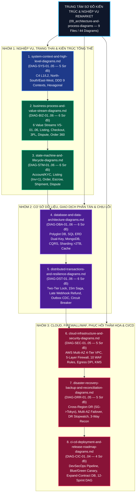

# Phân hệ 09: Trung tâm Sơ đồ Kiến trúc & Quy trình Nghiệp vụ (Master Architecture & Process Diagrams Hub)

> **Mã tài liệu:** `DOC-BA-09-IDX`  
> **Phiên bản:** `v2.0`  
> **Ngày cập nhật:** `2026-11-12`  
> **Tác giả:** Senior Principal Solutions Architect & Lead Business Analyst  
> **Trạng thái:** `Baseline — Single Source of Visual Truth`

---

## 1. Giới thiệu & Tầm nhìn

Thư mục **`09_architecture-and-process-diagrams/`** là **Trung tâm Sơ đồ Kiến trúc và Nghiệp vụ Hợp nhất (Single Source of Visual Truth)** của toàn bộ dự án **ReMarket Platform** — Nền tảng Thương mại Điện tử Mua bán Đồ cũ (Re-commerce C2C/B2C) với cơ chế Thanh toán Ký quỹ An toàn (Escrow) và Đặc thù Tồn kho Đơn chiếc (`Inventory = 1`).

Thay vì phải tìm kiếm rải rác trong hàng chục tài liệu văn bản, đội ngũ **Product Owner, Business Analyst, Solution Architect, Backend/Frontend Engineers, DevOps/SRE, Security Engineers và QA/SDET** có thể tra cứu trực tiếp tại đây **44 sơ đồ kỹ thuật và nghiệp vụ chuẩn hóa** được phân hoạch khoa học thành **8 chuyên đề trọng tâm**:

1. **Bối cảnh Hệ thống & Kiến trúc Tổng thể (`C4 Level 1/2, DDD Context Map, Hexagonal Architecture`)**
2. **Luồng Nghiệp vụ End-to-End & Chuỗi Giá trị (`6 Value Streams VS-01..VS-06`)**
3. **Sơ đồ Máy Trạng thái & Vòng đời Thực thể (`6 State Machines + Bảng Invariants`)**
4. **Kiến trúc Cơ sở Dữ liệu Đa mô hình (`SQL Server ERD, MongoDB Schemas, CQRS, Sharding > 2TB, Multi-Tier Caching`)**
5. **Giao dịch Phân tán & Khả năng Chịu lỗi (`Two-Tier Lock, Saga Compensation, Outbox CDC, Circuit Breaker, DLQ`)**
6. **Hạ tầng Cloud AWS, Tường lửa Đa lớp & Bảo mật (`Multi-AZ VPC, 5-Layer Firewall, 10 WAF v2 Rules, Egress DPI, KMS`)**
7. **Sao lưu, Phục hồi Thảm họa & Đối soát Tài chính (`Cross-Region DR RPO <= 5m / RTO <= 30m, Multi-AZ Failover, 3-Way Reconciliation`)**
8. **Đường ống CI/CD DevSecOps, Triển khai Zero-Downtime & Lộ trình Phát hành (`Canary Rollback, Expand-Contract DB, Critical Path 12 Sprints`)**

---

## 2. `DIAG-IDX-01` — Bản đồ Điều hướng Tổng thể Phân hệ 09 (`Master Visual Architecture Navigation Map`)

---

## 3. Danh mục Chi tiết 8 Tài liệu Chuyên đề & 44 Sơ đồ (`Master Diagram Catalog`)

### 3.1. Chuyên đề 1: Bối cảnh Hệ thống & Kiến trúc Tổng thể
- **Tài liệu:** [system-context-and-high-level-diagrams.md](file:///d:/remarket-platform-system/docs/BA/09_architecture-and-process-diagrams/system-context-and-high-level-diagrams.md) (`DOC-BA-09-SYS`)

| Mã Sơ đồ | Tên Sơ đồ | Loại Mermaid | Nội dung Trọng tâm |
| :--- | :--- | :--- | :--- |
| **`DIAG-SYS-01`** | Sơ đồ Bối cảnh Hệ thống C4 Level 1 (`System Context`) | `flowchart TB` | Toàn cảnh hệ sinh thái ReMarket: 6 nhóm Actor (`STK-01..10`) và 8 hệ thống đối tác ngoại vi (`VNPay/MoMo/VietQR`, `GHN/GHTK`, `FPT.AI eKYC`, `AWS S3/CloudFront`, `FCM/APNs/SES`, `Zalo ZNS/SMS`). |
| **`DIAG-SYS-02`** | Kiến trúc Container Toàn Hệ thống C4 Level 2 (`High-Level Container`) | `flowchart TB` | Đầy đủ 6 lớp kiến trúc: Edge/CDN/WAF $\rightarrow$ API Gateway/BFF $\rightarrow$ 9 Microservices (`SVC-01..09`) + `SVC-00 Audit` $\rightarrow$ Event Backbone (`Kafka + Debezium`) $\rightarrow$ Polyglot Data Tier $\rightarrow$ Observability. |
| **`DIAG-SYS-03`** | Định tuyến Giao thức Đa tầng (`North-South vs East-West Traffic`) | `flowchart LR` | Phân tách rạch ròi giao thức `HTTPS REST/WebSocket` (North-South), `gRPC HTTP/2 mTLS` cho tác vụ đồng bộ `<= 50ms`, và `Kafka Event Streaming` cho tác vụ bất đồng bộ. |
| **`DIAG-SYS-04`** | Bản đồ Ngữ cảnh Giới hạn DDD (`Bounded Context Map`) | `flowchart TB` | Phân bổ 9 Bounded Contexts (`BC-01..09`) theo 3 phân nhóm chiến lược (**Core Domain**, **Supporting Domain**, **Generic Subdomain**) và các mẫu tích hợp (`ACL`, `OHS`, `Customer-Supplier`). |
| **`DIAG-SYS-05`** | Kiến trúc Lục giác chuẩn bên trong mỗi Microservice (`Hexagonal Architecture`) | `flowchart LR` | Cấu trúc 4 vòng đồng tâm (`Domain Core`, `Application Use Cases`, `Inbound Driving Adapters`, `Outbound Driven Adapters`) cùng bảng ánh xạ cổng giao tiếp của `SVC-01..09`. |

---

### 3.2. Chuyên đề 2: Luồng Nghiệp vụ End-to-End & Chuỗi Giá trị
- **Tài liệu:** [business-process-and-value-stream-diagrams.md](file:///d:/remarket-platform-system/docs/BA/09_architecture-and-process-diagrams/business-process-and-value-stream-diagrams.md) (`DOC-BA-09-BIZ`)

| Mã Sơ đồ | Tên Sơ đồ | Loại Mermaid | Nội dung Trọng tâm |
| :--- | :--- | :--- | :--- |
| **`DIAG-BIZ-01`** | Chuỗi Giá trị Tổng thể End-to-End (`6 Value Streams Architecture`) | `flowchart LR` | Liên kết khép kín 6 chuỗi giá trị cốt lõi (`VS-01` Onboarding/KYC $\rightarrow$ `VS-02` Listing/Discovery $\rightarrow$ `VS-03` Reservation/Escrow $\rightarrow$ `VS-04` 3PL/Settlement $\rightarrow$ `VS-05` Dispute $\rightarrow$ `VS-06` Support/Reconciliation). |
| **`DIAG-BIZ-02`** | Luồng Đăng tin, Tải ảnh S3, Quét Virus, Kiểm duyệt AI & NRT Index | `sequenceDiagram` | Tải ảnh qua `S3 Pre-signed URL`, quét mã độc `ClamAV`, chấm điểm `AI Content Moderation` (`Score < 0.30` tự động duyệt), và đồng bộ sang `OpenSearch < 2 giây`. |
| **`DIAG-BIZ-03`** | Luồng Đặt mua Hàng Đơn chiếc, Khóa Tồn kho 15 Phút & Ký quỹ | `sequenceDiagram` | Luồng `Inventory = 1`: lấy khóa `Redis SET NX EX 900` + `SQL UPDLOCK`, thanh toán qua `VNPay/MoMo/VietQR`, ghi sổ cái `Escrow HELD` và đánh dấu `Listing = SOLD`. |
| **`DIAG-BIZ-04`** | Luồng Giao nhận 3PL, Đối soát POD & Giải ngân Tự động `T+3` | `sequenceDiagram` | Tạo vận đơn `GHN/GHTK`, nhận Webhook `DELIVERED + POD`, khởi chạy đồng hồ 72 giờ (`T+3`) và tự động giải ngân tiền hàng sau khi khấu trừ phí sàn (`8%`). |
| **`DIAG-BIZ-05`** | Luồng Khiếu nại, Đóng băng Ký quỹ Tức thời (`INV-04`) & Trọng tài | `sequenceDiagram` | Chặn đứng bộ đếm giải ngân trong `< 1 giây` (`HELD -> FROZEN`), thương lượng 48h, Trọng tài viên phán quyết hoàn tiền 100%, hoàn tiền một phần (`Split Escrow`), hoặc bác bỏ khiếu nại. |
| **`DIAG-BIZ-06`** | Luồng Chăm sóc Khách hàng & Tra cứu `Order 360° Unified View` | `flowchart TB` | Tổng hợp tức thời (`< 500ms`) dữ liệu Đơn hàng, Sổ cái Ký quỹ, Hành trình Vận đơn 3PL, Lịch sử Chat và Bằng chứng Khiếu nại trên một màn hình duy nhất cho CS Agent. |

---

### 3.3. Chuyên đề 3: Sơ đồ Máy Trạng thái & Vòng đời Thực thể
- **Tài liệu:** [state-machine-and-lifecycle-diagrams.md](file:///d:/remarket-platform-system/docs/BA/09_architecture-and-process-diagrams/state-machine-and-lifecycle-diagrams.md) (`DOC-BA-09-STM`)

| Mã Sơ đồ | Tên Sơ đồ | Loại Mermaid | Nội dung Trọng tâm |
| :--- | :--- | :--- | :--- |
| **`DIAG-STM-01`** | Máy Trạng thái Tài khoản, Định danh eKYC & Điểm Uy tín | `stateDiagram-v2` | Chuyển đổi `UNVERIFIED -> ACTIVE_BUYER -> KYC_PENDING -> VERIFIED_SELLER -> RESTRICTED -> SUSPENDED -> BANNED` kèm điều kiện ngưỡng giao dịch `>= 5.000.000 VNĐ`. |
| **`DIAG-STM-02`** | Máy Trạng thái Tin đăng Sản phẩm Đơn chiếc (`Inventory = 1`) | `stateDiagram-v2` | Vòng đời 10 trạng thái từ `DRAFT`, `PENDING_MODERATION`, `ACTIVE` sang `RESERVED` (khóa 15 phút), `SOLD`, `DELIVERED_COMPLETED` và nhả lại `ACTIVE` khi hủy/hoàn hàng. |
| **`DIAG-STM-03`** | Máy Trạng thái Đơn hàng (`Order Lifecycle`) | `stateDiagram-v2` | Vòng đời 11 trạng thái từ `PENDING_PAYMENT` qua `PAID_ESCROW_HELD`, `AWAITING_PICKUP`, `IN_TRANSIT`, `DELIVERED` đến `COMPLETED`, `DISPUTED` và `REFUNDED`. |
| **`DIAG-STM-04`** | Máy Trạng thái Thanh toán & Sổ cái Ký quỹ (`Payment & Escrow`) | `stateDiagram-v2` | Kiểm soát dòng tiền `INITIATED -> AUTHORIZED -> ESCROW_HELD -> ESCROW_FROZEN -> RELEASE_SCHEDULED -> RELEASED_TO_SELLER / REFUNDED_TO_BUYER` bảo chứng bất biến `INV-02`, `INV-04`, `INV-05`. |
| **`DIAG-STM-05`** | Máy Trạng thái Vận đơn 3PL & Giao lại/Chuyển hoàn (`Shipment & RTS`) | `stateDiagram-v2` | Quản lý 3 lần lấy hàng (`PICKUP_FAILED_1..3`), hành trình luân chuyển Hub, 3 lần phát hàng (`DELIVERY_FAILED_1..3`) và luồng Chuyển hoàn (`RETURNING_TO_SELLER -> RETURNED_TO_SELLER`). |
| **`DIAG-STM-06`** | Máy Trạng thái Hồ sơ Khiếu nại & Tranh chấp (`Dispute Case`) | `stateDiagram-v2` | Quản lý SLA 48h thương lượng, SLA 24h leo thang Trọng tài viên, SLA 72h gửi hàng hoàn trả và 3 nhánh phán quyết cuối cùng. |

---

### 3.4. Chuyên đề 4: Kiến trúc Cơ sở Dữ liệu Đa mô hình, Sharding & Caching
- **Tài liệu:** [database-and-data-architecture-diagrams.md](file:///d:/remarket-platform-system/docs/BA/09_architecture-and-process-diagrams/database-and-data-architecture-diagrams.md) (`DOC-BA-09-DBA`)

| Mã Sơ đồ | Tên Sơ đồ | Loại Mermaid | Nội dung Trọng tâm |
| :--- | :--- | :--- | :--- |
| **`DIAG-DBA-01`** | Kiến trúc Lưu trữ Đa mô hình (`Polyglot Persistence Topology`) | `flowchart TB` | Ánh xạ 9 Microservices vào 4 công nghệ lưu trữ chuyên biệt (**SQL Server 2022 Enterprise**, **MongoDB 7.0 Replica Set**, **OpenSearch 2.x**, **Redis Cluster 7.x**) tuân thủ nguyên tắc `Database-per-Service`. |
| **`DIAG-DBA-02`** | Sơ đồ Thực thể Liên kết ERD Cốt lõi trên SQL Server (`Dual-Key Pattern`) | `erDiagram` | Thiết kế 11 bảng giao dịch cốt lõi áp dụng mẫu **Khóa Kép (`BIGINT IDENTITY Clustered PK` + `UUID Public_ID`)** và cấu trúc Sổ cái Kép Bất biến (`Escrow_Accounts`, `Ledger_Entries`). |
| **`DIAG-DBA-03`** | Mô hình Hóa Tài liệu MongoDB (`Polymorphic & Bucket Pattern`) | `erDiagram` | Thiết kế 6 Collection (`listings_catalog` đa hình theo danh mục, `chat_messages_bucket` gom nhóm 50 tin nhắn/document, `notifications_inbox`, `system_audit_logs_worm`). |
| **`DIAG-DBA-04`** | Đường ống Đồng bộ Dữ liệu CQRS (`Write Store -> Kafka CDC -> Read Store`) | `sequenceDiagram` | Tách biệt hoàn toàn luồng Ghi chuẩn hóa (`SQL + MongoDB`) và luồng Đọc tốc độ cao (`OpenSearch < 150ms`) qua `Debezium CDC` với độ trễ đồng bộ `< 2 giây`. |
| **`DIAG-DBA-05`** | Chiến lược Phân mảnh Ngang (`Horizontal Sharding > 2TB`) | `flowchart TB` | Định tuyến `Consistent Hashing (MurmurHash3)` mở rộng cụm SQL Server sang 4 Shards vật lý (`Shard 01..04`) khi dữ liệu vượt ngưỡng `2 TB`, kèm `Broadcast Reference Tables`. |
| **`DIAG-DBA-06`** | Kiến trúc Bộ nhớ Đệm Đa tầng (`L1/L2/L3 Cache`) & Xóa Cache theo Sự kiện | `flowchart TB` | Phối hợp `L1 CloudFront CDN`, `L2 In-Memory IMemoryCache`, `L3 Redis Cluster` (Chống Cache Stampede bằng `SingleFlight Lock`) và cơ chế xóa cache tức thời (`< 500ms`) qua Kafka Event. |

---

### 3.5. Chuyên đề 5: Giao dịch Phân tán, Điều phối Saga & Khả năng Chịu lỗi
- **Tài liệu:** [distributed-transactions-and-resilience-diagrams.md](file:///d:/remarket-platform-system/docs/BA/09_architecture-and-process-diagrams/distributed-transactions-and-resilience-diagrams.md) (`DOC-BA-09-DST`)

| Mã Sơ đồ | Tên Sơ đồ | Loại Mermaid | Nội dung Trọng tâm |
| :--- | :--- | :--- | :--- |
| **`DIAG-DST-01`** | Cơ chế Khóa Tồn kho Hai Tầng (`Two-Tier Reservation Lock`) | `sequenceDiagram` | Mô phỏng 100 Buyers bấm mua cùng lúc: `Redis Lua Script SET NX EX 900` chặn 99 requests ở `~2ms`, chỉ cho 1 request đi xuống `SQL Server UPDLOCK, ROWLOCK` (Bảo chứng `INV-01`). |
| **`DIAG-DST-02`** | Saga Đặt hàng & Tự động Giải phóng Khóa sau 15 Phút (`Compensation Saga`) | `sequenceDiagram` | Điều phối quy trình giữ chỗ 15 phút và kích hoạt giao dịch bù trừ (`Compensating Transaction`) nhả tin đăng về `ACTIVE` khi hết hạn TTL 900 giây. |
| **`DIAG-DST-03`** | Xử lý Webhook Thanh toán Lặp & Tự động Hoàn tiền khi Webhook Đến Muộn | `sequenceDiagram` | Kiểm tra khóa chống trùng lặp (`Idempotency_Key`) và tự động hoàn tiền 100% (`Auto-Refund Saga`) khi tiền về ở phút thứ 16 sau khi đơn hàng đã hết hạn giữ chỗ (`INV-02`). |
| **`DIAG-DST-04`** | Mẫu Transactional Outbox, Debezium CDC & Idempotent Consumer (`INV-03`) | `flowchart LR` | Đảm bảo gửi thông điệp `At-Least-Once` từ bảng `Outbox_Messages` qua `Debezium` và xử lý `Exactly-Once` tại đích nhờ bảng `Inbox_Processed_Messages`. |
| **`DIAG-DST-05`** | Mẫu Ngắt mạch Tự động (`Circuit Breaker`) & Cô lập Khoang (`Bulkhead`) | `stateDiagram-v2` | Chuyển đổi `CLOSED -> OPEN -> HALF_OPEN` khi đối tác `VNPay/GHN/eKYC` lỗi `>= 50%`, kết hợp tách biệt `Thread Pool` để ngăn lỗi dây chuyền (`Cascading Failure`). |
| **`DIAG-DST-06`** | Chiến lược Thử lại Luỹ thừa (`Exponential Backoff`) & Xử lý `DLQ Replay` | `flowchart TB` | Quy trình 4 lần thử lại có nhiễu ngẫu nhiên (`Jitter`), đẩy vào `Kafka DLQ (.dlq)`, cảnh báo PagerDuty và công cụ `Admin DLQ Replay Tool`. |

---

### 3.6. Chuyên đề 6: Hạ tầng Cloud AWS, Tường lửa Đa lớp & Bảo mật
- **Tài liệu:** [cloud-infrastructure-and-security-diagrams.md](file:///d:/remarket-platform-system/docs/BA/09_architecture-and-process-diagrams/cloud-infrastructure-and-security-diagrams.md) (`DOC-BA-09-SEC`)

| Mã Sơ đồ | Tên Sơ đồ | Loại Mermaid | Nội dung Trọng tâm |
| :--- | :--- | :--- | :--- |
| **`DIAG-SEC-01`** | Kiến trúc Mạng AWS VPC Đa vùng Sẵn sàng Cao (`Multi-AZ 4-Tier Subnet`) | `flowchart TB` | Phân bổ 3 Availability Zones (`AZ-a`, `AZ-b`, `AZ-c`) tại `ap-southeast-1` với 4 tầng Subnet (`Public Ingress/NAT`, `Firewall Inspection`, `Private App EKS/ECS`, `Isolated Data`). |
| **`DIAG-SEC-02`** | Kiến trúc Phòng thủ Đa lớp 5 Tầng (`5-Layer Defense-in-Depth`) | `flowchart TB` | Xâu chuỗi 5 lớp khiên bảo vệ: `L1 CloudFront + Shield + WAF v2` $\rightarrow$ `L2 AWS Network Firewall Suricata DPI` $\rightarrow$ `L3 NACL + Security Group Chain` $\rightarrow$ `L4 Kong API Gateway + mTLS` $\rightarrow$ `L5 KMS + GuardDuty`. |
| **`DIAG-SEC-03`** | Luồng Kiểm duyệt Request qua 10 Tập luật AWS WAF v2 & Tự động Phong tỏa IP | `sequenceDiagram` | Thứ tự ưu tiên `Priority 10 -> 100` (IP Blacklist, Geo-Restriction, Rate Limiting, Anti-Bot, OWASP SQLi/XSS, Size Constraint) và luồng `Kinesis -> Auto-Blocker Lambda` khóa IP tấn công trong `< 30 giây`. |
| **`DIAG-SEC-04`** | Kiến trúc Kiểm soát Lưu lượng Chiều ra (`Outbound Egress Filtering`) | `flowchart LR` | Chặn tuyệt đối kết nối Internet trực tiếp từ App/Data Subnet; ép buộc đi qua `AWS Network Firewall Egress TLS SNI Inspection` với danh sách trắng tên miền (`VNPay`, `MoMo`, `GHN`, `GHTK`, `FPT.AI`). |
| **`DIAG-SEC-05`** | Quản lý Khóa Mã hóa (`AWS KMS`), Bí mật (`Secrets Manager`) & Che dấu PII | `flowchart TB` | Cơ chế cấp quyền không mật khẩu (`IAM Roles for Service Accounts - IRSA`), tự động xoay vòng mật khẩu 30 ngày, mã hóa `TDE AES-256` và bộ lọc `PII Masking` trước khi ghi Log. |

---

### 3.7. Chuyên đề 7: Sao lưu, Phục hồi Thảm họa & Đối soát Tài chính
- **Tài liệu:** [disaster-recovery-backup-and-reconciliation-diagrams.md](file:///d:/remarket-platform-system/docs/BA/09_architecture-and-process-diagrams/disaster-recovery-backup-and-reconciliation-diagrams.md) (`DOC-BA-09-DRR`)

| Mã Sơ đồ | Tên Sơ đồ | Loại Mermaid | Nội dung Trọng tâm |
| :--- | :--- | :--- | :--- |
| **`DIAG-DRR-01`** | Kiến trúc Sao lưu Đa tầng (`PITR`) & Sao chép Liên vùng (`Singapore -> Tokyo`) | `flowchart LR` | Sao lưu liên tục `SQL Transaction Log (5m)`, `MongoDB Oplog Stream`, khóa bất biến `S3 Object Lock WORM 10 năm` (`INV-05`) và nhân bản sang vùng dự phòng `ap-northeast-1 (Tokyo)`. |
| **`DIAG-DRR-02`** | Kịch bản Tự động Chuyển đổi Dự phòng Nội vùng (`Multi-AZ Failover < 60s`) | `sequenceDiagram` | Phát hiện sập `AZ-1a` trong `15 giây`, tự động thăng cấp `SQL Server Standby` (`RPO = 0`), bầu chọn `MongoDB Primary` và `Redis Master` mới tại `AZ-1b` hoàn tất dưới `60 giây`. |
| **`DIAG-DRR-03`** | Kịch bản Phục hồi Thảm họa Toàn vùng (`Regional DR Drill — RPO <= 5m, RTO <= 30m`) | `sequenceDiagram` | Quy trình bấm giờ từng phút (`T+00:00 -> T+28:00`) khi toàn vùng Singapore gặp sự cố: nâng cấp cụm Warm Standby tại Tokyo, chạy đối soát bù trừ và chuyển hướng `Route 53 DNS`. |
| **`DIAG-DRR-04`** | Quy trình Đối soát Tài chính Tự động 3 Chiều (`3-Way Daily Reconciliation`) | `flowchart TB` | Đối chiếu hàng đêm lúc `02:00 AM` giữa **(1) Sao kê Cổng TT** $\leftrightarrow$ **(2) Sổ cái Ký quỹ Nội bộ** $\leftrightarrow$ **(3) Trạng thái Đơn hàng/Vận đơn**; tự động xử lý lệch và khóa giải ngân nếu sai số `!= 0 VNĐ`. |
| **`DIAG-DRR-05`** | Quy trình Đối soát & Khôi phục Trạng thái Dữ liệu Sau Phục hồi (`Post-Restore`) | `flowchart TB` | Thuật toán bù trừ giao dịch "mồ côi" trong khoảng trống `RPO 5 phút` bằng cách truy vấn ngược API `VNPay/MoMo` và `GHN/GHTK` trước khi mở lại cổng giao dịch cho người dùng. |

---

### 3.8. Chuyên đề 8: Đường ống CI/CD, Triển khai Zero-Downtime & Lộ trình Phát hành
- **Tài liệu:** [ci-cd-deployment-and-release-roadmap-diagrams.md](file:///d:/remarket-platform-system/docs/BA/09_architecture-and-process-diagrams/ci-cd-deployment-and-release-roadmap-diagrams.md) (`DOC-BA-09-CIC`)

| Mã Sơ đồ | Tên Sơ đồ | Loại Mermaid | Nội dung Trọng tâm |
| :--- | :--- | :--- | :--- |
| **`DIAG-CIC-01`** | Đường ống CI/CD DevSecOps Tự động & Cổng Chất lượng (`Quality Gates`) | `flowchart TB` | Chuỗi 6 chặng kiểm duyệt tự động: GitHub PR $\rightarrow$ SonarQube/Snyk/GitLeaks $\rightarrow$ Unit Test (`>= 80%`) + Testcontainers + Pact Contract Test $\rightarrow$ Docker Build + Trivy Scan + Cosign $\rightarrow$ Staging E2E/k6 $\rightarrow$ Production. |
| **`DIAG-CIC-02`** | Chiến lược Triển khai Zero-Downtime (`Blue/Green & Canary`) & Auto-Rollback | `sequenceDiagram` | Dịch chuyển lưu lượng qua `AWS CodeDeploy`: `10% Green (5m) -> 50% Green (10m) -> 100% Green`; tự động quay lui (`Auto-Rollback < 30s`) về cụm Blue nếu `HTTP 5xx > 0.5%`. |
| **`DIAG-CIC-03`** | Quy trình Nâng cấp Cơ sở Dữ liệu Không Khóa Bảng (`Expand-and-Contract`) | `flowchart LR` | Tiến hóa lược đồ DB qua 3 pha (`Pha 1: Expand Nullable & Dual-Write` $\rightarrow$ `Pha 2: Batch Backfill & Cutover` $\rightarrow$ `Pha 3: Contract & Cleanup`) đảm bảo tương thích ngược 100%. |
| **`DIAG-CIC-04`** | Sơ đồ Đường găng Dự án (`Critical Path DAG`) & Lộ trình 12 Sprints | `flowchart LR` | Mạng lưới phụ thuộc thực thi 11 Epics (`EP-01..11`) và 4 Enablers (`EN-01..04`) qua 3 cột mốc phát hành lớn: `Release 1.0 MVP` (Sprint 5), `Release 1.5 Governance` (Sprint 8), `Release 2.0 Scale` (Sprint 12). |

---

## 4. Quy ước Mã màu & Ký hiệu Kiến trúc Chuẩn (`Standard Color Palette & Legend`)

Toàn bộ 44 sơ đồ trong Phân hệ 09 tuân thủ thống nhất bảng mã màu (`classDef`) dưới đây để giúp người đọc nhận diện tức thì vai trò của từng thành phần kiến trúc:

| Phân lớp / Thành phần Kiến trúc | Mã Màu Nền (`fill`) | Mã Màu Viền (`stroke`) | Ý nghĩa Biểu đạt |
| :--- | :--- | :--- | :--- |
| **Actors & External Clients** (`Buyer`, `Seller`, `Admin`) | `#1e293b` (Xám Đậm Slate) | `#475569` | Tác nhân con người hoặc thiết bị đầu cuối bên ngoài hệ thống. |
| **Edge, Firewall & Security Layer** (`WAF v2`, `Network Firewall`, `KMS`) | `#881337` / `#7f1d1d` (Đỏ Đậm / Crimson) | `#e11d48` / `#dc2626` | Lớp khiên bảo mật, tường lửa, kiểm soát truy cập, hoặc trạng thái phong tỏa/cảnh báo. |
| **API Gateway & Routing Layer** (`Kong Gateway`, `ALB`, `BFF`) | `#0f766e` (Xanh Ngọc Teal) | `#0d9488` | Lớp điều phối lưu lượng, xác thực JWT, định tuyến North-South. |
| **Core Domain Microservices** (`SVC-01..09`, `Use Cases`) | `#1e3a8a` / `#065f46` (Xanh Dương Đậm / Xanh Lá Rừng) | `#1d4ed8` / `#059669` | Các dịch vụ vi mô lõi xử lý nghiệp vụ và các trạng thái hoạt động hợp lệ (`Happy Path`). |
| **Event Backbone & Async Messaging** (`Kafka`, `Debezium CDC`, `Outbox`) | `#b45309` / `#7c2d12` (Cam Đậm Amber) | `#d97706` / `#ea580c` | Luồng sự kiện bất đồng bộ, hàng đợi thông điệp, hoặc trạng thái chờ xử lý (`Pending/Waiting`). |
| **Polyglot Data & Storage Tier** (`SQL Server`, `MongoDB`, `Redis`, `S3`) | `#4c1d95` (Tím Đậm Violet) | `#6d28d9` | Cơ sở dữ liệu giao dịch, kho tài liệu, bộ nhớ đệm và kho lưu trữ bất biến WORM. |
| **External Partners (3rd-Party)** (`VNPay`, `MoMo`, `GHN`, `GHTK`, `FPT.AI`) | `#374151` (Xám Trung Tính) | `#6b7280` | Hệ thống đối tác bên thứ ba kết nối qua lớp Anti-Corruption Layer (`ACL`). |

---

## 5. Ma trận Truy vết Sơ đồ sang Hồ sơ BA Toàn Dự án (`Cross-Section Traceability Matrix`)

| Chuyên đề Sơ đồ (`Section 09`) | Liên kết Phân hệ `00` – `02` (Bối cảnh & Quy trình) | Liên kết Phân hệ `03` – `04` (Yêu cầu & Use Cases) | Liên kết Phân hệ `05` – `06` (Domain, DB & Cloud) | Liên kết Phân hệ `07` – `08` (Backlog & Kiểm thử) |
| :--- | :--- | :--- | :--- | :--- |
| **[01. System Context & High-Level](file:///d:/remarket-platform-system/docs/BA/09_architecture-and-process-diagrams/system-context-and-high-level-diagrams.md)** (`DIAG-SYS-01..05`) | [project-vision.md](../00_context/project-vision.md) [stakeholder-analysis.md](../01_stakeholders/stakeholder-analysis.md) | [business-requirements.md](../03_requirements/business-requirements.md) (`BR-01..12`) | [bounded-contexts.md](../05_domain-and-data/bounded-contexts.md) [service-catalog.md](../06_microservices-and-integrations/service-catalog.md) | [epics-and-features.md](../07_backlog-and-release/epics-and-features.md) (`EP-01..11`) |
| **[02. Business Process & Value Streams](file:///d:/remarket-platform-system/docs/BA/09_architecture-and-process-diagrams/business-process-and-value-stream-diagrams.md)** (`DIAG-BIZ-01..06`) | [to-be-processes.md](../02_business-process/to-be-processes.md) [value-streams.md](../02_business-process/value-streams.md) (`VS-01..06`) | [use-cases.md](../04_use-cases-and-user-stories/use-cases.md) (`UC-01..26`) | [api-contracts.md](../06_microservices-and-integrations/api-contracts.md) [external-integrations.md](../06_microservices-and-integrations/external-integrations.md) | [test-scenarios.md](../08_validation-and-governance/test-scenarios.md) (`TS-EP01..11`) |
| **[03. State Machine & Lifecycles](file:///d:/remarket-platform-system/docs/BA/09_architecture-and-process-diagrams/state-machine-and-lifecycle-diagrams.md)** (`DIAG-STM-01..06`) | [business-rules.md](../03_requirements/business-rules.md) (`BR-INV-*`, `BR-FIN-*`) | [functional-requirements.md](../03_requirements/functional-requirements.md) | [state-lifecycles.md](../05_domain-and-data/state-lifecycles.md) [domain-model.md](../05_domain-and-data/domain-model.md) | [requirements-traceability-matrix.md](../08_validation-and-governance/requirements-traceability-matrix.md) |
| **[04. Database & Data Architecture](file:///d:/remarket-platform-system/docs/BA/09_architecture-and-process-diagrams/database-and-data-architecture-diagrams.md)** (`DIAG-DBA-01..06`) | — | [non-functional-requirements.md](../03_requirements/non-functional-requirements.md) (`NFR-PER-01..05`) | [hybrid-database-architecture.md](../05_domain-and-data/hybrid-database-architecture.md) [data-dictionary.md](../05_domain-and-data/data-dictionary.md) | [non-functional-and-resilience-validation-plan.md](../08_validation-and-governance/non-functional-and-resilience-validation-plan.md) |
| **[05. Distributed Transactions & Resilience](file:///d:/remarket-platform-system/docs/BA/09_architecture-and-process-diagrams/distributed-transactions-and-resilience-diagrams.md)** (`DIAG-DST-01..06`) | — | [non-functional-requirements.md](../03_requirements/non-functional-requirements.md) (`INV-01..05`, `NFR-REL-*`) | [event-driven-and-saga-workflows.md](../06_microservices-and-integrations/event-driven-and-saga-workflows.md) | [test-scenarios.md](../08_validation-and-governance/test-scenarios.md) (`Chaos & Concurrency Suite`) |
| **[06. Cloud Infrastructure, Firewall & Security](file:///d:/remarket-platform-system/docs/BA/09_architecture-and-process-diagrams/cloud-infrastructure-and-security-diagrams.md)** (`DIAG-SEC-01..05`) | — | [non-functional-requirements.md](../03_requirements/non-functional-requirements.md) (`NFR-SEC-01..15`) | [aws-cloud-and-network-architecture.md](../06_microservices-and-integrations/aws-cloud-and-network-architecture.md) [network-firewall-and-waf-security.md](../06_microservices-and-integrations/network-firewall-and-waf-security.md) | [non-functional-and-resilience-validation-plan.md](../08_validation-and-governance/non-functional-and-resilience-validation-plan.md) (`SEC-WAF-01..06`, `SEC-FW-01..04`) |
| **[07. Disaster Recovery, Backup & Reconciliation](file:///d:/remarket-platform-system/docs/BA/09_architecture-and-process-diagrams/disaster-recovery-backup-and-reconciliation-diagrams.md)** (`DIAG-DRR-01..05`) | — | [non-functional-requirements.md](../03_requirements/non-functional-requirements.md) (`NFR-AVL-01..05`) | [backup-and-disaster-recovery.md](../05_domain-and-data/backup-and-disaster-recovery.md) | [non-functional-and-resilience-validation-plan.md](../08_validation-and-governance/non-functional-and-resilience-validation-plan.md) (`DR Drill & 3-Way Recon`) |
| **[08. CI/CD, Deployment & Release Roadmap](file:///d:/remarket-platform-system/docs/BA/09_architecture-and-process-diagrams/ci-cd-deployment-and-release-roadmap-diagrams.md)** (`DIAG-CIC-01..04`) | [success-metrics.md](../00_context/success-metrics.md) | [non-functional-requirements.md](../03_requirements/non-functional-requirements.md) (`NFR-MNT-01..04`) | — | [release-scope.md](../07_backlog-and-release/release-scope.md) [story-mapping-and-delivery-roadmap.md](../07_backlog-and-release/story-mapping-and-delivery-roadmap.md) |
