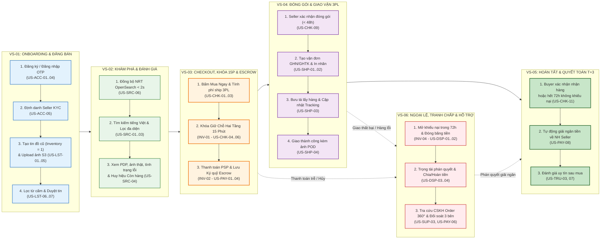
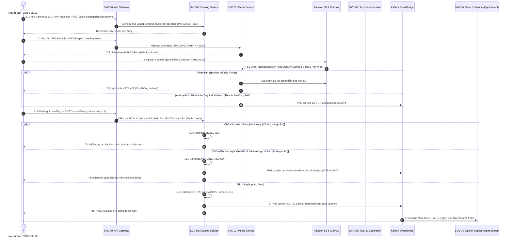
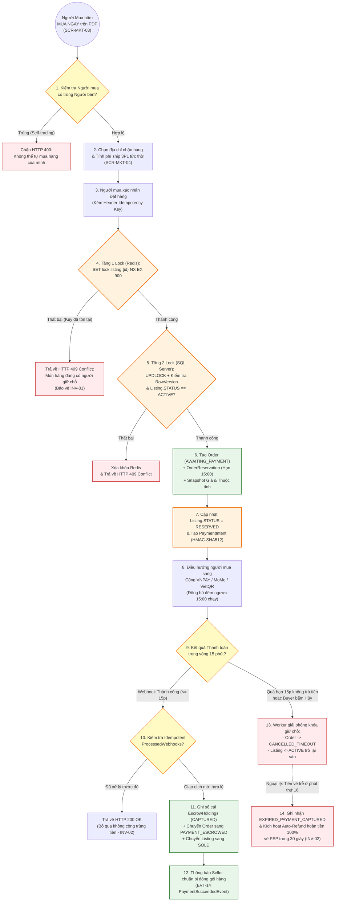
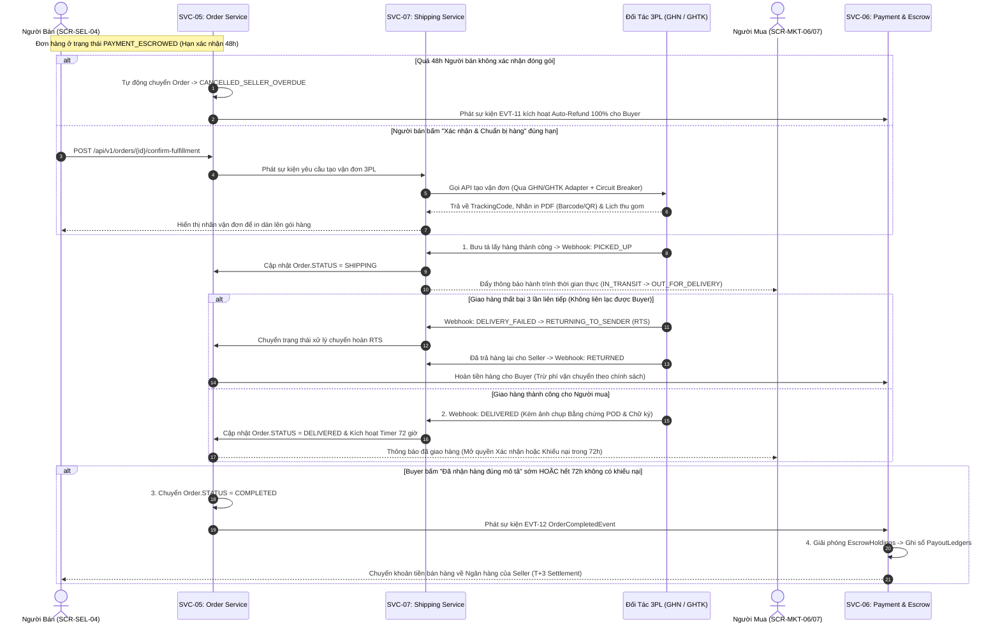
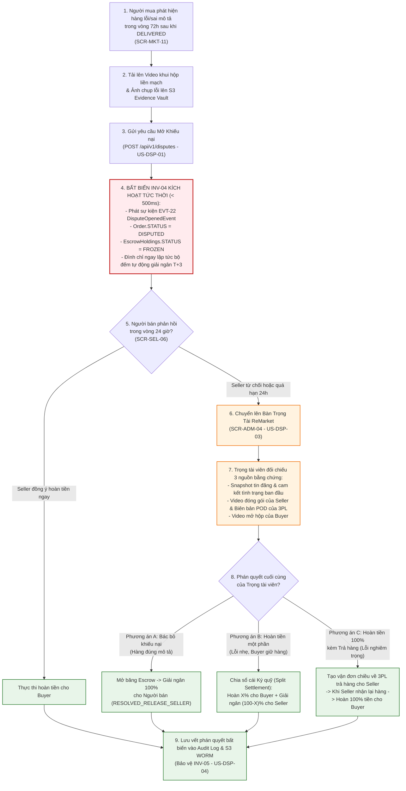
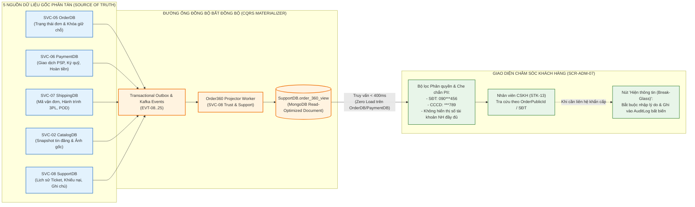

# Sơ Đồ Luồng Nghiệp Vụ & Chuỗi Giá Trị Đầu-Cuối (Business Process & Value Stream Diagrams) – ReMarket

## Thông tin tài liệu

| Thuộc tính | Giá trị |
|---|---|
| Dự án | ReMarket – Nền tảng Thương mại Điện tử Đồ cũ C2C/B2C Phân tán |
| Tài liệu | Tập hợp Sơ đồ Chuỗi Giá trị (`VS-01..06`) & Các Luồng Quy trình Nghiệp vụ Trọng yếu (`UC-01..26`) |
| Mã tài liệu | `DOC-BA-09-BIZ` |
| Phiên bản | 1.0 |
| Trạng thái | Hoàn thiện (Baseline Luồng Nghiệp vụ Đầu-Cuối) |
| Ngày cập nhật | 12/11/2026 |
| Phân hệ cha | [docs/BA/09_architecture-and-process-diagrams/README.md](file:///d:/remarket-platform-system/docs/BA/09_architecture-and-process-diagrams/README.md) |
| Tài liệu liên quan | [use-cases.md](file:///d:/remarket-platform-system/docs/BA/03_requirements/use-cases.md), [business-rules.md](file:///d:/remarket-platform-system/docs/BA/02_business-analysis/business-rules.md), [story-mapping-and-delivery-roadmap.md](file:///d:/remarket-platform-system/docs/BA/07_backlog-and-release/story-mapping-and-delivery-roadmap.md) |

---

## 1. Sơ Đồ Chuỗi Giá Trị Đầu-Cuối 6 Chặng (`DIAG-BIZ-01`: End-to-End Value Stream Map `VS-01..06`)

Sơ đồ mô tả bức tranh tổng thể 6 chặng dòng giá trị cốt lõi của ReMarket, kết nối hành trình của Người bán, Người mua và Đội ngũ Vận hành Sàn:

---

## 2. Sơ Đồ Luồng Đăng Tin Đồ Cũ, Tải Ảnh S3, Quét Mã Độc & Kiểm Duyệt (`DIAG-BIZ-02`: `UC-05..08`)

Sơ đồ Sequence chi tiết hóa quy trình từ lúc Người bán tạo tin đăng với thuộc tính động theo danh mục, tải ảnh trực tiếp lên Amazon S3 qua Presigned URL, quét virus bằng ClamAV, kiểm tra từ khóa cấm đến khi đồng bộ chỉ mục tìm kiếm OpenSearch dưới 2 giây:

---

## 3. Sơ Đồ Luồng Đặt Hàng Đơn Chiếc, Khóa 15 Phút & Thanh Toán Ký Quỹ (`DIAG-BIZ-03`: `UC-11..15`)

Sơ đồ mô tả luồng giao dịch cốt lõi nhất của ReMarket: Đặt mua món hàng đơn chiếc (`Inventory = 1`), kích hoạt khóa giữ chỗ 15 phút chống bán trùng (`INV-01`) và thanh toán qua cổng điện tử vào tài khoản ký quỹ (`INV-02`):

---

## 4. Sơ Đồ Luồng Giao Nhận 3PL, Bằng Chứng POD & Tự Động Giải Ngân T+3 (`DIAG-BIZ-04`: `UC-16..20`)

Sơ đồ mô tả luồng thực hiện đơn hàng từ lúc Người bán xác nhận đóng gói, tạo vận đơn tự động qua Adapter 3PL (GHN/GHTK), theo dõi hành trình bưu tá, xử lý giao thất bại/chuyển hoàn (RTS), đến khi tự động giải ngân tiền ký quỹ sau 72 giờ:

---

## 5. Sơ Đồ Luồng Khiếu Nại Tranh Chấp, Đóng Băng Ký Quỹ (`INV-04`) & Trọng Tài (`DIAG-BIZ-05`: `UC-25`)

Sơ đồ mô tả chi tiết cơ chế bảo vệ tiền người mua khi phát sinh tranh chấp hàng không đúng mô tả hoặc vỡ hỏng:

---

## 6. Sơ Đồ Luồng Hỗ Trợ Khách Hàng & Tra Cứu Hợp Nhất `Order 360°` (`DIAG-BIZ-06`: `UC-26`)

Sơ đồ minh họa cách nhân viên CSKH tra cứu toàn bộ lịch sử đơn hàng từ 5 dịch vụ phân tán trên một màn hình duy nhất (`SCR-ADM-07`) mà không gây tải lên CSDL giao dịch và bảo đảm che giấu thông tin nhạy cảm PII:

---

## 7. Lịch sử cập nhật

| Phiên bản | Ngày | Tác giả | Nội dung thay đổi |
|---|---|---|---|
| 1.0 | 12/11/2026 | Nhóm Phân tích Nghiệp vụ & Kiến trúc | Khởi tạo hoàn chỉnh 6 sơ đồ luồng nghiệp vụ và chuỗi giá trị đầu-cuối (`DIAG-BIZ-01..06`). |
