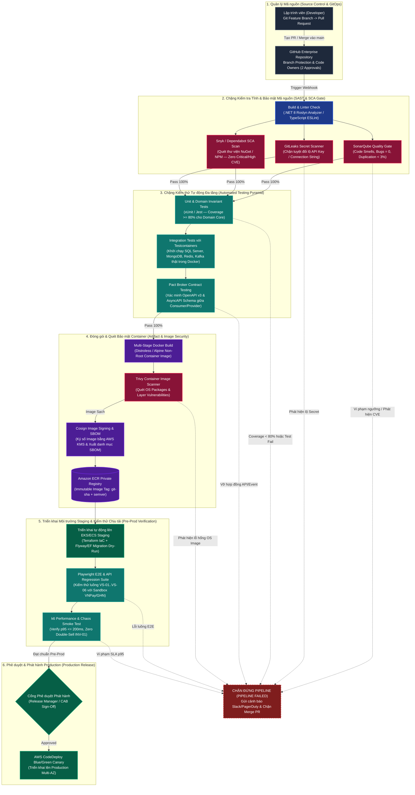
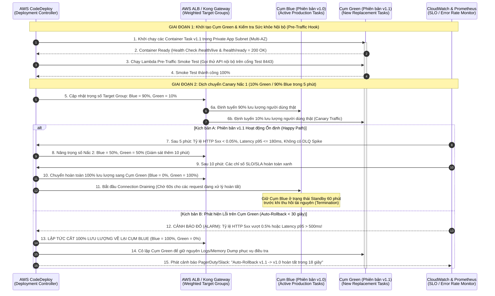
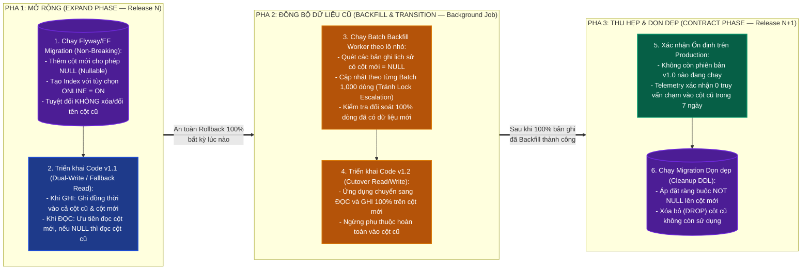

# Bộ Sơ đồ Đường ống CI/CD, Triển khai Zero-Downtime & Lộ trình Phát hành (CI/CD, Deployment & Release Roadmap Diagrams)

> **Mã tài liệu:** `DOC-BA-09-CIC`  
> **Phiên bản:** `v2.0`  
> **Ngày cập nhật:** `2026-11-12`  
> **Tác giả:** Senior Principal DevOps Architect & Lead Business Analyst  
> **Liên kết đối chiếu:** [non-functional-requirements.md](../03_requirements/non-functional-requirements.md), [dependencies-and-risks.md](../07_backlog-and-release/dependencies-and-risks.md), [story-mapping-and-delivery-roadmap.md](../07_backlog-and-release/story-mapping-and-delivery-roadmap.md), [non-functional-and-resilience-validation-plan.md](../08_validation-and-governance/non-functional-and-resilience-validation-plan.md)

---

## 1. Mục đích Tài liệu

Tài liệu này mô hình hóa trực quan quy trình tự động hóa tích hợp và triển khai liên tục (**DevSecOps CI/CD Pipeline**), chiến lược phát hành không gián đoạn dịch vụ (**Blue/Green & Canary Zero-Downtime Deployment**), quy trình tiến hóa lược đồ cơ sở dữ liệu không khóa bảng (**Expand-and-Contract Database Migration**), và **Sơ đồ Đường găng Dự án (Critical Path DAG)** trải dài qua 12 Sprints (24 tuần) của hệ thống **ReMarket Platform**.

Toàn bộ các sơ đồ dưới đây đảm bảo tuân thủ nghiêm ngặt chỉ tiêu `NFR-MNT-01..03` (Thời gian từ Git Commit đến Production `< 15 phút`, Tỷ lệ kiểm thử tự động `>= 80%`, Zero-Downtime Deployment `100%`) và `NFR-SEC-14` (Quét lỗ hổng bảo mật SAST/SCA/Container Image 100% trước khi phát hành).

---

## 2. `DIAG-CIC-01` — Đường ống CI/CD DevSecOps Tự động & Cổng Chất lượng (`Automated DevSecOps Pipeline & Quality Gates`)

### 2.1. Bối cảnh & Mục tiêu Kỹ thuật
Mỗi khi lập trình viên tạo Pull Request hoặc hợp nhất mã nguồn vào nhánh `main`, đường ống **GitHub Actions** kết hợp **AWS CodeDeploy** sẽ thực thi 6 chặng kiểm duyệt tự động (Quality Gates). Bất kỳ vi phạm nào về độ bao phủ kiểm thử (`< 80%`), lỗi hợp đồng giao tiếp giữa các Microservices (**Pact Consumer-Driven Contract Testing**), hoặc phát hiện lỗ hổng bảo mật mức `High/Critical` từ **SonarQube / Snyk / Trivy** đều ngay lập tức chặn đứng tiến trình Build (`Fail-Fast Gate`).

### 2.2. Sơ đồ Luồng Đường ống CI/CD (`DIAG-CIC-01`)

---

## 3. `DIAG-CIC-02` — Chiến lược Triển khai Zero-Downtime (`Blue/Green & Canary Deployment`) & Tự động Quay lui (`Instant Rollback`)

### 3.1. Bối cảnh & Mục tiêu Kỹ thuật
Khi phát hành phiên bản mới của các dịch vụ lõi (như `SVC-04 Order`, `SVC-05 Payment & Escrow`), hệ thống tuyệt đối không được làm rớt bất kỳ kết nối thanh toán hay giữ chỗ nào đang diễn ra. **AWS CodeDeploy** phối hợp cùng **Application Load Balancer (ALB)** và **ECS Fargate / EKS** thực hiện dịch chuyển lưu lượng theo từng nấc (**Canary Traffic Shifting**: `10%` trong 5 phút $\rightarrow$ `50%` trong 10 phút $\rightarrow$ `100%`), đồng thời giám sát chặt chẽ tỷ lệ lỗi `HTTP 5xx` và độ trễ `p95` qua **CloudWatch Alarms** để tự động quay lui (**Auto-Rollback `< 30 giây`**) nếu phát hiện bất thường.

### 3.2. Sơ đồ Tuần tự Triển khai Canary & Tự động Rollback (`DIAG-CIC-02`)

---

## 4. `DIAG-CIC-03` — Quy trình Nâng cấp Cơ sở Dữ liệu Không Khóa Bảng (`Expand-and-Contract Zero-Downtime Schema Migration`)

### 4.1. Bối cảnh & Mục tiêu Kỹ thuật
Trong suốt quá trình triển khai Canary (khi cả hai phiên bản ứng dụng `v1.0 Blue` và `v1.1 Green` cùng đọc/ghi vào một cơ sở dữ liệu **SQL Server** hoặc **MongoDB**), mọi thay đổi cấu trúc bảng (Schema Migration) tuyệt đối không được làm gãy truy vấn của phiên bản cũ (`Backward Compatibility`) và không được gây khóa bảng (`Table Lock`). ReMarket áp dụng bắt buộc mẫu **Expand-and-Contract (Parallel Change)** gồm 3 pha tách biệt.

### 4.2. Sơ đồ Quy trình Tiến hóa Lược đồ 3 Pha (`DIAG-CIC-03`)

---

## 5. `DIAG-CIC-04` — Sơ đồ Đường găng Dự án (`Critical Path DAG`) & Lộ trình Thực thi 12 Sprints qua 3 Đợt Phát hành (`R1`, `R2`, `R3`)

### 5.1. Bối cảnh & Mục tiêu Kỹ thuật
Sơ đồ mạng lưới phụ thuộc có hướng (**Directed Acyclic Graph — DAG**) dưới đây đồng bộ 100% với **12 Epics (`EP-ACC..EP-OPS`)**, **10 Architectural Enablers (`EN-01..10`)** và **10 Microservices (`SVC-00..09`)** trong **24 tuần (12 Sprints)** chia thành 3 đợt phát hành chuẩn tại [story-mapping-and-delivery-roadmap.md](../07_backlog-and-release/story-mapping-and-delivery-roadmap.md):
- **Release 1 — MVP Core Marketplace & Safe Escrow (Sprint 1 $\rightarrow$ 6 | Tuần 1–12):** Xây dựng đường găng từ Hạ tầng AWS/WAF/Network Firewall & Outbox (`EN-01..05`), Tài khoản & eKYC `>= 5M` (`EP-ACC` / `SVC-01`), Tin đăng `Inv=1`, `<= 30kg`, Media `<= 10MB` (`EP-LST` / `SVC-02`, `SVC-03`), Tìm kiếm OpenSearch (`EP-SRC` / `SVC-04`), Giữ chỗ 15m + Anti-Hoarding (`EP-CHK` / `SVC-05`), Prepaid Escrow `5%` & Bảo hiểm 3PL `>= 3M` (`EP-PAY`, `EP-SHP`, `EP-NTF` / `SVC-06`, `SVC-07`, `SVC-09`), đến Kiểm duyệt, Support 360° & DR Drill (`EP-TRU`, `EP-SUP`, `EP-OPS` / `SVC-08`).
- **Release 2 — Governance, Dispute & Financial Automation (Sprint 7 $\rightarrow$ 10 | Tuần 13–20):** Tự động hóa Khiếu nại `72h`, Đóng băng Escrow `< 500ms` & Reverse Logistics `72h/48h` (`EP-DSP`, `EP-TRU`), Giải ngân `T+3`, Khấu trừ `OverweightSurcharge` & Đối soát 3 bên `02:00 AM` (`EP-PAY`, `EP-SHP`), Danh mục động & 2FA/Thuế MST (`EP-ADM`, `EP-ACC`, `EP-LST`), Notification tùy biến, Sandbox 3PL/PSP & CQRS (`EP-NTF`, `EP-OPS`, `EN-08`).
- **Release 3 — Growth, Social Commerce & Scale Hardening (Sprint 11 $\rightarrow$ 12 | Tuần 21–24):** Đánh giá Bayes, Watchlist, Dashboard GMV, Chat 1-1 ẩn danh & `Private Price Offer` 24h (`EP-TRU`, `EP-ADM`, `EP-SRC`), tách Shard DB `5.000 TPS` & Nghiệm thu bàn giao (`EP-OPS`).

### 5.2. Sơ đồ Đường găng & Lộ trình 12 Sprints (`DIAG-CIC-04`)

```mermaid
flowchart LR
    classDef crit fill:#881337,stroke:#f43f5e,color:#ffffff,stroke-width:3px
    classDef r1 fill:#1e3a8a,stroke:#3b82f6,color:#ffffff,stroke-width:2px
    classDef r2 fill:#0f766e,stroke:#14b8a6,color:#ffffff,stroke-width:2px
    classDef r3 fill:#4c1d95,stroke:#8b5cf6,color:#ffffff,stroke-width:2px
    classDef mile fill:#b45309,stroke:#f59e0b,color:#ffffff,stroke-width:3px

    subgraph SG_R1["RELEASE 1: MVP CORE & SAFE ESCROW (Sprint 1 -> Sprint 6 | Tuần 1-12)"]
        direction TB
        S1_ACC["[Sprint 1-2] EN-01..03 & EP-ACC<br/>AWS Multi-AZ, WAF v2, Network FW, Kong (SVC-00)<br/>OAuth2/PKCE, RBAC & eKYC >= 5M (SVC-01)"]:::crit
        S2_LST["[Sprint 2-3] EP-LST<br/>Tin đăng Inv=1 (<=30kg), S3 Pre-signed (<=10MB)<br/>+ ClamAV & Video <=50MB (SVC-02, SVC-03)"]:::crit
        S3_SRC["[Sprint 3] EP-SRC<br/>OpenSearch NRT (< 2s), Facet Filtering<br/>& Trang chi tiết PDP (SVC-04)"]:::r1
        S4_CHK["[Sprint 4] EP-CHK & EN-04/05<br/>Two-Tier Lock 15m, Anti-Hoarding (2 holds/30m)<br/>& Transactional Outbox (SVC-05)"]:::crit
        S5_PAY["[Sprint 5] EP-PAY, EP-SHP & EP-NTF<br/>Prepaid Escrow (Phí 5%), VNPay/MoMo, 3PL + BH >=3M<br/>& Multi-Channel Alert (SVC-06, SVC-07, SVC-09)"]:::crit
        S6_SUP["[Sprint 6] EP-TRU, EP-SUP & EP-OPS<br/>Kiểm duyệt, CSKH 360, OTel (EN-09)<br/>& Diễn tập Backup DR (EN-10) (SVC-08)"]:::crit
        M1(("CỘT MỐC R1 MVP<br/>(Cuối Sprint 6 — Tuần 12)<br/>Core Marketplace Launch")):::mile
    end

    subgraph SG_R2["RELEASE 2: GOVERNANCE & AUTOMATION (Sprint 7 -> Sprint 10 | Tuần 13-20)"]
        direction TB
        S7_DSP["[Sprint 7] EP-DSP & EP-TRU<br/>Khiếu nại 72h sau Delivered, Đóng băng Escrow <500ms<br/>& Reverse Logistics 72h/48h (SVC-06, SVC-08)"]:::crit
        S8_REC["[Sprint 8] EP-PAY & EP-SHP<br/>Giải ngân T+3, Trừ OverweightSurcharge & RTS<br/>Đối soát 3 Bên 02:00 AM (SVC-06, SVC-07)"]:::crit
        S9_ADM["[Sprint 9] EP-ADM, EP-ACC & EP-LST<br/>Danh mục Động JSON Schema, 2FA Rút tiền<br/>& Tuân thủ MST/Thuế C2C (SVC-01, SVC-02, SVC-08)"]:::r2
        S10_OPT["[Sprint 10] EP-NTF, EP-OPS & EN-08<br/>Giờ yên lặng Notification, Sandbox 3PL/PSP<br/>& CQRS Order 360 Materializer (SVC-08, SVC-09)"]:::r2
        M2(("CỘT MỐC R2 GOVERNANCE<br/>(Cuối Sprint 10 — Tuần 20)<br/>Full Automation Launch")):::mile
    end

    subgraph SG_R3["RELEASE 3: GROWTH & SCALE (Sprint 11 -> Sprint 12 | Tuần 21-24)"]
        direction TB
        S11_GRO["[Sprint 11] EP-TRU, EP-ADM & Chat R3<br/>Bayes Rating, Watchlist, Dashboard GMV<br/>Chat ẩn danh PII & Private Offer 24h (SVC-04, SVC-05, SVC-08)"]:::r3
        S12_DR["[Sprint 12] EP-OPS & Scale/DR<br/>SQL/MongoDB Sharding, Load Test 5.000 TPS<br/>& Đánh giá COD R3+ Backlog"]:::crit
        M3(("CỘT MỐC R3 SCALE<br/>(Cuối Sprint 12 — Tuần 24)<br/>Production Scale Ready")):::mile
    end

    %% Đường găng (Critical Path)
    S1_ACC ==>|"Hạ tầng & eKYC"| S2_LST
    S2_LST ==>|"Tin đăng ACTIVE"| S4_CHK
    S2_LST --> S3_SRC
    S3_SRC --> S4_CHK
    S4_CHK ==>|"Lock 15 phút"| S5_PAY
    S5_PAY ==>|"Prepaid Escrow + 3PL"| S6_SUP
    S6_SUP ==> M1

    M1 ==> S7_DSP
    S7_DSP ==>|"Đóng băng INV-04"| S8_REC
    S8_REC --> S9_ADM
    S8_REC --> S10_OPT
    S9_ADM --> S10_OPT
    S10_OPT ==> M2

    M2 --> S11_GRO
    M2 ==> S12_DR
    S11_GRO ==> S12_DR
    S12_DR ==> M3
```

---

## 6. Bảng Đối chiếu Truy vết Sơ đồ (`Traceability Mapping`)

| Mã Sơ đồ | Tên Sơ đồ | Yêu cầu Phi chức năng & Epic Liên kết | Tiêu chuẩn Kiểm chứng (`Section 08`) |
| :--- | :--- | :--- | :--- |
| **`DIAG-CIC-01`** | Đường ống CI/CD DevSecOps Tự động & Cổng Chất lượng | `NFR-MNT-01`, `NFR-MNT-02`, `NFR-SEC-14`, `EN-01` | 100% PR chạy qua SonarQube, Snyk, Unit Test (`>= 80%`), Pact Contract Test và Trivy Scan trước khi lên ECR. |
| **`DIAG-CIC-02`** | Chiến lược Triển khai Zero-Downtime (`Blue/Green & Canary`) | `NFR-MNT-03`, `NFR-AVL-01`, `EP-CHK`, `EP-PAY` | Dịch chuyển lưu lượng `10% -> 50% -> 100%`; kích hoạt Auto-Rollback `< 30 giây` khi tỷ lệ `HTTP 5xx > 0.5%`. |
| **`DIAG-CIC-03`** | Nâng cấp Cơ sở Dữ liệu Không Khóa Bảng (`Expand-and-Contract`) | `NFR-MNT-03`, `NFR-PER-05` | Thực hiện 3 pha `Expand -> Backfill -> Contract`; tạo chỉ mục với `ONLINE = ON` không gây khóa giao dịch. |
| **`DIAG-CIC-04`** | Sơ đồ Đường găng Dự án (`Critical Path DAG`) & Lộ trình 12 Sprints | `EP-ACC..EP-OPS`, `EN-01..EN-10` | Tuân thủ đúng thứ tự phụ thuộc kỹ thuật qua 3 cột mốc `R1 MVP` (Sprint 6), `R2 Governance` (Sprint 10), `R3 Scale` (Sprint 12). |

