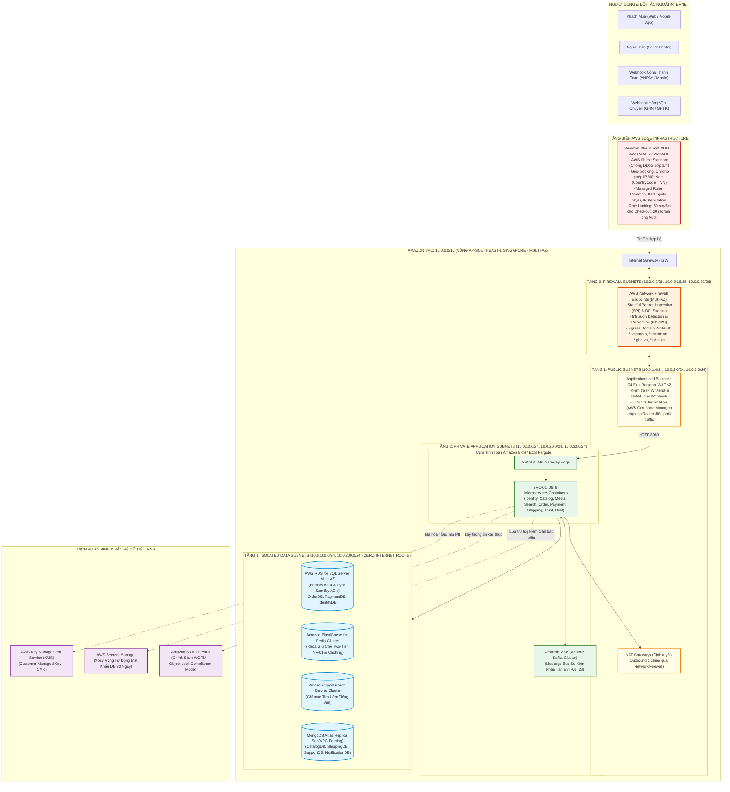
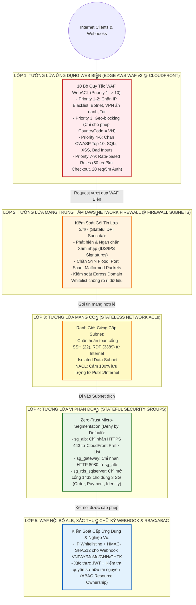
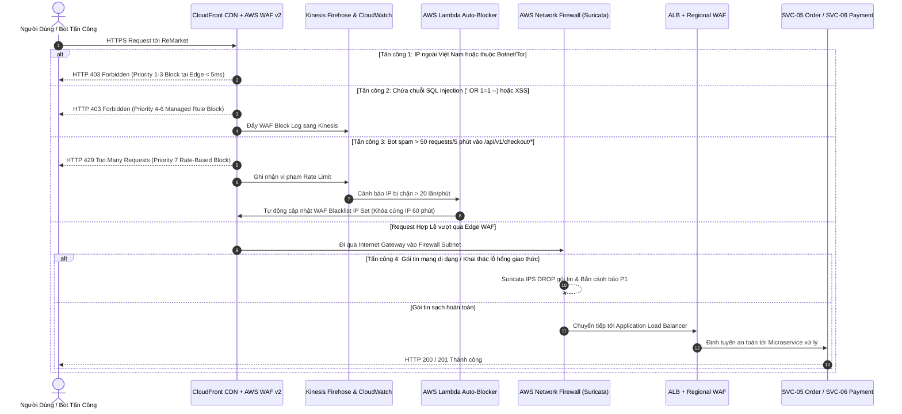
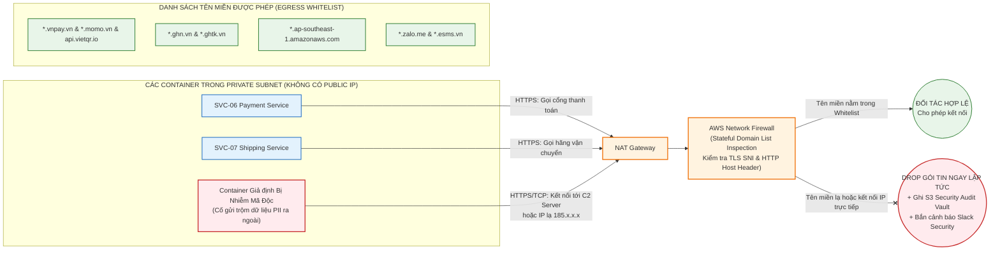
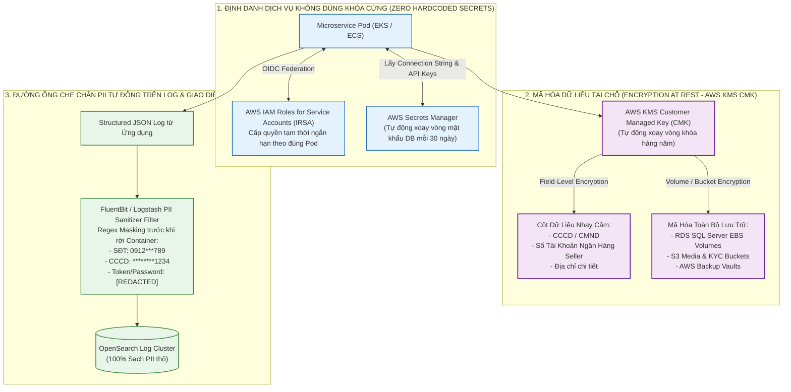

# Sơ Đồ Kiến Trúc Đám Mây AWS, Tường Lửa Mạng (Firewall), WAF v2 & An Ninh Dữ Liệu – ReMarket

## Thông tin tài liệu

| Thuộc tính | Giá trị |
|---|---|
| Dự án | ReMarket – Nền tảng Thương mại Điện tử Đồ cũ C2C/B2C Phân tán |
| Tài liệu | Tập hợp 5 Sơ đồ Trực quan Hạ tầng AWS Cloud, VPC 4 Tầng, Phòng thủ 5 Lớp, AWS Network Firewall, AWS WAF v2 & KMS/PII Security |
| Mã tài liệu | `DOC-BA-09-AWS-SEC` |
| Phiên bản | 1.1 |
| Trạng thái | Hoàn thiện (Chuẩn hóa Trực quan cho Kiến trúc An ninh Hạ tầng & Tường lửa) |
| Ngày cập nhật | 12/11/2026 |
| Phân hệ cha | [docs/BA/09_architecture-and-process-diagrams/README.md](file:///d:/remarket-platform-system/docs/BA/09_architecture-and-process-diagrams/README.md) |
| Tài liệu liên quan | [aws-cloud-and-network-architecture.md](file:///d:/remarket-platform-system/docs/BA/06_microservices-and-integrations/aws-cloud-and-network-architecture.md), [network-firewall-and-waf-security.md](file:///d:/remarket-platform-system/docs/BA/06_microservices-and-integrations/network-firewall-and-waf-security.md) |

---

## 1. Sơ Đồ Mạng AWS Multi-AZ 4 Tầng Subnet với Network Firewall & WAF (`DIAG-SEC-01`)

Sơ đồ thể hiện kiến trúc mạng AWS VPC (`10.0.0.0/16`) tại vùng `ap-southeast-1` (Singapore) phân tách thành **4 Tầng Subnet độc lập** trên 3 Availability Zones (`AZ-a`, `AZ-b`, `AZ-c`):

---

## 2. Sơ Đồ Kiến Trúc Phòng Thủ Đa Tầng 5 Lớp (`DIAG-SEC-02`: 5-Layer Defense-in-Depth)

Sơ đồ mô tả 5 hàng rào tường lửa nối tiếp nhau bảo vệ từ lớp biên CDN vào đến tận cơ sở dữ liệu lõi:

---

## 3. Sơ Đồ Trình Tự Lọc Gói Tin Qua WAF v2, Network Firewall & Auto-Mitigation (`DIAG-SEC-03`)

Sơ đồ Sequence minh họa cách hệ thống xử lý các cuộc tấn công thực tế và cơ chế tự động thêm IP tấn công vào danh sách đen bằng AWS Lambda:

---

## 4. Sơ Đồ Kiểm Soát Lưu Lượng Đi Ra Ngoài (`DIAG-SEC-04`: Egress Domain Whitelist Filtering)

Sơ đồ mô tả cơ chế ngăn chặn triệt để nguy cơ mã độc rò rỉ dữ liệu nhạy cảm ra ngoài Internet (Anti-Data Exfiltration):

---

## 5. Sơ Đồ Bảo Mật Dữ Liệu Nhạy Cảm: KMS, Secrets Manager, IRSA & Đường Ống Che Chắn PII (`DIAG-SEC-05`)

Sơ đồ mô tả kiến trúc bảo vệ dữ liệu cá nhân (PII: CCCD, SĐT, Tài khoản ngân hàng) ở cả 3 trạng thái: Khi truyền tải (In-Transit), Khi lưu trữ (At-Rest) và Khi ghi nhật ký/hiển thị (In-Use / Logging):

---

## 6. Lịch sử cập nhật

| Phiên bản | Ngày | Tác giả | Nội dung thay đổi |
|---|---|---|---|
| 1.0 | 12/11/2026 | Nhóm Kiến trúc An ninh & Đám mây | Khởi tạo 3 sơ đồ mạng VPC 4 tầng, WAF v2, Network Firewall và Egress Filtering. |
| 1.1 | 12/11/2026 | Nhóm Kiến trúc An ninh & Đám mây | Mở rộng hoàn chỉnh lên 5 sơ đồ chuẩn hóa (`DIAG-SEC-01..05`), bổ sung sơ đồ Phòng thủ 5 lớp và KMS/IRSA/PII Masking Pipeline. |
