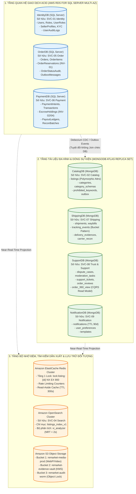
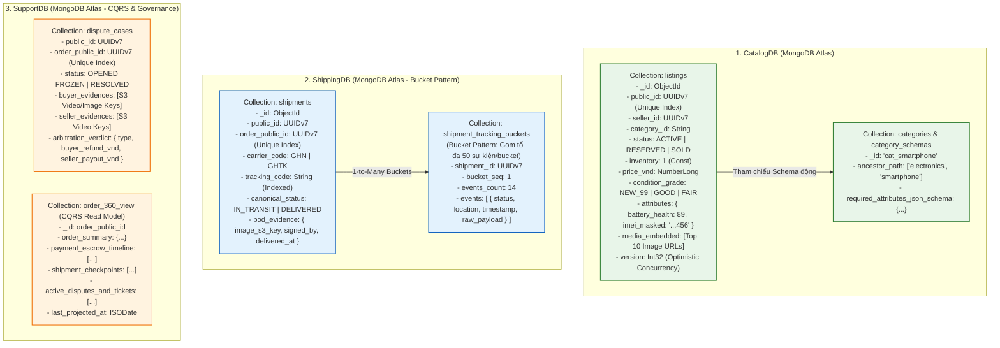
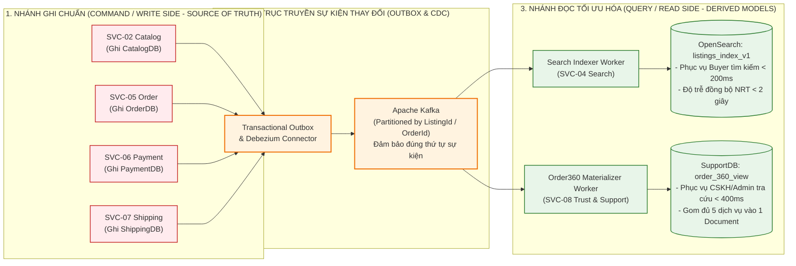
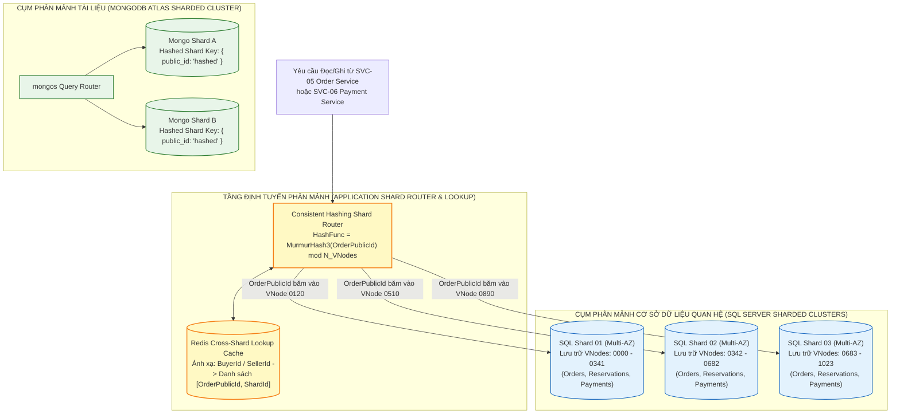
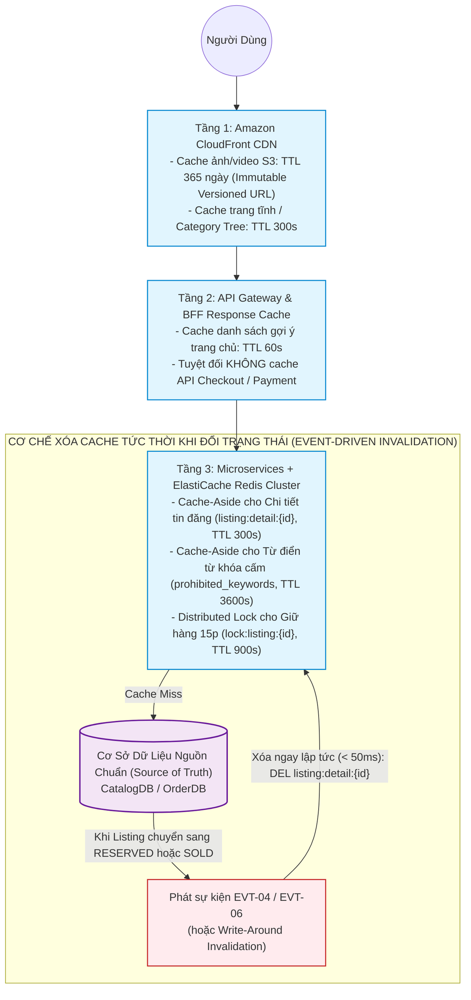

# Sơ Đồ Kiến Trúc Cơ Sở Dữ Liệu, ERD, Sharding, CQRS & Caching – ReMarket

## Thông tin tài liệu

| Thuộc tính | Giá trị |
|---|---|
| Dự án | ReMarket – Nền tảng Thương mại Điện tử Đồ cũ C2C/B2C Phân tán |
| Tài liệu | Tập hợp Sơ đồ Kiến trúc Polyglot Persistence, Dual-Key ERD, MongoDB Schemas, CQRS, Sharding & Caching |
| Mã tài liệu | `DOC-BA-09-DBA` |
| Phiên bản | 1.0 |
| Trạng thái | Hoàn thiện (Baseline Kiến trúc Dữ liệu Phân tán) |
| Ngày cập nhật | 12/11/2026 |
| Phân hệ cha | [docs/BA/09_architecture-and-process-diagrams/README.md](file:///d:/remarket-platform-system/docs/BA/09_architecture-and-process-diagrams/README.md) |
| Tài liệu liên quan | [entity-relationship-model.md](file:///d:/remarket-platform-system/docs/BA/05_domain-and-data/entity-relationship-model.md), [polyglot-persistence-and-db-architecture.md](file:///d:/remarket-platform-system/docs/BA/05_domain-and-data/polyglot-persistence-and-db-architecture.md), [sharding-and-partitioning-strategy.md](file:///d:/remarket-platform-system/docs/BA/05_domain-and-data/sharding-and-partitioning-strategy.md) |

---

## 1. Sơ Đồ Kiến Trúc Lưu Trữ Đa Mô Hình (`DIAG-DBA-01`: Polyglot Persistence Topology)

Sơ đồ minh họa nguyên tắc **Database-per-Service** và lựa chọn công nghệ lưu trữ tối ưu theo đặc thù tải của từng miền (`DEC-DIR-01`, `DEC-DIR-02`, `DEC-DIR-03`):

---

## 2. Sơ Đồ Quan Hệ Thực Thể Chuẩn Dual-Key Cho SQL Server (`DIAG-DBA-02`: Relational ERD)

Sơ đồ `erDiagram` mô tả kiến trúc **Dual-Key (`InternalId BIGINT IDENTITY` làm Clustered Primary Key chống phân mảnh B-Tree + `PublicId UNIQUEIDENTIFIER UUIDv7` làm Non-Clustered Unique Index tiếp xúc ra API)** trên `IdentityDB`, `OrderDB` và `PaymentDB`:

```mermaid
erDiagram
    USERS ||--o{ USER_ADDRESSES : "has"
    USERS ||--o| SELLER_PROFILES : "upgrades_to"
    USERS {
        bigint InternalId PK "IDENTITY(1,1) Clustered"
        uniqueidentifier PublicId UK "UUIDv7 Public ID"
        varchar PhoneNumber UK "Encrypted / Indexed"
        varchar PasswordHash "BCrypt Cost 12"
        varchar AccountStatus "ACTIVE, SUSPENDED, BANNED"
        bit Is2FAEnabled "TOTP / SMS 2FA"
        rowversion ConcurrencyStamp "Optimistic Lock"
    }
    SELLER_PROFILES {
        bigint InternalId PK
        bigint UserInternalId FK
        varchar KycStatus "PENDING, VERIFIED, REJECTED"
        varchar BankAccountEncrypted "KMS Encrypted"
        decimal ReputationScore "Bayesian Score"
    }

    ORDERS ||--|| ORDER_ITEMS : "contains_single_item"
    ORDERS ||--o{ ORDER_RESERVATIONS : "guards_15m_hold"
    ORDERS ||--o{ ORDER_STATUS_AUDIT : "tracks_history"
    ORDERS {
        bigint InternalId PK "IDENTITY(1,1) Clustered"
        uniqueidentifier PublicId UK "UUIDv7 Order Code"
        uniqueidentifier BuyerPublicId "Logical Ref to IdentityDB"
        uniqueidentifier SellerPublicId "Logical Ref to IdentityDB"
        uniqueidentifier ListingPublicId "Logical Ref to CatalogDB"
        decimal ItemPriceVnd "DECIMAL(18,0)"
        decimal ShippingFeeVnd "DECIMAL(18,0)"
        decimal TotalAmountVnd "DECIMAL(18,0)"
        varchar OrderStatus "CREATED, AWAITING_PAYMENT, PAYMENT_ESCROWED, SHIPPING, DELIVERED, COMPLETED, DISPUTED, CANCELLED"
        datetime2 CreatedAtUtc "Partition Key Candidate"
        rowversion RowVersionStamp "Protects State Transitions"
    }
    ORDER_ITEMS {
        bigint InternalId PK
        bigint OrderInternalId FK
        nvarchar ListingSnapshotJson "Immutable Snapshot of Title, Condition, Images at Buy Time"
    }
    ORDER_RESERVATIONS {
        bigint InternalId PK
        bigint OrderInternalId FK
        uniqueidentifier ListingPublicId "Filtered Unique Index WHERE Status = ACTIVE"
        varchar ReservationStatus "ACTIVE, CONSUMED, EXPIRED, RELEASED"
        datetime2 ExpiresAtUtc "CreatedAt + 15 Minutes"
    }

    PAYMENT_INTENTS ||--o{ PAYMENT_TRANSACTIONS : "records_attempts"
    PAYMENT_INTENTS ||--o| ESCROW_HOLDINGS : "locks_funds"
    ESCROW_HOLDINGS ||--o{ PAYOUT_LEDGERS : "settles_or_refunds"
    PAYMENT_INTENTS {
        bigint InternalId PK
        uniqueidentifier PublicId UK "UUIDv7"
        uniqueidentifier OrderPublicId UK "Logical Ref to OrderDB"
        varchar IdempotencyKey UK "Prevents Duplicate Intent"
        decimal AmountVnd "DECIMAL(18,0)"
        varchar ProviderCode "VNPAY, MOMO, VIETQR"
        varchar IntentStatus "CREATED, CAPTURED, EXPIRED, FAILED"
    }
    PAYMENT_TRANSACTIONS {
        bigint InternalId PK
        bigint PaymentIntentInternalId FK
        varchar ProviderTxnRef UK "Unique Index for Webhook Idempotency (INV-02)"
        varchar TxnType "CAPTURE, AUTO_REFUND, DISPUTE_REFUND"
        varchar TxnStatus "SUCCEEDED, FAILED"
        datetime2 ProcessedAtUtc
    }
    ESCROW_HOLDINGS {
        bigint InternalId PK
        bigint PaymentIntentInternalId FK
        uniqueidentifier OrderPublicId UK
        decimal HeldAmountVnd "DECIMAL(18,0)"
        varchar EscrowStatus "CAPTURED, FROZEN_BY_DISPUTE, RELEASED, REFUNDED, SPLIT_SETTLED"
        datetime2 AutoReleaseAfterUtc "DeliveredAt + 72 Hours"
        rowversion RowVersionStamp "Protects INV-04 Freeze"
    }
    PAYOUT_LEDGERS {
        bigint InternalId PK
        bigint EscrowInternalId FK
        varchar EntryDirection "DEBIT_ESCROW, CREDIT_SELLER, CREDIT_BUYER_REFUND, CREDIT_PLATFORM_FEE"
        decimal EntryAmountVnd "Double-Entry Bookkeeping (Sum = 0)"
        datetime2 CreatedAtUtc
    }
```

---

## 3. Sơ Đồ Cấu Trúc Document Schema & Hybrid Pattern Cho MongoDB (`DIAG-DBA-03`)

Sơ đồ mô tả cách thiết kế các Collection trên MongoDB Atlas để vừa tận dụng tính linh hoạt của JSON Schema đa hình (Polymorphic Attributes cho đồ cũ), vừa tránh lỗi phình to kích thước Document vượt giới hạn 16MB (nhờ Bucket & Outlier Pattern):

---

## 4. Sơ Đồ Kiến Trúc Tách Đọc/Ghi CQRS Read Model (`DIAG-DBA-04`: CQRS Synchronization Pipeline)

Sơ đồ minh họa nguyên tắc **`DEC-DIR-06`**: Dữ liệu giao dịch gốc (Source of Truth) nằm ở `OrderDB`, `PaymentDB`, `CatalogDB`; dữ liệu phục vụ tìm kiếm (`OpenSearch`) và tra cứu hợp nhất CSKH (`Order360View`) là dữ liệu dẫn xuất bất đồng bộ (Derived Read Models):

---

## 5. Sơ Đồ Chiến Lược Phân Mảnh Ngang Khi Vượt Ngưỡng 2TB (`DIAG-DBA-05`: Horizontal Sharding Architecture)

Sơ đồ mô tả kiến trúc mở rộng quy mô ngang ở **Release 3** khi dung lượng `OrderDB`/`PaymentDB` vượt ngưỡng **2TB** hoặc thông lượng vượt **5.000 TPS**:

---

## 6. Sơ Đồ Chiến Lược Bộ Nhớ Đệm Đa Tầng & Xóa Cache Tức Thời (`DIAG-DBA-06`: Multi-Tier Caching)

Sơ đồ mô tả 3 tầng bộ nhớ đệm và cơ chế chống đọc dữ liệu cũ (Stale Read Prevention) đối với trạng thái tin đăng đồ cũ đơn chiếc:

---

## 7. Lịch sử cập nhật

| Phiên bản | Ngày | Tác giả | Nội dung thay đổi |
|---|---|---|---|
| 1.0 | 12/11/2026 | Nhóm Kiến trúc Dữ liệu & DBA | Khởi tạo hoàn chỉnh 6 sơ đồ kiến trúc cơ sở dữ liệu, Dual-Key ERD, MongoDB Schemas, CQRS, Sharding và Multi-Tier Caching (`DIAG-DBA-01..06`). |
