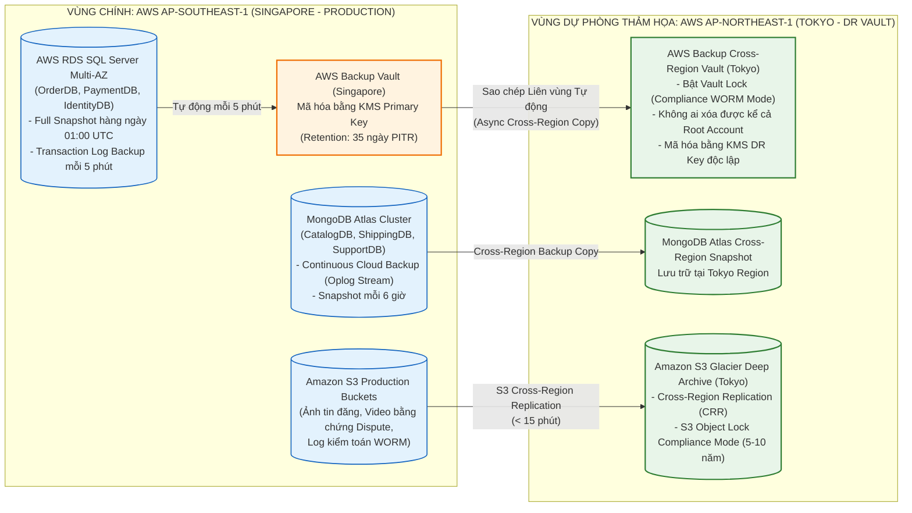
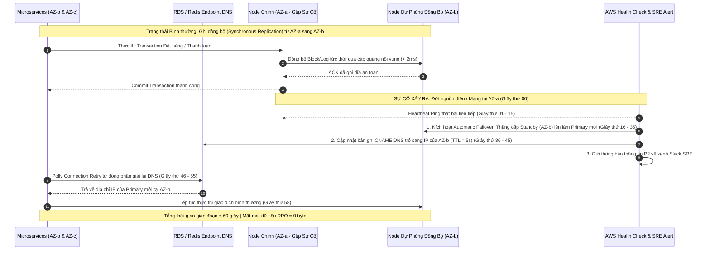
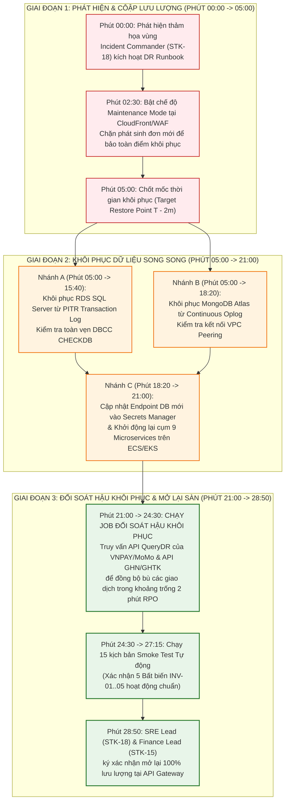
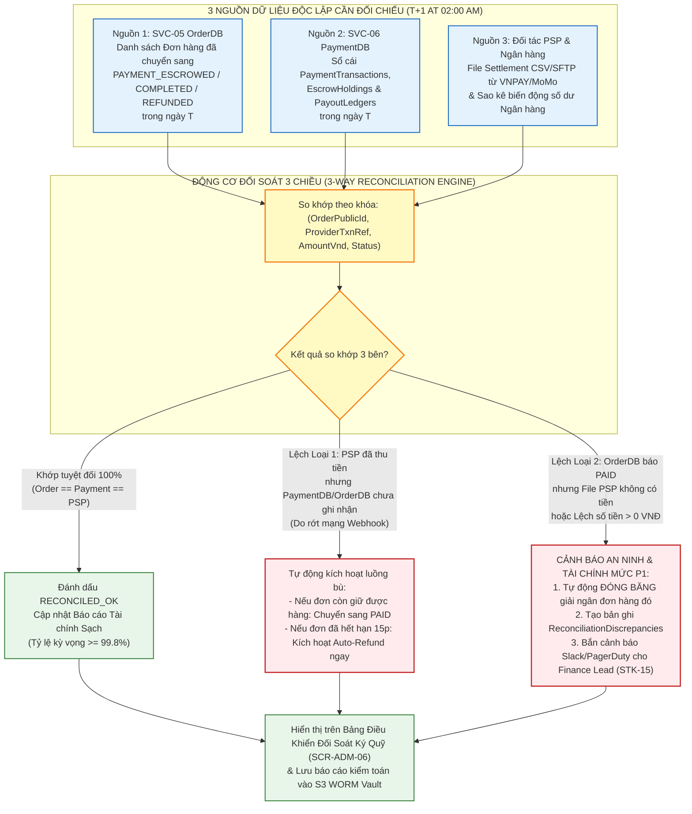
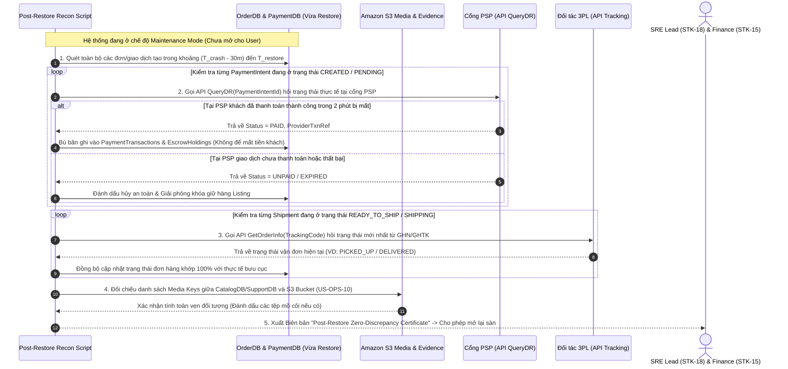

# Sơ Đồ Sao Lưu Phục Hồi Thảm Họa (DR/Backup) & Đối Soát Tài Chính 3 Bên – ReMarket

## Thông tin tài liệu

| Thuộc tính | Giá trị |
|---|---|
| Dự án | ReMarket – Nền tảng Thương mại Điện tử Đồ cũ C2C/B2C Phân tán |
| Tài liệu | Tập hợp 5 Sơ đồ Sao lưu PITR Liên vùng (`INV-05`), Chuyển đổi Dự phòng Multi-AZ, Kịch bản Bấm giờ DR Drill, Đối soát 3 Bên & Đối soát Hậu Khôi phục |
| Mã tài liệu | `DOC-BA-09-DRR` |
| Phiên bản | 1.0 |
| Trạng thái | Hoàn thiện (Baseline Phục hồi Thảm họa & Kiểm toán Tài chính) |
| Ngày cập nhật | 12/11/2026 |
| Phân hệ cha | [docs/BA/09_architecture-and-process-diagrams/README.md](file:///d:/remarket-platform-system/docs/BA/09_architecture-and-process-diagrams/README.md) |
| Tài liệu liên quan | [replication-high-availability-and-consistency.md](file:///d:/remarket-platform-system/docs/BA/05_domain-and-data/replication-high-availability-and-consistency.md), [data-lifecycle-and-retention.md](file:///d:/remarket-platform-system/docs/BA/05_domain-and-data/data-lifecycle-and-retention.md), [observability-tracing-and-reconciliation.md](file:///d:/remarket-platform-system/docs/BA/06_microservices-and-integrations/observability-tracing-and-reconciliation.md) |

---

## 1. Sơ Đồ Kiến Trúc Sao Lưu Tự Động PITR & Sao Chép Liên Vùng (`DIAG-DRR-01`: Bảo Vệ `INV-05`)

Sơ đồ mô tả kiến trúc sao lưu đa tầng tại Vùng chính **Singapore (`ap-southeast-1`)** và sao chép bất biến sang Vùng dự phòng **Tokyo (`ap-northeast-1`)** kết hợp khóa chống xóa mã hóa tống tiền **S3 Object Lock WORM (Write-Once-Read-Many)**:

### Bảng Cam kết Mục tiêu Phục hồi (`RPO` & `RTO`) theo Phân loại Dữ liệu:

| Phân loại Dữ liệu | Hệ Quản Trị | Cơ Chế Sao Lưu | Cam Kết RPO | Cam Kết RTO | Thời Hạn Lưu Giữ |
|---|---|---|:---:|:---:|---|
| **Hạng 1: Giao dịch & Tài chính** (`OrderDB`, `PaymentDB`, `IdentityDB`) | RDS SQL Server | Multi-AZ Sync + PITR Log 5m | **<= 5 phút** (Multi-AZ = 0s) | **<= 30 phút** (Multi-AZ < 60s) | 35 ngày PITR + 10 năm WORM |
| **Hạng 2: Tin đăng, Vận đơn & Tranh chấp** (`CatalogDB`, `ShippingDB`, `SupportDB`) | MongoDB Atlas | Replica Set 3 Nodes + Continuous Oplog | **<= 5 phút** | **<= 30 phút** | 30 ngày PITR + 5 năm Archive |
| **Hạng 3: Ảnh & Video Bằng chứng** (`S3 Media & Evidence`) | Amazon S3 | Versioning + CRR sang Tokyo | **<= 15 phút** | **<= 15 phút** | 5 năm (WORM cho Dispute) |
| **Hạng 4: Dữ liệu Dẫn xuất** (`OpenSearch`, `Redis Cache`) | OpenSearch / Redis | Rebuild từ Source of Truth / Snapshot | Tái tạo từ DB gốc | **<= 45 phút** | Không yêu cầu lưu lịch sử |

---

## 2. Sơ Đồ Chuyển Đổi Dự Phòng Tự Động Nội Vùng (`DIAG-DRR-02`: Multi-AZ High Availability Failover < 60s)

Sơ đồ mô tả cách hệ thống tự động vượt qua sự cố sập một Trung tâm dữ liệu (Availability Zone `AZ-a`) mà không cần con người can thiệp và không mất bất kỳ giao dịch nào (`RPO = 0`):

---

## 3. Sơ Đồ Quy Trình Bấm Giờ Khôi Phục Thảm Họa Toàn Vùng (`DIAG-DRR-03`: Stopwatch DR Restore Drill)

Sơ đồ mô tả quy trình khôi phục thảm họa theo kịch bản diễn tập thực tế (đã định nghĩa tại `08_validation-and-governance/non-functional-and-resilience-validation-plan.md`), chứng minh đạt chuẩn **`RPO <= 5 phút`** và **`RTO <= 30 phút`**:

---

## 4. Sơ Đồ Động Cơ Đối Soát Tài Chính 3 Bên Tự Động Lúc 02:00 Sáng (`DIAG-DRR-04`: 3-Way Financial Reconciliation)

Sơ đồ mô tả luồng vận hành của **Động cơ Đối soát Tài chính 3 Chiều (`FT-15`, `US-PAY-06, 09`)** đối chiếu từng đồng VNĐ giữa `OrderDB`, `PaymentDB` và File Quyết toán từ Cổng PSP / Sao kê Ngân hàng:

---

## 5. Sơ Đồ Quy Trình Đối Soát Bù Đắp Hậu Khôi Phục Thảm Họa (`DIAG-DRR-05`: Post-Restore State Reconciliation)

Sơ đồ giải quyết câu hỏi mở trọng yếu **`Q-DR-05`**: Khi khôi phục cơ sở dữ liệu từ bản sao lưu PITR (ví dụ bị lùi về quá khứ 2 phút), làm thế nào để đồng bộ lại trạng thái với Cổng thanh toán VNPAY/MoMo, Hãng vận chuyển GHN/GHTK và Amazon S3 trước khi mở lại sàn?

---

## 6. Lịch sử cập nhật

| Phiên bản | Ngày | Tác giả | Nội dung thay đổi |
|---|---|---|---|
| 1.0 | 12/11/2026 | Nhóm Kiến trúc Dữ liệu, SRE & Tài chính | Khởi tạo hoàn chỉnh 5 sơ đồ sao lưu PITR liên vùng, Multi-AZ Failover, DR Drill, Đối soát 3 bên và Đối soát hậu khôi phục (`DIAG-DRR-01..05`). |

