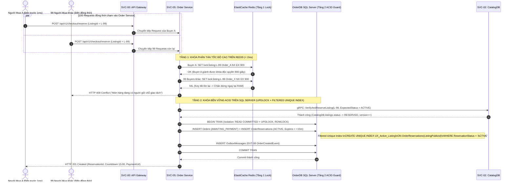
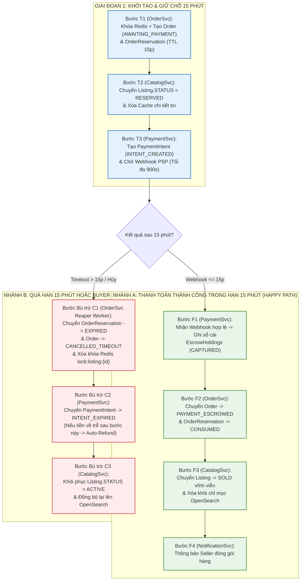
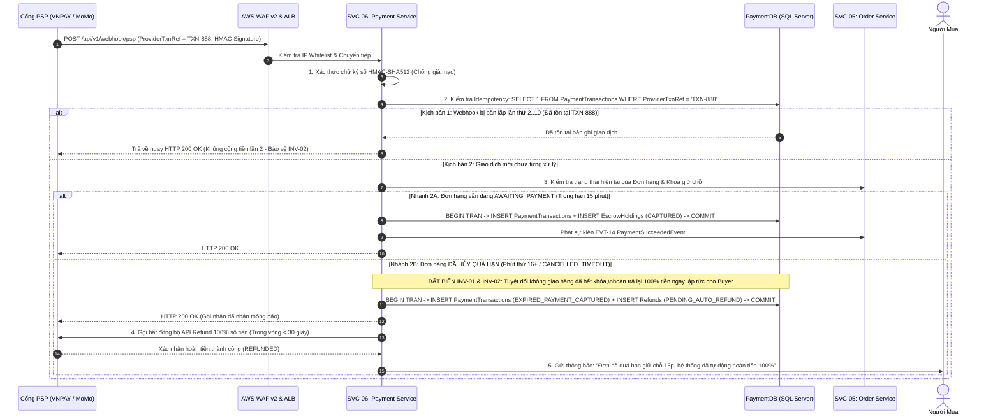
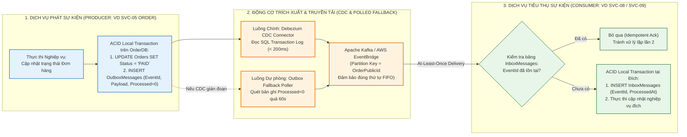
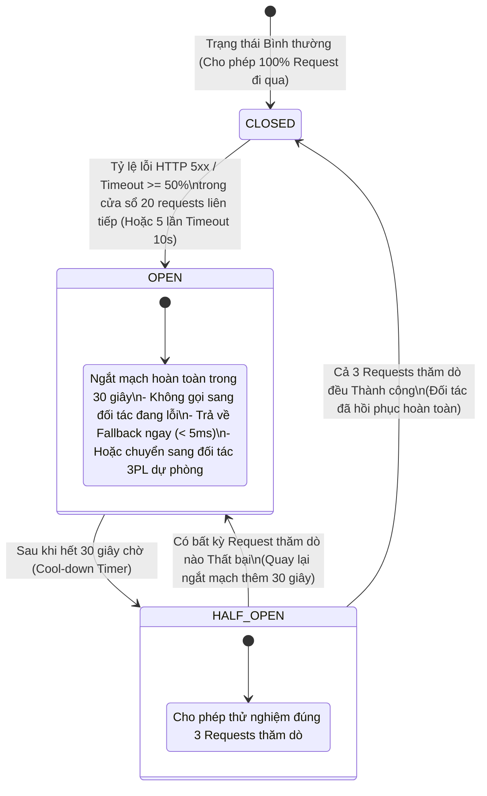
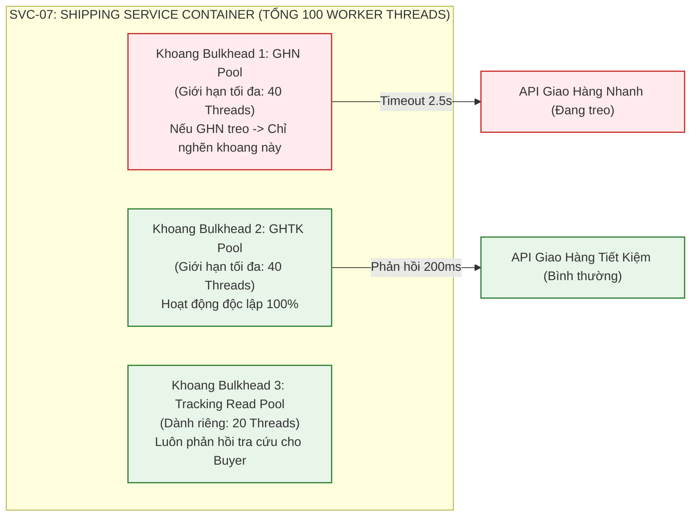

# Sơ Đồ Giao Dịch Phân Tán, Khóa Đồng Thời & Khả Năng Chịu Lỗi (Distributed Transactions & Resilience Diagrams) – ReMarket

## Thông tin tài liệu

| Thuộc tính | Giá trị |
|---|---|
| Dự án | ReMarket – Nền tảng Thương mại Điện tử Đồ cũ C2C/B2C Phân tán |
| Tài liệu | Tập hợp Sơ đồ Khóa Giữ hàng Hai Tầng (`INV-01`), Saga Đặt hàng, Webhook Idempotent (`INV-02`), Transactional Outbox (`INV-03`), Circuit Breaker & DLQ |
| Mã tài liệu | `DOC-BA-09-DST` |
| Phiên bản | 1.0 |
| Trạng thái | Hoàn thiện (Baseline Kiến trúc Giao dịch Phân tán & Chịu lỗi) |
| Ngày cập nhật | 12/11/2026 |
| Phân hệ cha | [docs/BA/09_architecture-and-process-diagrams/README.md](file:///d:/remarket-platform-system/docs/BA/09_architecture-and-process-diagrams/README.md) |
| Tài liệu liên quan | [concurrency-locking-and-distributed-transactions.md](file:///d:/remarket-platform-system/docs/BA/05_domain-and-data/concurrency-locking-and-distributed-transactions.md), [resilience-fault-tolerance-and-rate-limiting.md](file:///d:/remarket-platform-system/docs/BA/06_microservices-and-integrations/resilience-fault-tolerance-and-rate-limiting.md) |

---

## 1. Sơ Đồ Động Cơ Khóa Giữ Hàng Hai Tầng 15 Phút (`DIAG-DST-01`: Two-Tier Reservation Lock – Bảo Vệ `INV-01`)

Sơ đồ Sequence chi tiết từng mili-giây khi 100 Người mua cùng bấm "Mua Ngay" một món hàng độc bản (`Inventory = 1`) tại cùng một thời điểm:

---

## 2. Sơ Đồ Saga Điều Phối Đặt Hàng & Bù Trừ Khi Quá Hạn 15 Phút (`DIAG-DST-02`: Checkout & Expiration Compensation Saga)

Sơ đồ mô tả đầy đủ hai nhánh của Saga Đặt hàng: **Nhánh Thành công (Forward Recovery)** và **Nhánh Bù trừ Tự động khi Hết hạn 15 phút (Backward Compensation)**:

---

## 3. Sơ Đồ Xử Lý Idempotent Webhook & Tự Động Hoàn Tiền Khi Thanh Toán Trễ Phút 16 (`DIAG-DST-03`: Bảo Vệ `INV-02`)

Sơ đồ mô tả cách `SVC-06 Payment Service` xử lý hai bài toán hóc búa nhất của thanh toán phân tán: (1) Đối tác PSP bắn lặp nhiều lần cùng một Webhook và (2) Người mua thanh toán sát giờ khiến tiền về ở phút thứ 16 sau khi khóa giữ hàng đã hết hạn:

---

## 4. Sơ Đồ Kiến Trúc Transactional Outbox, Debezium CDC & Idempotent Inbox (`DIAG-DST-04`: Bảo Vệ `INV-03`)

Sơ đồ mô tả cơ chế đảm bảo **Zero Lost Events (`INV-03`)** và **Exactly-Once Processing Semantics** giữa các Microservices mà không cần dùng giao dịch 2 pha (2PC) gây nghẽn cổ chai:

---

## 5. Sơ Đồ Máy Trạng Thái Circuit Breaker, Bulkhead Isolation & Timeout Budget (`DIAG-DST-05`)

Sơ đồ mô tả cơ chế tự bảo vệ của ReMarket khi các hệ thống bên ngoài (VNPAY, MoMo, GHN, GHTK) hoặc một thành phần phụ thuộc gặp sự cố chậm/treo:

### Sơ đồ Cô lập Khoang Chịu Lỗi (Bulkhead Thread/Connection Pool Isolation):

---

## 6. Sơ Đồ Cô Lập Tin Nhắn Lỗi Vào Dead Letter Queue (DLQ) & Công Cụ Replay (`DIAG-DST-06`)

Sơ đồ mô tả quy trình xử lý tin nhắn lỗi (Poison Pill / Transient Failure) qua 3 cấp thử lại trước khi đưa vào hàng đợi chết (DLQ) và công cụ phát lại (Replay) dành cho SRE (`US-OPS-07`):

```mermaid
flowchart LR
    MAIN_Q["Hàng Đợi Chính\n(Main Kafka Topic / SQS Queue)"] --> CONSUMER["Event Consumer Worker"]

    CONSUMER --> RESULT{"Xử lý thành công?"}
    RESULT -- "Thành công" --> COMMIT["Commit Offset\n& Ghi InboxMessages"]

    RESULT -- "Lỗi tạm thời / Poison Pill" --> RETRY_1["Retry Lần 1\n(Chờ 2 giây + Jitter)"]
    RETRY_1 --> R1_OK{"Thành công?"}
    R1_OK -- "Không" --> RETRY_2["Retry Lần 2\n(Chờ 10 giây + Jitter)"]
    RETRY_2 --> R2_OK{"Thành công?"}
    R2_OK -- "Không" --> RETRY_3["Retry Lần 3\n(Chờ 60 giây + Jitter)"]
    RETRY_3 --> R3_OK{"Thành công?"}

    R1_OK & R2_OK & R3_OK -- "Có" --> COMMIT
    R3_OK -- "Thất bại sau 3 lần" --> DLQ[("Dead Letter Queue (SQS DLQ)\nLưu giữ bản tin lỗi + StackTrace\n(Retention: 14 ngày)")]

    DLQ --> ALERT["Kích hoạt Cảnh báo P2:\nBắn tin nhắn Slack & PagerDuty cho SRE"]
    ALERT --> SRE_TOOL["SRE Admin Replay UI (US-OPS-07):\n1. Kỹ sư kiểm tra & sửa lỗi logic/dữ liệu\n2. Bấm 'Replay Selected Messages'\n3. Đẩy ngược bản tin về Main Queue an toàn"]
    SRE_TOOL -.-> MAIN_Q

    classDef main fill:#e3f2fd,stroke:#1565c0,stroke-width:1.5px;
    classDef rty fill:#fff3e0,stroke:#ef6c00,stroke-width:1.5px;
    classDef dlq fill:#ffebee,stroke:#c62828,stroke-width:2px;
    classDef ok fill:#e8f5e9,stroke:#2e7d32,stroke-width:1.5px;
    class MAIN_Q,CONSUMER main;
    class RETRY_1,RETRY_2,RETRY_3 rty;
    class DLQ,ALERT dlq;
    class COMMIT,SRE_TOOL ok;
```

---

## 7. Lịch sử cập nhật

| Phiên bản | Ngày | Tác giả | Nội dung thay đổi |
|---|---|---|---|
| 1.0 | 12/11/2026 | Nhóm Kiến trúc Phân tán & SRE | Khởi tạo hoàn chỉnh 6 sơ đồ giao dịch phân tán, khóa đồng thời và khả năng chịu lỗi (`DIAG-DST-01..06`). |
