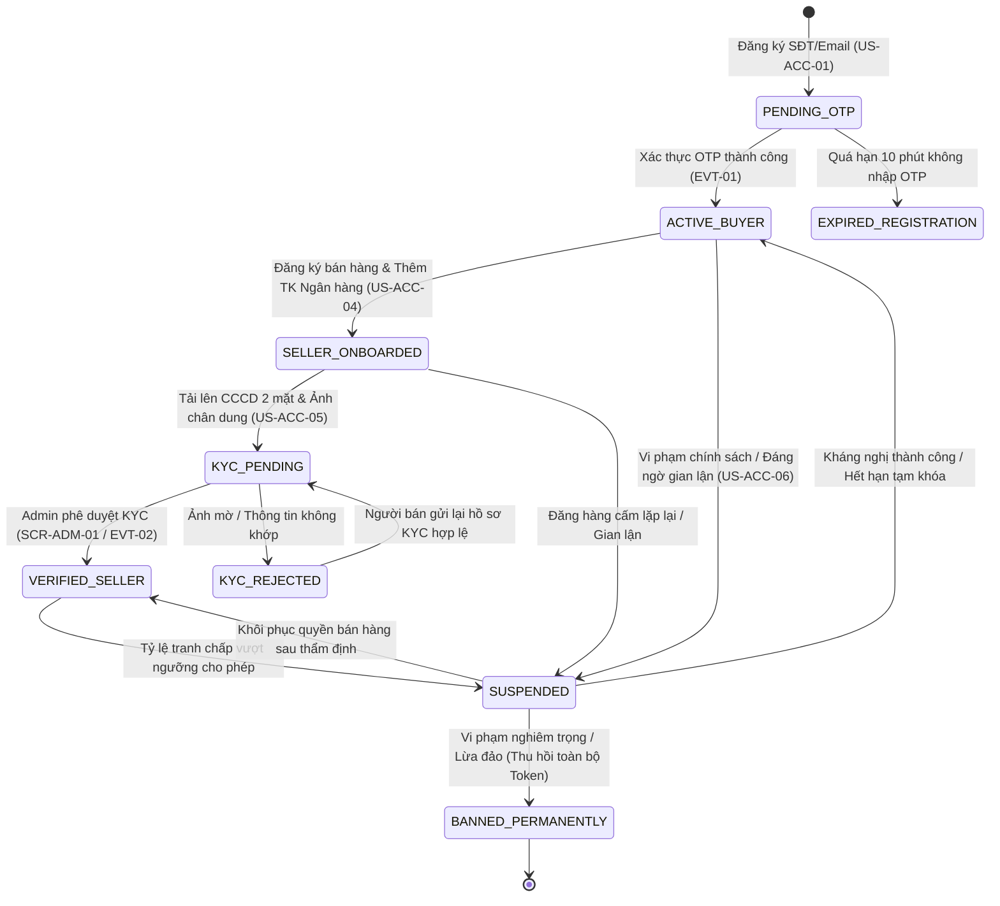
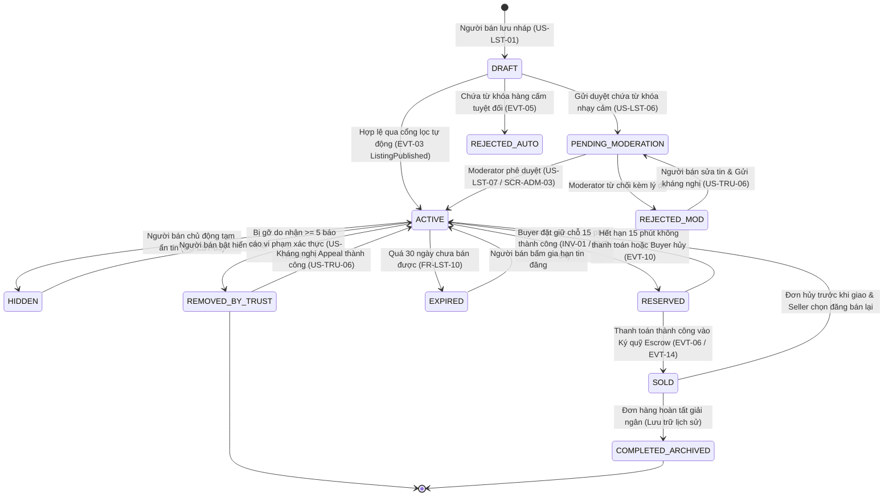
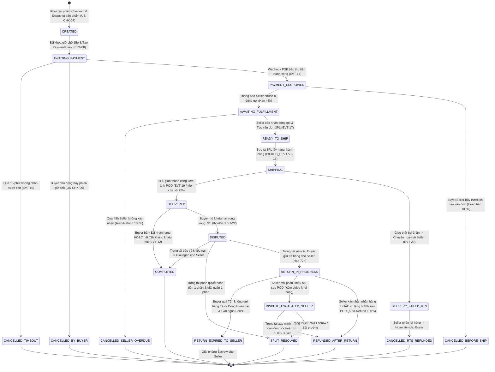
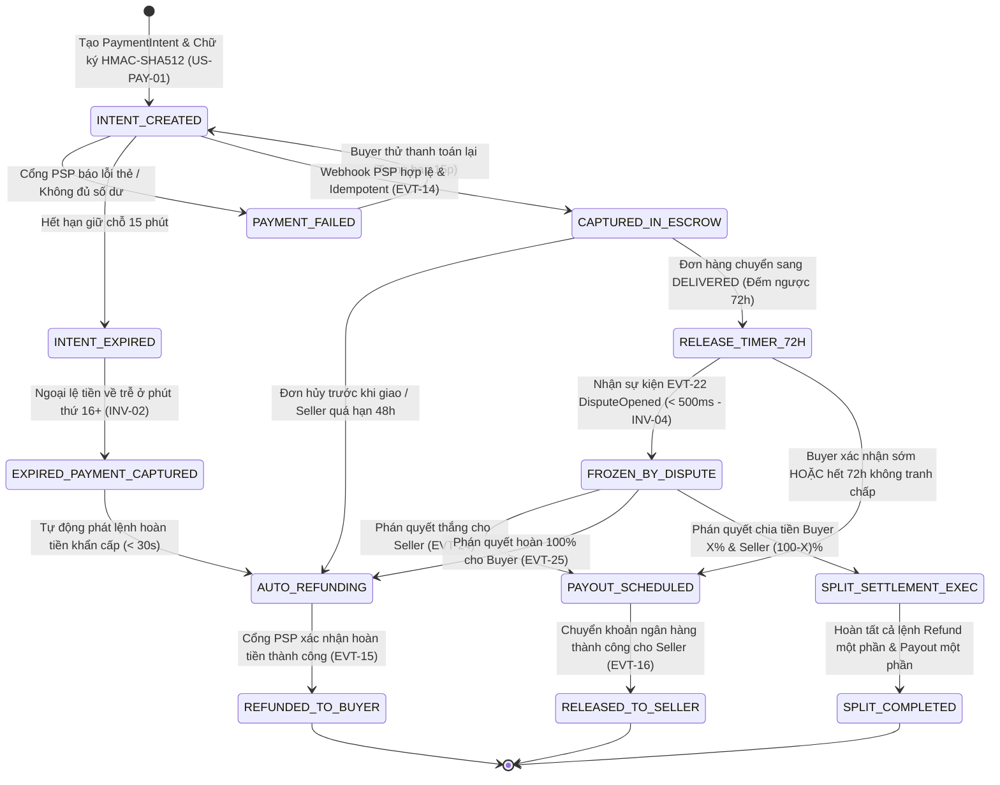
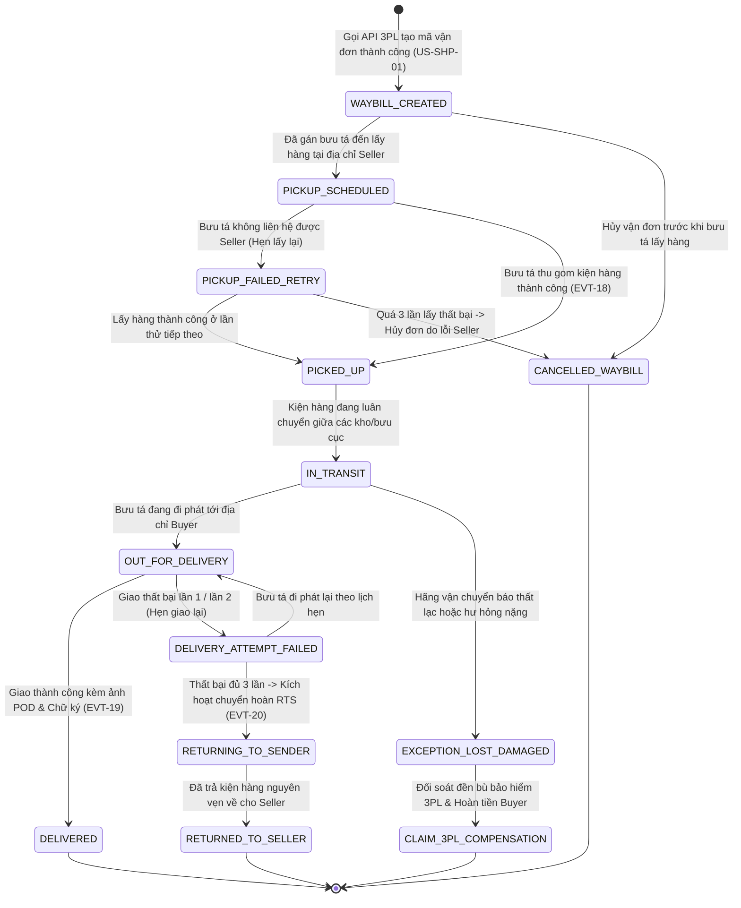
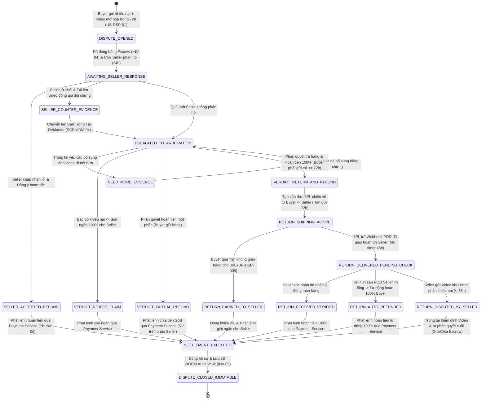

# Sơ Đồ Máy Trạng Thái & Vòng Đời Thực Thể (State Machine & Lifecycle Diagrams) – ReMarket

## Thông tin tài liệu

| Thuộc tính | Giá trị |
|---|---|
| Dự án | ReMarket – Nền tảng Thương mại Điện tử Đồ cũ C2C/B2C Phân tán |
| Tài liệu | Tập hợp 6 Sơ đồ Máy Trạng thái Hữu hạn (Finite State Machines): Tài khoản/KYC, Tin đăng, Đơn hàng, Thanh toán Ký quỹ, Vận đơn 3PL & Khiếu nại |
| Mã tài liệu | `DOC-BA-09-STM` |
| Phiên bản | 1.0 |
| Trạng thái | Hoàn thiện (Baseline Quy tắc Chuyển dịch Trạng thái Miền) |
| Ngày cập nhật | 12/11/2026 |
| Phân hệ cha | [docs/BA/09_architecture-and-process-diagrams/README.md](file:///d:/remarket-platform-system/docs/BA/09_architecture-and-process-diagrams/README.md) |
| Tài liệu liên quan | [domain-model.md](file:///d:/remarket-platform-system/docs/BA/05_domain-and-data/domain-model.md), [functional-requirements.md](file:///d:/remarket-platform-system/docs/BA/03_requirements/functional-requirements.md), [event-catalog.md](file:///d:/remarket-platform-system/docs/BA/06_microservices-and-integrations/event-catalog.md) |

---

## 1. Máy Trạng Thái Tài Khoản & Định Danh KYC Người Bán (`DIAG-STM-01`: Account & KYC State Machine)

Quản lý bởi `SVC-01 Identity & Access Service` trên `IdentityDB`. Đảm bảo phân tách rõ trạng thái xác thực người mua, hồ sơ KYC người bán và các chế tài khóa tài khoản:

### Bảng Quy tắc Chuyển trạng thái Tài khoản:
- Khi chuyển sang `SUSPENDED` hoặc `BANNED_PERMANENTLY`: Toàn bộ Refresh Token trên Redis bị thu hồi tức thời; các tin đăng đang `ACTIVE` của người bán đó bị ẩn tạm thời khỏi sàn (`HIDDEN`), nhưng các đơn hàng đang trong quá trình giao hoặc đang giữ tiền ký quỹ vẫn tiếp tục được xử lý hoàn tất/hoàn tiền để bảo vệ người mua.

---

## 2. Máy Trạng Thái Vòng Đời Tin Đăng Đồ Cũ Đơn Chiếc (`DIAG-STM-02`: Listing Lifecycle State Machine)

Quản lý bởi `SVC-02 Catalog & Listing Service` trên `CatalogDB`. Bảo vệ nghiêm ngặt nguyên tắc **Món hàng đơn chiếc (`Inventory = 1`)** và **Bất biến `INV-01` (Zero Overselling)**:

### Bảng Ràng buộc Bất biến Trạng thái Tin đăng:
- **Chỉ trạng thái `ACTIVE`** mới được phép hiển thị trên kết quả tìm kiếm OpenSearch và mới được phép chuyển sang `RESERVED`.
- Khi ở trạng thái `RESERVED` hoặc `SOLD`: Hệ thống khóa cứng các trường `Price`, `ConditionGrade`, `Images`, `Description` (cấm Người bán chỉnh sửa làm sai lệch bằng chứng mua hàng).

---

## 3. Máy Trạng Thái Vòng Đời Đơn Hàng (`DIAG-STM-03`: Order Lifecycle State Machine)

Quản lý bởi `SVC-05 Order Processing Service` trên `OrderDB` (SQL Server). Mọi chuyển dịch trạng thái đều kiểm tra `RowVersion` và ghi vào bảng `OrderStatusAudit` + `OutboxMessages`:

---

## 4. Máy Trạng Thái Thanh Toán & Sổ Cái Ký Quỹ (`DIAG-STM-04`: Payment & Escrow State Machine)

Quản lý bởi `SVC-06 Payment & Escrow Service` trên `PaymentDB` (SQL Server). Bảo vệ **Bất biến `INV-02` (Zero Double Charge)** và **`INV-04` (Escrow Freeze on Dispute)**:

---

## 5. Máy Trạng Thái Vận Đơn 3PL & Chuyển Hoàn (`DIAG-STM-05`: Shipment & RTS State Machine)

Quản lý bởi `SVC-07 Shipping & Logistics Service` trên `ShippingDB` (MongoDB). Chuẩn hóa toàn bộ mã trạng thái riêng của GHN, GHTK về **6 nhóm trạng thái chuẩn hóa (Canonical Shipment Statuses)**:

---

## 6. Máy Trạng Thái Hồ Sơ Khiếu Nại & Tranh Chấp (`DIAG-STM-06`: Dispute Case State Machine)

Quản lý bởi `SVC-08 Trust & Support Service` trên `SupportDB` (MongoDB), phối hợp chặt chẽ với `SVC-06 Payment`:

---

## 7. Lịch sử cập nhật

| Phiên bản | Ngày | Tác giả | Nội dung thay đổi |
|---|---|---|---|
| 1.0 | 12/11/2026 | Nhóm Phân tích Nghiệp vụ & Kiến trúc | Khởi tạo hoàn chỉnh 6 sơ đồ máy trạng thái hữu hạn (`DIAG-STM-01..06`). |
