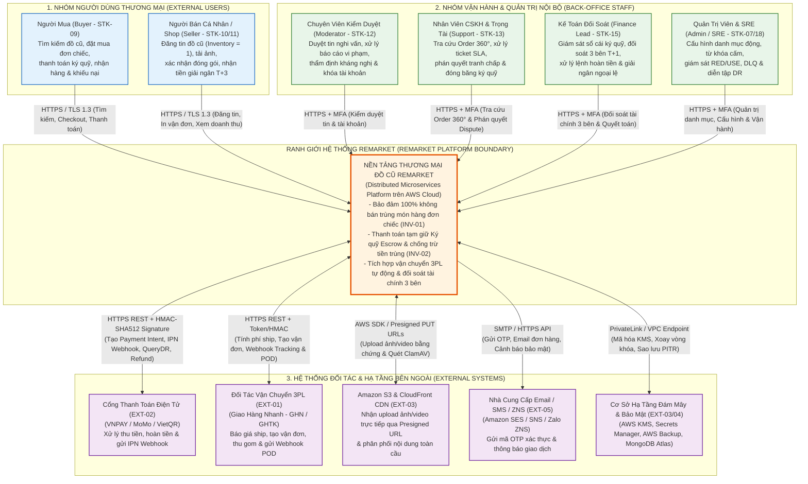
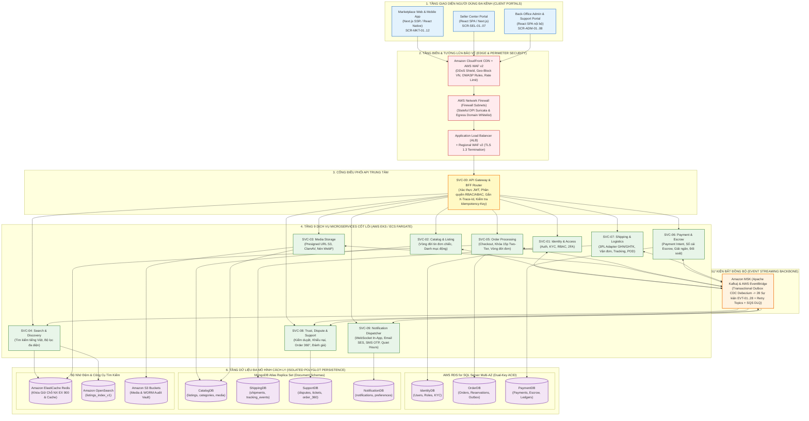
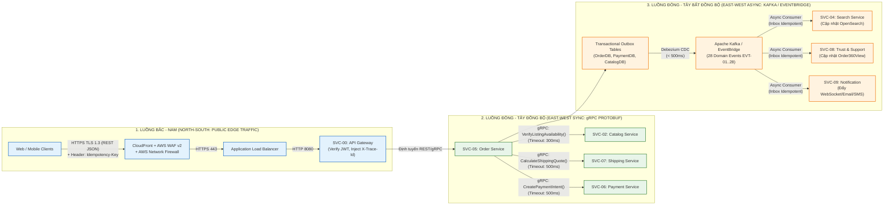
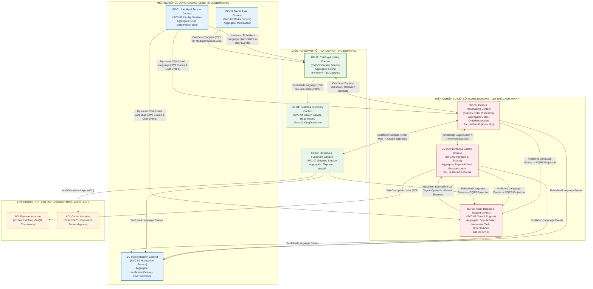
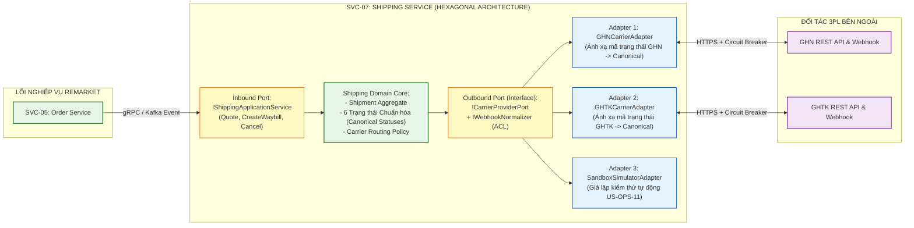

# Sơ Đồ Bối Cảnh Hệ Thống & Kiến Trúc Tổng Thể (C4 High-Level Diagrams) – ReMarket

## Thông tin tài liệu

| Thuộc tính | Giá trị |
|---|---|
| Dự án | ReMarket – Nền tảng Thương mại Điện tử Đồ cũ C2C/B2C Phân tán |
| Tài liệu | Tập hợp Sơ đồ Bối cảnh Hệ thống (C4 Level 1), Kiến trúc Container (C4 Level 2), Luồng North-South/East-West & Bounded Contexts |
| Mã tài liệu | `DOC-BA-09-SYS` |
| Phiên bản | 1.0 |
| Trạng thái | Hoàn thiện (Baseline Kiến trúc Hệ thống Mức cao) |
| Ngày cập nhật | 12/11/2026 |
| Phân hệ cha | [docs/BA/09_architecture-and-process-diagrams/README.md](file:///d:/remarket-platform-system/docs/BA/09_architecture-and-process-diagrams/README.md) |
| Tài liệu liên quan | [system-context.md](file:///d:/remarket-platform-system/docs/BA/06_microservices-and-integrations/system-context.md), [service-catalog.md](file:///d:/remarket-platform-system/docs/BA/06_microservices-and-integrations/service-catalog.md), [domain-model.md](file:///d:/remarket-platform-system/docs/BA/05_domain-and-data/domain-model.md) |

---

## 1. Sơ Đồ Bối Cảnh Hệ Thống Tổng Thể (`DIAG-SYS-01`: C4 Level 1 – System Context Diagram)

Sơ đồ xác định ranh giới của nền tảng **ReMarket** ở trung tâm, tương tác với **6 nhóm Người dùng (Actors)** và **5 Hệ thống Đối tác Bên ngoài (External Systems)**:

### Bảng Đặc tả Giao diện Bối cảnh Hệ thống:

| Tác nhân / Đối tác | Mã Định Danh | Chiều Tương Tác | Giao Thức & Cơ Chế Bảo Mật | Dữ Liệu Trao Đổi Chính |
|---|---|---|---|---|
| **Người Mua (Buyer)** | `STK-09` | Hai chiều | HTTPS TLS 1.3, JWT Bearer, WAF Rate-Limit | Tìm kiếm, đặt giữ chỗ 15p, thanh toán, theo dõi vận đơn, mở khiếu nại. |
| **Người Bán (Seller)** | `STK-10`, `STK-11` | Hai chiều | HTTPS TLS 1.3, JWT + 2FA (TOTP/OTP) | Hồ sơ KYC, thông tin tin đăng, ảnh S3, xác nhận đóng gói, sao kê ký quỹ. |
| **Nhân sự Back-office** | `STK-12..16` | Hai chiều | HTTPS TLS 1.3, RBAC/ABAC + 2FA bắt buộc | Hàng đợi kiểm duyệt, hồ sơ `Order 360°`, phán quyết tranh chấp, bảng đối soát. |
| **Cổng Thanh toán PSP** | `EXT-02` | Hai chiều | REST HTTPS, IP Whitelist, HMAC-SHA512 | URL thanh toán, IPN Webhook kết quả, truy vấn `QueryDR`, lệnh hoàn tiền `Refund`. |
| **Đối tác Vận chuyển 3PL** | `EXT-01` | Hai chiều | REST HTTPS, Adapter Pattern, Webhook | Báo giá cước phí, mã vận đơn (`Waybill`), hành trình bưu tá, ảnh POD. |

---

## 2. Sơ Đồ Kiến Trúc Container Toàn Hệ Thống (`DIAG-SYS-02`: C4 Level 2 – Container Architecture)

Sơ đồ mô tả chi tiết cấu trúc bên trong của ReMarket gồm: **3 Phân hệ Giao diện (Frontend Portals)**, **Lớp Phòng thủ Biên (WAF/Firewall/ALB)**, **API Gateway (`SVC-00`)**, **9 Core Microservices (`SVC-01..09`)**, **Trục Sự kiện (`Apache Kafka / EventBridge`)** và **Hệ thống Cơ sở Dữ liệu Đa mô hình (Polyglot Persistence)**:

---

## 3. Sơ Đồ Phân Luồng Giao Tiếp North-South & East-West (`DIAG-SYS-03`)

Sơ đồ làm rõ quy tắc giao tiếp hai tầng:
- **Lưu lượng Bắc-Nam (North-South Traffic):** Từ Client bên ngoài đi vào hệ thống qua HTTPS REST JSON, được bảo vệ bởi WAF, Network Firewall và API Gateway.
- **Lưu lượng Đông-Tây (East-West Traffic):** Giao tiếp nội bộ giữa các Microservices chỉ sử dụng **gRPC Protobuf** (cho truy vấn đồng bộ cần độ trễ thấp < 15ms) và **Kafka CloudEvents** (cho toàn bộ các thay đổi trạng thái nghiệp vụ bất đồng bộ):

---

## 4. Sơ Đồ Ánh Xạ 9 Bounded Contexts Sang 9 Microservices (`DIAG-SYS-04`: DDD Context Map)

Sơ đồ thể hiện mối quan hệ chiến lược giữa **9 Bounded Contexts (`BC-01..09`)** theo thiết kế hướng miền (Domain-Driven Design) và các mẫu tích hợp (`Customer-Supplier`, `Conformist`, `Anti-Corruption Layer - ACL`, `Published Language`):

---

## 5. Sơ Đồ Kiến Trúc Ports & Adapters (Hexagonal / ACL) Tích Hợp Đối Tác (`DIAG-SYS-05`)

Sơ đồ minh họa nguyên tắc kiến trúc **`DEC-DIR-05`**: Tuyệt đối không tạo microservice riêng cho từng hãng vận chuyển hay cổng thanh toán, mà cô lập bên trong `SVC-06` và `SVC-07` qua **Ports & Adapters (Hexagonal Architecture)** và **Anti-Corruption Layer (ACL)**:

---

## 6. Lịch sử cập nhật

| Phiên bản | Ngày | Tác giả | Nội dung thay đổi |
|---|---|---|---|
| 1.0 | 12/11/2026 | Nhóm Kiến trúc Hệ thống | Khởi tạo hoàn chỉnh 5 sơ đồ bối cảnh và kiến trúc mức cao (`DIAG-SYS-01..05`). |
