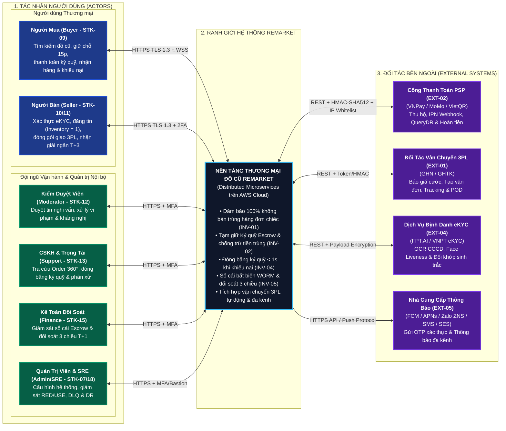
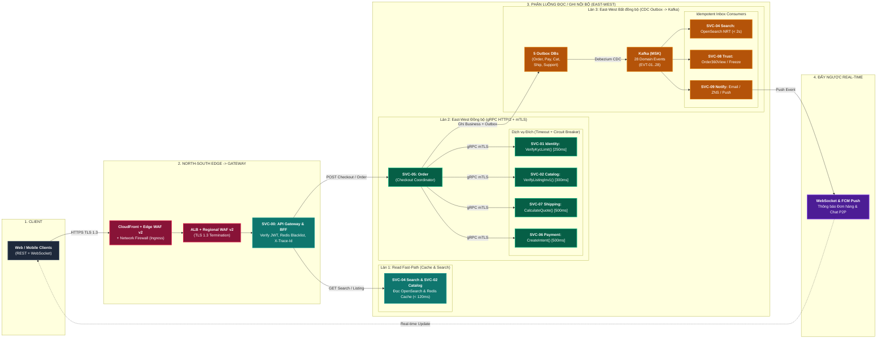
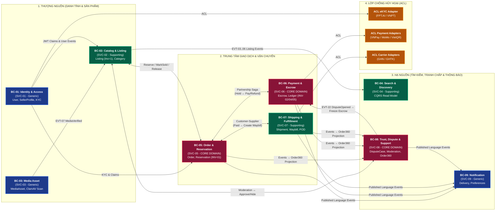
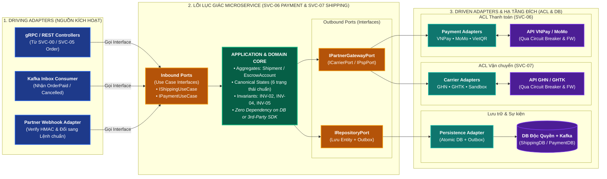

# Sơ Đồ Bối Cảnh Hệ Thống & Kiến Trúc Tổng Thể (C4 High-Level System Design) – ReMarket

## Thông tin tài liệu

| Thuộc tính | Giá trị |
|---|---|
| Dự án | ReMarket – Nền tảng Thương mại Điện tử Đồ cũ C2C/B2C Phân tán |
| Tài liệu | Bộ Sơ đồ System Design Mức Cao: C4 Level 1 (System Context), C4 Level 2 (Layered High-Level Architecture), North-South / East-West Traffic, DDD Context Map & Hexagonal Ports/Adapters |
| Mã tài liệu | `DOC-BA-09-SYS` |
| Phiên bản | `2.2` (Hoàn thiện căn chỉnh cột thẳng hàng, khử dây nối bắt chéo & kiểm tra chuẩn Mermaid) |
| Trạng thái | Hoàn thiện (Baseline Kiến trúc Hệ thống Mức cao) |
| Ngày cập nhật | 13/11/2026 |
| Phân hệ cha | [docs/BA/09_architecture-and-process-diagrams/README.md](file:///d:/remarket-platform-system/docs/BA/09_architecture-and-process-diagrams/README.md) |
| Tài liệu đối chiếu | [system-context.md](file:///d:/remarket-platform-system/docs/BA/06_microservices-and-integrations/system-context.md), [service-catalog.md](file:///d:/remarket-platform-system/docs/BA/06_microservices-and-integrations/service-catalog.md), [aws-cloud-and-network-architecture.md](file:///d:/remarket-platform-system/docs/BA/06_microservices-and-integrations/aws-cloud-and-network-architecture.md), [network-firewall-and-waf-security.md](file:///d:/remarket-platform-system/docs/BA/06_microservices-and-integrations/network-firewall-and-waf-security.md), [polyglot-persistence-and-db-architecture.md](file:///d:/remarket-platform-system/docs/BA/05_domain-and-data/polyglot-persistence-and-db-architecture.md) |

---

## 1. Sơ Đồ Bối Cảnh Hệ Thống Tổng Thể (`DIAG-SYS-01`: C4 Level 1 – System Context Diagram)

Sơ đồ được bố cục theo trục **Trái $\rightarrow$ Giữa $\rightarrow$ Phải** để không có bất kỳ mũi tên nào cắt ngang qua nhóm tác nhân khác:
- **Cột Trái:** Toàn bộ **6 nhóm Người dùng (Commercial Users & Internal Back-Office Staff)**.
- **Cột Giữa:** **Ranh giới Hệ thống ReMarket** trên AWS Cloud.
- **Cột Phải:** **4 nhóm Hệ thống Đối tác Bên ngoài** (`PSP`, `3PL`, `eKYC`, `Notification Providers`).

### Bảng Đặc tả Giao diện Bối cảnh (`System Context Interface Specification`)

| Tác nhân / Đối tác | Mã Định Danh | Chiều Tương Tác | Giao Thức & Cơ Chế Bảo Mật | Dữ Liệu Trao Đổi Chính |
|---|---|---|---|---|
| **Người Mua (Buyer)** | `STK-09` | Hai chiều | HTTPS TLS 1.3, WebSocket (WSS), JWT Bearer, WAF Rate-Limit | Tìm kiếm, đặt giữ chỗ 15p, thanh toán, chat P2P, theo dõi vận đơn, mở khiếu nại. |
| **Người Bán (Seller)** | `STK-10`, `STK-11` | Hai chiều | HTTPS TLS 1.3, JWT + 2FA (TOTP/OTP) | Hồ sơ eKYC, thông tin tin đăng, ảnh S3 (Presigned URL), xác nhận đóng gói, sao kê ký quỹ. |
| **Nhân sự Nội bộ** | `STK-07, 12..18` | Hai chiều | HTTPS TLS 1.3, RBAC/ABAC + MFA bắt buộc | Hàng đợi kiểm duyệt, hồ sơ `Order 360°`, phán quyết tranh chấp, bảng đối soát tài chính. |
| **Cổng Thanh toán PSP** | `EXT-02` | Hai chiều | REST HTTPS, IP Whitelist, HMAC-SHA512, Egress Whitelist | Payment URL/QR, IPN Webhook kết quả, truy vấn `QueryDR`, lệnh hoàn tiền `Refund`. |
| **Đối tác Vận chuyển 3PL** | `EXT-01` | Hai chiều | REST HTTPS, Adapter Pattern, Webhook, Egress Whitelist | Báo giá cước phí, mã vận đơn (`Waybill`), hành trình bưu tá, ảnh POD xác nhận giao. |
| **Dịch vụ Định danh eKYC** | `EXT-04` | Hai chiều | REST HTTPS, Payload Encryption, Egress Whitelist | Ảnh CCCD 2 mặt, video Liveness, điểm tin cậy đối khớp khuôn mặt (`Confidence Score`). |
| **Nhà cung cấp Thông báo** | `EXT-05` | Một chiều ra (Outbound) | HTTPS REST API (FCM, APNs, Zalo ZNS, SMS) + Amazon SES | Mã OTP, thông báo trạng thái đơn hàng, cảnh báo giải ngân & tranh chấp. |

---

## 2. Sơ Đồ Kiến Trúc Tổng Thể Toàn Hệ Thống (`DIAG-SYS-02`: C4 Level 2 – Layered High-Level System Architecture)

Sơ đồ được sắp xếp lại chuẩn mực thành **7 Tầng Nằm Ngang Riêng Biệt theo đúng trình tự luồng dữ liệu từ Trên xuống Dưới (Top-to-Bottom Layered Stack)**, đồng thời căn chỉnh thẳng cột 1-1 giữa từng Microservice với Cơ sở dữ liệu sở hữu để loại bỏ hoàn toàn tình trạng dây nối bắt chéo:

1. **Tầng 1 — Entry Points:** 3 cổng giao diện Client Portals & kênh Webhook đầu vào từ đối tác PSP/3PL.
2. **Tầng 2 — Perimeter Defense (Trình tự vào):** `CloudFront CDN + Edge WAF v2` $\rightarrow$ `AWS Network Firewall (Ingress DPI)` $\rightarrow$ `ALB + Regional WAF v2`.
3. **Tầng 3 — API Gateway & BFF (`SVC-00`):** Xác thực JWT, kiểm tra Blacklist/Session trên Redis, gắn `X-Trace-Id` và định tuyến xuống cụm dịch vụ.
4. **Tầng 4 — 9 Microservices (`SVC-01..09`) & Outbound Egress Firewall:** Sắp theo 3 phân khu thẳng hàng với kho dữ liệu ngay bên dưới (`SQL ACID Core` | `Cache, Search & Media` | `MongoDB Ops`), kèm cổng **NAT GW + AWS Network Firewall (Egress Whitelist)** gọi ra đối tác bên ngoài.
5. **Tầng 5 — Isolated Polyglot Data Tier (`Database-per-Service`):** Đặt tách thành một tầng riêng ngay dưới Tầng 4 với thứ tự cột khớp 1-1 (`IdentityDB | PaymentDB | OrderDB` — `Redis | OpenSearch | S3 Vault` — `CatalogDB | ShippingDB | SupportDB | NotificationDB`).
6. **Tầng 6 — Event Backbone (`Outbox CDC -> Kafka -> Consumers & DLQ`):** Đặt ngay dưới Tầng 5, đúng với luồng ghi Outbox/Change Stream $\rightarrow$ Debezium CDC $\rightarrow$ Kafka $\rightarrow$ Consumers & SQS DLQ.
7. **Tầng 7 — Cross-Cutting Platform:** Nền tảng `AWS KMS / Secrets / IRSA` và `Observability (OTel / Prometheus / Grafana / PII Masking)` nằm gọn dưới đáy.

```mermaid
flowchart TB
    classDef client fill:#1e293b,stroke:#475569,color:#ffffff,stroke-width:2px
    classDef edge fill:#881337,stroke:#e11d48,color:#ffffff,stroke-width:2px
    classDef gw fill:#0f766e,stroke:#0d9488,color:#ffffff,stroke-width:2px
    classDef svc fill:#1e3a8a,stroke:#2563eb,color:#ffffff,stroke-width:2px
    classDef core_svc fill:#065f46,stroke:#10b981,color:#ffffff,stroke-width:2px
    classDef db fill:#4c1d95,stroke:#7c3aed,color:#ffffff,stroke-width:2px
    classDef bus fill:#b45309,stroke:#d97706,color:#ffffff,stroke-width:2px
    classDef ops fill:#334155,stroke:#64748b,color:#ffffff,stroke-width:1.5px
    classDef ext fill:#374151,stroke:#9ca3af,color:#ffffff,stroke-width:2px,stroke-dasharray: 5 3

    %% =========================================================
    %% TẦNG 1: CLIENTS & EXTERNAL WEBHOOKS
    %% =========================================================
    subgraph T1_CLIENTS ["1. TẦNG CLIENT PORTALS & KÊNH VÀO ĐỐI TÁC (ENTRY POINTS)"]
        direction LR
        MKT_APP["<b>Marketplace Web & App</b><br/>(Next.js / React Native)<br/>Buyer & Guest"]:::client
        SEL_APP["<b>Seller Center Portal</b><br/>(Next.js / React SPA)<br/>Đăng tin & Vận đơn"]:::client
        ADM_APP["<b>Back-Office Admin Portal</b><br/>(React Admin nội bộ)<br/>Mod, CSKH 360°, Finance"]:::client
        EXT_IN["<b>Webhooks Đối Tác</b><br/>PSP (VNPay/MoMo IPN)<br/>3PL (GHN/GHTK POD)"]:::ext
    end

    %% =========================================================
    %% TẦNG 2: EDGE CDN, WAF & NETWORK FIREWALL (THEO THỨ TỰ VÀO)
    %% =========================================================
    subgraph T2_PERIMETER ["2. TẦNG PHÒNG THỦ BIÊN (TRÌNH TỰ VÀO: CLOUDFRONT WAF -> NETWORK FIREWALL -> ALB)"]
        direction TB
        CF_WAF["<b>Lớp 1: Amazon CloudFront CDN + Edge WAF v2</b><br/>DDoS Shield • Geo-Block VN • OWASP Rules • Rate Limit (50 req/5m Checkout)<br/><i>(Nhánh Static/Media đọc thẳng qua OAC tới S3 Vault)</i>"]:::edge
        NET_FW_IN["<b>Lớp 2: AWS Network Firewall (Firewall Subnets — VPC Ingress Routing)</b><br/>Stateful Packet Inspection (SPI) • Deep Packet Inspection (DPI Suricata IDS/IPS)"]:::edge
        ALB_WAF["<b>Lớp 3: Application Load Balancer (ALB) + Regional WAF v2</b><br/>TLS 1.3 Termination • Webhook Partner IP Whitelist • Multi-AZ Routing"]:::edge
        CF_WAF -->|"API & Webhook Traffic"| NET_FW_IN -->|"Gói tin sạch"| ALB_WAF
    end

    %% =========================================================
    %% TẦNG 3: API GATEWAY & BFF LAYER
    %% =========================================================
    subgraph T3_GATEWAY ["3. CỔNG ĐIỀU PHỐI API TRUNG TÂM (API GATEWAY & BFF)"]
        SVC00["<b>SVC-00: API Gateway & BFF Layer (Kong / Envoy)</b><br/>Xác thực JWT • Kiểm tra Blacklist/Session & Rate Limit trên Redis • Gắn X-Trace-Id • Chặn trùng Idempotency-Key"]:::gw
    end

    %% =========================================================
    %% TẦNG 4: 9 MICROSERVICES + CỔNG EGRESS OUTBOUND
    %% =========================================================
    subgraph T4_COMPUTE ["4. TẦNG 9 MICROSERVICES (PRIVATE APP SUBNET — EKS / ECS FARGATE) & KẾT NỐI ĐỐI TÁC NGOÀI"]
        direction LR
        subgraph T4_SERVICES ["Cụm 9 Core Microservices (Xếp thẳng cột với Tầng Dữ Liệu bên dưới)"]
            direction LR
            subgraph SVCS_SQL ["Nhóm ACID Core (.NET 8)"]
                direction LR
                SVC01["<b>SVC-01: Identity</b><br/>Auth, 2FA, eKYC"]:::svc
                SVC06["<b>SVC-06: Payment</b><br/>Escrow, T+3, Recon<br/><i>(99.99% SLA)</i>"]:::core_svc
                SVC05["<b>SVC-05: Order</b><br/>Lock 15p, Saga<br/><i>(99.99% SLA)</i>"]:::core_svc
            end
            subgraph SVCS_FAST ["Nhóm Search & Media"]
                direction LR
                SVC04["<b>SVC-04: Search</b><br/>(Java/Spring)<br/>NRT & Facets"]:::svc
                SVC03["<b>SVC-03: Media</b><br/>(Go/FastAPI)<br/>Presigned, ClamAV"]:::svc
            end
            subgraph SVCS_MONGO ["Nhóm Document & Ops (Node.js / .NET 8)"]
                direction LR
                SVC02["<b>SVC-02: Catalog</b><br/>Tin Inv=1, Danh mục"]:::svc
                SVC07["<b>SVC-07: Shipping</b><br/>3PL GHN/GHTK, POD"]:::svc
                SVC08["<b>SVC-08: Trust</b><br/>Dispute, Order 360°"]:::core_svc
                SVC09["<b>SVC-09: Notify</b><br/>WSS, ZNS, SES, FCM"]:::svc
            end
        end

        subgraph T4_EGRESS ["Outbound Egress An Toàn (NAT GW -> Network Firewall)"]
            direction TB
            EGRESS_FW["<b>NAT GW + AWS Network Firewall</b><br/>Egress Domain Whitelist & TLS SNI Filter"]:::edge
            EXT_OUT["<b>Đối Tác Bên Ngoài</b><br/>PSP (VNPay/MoMo) • 3PL (GHN/GHTK)<br/>eKYC (FPT.AI) • Notify (ZNS/FCM/SES)"]:::ext
            EGRESS_FW -->|"Filtered API"| EXT_OUT
        end

        T4_SERVICES -->|"Outbound Partner Calls (SVC-01, 06, 07, 09)"| EGRESS_FW
    end

    %% =========================================================
    %% TẦNG 5: TẦNG DỮ LIỆU ĐA MÔ HÌNH ĐỘC QUYỀN (DATABASE-PER-SERVICE)
    %% =========================================================
    subgraph T5_DATA ["5. TẦNG DỮ LIỆU ĐA MÔ HÌNH CÁCH LY (ISOLATED DATA SUBNET — DATABASE-PER-SERVICE)"]
        direction LR
        subgraph DBS_SQL ["AWS RDS SQL Server Multi-AZ (Dual-Key + Outbox)"]
            direction LR
            DB_IDN[("<b>IdentityDB</b><br/>Users, KYC<br/>& Outbox")]:::db
            DB_PAY[("<b>PaymentDB</b><br/>Escrow, Ledger<br/>& Outbox")]:::db
            DB_ORD[("<b>OrderDB</b><br/>Orders, Lock<br/>& Outbox")]:::db
        end
        subgraph DBS_FAST ["Cache, Search Index & Object Storage Vault"]
            direction LR
            REDIS[("<b>Redis Cluster</b><br/>Lock NX EX 900<br/>Token & Hot Cache")]:::db
            OPENSEARCH[("<b>OpenSearch</b><br/>listings_index_v1<br/>(vi_analyzer)")]:::db
            S3_VAULT[("<b>Amazon S3 Vault</b><br/>Media (OAC) • Evidence<br/>WORM Ledger (10y)")]:::db
        end
        subgraph DBS_MONGO ["MongoDB Atlas Replica Set (Document + Outbox)"]
            direction LR
            DB_CAT[("<b>CatalogDB</b><br/>listings, cats<br/>& Outbox")]:::db
            DB_SHP[("<b>ShippingDB</b><br/>shipments, POD<br/>& Outbox")]:::db
            DB_SUP[("<b>SupportDB</b><br/>disputes, 360°<br/>& Outbox")]:::db
            DB_NTF[("<b>NotificationDB</b><br/>inbox, prefs")]:::db
        end
    end

    %% =========================================================
    %% TẦNG 6: TRỤC SỰ KIỆN BẤT ĐỒNG BỘ (DEBEZIUM CDC -> KAFKA -> DLQ)
    %% =========================================================
    subgraph T6_EVENTS ["6. TẦNG XƯƠNG SỐNG SỰ KIỆN BẤT ĐỒNG BỘ (EVENT BACKBONE: OUTBOX CDC -> KAFKA -> CONSUMERS)"]
        direction LR
        DEBEZIUM["<b>Debezium CDC Connectors</b><br/>Đọc Transaction Log / Oplog từ Outbox (< 500ms)"]:::bus
        KAFKA["<b>Amazon MSK (Apache Kafka) + EventBridge</b><br/>28 Domain Events (EVT-01..28) • At-Least-Once • Partitioned"]:::bus
        CONSUMERS["<b>Idempotent Inbox Event Consumers</b><br/>• SVC-04: Đồng bộ OpenSearch NRT (< 2s)<br/>• SVC-08: Cập nhật Order 360° & Mở Dispute<br/>• SVC-09: Đẩy WebSocket / ZNS / Email<br/>• Saga Listeners: SVC-02, 05, 06, 07 (Nhả Lock / Tạo Vận đơn / Giải ngân)"]:::bus
        DLQ["<b>Amazon SQS DLQ & Admin Replay</b><br/>Hứng lỗi sau 4 lần Retry (Exponential Backoff)"]:::bus

        DEBEZIUM --> KAFKA --> CONSUMERS
        KAFKA -.->|"Lỗi vĩnh viễn"| DLQ
    end

    %% =========================================================
    %% TẦNG 7: HẠ TẦNG CHÉO (BẢO MẬT, BÍ MẬT & GIÁM SÁT TOÀN DIỆN)
    %% =========================================================
    subgraph T7_PLATFORM ["7. TẦNG NỀN TẢNG CHÉO: BẢO MẬT DỮ LIỆU & GIÁM SÁT TOÀN HỆ THỐNG (CROSS-CUTTING INFRASTRUCTURE)"]
        direction LR
        SEC_KMS["<b>Bảo Mật & Quản Trị Bí Mật</b><br/>AWS KMS (CMK AES-256 TDE & Ledger Hash)<br/>AWS Secrets Manager (Auto-Rotate 30d)<br/>IAM Roles for Service Accounts (IRSA)"]:::ops
        OBS_STACK["<b>Observability & Telemetry Stack</b><br/>OpenTelemetry Distributed Tracing (X-Trace-Id)<br/>Prometheus + Grafana Dashboards (RED/USE)<br/>CloudWatch Logs + Bộ lọc Che Chắn PII"]:::ops
    end

    %% =========================================================
    %% KẾT NỐI CHÍNH GIỮA CÁC TẦNG (THẲNG HÀNG, KHÔNG CẮT CHÉO)
    %% =========================================================
    %% Tầng 1 -> Tầng 2 -> Tầng 3
    MKT_APP & SEL_APP & ADM_APP -->|"HTTPS / WSS"| CF_WAF
    EXT_IN -->|"IPN / 3PL Webhook"| CF_WAF
    ALB_WAF --> SVC00

    %% Tầng 3 -> Tầng 4 (Nối gọn tới 3 phân khu Microservices)
    SVC00 -->|"REST / gRPC"| SVCS_SQL & SVCS_FAST & SVCS_MONGO

    %% Tầng 4 -> Tầng 5 (Nối thẳng đứng 1-1 từ Service xuống DB bên dưới)
    SVC01 --> DB_IDN
    SVC06 --> DB_PAY
    SVC05 --> DB_ORD
    SVC05 -->|"Lock Tầng 1 (NX EX 900)"| REDIS
    SVC04 -.->|"Hot Cache"| REDIS
    SVC04 --> OPENSEARCH
    SVC03 -->|"Direct Presigned + ClamAV + WebP"| S3_VAULT
    SVC02 --> DB_CAT
    SVC07 --> DB_SHP
    SVC08 --> DB_SUP
    SVC09 --> DB_NTF

    %% Kết nối CDN OAC & Gateway Redis
    SVC00 -.->|"Token Blacklist & Rate Limit"| REDIS
    CF_WAF -.->|"Static/Media CDN (OAC) & Direct Upload"| S3_VAULT

    %% Tầng 5 (Data Outbox) -> Tầng 6 (Debezium -> Kafka)
    DBS_SQL & DBS_MONGO -->|"Transactional Outbox / Oplog"| DEBEZIUM

    %% Nền tảng chéo dưới đáy
    T5_DATA -.->|"Mã hóa TDE/KMS, Secrets & Telemetry"| T7_PLATFORM
```

---

## 3. Sơ Đồ Phân Luồng Giao Tiếp North-South & East-West (`DIAG-SYS-03`)

Sơ đồ bố cục tuần tự **4 Cột từ Trái sang Phải**, phân tách rành mạch 4 loại lưu lượng:
1. **North-South Ingress:** Từ Client qua CDN/WAF, Network Firewall, ALB vào `SVC-00 API Gateway`.
2. **Read Fast-Path (Đọc siêu nhanh):** Truy vấn trực tiếp `SVC-04 Search (OpenSearch)` & `SVC-02 Catalog (Redis)` không qua luồng ghi.
3. **East-West Đồng bộ (`gRPC HTTP/2 + mTLS`):** Luồng Checkout do `SVC-05 Order` điều phối gọi kiểm tra tức thời (`Timeout 250–500ms`) tới `SVC-01`, `SVC-02`, `SVC-07`, `SVC-06`.
4. **East-West Bất đồng bộ (`CDC Outbox -> Kafka`) & Phản hồi Real-time (`WSS/Push`):** Cập nhật chỉ mục tìm kiếm NRT, Order 360° và đẩy thông báo ngược về Client.

---

## 4. Sơ Đồ Ánh Xạ 9 Bounded Contexts Sang 9 Microservices (`DIAG-SYS-04`: DDD Context Map)

Sơ đồ được sắp xếp lại theo **dòng chảy phụ thuộc tự nhiên từ Thượng nguồn (Upstream) $\rightarrow$ Trung tâm Xử lý (Core Processing) $\rightarrow$ Hạ nguồn (Downstream & ACL)**, giúp loại bỏ hoàn toàn các mũi tên nhảy cóc đan chéo:

---

## 5. Sơ Đồ Kiến Trúc Lục Giác Chuẩn (`DIAG-SYS-05`: Hexagonal Ports & Adapters + ACL)

Sơ đồ bố cục cân xứng **3 cột Trái $\rightarrow$ Giữa $\rightarrow$ Phải**, thể hiện nguyên tắc đảo ngược phụ thuộc (**Dependency Inversion**): mọi tương tác vào/ra đều phải đi qua **Ports (Interfaces)** bao bọc xung quanh **Domain Core**:

---

## 6. Lịch sử cập nhật & Điểm tối ưu hóa

| Phiên bản | Ngày | Tác giả | Nội dung thay đổi |
|---|---|---|---|
| `1.0` | 12/11/2026 | Nhóm Kiến trúc Hệ thống | Khởi tạo 5 sơ đồ bối cảnh và kiến trúc mức cao (`DIAG-SYS-01..05`). |
| `2.0` | 13/11/2026 | Principal Solutions Architect | Chuẩn hóa ranh giới C4 L1/L2, bổ sung eKYC, tách luồng Static OAC / Direct S3 Upload / Ingress-Egress Firewall, sửa `Database-per-Service` và bổ sung Cross-Cutting KMS/Observability. |
| `2.1` | 13/11/2026 | Principal Solutions Architect | Tái cấu trúc bố cục và đảo thứ tự các tầng (`Microservices -> Databases -> Event Backbone`), căn chỉnh `DIAG-SYS-01`, `DIAG-SYS-03`, `DIAG-SYS-04`. |
| `2.2` | 13/11/2026 | Principal Solutions Architect | **Tối ưu phân tầng 7 lớp & căn chỉnh cột 1-1 (`Column Alignment`):** Tách rành mạch **Tầng 4 (Compute + Egress Firewall)** và **Tầng 5 (Polyglot Data Tier)**; xếp thứ tự khớp thẳng cột (`SVC-01, 06, 05` $\rightarrow$ `IdentityDB, PaymentDB, OrderDB`; `SVC-04, 03` $\rightarrow$ `Redis, OpenSearch, S3`; `SVC-02, 07, 08, 09` $\rightarrow$ `CatalogDB..NotificationDB`) để loại bỏ dây nối chéo; sửa lỗi cú pháp `classDef` trong `DIAG-SYS-04`. |
